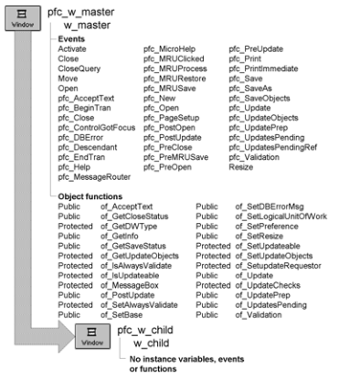

# w_child

**Description**

Ancestor for all PFC child windows.

**Ancestry**

**Library**

- PFCMAIN.PBL
- PFEMAIN.PBL

**Usage**

Use this window as the ancestor for all of your application’s child windows.

**See also**

w_master
