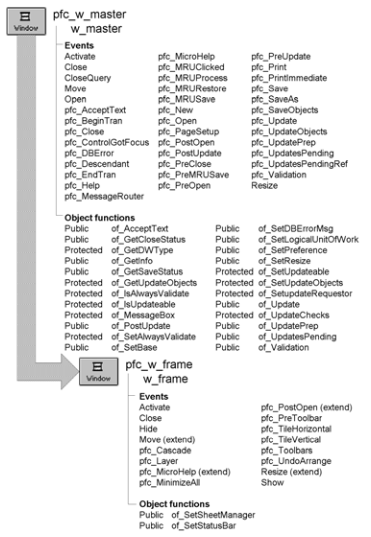

# w_frame

**Description**

Ancestor frame window for all MDI applications.

It includes MicroHelp automatically. To create a frame window without MicroHelp, either modify or rename your application’s frame window.

**Ancestry**



**Library**

- PFCMAIN.PBL
- PFEMAIN.PBL

**Object relationships**

- [m_frame](../03-menus/m_frame.md)
- [n_cst_toolbarattrib](../05-global-structures-and-structure-objects/n_cst_toolbarattrib.md)
- w_statusbar
- w_toolbars

**Usage**

Use this window or a descendant as the frame window for all MDI applications that use PFC.

**See also**

- [m_frame](../03-menus/m_frame.md)
- [w_master](w_master.md)
- w_statusbar
- w_toolbars

## Instance variables

W_frame includes instance variables:

| Instance variable | Description | Data type | Access | Usage |
| --- | --- | --- | --- | --- |
| inv_sheetmanager | Reference variable for sheet management service | n_cst_winsrv_sheetmanager | Public | Set with of_SetSheetManager |
| inv_statusbar | Reference variable for status bar service | n_cst_winsrv_statusbar | Public | Set with of_SetStatusBar |

## Events

W_frame includes precoded events:

- Activate
- Close
- Hide
- Move
- pfc_Cascade
- pfc_Layer
- pfc_MicroHelp
- pfc_MinimizeAll
- pfc_PostOpen
- pfc_PreToolbar
- pfc_TileHorizontal
- pfc_TileVertical
- pfc_Toolbars
- pfc_UndoArrange
- Resize
- Show

### Activate

**Description**

Calls the n_cst_appmanager of_SetFrame function to establish this window as the active frame.

This event extends the ancestor Activate event.

**Usage**

This event executes when the window becomes active.

### Close

**Description**

Destroys any instantiated services.

**Usage**

This event executes when the window closes.

### Hide

**Description**

Calls the n_cst_winsrv_statusbar pfc_Hide event.

**Usage**

This event executes when the window is hidden.

### Move

**Description**

Positions the status bar when the user moves the window.

This event extends the ancestor Move event.

**Usage**

This event executes when the user moves the frame window.

### pfc_Cascade

**Description**

Calls the n_cst_winsrv_sheetmanager pfc_Cascade event.

**Return value**

Integer. Returns 1 if the event succeeds and -1 if an error occurs.

**Usage**

This event executes when the user selects Window>Cascade from the menu bar of a menu descended from the PFC m_master menu.

### pfc_Layer

**Description**

Calls the n_cst_winsrv_sheetmanager pfc_Layer event.

**Return value**

Integer. Returns 1 if the event succeeds and -1 if an error occurs.

**Usage**

This event executes when the user selects Window>Layer from the menu bar of a menu descended from the PFC m_master menu.

### pfc_MicroHelp

**Description**

Displays the passed string in the status bar.

This event extends the w_master pfc_MicroHelp event.

**Syntax**

```
instancename.EVENT pfc_MicroHelp ( microhelp )
```

| Argument | Description |
| --- | --- |
| *instancename* | Instance name of w_frame |
| *microhelp* | String to be displayed in the status bar |

**Return value**

None

**Usage**

This event is called by u_dw ItemFocusChanged event. It is also extended in w_sheet.

### pfc_MinimizeAll

**Description**

Minimizes all open sheets.

**Return value**

Integer. Returns 1 if the event succeeds and -1 if an error occurs.

**Usage**

This event executes when the user selects Window>Minimize All from the menu bar of a menu descended from the PFC m_master menu.

### pfc_PostOpen

**Description**

Opens the w_statusbar window if this capability has been requested through the of_SetStatusBar function.

This event extends the w_master pfc_PostOpen event.

**Usage**

This event executes after the window opens.

### pfc_PreToolbar

**Description**

Populates toolbar attributes.

**Syntax**

```
instancename.EVENT pfc_PreToolbar ( attributes )
```

| Argument | Description |
| --- | --- |
| *instancename* | Instance name of w_frame |
| *attributes* | N_cst_toolbarattrib variable into which the event places toolbar attributes (passed by reference) |

**Usage**

The pfc_Toolbars event calls this event before displaying the w_toolbars dialog box.

### pfc_TileHorizontal

**Description**

Tiles sheets horizontally.

**Return value**

Integer. Returns 1 if the event succeeds and -1 if an error occurs.

**Usage**

This event executes when the user selects Window >Tile Horizontal from the menu bar of a menu descended from the PFC m_master menu.

### pfc_TileVertical

**Description**

Tiles open sheets vertically.

**Return value**

Integer. Returns 1 if the event succeeds and -1 if an error occurs.

**Usage**

This event executes when the user selects Window>Tile Vertical from the menu bar of a menu descended from the PFC m_master menu.

### pfc_Toolbars

**Description**

Displays the w_toolbars dialog box.

**Return value**

Integer. Returns 1 if the event succeeds, 0 if the user cancels out of the w_toolbars dialog box, and -1 if an error occurs.

**Usage**

This event executes when the user selects View>Toolbars from the menu bar of a menu that descends from the PFC m_master menu.

### pfc_UndoArrange

**Description**

Calls the n_cst_winsrv_sheetmanager pfc_UndoArrange event.

**Return value**

Integer. Returns the number of sheets undone if the event succeeds and -1 if an error occurs.

**Usage**

This event executes when the user selects Window>Undo Arrange from the menu bar of a menu descended from the PFC m_master menu.

### Resize

**Description**

Positions the status bar when the user resizes the window.

It also calls of_LayoutClient, which places a ribbon bar on the frame across the top of the window and fits the MDI client area below it.

**Usage**

This event executes when the user resizes the frame window.

### Show

**Description**

Calls the n_cst_winsrv_statusbar pfc_Show event.

**Usage**

This event executes when the window displays after being hidden.

## Functions

W_frame includes precoded object functions:

- of_LayoutClient
- of_SetSheetManager
- of_SetStatusBar

### of_LayoutClient

**Description**

Places a ribbon bar on the frame across the top of the window and fits the MDI client area between the ribbon bar and the MicroHelp bar.

A frame window that contains controls other than the MDI client does not size its client area itself, so a frame with a ribbon bar needs this layout. Frames without a ribbon bar are left unchanged.

**Access**

Public

**Syntax**

```
windowname.of_LayoutClient ( )
```

| Argument | Description |
| --- | --- |
| *windowname* | Instance name of w_frame |

**Return value**

Integer. Returns 1 if the client area was laid out around a ribbon bar, and 0 if there was nothing to do (the frame has no ribbon bar, or it is minimized).

**Usage**

To add a ribbon bar to a frame, place a u_rbb control on your w_frame descendant. You don't need any code to size it: the frame's Resize event calls of_LayoutClient. The ribbon bar spans the width of the frame; when the frame is narrower than the ribbon bar's content, the ribbon bar collapses its groups. If the ribbon bar is not visible, the client area takes its space.

The height of the ribbon bar depends on its content. Set the ribbon bar's AutoSizeHeight property to TRUE (it is not shown in the Window painter) so that the ribbon bar resizes itself when its content changes. The u_rbb functions of_SetHidePanelText and of_SetHideTabHeader call of_LayoutClient for you. Call of_LayoutClient yourself after anything else that can change the ribbon bar's height, such as setting the HidePanelText or HideTabHeader properties directly, changing the font, or loading a definition with ImportFromXMLFile.

**Examples**

This example loads a ribbon bar definition in the frame's Open event and then lays out the client area for the ribbon bar's new height:

```
rbb_1.ImportFromXMLFile ("ribbonbar.xml")
this.of_LayoutClient ()
```

**See also**

- [u_rbb](../06-standard-visual-user-objects/u_rbb.md)

### of_SetSheetManager

**Description**

Creates or destroys an instance of n_cst_winsrv_sheetmanager, which provides sheet management services.

**Access**

Public

**Syntax**

```
windowname.of_SetSheetManager ( boolean )
```

| Argument | Description |
| --- | --- |
| *windowname* | Instance name of w_frame |
| *boolean* | Boolean specifying whether to create (TRUE) or destroy (FALSE) an instance of the n_cst_winsrv_sheetmanager object |

**Return value**

Integer. Returns 1 if the function succeeds and -1 if an error occurs.

**Examples**

This example calls the of_SetSheetManager function:

```
of_SetSheetManager(TRUE)
of_SetStatusBar(TRUE)
```

### of_SetStatusBar

**Description**

Creates or destroys an instance of n_cst_winsrv_statusbar, which provides status bar services and opens the w_statusbar at the bottom of the frame.

**Access**

Public

**Syntax**

```
windowname.of_SetStatusBar ( boolean )
```

| Argument | Description |
| --- | --- |
| *windowname* | Instance name of w_frame |
| *boolean* | Boolean specifying whether to create (TRUE) or destroy (FALSE) an instance of the n_cst_winsrv_statusbar object |

**Return value**

Integer. Returns 1 if the function succeeds and -1 if an error occurs.

**Examples**

This example calls the of_SetStatusBar function:

```
of_SetStatusBar (TRUE)
```
