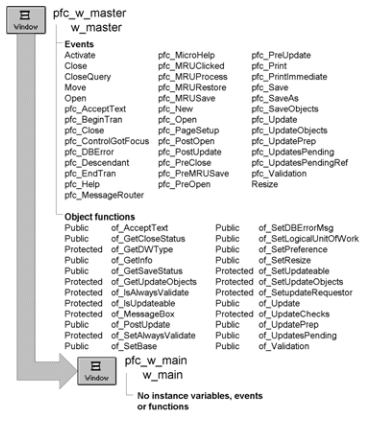

# w_main

**Description**

Ancestor main window for all SDI applications.

**Ancestry**

**Library**

- PFCMAIN.PBL
- PFEMAIN.PBL

**Usage**

Use w_main as the ancestor window for all single document interface (SDI) applications.

**See also**

w_master
