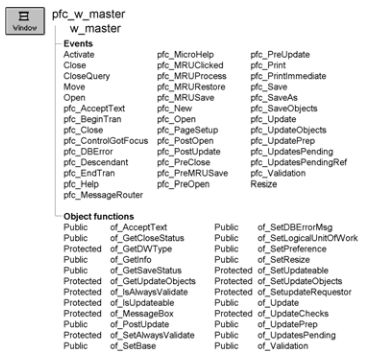

# w_master

**Description**

W_master is the ancestor for all PFC windows. It includes instance variables, events, and functions that are accessed by many PFC objects.

W_master is a self-updating object.

**Ancestry**



**Library**

- PFCWNSRV.PBL
- PFEWNSRV.PBL

**Object relationships**

- [n_cst_appmanager](../09-custom-class-user-objects/n_cst_appmanager.md)
- [n_cst_dberrorattrib](../05-global-structures-and-structure-objects/n_cst_dberrorattrib.md)
- [n_cst_dwsrv_linkage](../09-custom-class-user-objects/n_cst_dwsrv_linkage.md)
- [n_cst_luw](../09-custom-class-user-objects/n_cst_luw.md)
- [n_cst_winsrv](../09-custom-class-user-objects/n_cst_winsrv.md)
- [n_cst_winsrv_preference](../09-custom-class-user-objects/n_cst_winsrv_preference.md)
- [n_cst_resize](../09-custom-class-user-objects/n_cst_resize.md)
- [u_dw](../06-standard-visual-user-objects/u_dw.md)

**Usage**

When writing a PFC-based application, all windows must descend from w_master.

W_master is the ancestor of all PFC windows. When you add instance variables, events, and functions to w_master, they are immediately available in all PFC windows.

**Descendants**

- [w_child](w_child.md)
- [w_frame](w_frame.md)
- [w_main](w_main.md)
- [w_popup](w_popup.md)
- [w_response](w_response.md)
- [w_sheet](w_sheet.md)

**See also**

- [n_cst_appmanager](../09-custom-class-user-objects/n_cst_appmanager.md)
- [n_cst_winsrv](../09-custom-class-user-objects/n_cst_winsrv.md)
- [n_cst_winsrv_preference](../09-custom-class-user-objects/n_cst_winsrv_preference.md)
- [n_cst_resize](../09-custom-class-user-objects/n_cst_resize.md)

## Instance variables

W_master includes instance variables:

| Instance variable | Description | Data type | Access | Usage |
| --- | --- | --- | --- | --- |
| CONTINUE_ACTION | Constant set to 1 | Integer | Public | Internal |
| FAILURE | Constant set to -1 | Integer | Public | Internal |
| ia_helptypeid | Controls whether PFC calls the ShowHelp function by topic, keyword, or index | Any | Protected | Set programmatically |
| ib_alwaysvalidate | Controls whether the save process includes all objects in the validation process | Boolean | Protected | Set with of_SetAlwaysValidate (default is FALSE) |
| ib_closestatus | Indicates whether the window is closing | Boolean | Protected | Internal |
| ib_disableclosequery | Indicates whether CloseQuery processing is enabled | Boolean | Protected | Internal |
| ib_IsObsolete |  | Boolean | Protected |  |
| ib_isupdateable | Indicates whether the window can be updated | Boolean | Protected | Set with of_SetUpdateable (default is TRUE) |
| ib_savestatus | Controls whether message display during the save process | Boolean | Protected | Internal |
| idw_active | Current DataWindow | U_dw | Protected | Internal |
| inv_base | Reference variable for basic window services | n_cst_winsrv | Public | Set with of_SetBase |
| inv_dberrorattrib | Contains database error information | n_cst_dberrorattrib | Protected | Set with of_SetDBErrorMsg |
| inv_luw | Reference variable for logical unit of work service | n_cst_luw | Protected | Set with of_SetLogicalUnitOfWork |
| inv_preference | Reference variable for window preference service | n_cst_winsrv_preference | Public | Set with of_SetPreference |
| inv_resize | Reference variable for resize service | n_cst_resize | Public | Set with of_SetResize |
| inv_style |  | n_cst_winsrv_style | Public |  |
| ipo_pendingupdates[ ] | Default list of objects to be updated | PowerObject | Protected | Internal |
| ipo_updateobjects[ ] | Customized list of objects to be updated | PowerObject | Protected | Internal |
| ipo_tempupdateobjects[ ] | One-time list of objects to be updated | PowerObject | Protected | Internal |
| ipo_updaterequestor | Owner of the save process | PowerObject | Protected | Internal |
| is_dberrormsg | Obsoleted in 6.0. | String | Protected |  |
| NO_ACTION | Constant set to 0 | Integer | Public | Internal |
| PREVENT_ACTION | Constant set to 0 | Integer | Public | Internal |
| SUCCESS | Constant set to 1 | Integer | Public | Internal |

## Events

W_master includes precoded events:

- Activate
- Close
- CloseQuery
- Move
- Open
- pfc_AcceptText
- pfc_BeginTran
- pfc_Close
- pfc_ControlGotFocus
- pfc_DBError
- pfc_Descendant
- pfc_EndTran
- pfc_Help
- pfc_MessageRouter
- pfc_MicroHelp
- pfc_MRUClicked
- pfc_MRUProcess
- pfc_MRURestore
- pfc_MRUSave
- pfc_New
- pfc_Open
- pfc_PageSetup
- pfc_PostOpen
- pfc_postprint
- pfc_PostUpdate
- pfc_PreClose
- pfc_PreMRUSave
- pfc_PreOpen
- pfc_preprint
- pfc_PreUpdate
- pfc_Print
- pfc_PrintImmediate
- pfc_Save
- pfc_SaveAs
- pfc_SaveObjects
- pfc_Update
- pfc_UpdateObjects
- pfc_UpdatePrep
- pfc_UpdatesPending
- pfc_UpdatesPendingRef
- pfc_Validation
- Resize

### Activate

**Description**

Calls the n_cst_mru pfc_MRURestore event to restore changed menu items as needed.

**Usage**

This event executes when the window becomes active.

### Close

**Description**

Stores preference information and destroys any existing window service objects.

**Usage**

This event executes when a window closes.

### CloseQuery

**Description**

Accesses all DataWindows, checks for validation errors and, if changes are pending, prompts the user to save the changes.

**Usage**

This event executes when a window closes, just before the Close event. It calls one or more of the following:

- Pfc_PreClose
- Of_UpdateChecks
- Pfc_Save

### Move

**Description**

Stores the window position and size.

**Usage**

This event executes when the user moves a window.

### Open

**Description**

Triggers the pfc_PreOpen event and posts the pfc_PostOpen event. If the preference and MRU services are enabled, this event also restores window settings and MRU information.

**Usage**

This event executes when the window opens. It's best to add application-specific code to either the pfc_PreOpen or pfc_PostOpen events.

### pfc_AcceptText

**Description**

Calls the n_cst_luw of_AcceptText function, which in turn calls the of_AcceptText function for all controls that implement it.

**Syntax**

```
instancename.EVENT pfc_AcceptText ( controlarray, focusonerror )
```

| Argument | Description |
| --- | --- |
| *instancename* | Instance name of the w_master-based descendant |
| *controlarray* | PowerObject array containing the controls for which to accept text. From within the pfc_AcceptText event, access this value through the *apo_control* argument |
| *focusonerror* | Boolean specifying whether to set focus on a DataWindow column with errors. From within the pfc_AcceptText event, access this value through the *ab_focusonerror* argument |

**Return value**

Integer. Returns 1 if the event succeeds and -1 if an error occurs.

**Usage**

This event is called by the of_UpdateChecks function.

### pfc_BeginTran

**Description**

Empty user event that you extend to perform start-of-transaction processing.

**Return value**

Integer. Returns 1 if the event succeeds and -1 if an error occurs.

**Usage**

This event is called by the pfc_Save event.

### pfc_Close

**Description**

Closes the window.

**Usage**

Call this event to close a window.

### pfc_ControlGotFocus

**Description**

Triggered when a PFC visual control gets focus. This event keeps track of the current control.

**Syntax**

```
instancename.EVENT pfc_ControlGotFocus ( control )
```

| Argument | Description |
| --- | --- |
| *instancename* | Instance name of the w_master-based descendant |
| *control* | DragObject variable containing the control that just received focus |

**Usage**

This event is called by PFC visual controls when they get focus.

Use this event to add application-specific functionality to be performed when a visual control gets focus.

If the control getting focus is a DataWindow inherited from u_dw, this event sets the idw_active instance variable.

### pfc_DBError

**Description**

Displays a database error encountered during the pfc_Save process.

**Usage**

This event is called by pfc_Save if an update error occurs.

### pfc_Descendant

**Description**

PFC events and functions call this event to determine if the window is inherited from w_master.

**Return value**

Boolean. Always returns TRUE.

**Usage**

Internal.

### pfc_EndTran

**Description**

Empty user event that you extend to initiate end-of-transaction processing, such as COMMIT or ROLLBACK.

**Syntax**

```
instancename.EVENT pfc_EndTran ( savecode )
```

| Argument | Description |
| --- | --- |
| *instancename* | Instance name of the w_master-based descendant |
| *savecode* | Integer specifying the return code from the pfc_Update function. From within the pfc_EndTran event, access this value through the *ai_update_results* argument |

**Return value**

Integer. Return 1 if the end transaction process succeeds and other application-specific values as appropriate.

**Usage**

This event is called by pfc_Save. The value passed in *savecode* indicates whether previous updates succeeded or failed. Based on *savecode*, you extend this event to add COMMIT, ROLLBACK, or other end-of-transaction processing.

**Examples**

This example extends the pfc_EndTran event to COMMIT all open transactions. This example returns 0 if it succeeds and -1 if a COMMIT fails:

```
n_tr  ltr_trans[ ]
Integer  li_trans, li_count
Long  ll_return

li_trans = &
  gnv_app.inv_trregistration.of_GetRegistered &
    (ltr_trans)
IF li_trans = 0 THEN Return 0
For li_count = 1 to li_trans
  ll_return = ltr_trans[li_count].of_Commit()
  IF ll_return < 0 THEN Return -1
Next
Return 0
```

### pfc_Help

**Description**

Calls the ShowHelp function by index, topic or keyword, based on the ia_helptypeid instance variable.

**Return value**

Integer. Returns 1 if the event succeeds and -1 if an error occurs.

**Usage**

This event is triggered when the window has focus and the user selects Help>Help Topics from the menu bar of a menu that descends from the PFC m_master menu. You can also trigger it directly (from a Help CommandButton, for example).

If the Help type ID is not specified, this event opens the top-level Help contents topic. Call the n_cst_appmanager of_SetHelpfile function to specify the application’s Help filename.

### pfc_MessageRouter

**Description**

Triggers the passed user event. This event first attempts to trigger the passed user event on the window, then the current control. If the user event is not found, it then attempts to trigger the passed user event on the last active DataWindow control.

**Syntax**

```
instancename.EVENT pfc_MessageRouter ( userevent )
```

| Argument | Description |
| --- | --- |
| *instancename* | Instance name of the w_master-based descendant |
| *userevent* | String specifying the event to trigger. From within the pfc_MessageRouter event, access this value through the *as_message* argument |

**Return value**

Integer. Returns 1 if the event succeeds, 0 if no objects contain the user event, and -1 if an error occurs.

**Usage**

This event is triggered when the user selects a menu choice that calls the of_SendMessage menu function.

All PFC visual controls, including u_dw, include events that work with the message router.

### pfc_MicroHelp

**Description**

Ancestor event to which descendants add code that displays MicroHelp.

**Syntax**

```
instancename.EVENT pfc_MicroHelp ( microhelp )
```

| Argument | Description |
| --- | --- |
| *instancename* | Instance name of the w_master-based descendant |
| *microhelp* | String to be displayed in the status bar |

**Usage**

This event is called by u_dw ItemFocusChanged event. It is extended in w_frame and w_sheet.

### pfc_MRUClicked

**Description**

Checks for the existence of the specified menu item in the MRU DataStore and calls the pfc_MRUProcess event if the menu item is found.

**Return value**

Integer. Returns 1 if the event succeeds and -1 if an error occurs.

**Usage**

Internal.

### pfc_MRUProcess

**Description**

Empty user event that you extend to open the appropriate window based on the clicked MRU menu item.

**Syntax**

```
instancename.EVENT pfc_MRUProcess ( row )
```

| Argument | Description |
| --- | --- |
| *instancename* | Instance name of the w_master-based descendant |
| *row* | Integer specifying the MRU DataStore row that corresponds to the clicked MRU menu item. From within the pfc_MRUProcess event, access this value through the *ai_row* argument |

**Return value**

Integer. Returns 1 if the event succeeds and -1 if an error occurs.

**Usage**

You extend this event to open windows (SDI) or sheets (MDI) with or without passing parameters.

The pfc_w_master ancestor contains sample code for this event.

**Examples**

This example shows code you might add to the pfc_MRUProcess event:

```
window  lw_frame, lw_window
n_cst_menu  lnv_menu
n_cst_mruattrib  lnv_mruattrib

// check parameters
if isnull(ai_row) or (ai_row < 1) then
       return -1
end if
if not isvalid(gnv_app.inv_mru) then
       return -1
end if
// retrieve row from datastore and do work with it
gnv_app.inv_mru.of_getitem(ai_row, lnv_mruattrib)
// get the mdi frame if necessary
lnv_menu.of_getmdiframe(this.menuid, lw_frame)
//example opens
// SDI Process
//open(lw_window, lnv_mruattrib.is_classname)
//openwithparm(lw_window,  &
//   lnv_mruattrib.is_menuitemkey,  &
//     lnv_mruattrib.is_classname)
// MDI Process
//opensheet(lw_window, lnv_mruattrib.is_classname,  &
//   lw_frame)
//opensheet(lw_window, lnv_mruattrib.is_classname,  &
//  lw_frame, 0, original!)
Return opensheetwithparm(lw_window,  &
  lnv_mruattrib.is_menuitemkey, &
    lnv_mruattrib.is_classname, lw_frame, 0,  &
      original! )
```

### pfc_MRURestore

**Description**

Empty user event that you extend to restore MRU settings.

**Return value**

Integer. Returns 1 if the event succeeds and -1 if an error occurs.

**Usage**

Add code to this event that calls the n_cst_mru of_Restore function.

The pfc_w_master ancestor contains sample code for this event.

**Examples**

This example shows the code you add to the pfc_MRURestore event:

```
If IsValid(gnv_app.inv_mru) Then
   Return gnv_app.inv_mru.of_Restore(ls_id, This)
End If
```

### pfc_MRUSave

**Description**

Saves MRU information for the current window.

**Return value**

Integer. Returns 1 if the event succeeds and -1 if an error occurs.

**Usage**

Call this event when the window opens (typically in the pfc_PreOpen event).

This event calls the pfc_PreMRUSave event. You must add code to pfc_PreMRUSave that populates the n_cst_mruattrib object with the ID, classname, key, menu item text, and menu item help to be saved.

### pfc_New

**Description**

Empty user event into which you place code that performs processing to add a new entity to the current window, window control, or DataWindow.

**Usage**

Use this event for application- and window-specific new entity processing.

This event is triggered when the user selects File>New from the menu bar of a menu that descends from the PFC m_master menu.

**Examples**

This example, which might be found in a descendent sheet or main window, inserts a new row into the active DataWindow when the user selects File>New from the menu bar:

```
idw_active.InsertRow(0)
```

### pfc_Open

**Description**

Empty user event into which you place code that performs processing to open a new entity (typically a file) in the current window, window control, or DataWindow.

**Usage**

Use this event for application- and window-specific open processing.

This event is triggered when the user selects File>Open from the menu bar of a menu that descends from the PFC m_master menu.

**Examples**

This example, which might be found in a descendent sheet or main window, displays the Open dialog box when the user selects File>Open from the menu bar. Is_fullname and is_filename are instance variables:

```
Integer  li_fileid

SetPointer (HourGlass!)
IF GetFileOpenName &
  ("Open", is_fullname, is_filename &
    "txt", "Text Files (*.txt),*.txt) < 1 THEN
      Return
END IF

// Open the new file and put results into the MLE.
li_fileid = FileOpen(is_fullname, StreamMode!)
FileRead (li_fileid, mle_notepad.text)
FileClose (li_fileid)
...
```

### pfc_PageSetup

**Description**

Empty user allowing you to add code to display a Page Setup dialog box and print multiple DataWindows.

**Return value**

Integer. Returns 1 if the event succeeds and -1 if an error occurs.

**Usage**

Call this event to synch page setup properties among multiple DataWindows.

**Examples**

This example synchs the paper source for three DataWindows:

```
Integer  li_rc
s_pagesetupattrib  lstr_pagesetup

li_rc = dw_1.event pfc_PageSetupDlg(lstr_pagesetup)
IF li_rc = 1 THEN
  dw_2.object.datawindow.print.paper.source = &
    lstr_pagesetup.i_papersource
  dw_3.object.datawindow.print.paper.source = &
    lstr_pagesetup.i_papersource
END IF
...
```

### pfc_PostOpen

**Description**

Empty user event into which you place code that performs processing just after a window opens.

**Usage**

Use this event for application- and window-specific post-open processing. This event executes just after a window opens.

**Examples**

This example calls the Retrieve function in a window’s pfc_PostOpen event:

```
Long  ll_return

ll_return = dw_employee.EVENT pfc_Retrieve()
IF ll_return = -1 THEN
  MessageBox("Retrieve", "Retrieval error")
ELSE
  gnv_app.of_getframe().SetMicroHelp &
    (String(ll_return) + " rows retrieved")
END IF
```

### pfc_postprint

**Description**

No description is available.

**Syntax**

```
instancename.EVENT pfc_postprint ( )
```

| Argument | Description |
| --- | --- |
| *instancename* | Instance name of w_master |

**Return value**

None.

### pfc_PostUpdate

**Description**

Calls the n_cst_luw of_PostUpdate function, which in turn calls the of_PostUpdate function for all controls that implement it.

**Syntax**

```
instancename.EVENT pfc_PostUpdate ( controlarray )
```

| Argument | Description |
| --- | --- |
| *instancename* | Instance name of the w_master-based descendant |
| *controlarray* | PowerObject array containing the controls for which to perform post update processing. From within the pfc_AcceptText event, access this value through the *apo_control* argument |

**Return value**

Integer. Returns 1 if the event succeeds and -1 if an error occurs.

**Usage**

The pfc_Save user event calls this event after calling the pfc_DBError user event.

You can extend this event to perform additional post-update processing.

### pfc_PreClose

**Description**

Empty user event that you extend to perform processing just before a window closes.

**Return value**

Integer. Return 1 if the pre-close process succeeds and -1 to prevent the window from closing.

**Usage**

Use this event for application- and window-specific pre-close processing.

This event executes just before CloseQuery processing.

**Examples**

This example uses the pfc_PreClose function to write to a log file:

```
IF inv_filesrv.of_FileWrite &
  (is_logfile, "Window: " + this.title &
    + " closing at " + String(Today()) &
    + String(Now()),TRUE) = 1 THEN
  Return 1
ELSE
  Return -1
END IF
```

### pfc_PreMRUSave

**Description**

Empty user event that you extend to create MRU information that you can later access when opening windows.

**Syntax**

```
instancename.EVENT pfc_PreMRUSave ( mruattrib )
```

| Argument | Description |
| --- | --- |
| *instancename* | Instance name of the w_master-based descendant |
| *mruattrib* | N_cst_mruattrib into which the event places window information |

**Return value**

Integer. Returns 1 if the event succeeds and -1 if an error occurs.

**Usage**

The pfc_MRUSave event calls this event.

The pfc_w_master ancestor contains sample code for this event.

**Examples**

This example shows code you might add to the pfc_PreMRUSave event:

```
anv_mruattrib.is_id = "empinfo"
anv_mruattrib.is_classname = this.classname()
anv_mruattrib.is_menuitemname = this.title
anv_mruattrib.is_menuitemkey = this.classname()
anv_mruattrib.is_menuitemmhelp = &
   "Opens " + this.classname()
```

### pfc_PreOpen

**Description**

Empty user event into which you place code that performs processing just before a window opens.

**Usage**

Use this event for application- and window-specific pre-open processing.

If you are using n_cst_mru to track most recently used windows, you typically call the pfc_MRUSave event from this event.

This event executes just before a window opens.

**Examples**

This example connects to the database in the frame window’s pfc_PreOpen event:

```
String  ls_file, ls_section
Long  ll_return

ls_file = "c:\pbapp\pbapp.ini"
ls_section = "PBAppDB"

itr_pbapp.of_Init(ls_file, ls_section)
ll_return = itr_pbapp.of_Connect()
IF ll_return <> 0 THEN
  itr_pbapp.of_Rollback()
  MessageBox("PBApp", "Connect error")
END IF
```

### pfc_preprint

**Description**

No description is available.

**Syntax**

```
instancename.EVENT pfc_preprint ( )
```

| Argument | Description |
| --- | --- |
| *instancename* | Instance name of w_master |

**Return value**

None.

### pfc_PreUpdate

**Description**

Empty user event into which you place pre-save processing.

**Return value**

Integer. Return 1 if the pre-save processing succeeds and -1 if it does not.

**Usage**

Extend this event to perform application-specific pre-save processing.

The pfc_Save user event calls this event before performing any save processing. If you return -1, save processing terminates.

**Examples**

This example adds code to the pfc_PreUpdate event to check for user ID:

```
String  ls_user

ls_user = gnv_app.of_GetUserID()
IF ls_user = "RNielsen" THEN
  Return -1
ELSE
  Return 1
END IF
```

### pfc_Print

**Description**

Empty user event into which you place code that prints windows or DataWindows, first displaying the Print dialog box.

**Usage**

Extend this event to print application- and window-specific information. For example, you might print a single DataWindow. Alternatively, you might call the DataWindow report service’s of_CreateComposite function to create a composite report of all the window’s DataWindows.

This event is triggered when the user selects File>Print from the menu bar of a menu that descends from the PFC m_master menu.

**Examples**

This example synchs the copies property of all DataWindows on the window:

```
Integer  li_rc
s_printdlgattrib  lstr_printdlg

li_rc = dw_1.Event pfc_PrintDlg(lstr_printdlg)
IF li_rc = 1 THEN
  dw_2.object.datawindow.print.copies = &
    lstr_printdlg.l_copies
  dw_3.object.datawindow.print.copies = &
    lstr_printdlg.l_copies
END IF
```

### pfc_PrintImmediate

**Description**

Empty user event into which you place code that prints windows or DataWindows without displaying the Print dialog box.

**Usage**

Extend this event to print application- and window-specific information.

This event is triggered when the user selects File>Print Immediate from the menu bar of a menu that descends from the PFC m_master menu.

**Examples**

This example prints the dw_employee DataWindow:

```
IF dw_employee.Event pfc_PrintImmediate( ) <> 1 THEN
  Return -1
END IF
```

### pfc_Save

**Description**

Calls w_master user events and functions to save changes for all self-updating objects in the window.

**Return value**

Integer. Returns values as follows:

- **1** All save processes succeeded
- **0** No pending updates
- **-1** Accept text error
- **-2** Updates pending error
- **-3** Validation error
- **-4** Pre-update process failed
- **-5** Pfc_BeginTran failed
- **-6** Pfc_Update failed
- **-7** Pfc_EndTran failed
- **-8** Post-update process failed
- **-9** Update prep process failed

**Usage**

The CloseQuery event calls this user event automatically to check for pending updates and initiate the save process. You can call it from your application to save changes, as needed.

For more on the save process, see [n_cst_luw](../09-custom-class-user-objects/n_cst_luw.md).

### pfc_SaveAs

**Description**

Empty user event allowing you to save all or part of a window.

**Usage**

This event is triggered when the user selects File>Save As from the menu bar of a menu that descends from the PFC m_master menu.

**Examples**

This example displays the Save As dialog box:

```
String is_docname, is_named
Integer li_value

li_value = GetFileSaveName("Save As", &
  is_docname, is_named, "TXT", &
    "Text Files (*.TXT),*.TXT," + &
      " Doc Files (*.DOC), *.DOC")
...
```

### pfc_SaveObjects

**Description**

Performs a save on the specified controls.

**Syntax**

```
instancename.EVENT pfc_SaveObjects ( controlarray )
```

| Argument | Description |
| --- | --- |
| *instancename* | Instance name of the w_master-based descendant |
| *controlarray* | PowerObject array containing the controls for which to perform save processing. From within the pfc_SaveObjects event, access this value through the *apo_control* argument |

**Return value**

Integer. Returns values as follows:

- **1** All save processes succeeded
- **0** No pending updates
- **-1** Accept text error
- **-2** Updates pending error
- **-3** Validation error
- **-4** Pre-update process failed
- **-5** Pfc_BeginTran failed
- **-6** Pfc_Update failed
- **-7** Pfc_EndTran failed
- **-8** Post-update process failed
- **-9** Update prep process failed

**Usage**

Call the of_SetUpdateObjects function to establish the array of controls to be updated.

**Examples**

This example calls the pfc_SaveObjects event:

```
PowerObject  lpo_save[ ]
Integer  li_return

lpo_save[1] = dw_1
this.of_SetUpdateObjects(lpo_save)
li_return = this.EVENT pfc_SaveObjects(lpo_save)
...
```

### pfc_Update

**Description**

Calls the pfc_UpdateObjects event.

**Syntax**

```
instancename.EVENT pfc_Update ( controlarray )
```

| Argument | Description |
| --- | --- |
| *instancename* | Instance name of the w_master-based descendant |
| *controlarray* | PowerObject array containing the controls to be updated. From within the pfc_Update event, access this value through the *apo_control* argument |

**Return value**

Integer. Returns 1 if the event succeeds and -1 if one or more DataWindow update errors occur.

**Usage**

The pfc_Save event calls this event.

### pfc_UpdateObjects

**Description**

Calls the n_cst_luw of_Update function, which in turn calls the of_Update function for all controls that implement it.

**Syntax**

```
instancename.EVENT pfc_UpdateObjects ( controls, accepttext, resetflags )
```

| Argument | Description |
| --- | --- |
| *instancename* | Instance name of the w_master-based descendant |
| *controls* | PowerObject array containing the objects to update. This argument is accessed through the *apo_control* argument |
| *accepttext* | Boolean specifying whether n_cst_luw should automatically perform an AcceptText before performing the Update (TRUE) or not (FALSE) |
| *resetflags* | Boolean specifying whether n_cst_luw should automatically reset DataWindow update flags (TRUE) or not (FALSE) |

**Return value**

Integer. Returns 1 if the event succeeds, 0 if no action was taken, and -1 if one or more update errors occur.

**Usage**

The of_Update function and the pfc_Update event call this event.

### pfc_UpdatePrep

**Description**

Empty user event to which you can add code that prepares for update.

**Syntax**

```
instancename.EVENT pfc_UpdatePrep ( controls )
```

| Argument | Description |
| --- | --- |
| *instancename* | Instance name of the w_master-based descendant |
| *controls* | PowerObject array containing the objects to update. This argument is accessed through the *apo_control* argument |

**Return value**

Long. Return 1 if the update preparation succeeds and -1 to halt the update process.

**Usage**

The of_UpdatePrep function calls this event.

### pfc_UpdatesPending

**Description**

Calls the pfc_UpdatesPendingRef event.

When CloseQuery calls this user event, validation messages are suppressed.

**Syntax**

```
instancename.EVENT pfc_UpdatesPending ( controlarray )
```

| Argument | Description |
| --- | --- |
| *instancename* | Instance name of the w_master-based descendant |
| *controlarray* | PowerObject array containing controls to be tested for pending updates |

**Return value**

Integer. Returns values as follows:

- 1 Pending updates were found
- 0 No pending updates
- -1 AcceptText failed

**Usage**

The CloseQuery event calls this event to determine if there are pending updates.

### pfc_UpdatesPendingRef

**Description**

Calls the n_cst_luw of_UpdatesPending function, which in turn calls the of_UpdatesPending function for all controls that implement it.

**Syntax**

```
instancename.Eventpfc_UpdatesPendingRef ( controls, pending )
```

| Argument | Description |
| --- | --- |
| *instancename* | Instance name of the w_master-based descendant |
| *controls* | PowerObject array containing the objects to update. This argument is accessed through the *apo_control* argument |
| *pending* | PowerObject array to contain objects with pending updates. This argument is accessed through the *apo_pending* argument (passed by reference) |

**Return value**

Integer. Returns values, as follows:

- 1 Pending updates were found
- 0 No pending updates
- -1 AcceptText failed

**Usage**

The pfc_UpdatesPending event calls this event to determine if there are pending updates.

### pfc_Validation

**Description**

Calls the n_cst_luw of_Validation function, which in turn calls the of_Validation function for all controls that implement it.

**Syntax**

```
instancename.EVENT pfc_Validation ( controlarray )
```

| Argument | Description |
| --- | --- |
| *instancename* | Instance name of the w_master-based descendant |
| *controlarray* | PowerObject control array containing controls to be validate |

**Return value**

Integer. Returns 1 if there are no validation errors and -1 if a validation error occurs.

**Usage**

The of_Validation and of_UpdateChecks functions call this event to determine if there are validation errors.

### Resize

**Description**

Triggers automatic resize processing, if enabled in n_cst_resize.

**Usage**

This event executes when the user resizes the window.

## Functions

W_master includes precoded object functions:

- of_AcceptText
- of_GetCloseStatus
- of_GetDWType
- of_GetInfo
- of_GetSaveStatus
- of_GetUpdateObjects
- of_IsAlwaysValidate
- of_IsUpdateable
- of_MessageBox
- of_PostUpdate
- of_SetAlwaysValidate
- of_SetBase
- of_SetDBErrorMsg
- of_SetLogicalUnitOfWork
- of_SetPreference
- of_SetResize
- of_SetStyle
- of_SetUpdateable
- of_SetUpdateObjects
- of_SetUpdateRequestor
- of_Update
- of_UpdateChecks
- of_UpdatePrep
- of_UpdatesPending
- of_Validation

### of_AcceptText

**Description**

Calls the pfc_AcceptText event.

**Access**

Public

**Syntax**

```
instancename.of_AcceptText ( focusonerror )
```

| Argument | Description |
| --- | --- |
| *instancename* | Instance name of w_master |
| *focusonerror* | Boolean indicating whether PFC sets focus to the first item in error when an error occurs |

**Return value**

Integer. Returns 1 if the function succeeds and -1 if an error occurs.

**Usage**

N_cst_luw calls this function as part of the default save process. This function is part of the self-updating object API. To customize accept text processing, extend the pfc_AcceptText event.

**Examples**

This example is from the n_cst_luw of_AcceptText function:

```
...
If lb_defined Then
       li_rc =  &
      lpo_tocheck.Function Dynamic of_AcceptText &
         (ab_focusonerror)
       If li_rc < 0 Then Return -1

...
```

### of_GetCloseStatus

**Description**

Reports the window’s close status (whether the window is closing.)

**Access**

Public

**Syntax**

```
windowname.of_GetCloseStatus ( )
```

| Argument | Description |
| --- | --- |
| *windowname* | Instance name of w_master |

**Return value**

Boolean. Returns TRUE if the window is closing and FALSE if it is not.

**Usage**

PFC does not report validation errors if the window is closing.

**Examples**

This example calls the of_GetCloseStatus function:

```
IF al_row <> 0 AND &
  (Not lw_parent. of_GetCloseStatus ( )) THEN
  IF IsValid(gnv_app) THEN
    MessageBox(gnv_app.iapp_object.Appname, &
      "Required Value Missing for " &
        + as_colname + " on row " + &
        String(al_row) + &
        ’. Please enter a value.’, StopSign!)
  ELSE
...
```

### of_GetDWType

**Description**

Indicates whether a DataWindow is a descendant of u_dw and whether it uses the linkage service.

**Access**

Protected

**Syntax**

```
instancename.of_GetDWType ( datawindow )
```

| Argument | Description |
| --- | --- |
| *instancename* | Instance name of w_master |
| *datawindow* | DataWindow variable containing the DataWindow to be tested |

**Return value**

Integer. Returns values as follows:

- 0 *Datawindow* is not a descendant of u_dw
- 1 *Datawindow* is a descendant of u_dw
- 2 *Datawindow* is a descendant of u_dw and it is linked
- -1 An error occurred

**Usage**

Internal.

**Examples**

This example calls the of_GetDWType function:

```
...
li_dwtype = of_GetDWType (ldw_dw)
If li_dwtype < 0 Then Return -1
...
```

### of_GetInfo

**Description**

Retrieves object information.

**Access**

Public

**Syntax**

```
instancename.of_GetInfo ( infoobject )
```

| Argument | Description |
| --- | --- |
| *instancename* | Instance name of w_master |
| *infoobject* | N_cst_infoattrib instance into which the function places information (passed by reference) |

**Return value**

Integer. Returns 1 if the function succeeds and -1 if an error occurs.

**Examples**

This example calls the of_GetInfo function:

```
n_cst_infoattrib  lnv_info

w_emplist.of_GetInfo(lnv_info)
MessageBox("Info",  &
  "Description: " + lnv_info.is_description  &
    + ". Name: " + lnv_info.is_name)
```

### of_GetSaveStatus

**Description**

Reports the window’s save status (whether the window is in the process of updating its DataWindows).

**Access**

Public

**Syntax**

```
windowname.of_GetSaveStatus ( )
```

| Argument | Description |
| --- | --- |
| *windowname* | Instance name of w_master |

**Return value**

Boolean. Returns TRUE if the window is updating and FALSE if it is not.

**Usage**

Call this function to determine whether a window is updating its DataWindows.

**Examples**

This example calls the of_GetSaveStatus function:

```
...
IF lw_parent.TriggerEvent &
  ("pfc_Descendant") = 1 THEN
    lb_pfcsaveprocess = &
      lw_parent.of_GetSaveStatus()
END IF
...
```

### of_GetUpdateObjects

**Description**

Retrieves the current default array of objects affected by the update process.

**Access**

Protected

**Syntax**

```
instancename.of_GetUpdateObjects ( objects )
```

| Argument | Description |
| --- | --- |
| *instancename* | Instance name of w_master |
| *objects* | PowerObject array into which the function places objects to be updated (passed by reference) |

**Return value**

Integer. Returns the number of elements in the *objects* array if the function succeeds and -1 if an error occurs.

**Examples**

This example calls the of_GetUpdateObjects function:

```
PowerObject  lpo_objs[ ]
Integer  li_return, li_count

li_return = this.of_GetUpdateObjects(lpo_objs)
FOR li_count = 1 to li_return
       IF lpo_objs[li_count] = ids_data THEN
       Return 1
       END IF
NEXT
li_return++
lpo_objs[li_return] = ids_data
Return this.of_SetUpdateObjects(lpo_objs)
```

### of_IsAlwaysValidate

**Description**

Reports whether the default save process always performs validation.

**Access**

Protected

**Syntax**

```
instancename.of_IsAlwaysValidate ( )
```

| Argument | Description |
| --- | --- |
| *instancename* | Instance name of w_master |

**Return value**

Boolean. Returns TRUE if the default save process always performs validation and FALSE if it does not.

**Examples**

This example calls the of_IsAlwaysValidate function:

```
IF this.of_IsAlwaysValidate() = TRUE THEN
   MessageBox("Window", "Always validate")
ELSE
   MessageBox("Window", "Sometimes validate")
END IF
```

### of_IsUpdateable

**Description**

Reports whether the window is updatable and should be included in save processing.

**Access**

Protected

**Syntax**

```
instancename.of_IsUpdateable ( )
```

| Argument | Description |
| --- | --- |
| *instancename* | Instance name of w_master |

**Return value**

Boolean. Returns TRUE if the window is updatable and FALSE if it is not.

**Usage**

Internal.

**Examples**

This example is from the pfc_UpdatesPendingRef event:

```
...
If Not of_IsUpdateable() Then Return NO_UPDATESPENDING
...
```

### of_MessageBox

**Description**

Displays a MessageBox.

**Access**

Protected

**Syntax 1**

```
instancename.of_MessageBox ( id, title, message, icon, button, default )
```

| Argument | Description |
| --- | --- |
| *instancename* | Instance name of w_master |
| *id* | String specifying an ID for the message |
| *title* | String specifying the title of the MessageBox |
| *message* | String specifying the message text |
| *icon* | Icon enumerated data type indicating the icon you want to display on the left side of the message box. Values are: |
|  | • Information! |
|  | • StopSign! |
|  | • Exclamation! |
|  | • Question! |
|  | • None! |
| *button* | Button enumerated data type indicating the set of CommandButtons you want to display at the bottom of the message box. The buttons are numbered in the order listed in the enumerated data type. Values are: |
|  | • OK! |
|  | • OKCancel! |
|  | • YesNo! |
|  | • YesNoCancel! |
|  | • RetryCancel! |
|  | • AbortRetryIgnore! |
| *default* | Integer specifying the number of the button you want to be the default button |

**Syntax 2** For a message that contains values (PFC 2025 and later)

```
instancename.of_MessageBox ( id, title, message, values, icon, button, default )
```

| Argument | Description |
| --- | --- |
| *instancename* | Instance name of w_master |
| *values* | String array. The values for the placeholders in *message* |

The other arguments are the same as in Syntax 1.

**Return value**

Integer. Returns 1 if the function succeeds and -1 if an error occurs.

**Usage**

Override this function to control MessageBox behavior in windows.

**PFC 2025 and later** When the language service is enabled (see the n_cst_appmanager of_SetLanguage function), the message comes from the language file if it has an entry for *id*: the entry *id* replaces *message*, and the entry *id*.title replaces *title*. Without the service, or without an entry, *message* and *title* are used as they are.

Use Syntax 2 for a message that contains values: *message* is the English text with placeholders (%s, or %1 - %9 by position) and *values* holds the values. Syntax 2 calls Syntax 1 to display the message, so an override of Syntax 1 still sees every message.

**Examples**

This example calls the of_MessageBox function:

```
of_Messagebox(’win_error’,’Save’, &
   as_error, StopSign!, Ok!, 1)
```

### of_PostUpdate

**Description**

Calls the pfc_PostUpdate event.

**Access**

Public

**Syntax**

```
instancename.of_PostUpdate ( )
```

| Argument | Description |
| --- | --- |
| *instancename* | Instance name of w_master |

**Return value**

Integer. Returns 1 if the function succeeds and -1 if an error occurs.

**Usage**

N_cst_luw calls this function as part of the default save process. This function is part of the self-updating object API. To customize post-update processing, extend the pfc_PostUpdate event.

**Examples**

This example is from the n_cst_luw of_PostUpdate function:

```
...
If lb_defined Then
  li_rc =  &
    lpo_tocheck.Function Dynamic of_PostUpdate()
...
```

### of_SetAlwaysValidate

**Description**

Specifies whether the default save process always performs validation.

**Access**

Protected

**Syntax**

```
instancename.of_SetAlwaysValidate ( boolean )
```

| Argument | Description |
| --- | --- |
| *instancename* | Instance name of w_master |
| *boolean* | Boolean specifying whether the default save process always perform validation (TRUE) or only performs validation if a control has pending updates (FALSE) |

**Return value**

Integer. Returns 1 if the function succeeds and -1 if an error occurs.

**Examples**

This example calls the of_SetAlwaysValidate function:

```
this.of_SetAlwaysValidate(TRUE)
```

### of_SetBase

**Description**

Enables or disables n_cst_winsrv, which provides basic window services.

**Access**

Public

**Syntax**

```
instancename.of_SetBase ( boolean )
```

| Argument | Description |
| --- | --- |
| *instancename* | Instance name of w_master |
| *boolean* | Boolean specifying whether to enable (TRUE) or disable (FALSE) an instance of the n_cst_winsrv object |

**Return value**

Integer. Returns 1 if the function succeeds, 0 if the service is already enabled, and -1 if an error occurs.

**Usage**

Use this function to create or destroy an instance of n_cst_winsrv. This instance is named inv_base.

Because all window services are descendants of n_cst_winsrv (and have n_cst_winsrv functions available to them), use this object when you require basic window services only.

**Examples**

This example calls the of_SetBase function in a window Open event to enable basic window services:

```
this.of_SetBase (TRUE)
```

### of_SetDBErrorMsg

**Description**

Saves a database update error message for display after save processing completes.

**Access**

Public

**Syntax**

```
windowname.of_SetDBErrorMsg ( message )
```

| Argument | Description |
| --- | --- |
| *windowname* | Instance name of w_master |
| *message* | String or n_cst_dberrorattrib containing the error message |

**Return value**

Integer. Returns 1 if the function succeeds and -1 if an error occurs.

**Usage**

Call this function to save a database error message for display after ROLLBACK processing completes.

The u_dw DBError event populates this instance variable, suppressing the display of a message dialog box. This allows you to roll back changes in the pfc_EndTran event. After calling pfc_EndTran, the pfc_Save process displays this message.

**Examples**

This example is from the u_dw DBError event:

```
...
If IsValid(lpo_updaterequestor) Then
  lpo_updaterequestor.Dynamic Function  &
    of_SetDBErrorMsg(lnv_dberrorattrib)
Else
...
```

### of_SetLogicalUnitOfWork

**Description**

Enables or disables n_cst_luw, which provides the logical unit of work service.

**Access**

Public

**Syntax**

```
instancename.of_SetLogicalUnitOfWork ( boolean )
```

| Argument | Description |
| --- | --- |
| *instancename* | Instance name of w_master |
| *boolean* | Boolean specifying whether to enable (TRUE) or disable (FALSE) n_cst_luw |

**Return value**

Integer. Returns 1 if the function succeeds, 0 if the service is already enabled, and -1 if an error occurs.

**Usage**

Use this function to create or destroy an instance of n_cst_luw. This instance is named inv_luw. If you do not enable n_cst_luw, w_master enables it automatically.

**Examples**

This example calls the of_SetLogicalUnitOfWork function:

```
this.of_SetLogicalUnitOfWork(TRUE)
```

### of_SetPreference

**Description**

Enables or disables n_cst_winsrv_preference, the window preference service.

**Access**

Public

**Syntax**

```
instancename.of_SetPreference ( boolean )
```

| Argument | Description |
| --- | --- |
| *instancename* | Instance name of w_master |
| *boolean* | Boolean specifying whether to enable (TRUE) or disable (FALSE) an instance of the n_cst_winsrv_preference object |

**Return value**

Integer. Returns 1 if the function succeeds, 0 if the service is already enabled, and -1 if an error occurs.

**Usage**

Use this function to create or destroy an instance of n_cst_winsrv_preference. This instance is named inv_preference.

**Examples**

This example calls the of_SetPreference function:

```
this.of_SetPreference(TRUE)
```

### of_SetResize

**Description**

Enables or disables n_cst_resize, the resize service.

**Access**

Public

**Syntax**

```
instancename.of_SetResize ( boolean )
```

| Argument | Description |
| --- | --- |
| *instancename* | Instance name of w_master |
| *boolean* | Boolean specifying whether to enable (TRUE) or disable (FALSE) an instance of the n_cst_resize object |

**Return value**

Integer. Returns 1 if the function succeeds, 0 if the service is already enabled, and -1 if an error occurs.

**Usage**

Use this function to create or destroy an instance of n_cst_resize. This instance is named inv_resize.

**Examples**

This example calls the of_SetResize function:

```
this.of_SetResize(TRUE)
```

### of_SetStyle

**Description**

Starts or stops the window style service.

**Access**

Public

**Syntax**

```
instancename.of_SetStyle ( ab_switch )
```

| Argument | Description |
| --- | --- |
| *instancename* | Instance name of w_master |
| *ab_switch* | Boolean. starts/stops the window style service. |

**Return value**

Integer. Returns 1 = Successful operation, 0 = No action necessary, -1 = An error was encountered.

### of_SetUpdateable

**Description**

Specifies whether the window is updatable and should be included in a default save process.

**Access**

Protected

**Syntax**

```
instancename.of_SetUpdateable ( boolean )
```

| Argument | Description |
| --- | --- |
| *instancename* | Instance name of w_master |
| *boolean* | Boolean indicating whether the window is updatable |

**Return value**

Integer. Returns 1 if the function succeeds and -1 if an error occurs.

**Usage**

Call this function to disable default save processing for windows that are not updatable.

**Examples**

This example calls the of_SetUpdateable function:

```
this.of_SetUpdateable(FALSE)
```

### of_SetUpdateObjects

**Description**

Sets a new default array containing objects for which updates are attempted.

**Access**

Protected

**Syntax**

```
instancename.of_SetUpdateObjects ( requestor )
```

| Argument | Description |
| --- | --- |
| *instancename* | Instance name of u_dw |
| *requestor* | PowerObject array containing the object to be updated |

**Return value**

Integer. Returns 1 if the function succeeds and -1 if an error occurs.

**Usage**

Call this function to customize the objects updated by the save process. You can even add other windows to the save process.

**Examples**

This example calls the of_SetUpdateObjects function:

```
PowerObject  lpo_objs[ ]
Integer  li_count

lpo_objs = this.control
li_count = UpperBound(lpo_objs)
li_count++
// Update w_other as well as this window
lpo_objs[li_count] = w_other
Return this.of_SetUpdateObjects(lpo_objs)
```

### of_SetUpdateRequestor

**Description**

Creates a reference to the object requesting an update within a logical unit of work.

**Access**

Protected

**Syntax**

```
instancename.of_SetUpdateRequestor ( requestor )
```

| Argument | Description |
| --- | --- |
| *instancename* | Instance name of w_master |
| *requestor* | PowerObject containing the object requesting the update |

**Return value**

Integer. Returns 1 if the function succeeds and -1 if an error occurs.

**Usage**

Internal.

**Examples**

This example is from the of_SetLogicalUnitOfWork function:

```
...
inv_luw = create n_cst_luw
inv_luw.of_SetRequestor (this)
inv_luw.of_SetUpdateRequestor (this)
...
```

### of_Update

**Description**

Calls the pfc_UpdateObjects event.

**Access**

Public

**Syntax**

```
instancename.of_Update ( accept, resetflag {, requestor } )
```

| Argument | Description |
| --- | --- |
| *instancename* | Instance name of w_master |
| *accept* | Boolean indicating whether the Update function performs an AcceptText before saving rows to the database |
| *resetflag* | Boolean indicating whether the Update function resets the update flags |
| *requestor* (optional) | PowerObject containing the requestor object |

**Return value**

Integer. Returns 1 if the update succeeds and -1 if an error occurs.

**Usage**

N_cst_luw calls this function as part of the default save process. This function is part of the self-updating object API. To customize update processing, extend the pfc_Update event.

You typically call the pfc_Save event instead of this function.

**Examples**

This example is from the n_cst_luw of_Update function:

```
...
If lb_defined Then
  li_rc = lpo_tocheck.Function Dynamic of_Update &
    (ab_accepttext,  ab_resetflag, &
      lpo_updaterequestor)
  If li_rc < 0 Then Return -1
  Continue
End If
...
```

### of_UpdateChecks

**Description**

Determines whether edits are pending and whether there are any validation errors.

**Access**

Protected

**Syntax**

```
instancename.of_UpdateChecks ( { controls } )
```

| Argument | Description |
| --- | --- |
| *instancename* | Instance name of w_master |
| *controls* (optional) | PowerObject array containing the objects to be checked |

**Return value**

Integer. Returns values as follows:

- **1** Updates are pending and there are no validation errors
- **0** No updates pending
- **-1** AcceptText error
- **-2** UpdatesPending error
- **-3** Validation error

**Usage**

Internal.

**Examples**

This example is from the pfc_Save event:

```
...
li_rc = of_UpdateChecks(lpo_updatearray)
       If li_rc <= 0 Then
...
```

### of_UpdatePrep

**Description**

Calls the pfc_UpdatePrep event, which allows you to code additional update preparation logic.

**Access**

Public

**Syntax**

```
instancename.of_UpdatePrep ( )
```

| Argument | Description |
| --- | --- |
| *instancename* | Instance name of w_master |

**Return value**

Integer. Returns 1 if the function succeeds and -1 if an error occurs.

**Usage**

N_cst_luw calls this function as part of the default save process. This function is part of the self-updating object API. To customize update preparation processing, extend the pfc_UpdatePrep event.

**Examples**

This example is from the n_cst_luw of_UpdatePrep function:

```
...
If lb_defined Then
  li_rc =  &
    lpo_tocheck.Function Dynamic of_UpdatePrep()
  If li_rc < 0 Then Return -1
  Continue
End If
...
```

### of_UpdatesPending

**Description**

Calls the pfc_UpdatesPendingRef event.

**Access**

Public

**Syntax**

```
instancename.of_UpdatesPending ( )
```

| Argument | Description |
| --- | --- |
| *instancename* | Instance name of w_master |

**Return value**

Integer. Returns values as follows:

- **1** Updates are pending
- **0** No updates pending
- **-1** An error occurred

**Usage**

N_cst_luw calls this function as part of the default save process. This function is part of the self-updating object API. To customize pending updates processing, extend the pfc_UpdatesPending event.

**Examples**

This example calls the of_UpdatesPending function:

```
...
If lb_defined Then
       la_rc = lpo_tocheck.Dynamic of_UpdatesPending()
...
```

### of_Validation

**Description**

Calls the pfc_Validation event.

**Access**

Public

**Syntax**

```
instancename.of_Validation ( )
```

| Argument | Description |
| --- | --- |
| *instancename* | Instance name of w_master |

**Return value**

Integer. Returns 1 if the function succeeds and -1 if a validation error occurs.

**Usage**

N_cst_luw calls this function as part of the default save process. This function is part of the self-updating object API. To customize validation processing, extend the pfc_Validation event.

**Examples**

This example calls the of_Validation function:

```
...
If lb_defined Then
  li_rc =  &
    lpo_tocheck.Function Dynamic of_Validation()
...
```
