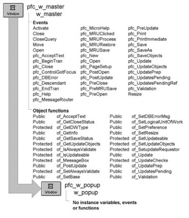

# w_popup

**Description**

Ancestor for all PowerBuilder Foundation Class Library popup windows.

**Ancestry**

**Library**

- PFCMAIN.PBL
- PFEMAIN.PBL

**Usage**

Use w_popup as the ancestor window for all popup windows.

**See also**

w_master
