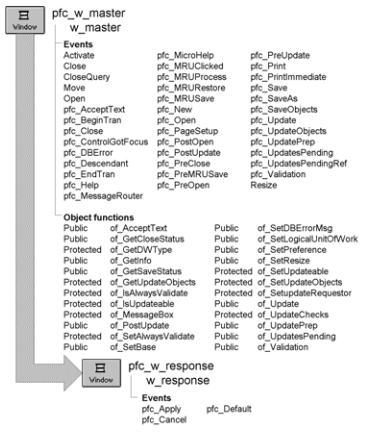

# w_response

**Description**

Ancestor for all PFC response windows.

**Ancestry**



**Library**

- PFCMAIN.PBL
- PFEMAIN.PBL

**Usage**

Use w_response as the ancestor window for all response windows.

Add OK, Cancel, and window-specific CommandButtons to your w_response descendant. Then add code to the CommandButtons’Clicked events to trigger the appropriate w_response user event. Typically, Cancel triggers pfc_Cancel, Apply triggers pfc_Apply, and OK triggers pfc_Default.

**See also**

w_master

## Instance variables

W_response includes instance variables:

| Instance variable | Description | Data type | Access | Usage |
| --- | --- | --- | --- | --- |
| ib_FitWorkSpace | Controls whether the window is made larger at open when its work area is too small for its visible controls (see of_FitWorkSpace) | Boolean | Protected | Set in a descendant (default is TRUE) |

## Events

W_response includes predefined events:

|   |
| --- |
| pfc_Apply pfc_Default |
| pfc_Cancel |

### Close

**Description**

Standard PowerBuilder close event.

**Syntax**

```
instancename.EVENT Close ( )
```

| Argument | Description |
| --- | --- |
| *instancename* | Instance name of w_response |

**Return value**

None.

### pfc_Apply

**Description**

Empty user event to which you add code that applies dialog box specifications to the associated sheet or window.

**Usage**

Add code to this event to apply specifications to the associated sheet or window. Trigger this user event from a cb_apply.Clicked event script.

**Examples**

This example shows code you might add to pfc_Apply:

```
Integer  li_cnt, li_arraysize, li_rc
Boolean  lb
ToolbarAlignment  lt
String  ls

// Set toolbar settings
li_arraysize = UpperBound(istr_toolbar[])
FOR li_cnt = 1 to li_arraysize
  istr_toolbar[li_cnt].w_owner.SetToolbar &
    (istr_toolbar[li_cnt].i_barindex, &
    istr_toolbar[li_cnt].b_visible, &
    istr_toolbar[li_cnt].e_alignment, &
    istr_toolbar[li_cnt].s_title)
  istr_toolbar[li_cnt].w_owner.GetToolbar &
    (istr_toolbar[li_cnt].i_barindex, lb, lt, ls)
NEXT
// Set application toolbar settings
iapp_object.ToolbarText = cbx_text.checked
iapp_object.ToolbarTips = cbx_tips.checked
// Disable Apply button. Make OK the default
cb_apply.Enabled = False
cb_apply.Default = False
cb_cancel.Default = False
cb_ok.Default = True
```

### pfc_Cancel

**Description**

Empty user event to which you add code that closes the window without accepting changes.

**Usage**

Add code to this user event to close the window without accepting changes. Trigger this user event from the cb_cancel.Clicked event script.

**Examples**

This example closes the window and passes a return value of 0:

```
CloseWithReturn(This, 0)
```

### pfc_Default

**Description**

Event to apply changes and close a response window.

**Usage**

Add code to this event to apply changes and close a response window. It is meant to be triggered by the default CommandButton (typically cb_ok), but it could be triggered by Cancel, Close, or some other CommandButton.

**Examples**

This example shows code you might add to the pfc_Default:

```
SetPointer(HourGlass!)

SQLCA.dbms = "ODBC"
SQLCA.database = "expense"
SQLCA.logid = sle_userid.text
SQLCA.logpass = sle_password.text
SQLCA.dbparm = "Connectstring=’DSN=" + &
SQLCA.database + ";UID=" + &
SQLCA.logid + ";PWD=" + SQLCA.logpass + "’"
IF SQLCA.of_Connect() <> 0 THEN
  MessageBox("Login Error", SQLCA.SQLErrText)
  CloseWithReturn(This, 0)
ELSE
  CloseWithReturn(This, 1)
END IF
```

### pfc_preOpen

**Description**

Triggered from the top of the open event.

Then, unless ib_FitWorkSpace is FALSE, it calls of_FitWorkSpace, so that the work area holds the window's controls before the descendant's open script runs.


**Syntax**

```
instancename.EVENT pfc_preOpen ( )
```

| Argument | Description |
| --- | --- |
| *instancename* | Instance name of w_response |

**Return value**

None.

### ue_sysCommand

**Description**

Mapped to pbm_sysCommand. The purpose here is to prevent the window from being closed using Alt-F4 when the close sysMenu option has been disabled.

**Syntax**

```
instancename.EVENT ue_sysCommand ( )
```

| Argument | Description |
| --- | --- |
| *instancename* | Instance name of w_response |

**Return value**

None.

## Functions

W_response includes precoded object functions:

- of_FitWorkSpace

### of_FitWorkSpace

**Description**

Makes the window larger, if necessary, so that its work area holds its visible controls, with as much room on the right and at the bottom as on the left and at the top (at least 18 and at most 64 PowerBuilder units). Drawing objects are left out, and a drop-down list counts without the list that drops down. The window is never made smaller, and a window whose controls fit is not resized.

**Access**

Protected

**Syntax**

```
instancename.of_FitWorkSpace ( )
```

| Argument | Description |
| --- | --- |
| *instancename* | Instance name of w_response |

**Return value**

Integer. Returns 1 if the window was made larger, 0 if its controls fit (or ib_FitWorkSpace is FALSE).

**Usage**

The pfc_preOpen event calls this function.

PowerBuilder gives a window the work area of its design, with the current Windows frame around it; the Resize function, though, sets the size of the whole window, frame included. A descendant that resizes itself at open has to allow for the frame, whose size is known only once the window has been resized (pfc_w_restorerow resizes itself twice for that reason).
