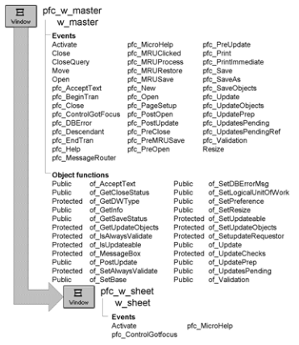

# w_sheet

**Description**

Ancestor for all PowerBuilder Foundation Class Library sheet windows.

This window contains automatic MicroHelp display capability.

**Ancestry**



**Library**

- PFCMAIN.PBL
- PFEMAIN.PBL

**Object relationships**

n_cst_string

**Usage**

Use this window as the ancestor for all of your application’s sheet windows.

If you want to display MicroHelp for controls within a sheet, associate the MicroHelp text with each control’s tag value. The control’s tag value must specify MICROHELP=*microhelptext*. When the control gets focus, the pfc_ControlGotFocus event displays the tag text in the status bar.

**See also**

- [w_frame](w_frame.md)
- [w_master](w_master.md)

## Events

W_sheet includes predefined events:

- Activate
- pfc_MicroHelp
- pfc_ControlGotFocus

### Activate

**Description**

Sets MicroHelp to the control with focus.

**Usage**

This event executes whenever the window receives focus.

### pfc_ControlGotFocus

**Description**

Displays the MicroHelp stored in the control’s tag value.

This event extends the ancestor pfc_ControlGotFocus event.

**Syntax**

```
instancename.EVENT pfc_ControlGotFocus ( control )
```

| Argument | Description |
| --- | --- |
| *instancename* | Instance name of w_sheet-based descendant |
| *control* | DragObject variable containing the control that just got focus |

**Usage**

This event is called by PFC visual controls when they get focus.

The control’s tag value must specify MICROHELP=*microhelptext*.

### pfc_MicroHelp

**Description**

Updates MicroHelp by calling the frame’s pfc_MicroHelp event.

This event extends the ancestor pfc_MicroHelp event.

**Syntax**

```
instancename.EVENT pfc_MicroHelp ( microhelp )
```

| Argument | Description |
| --- | --- |
| *instancename* | Instance name of w_sheet-based descendant |
| *microhelp* | String to be displayed in the status bar |

**Usage**

This event executes whenever the sheet or a control on the sheet receives focus.
