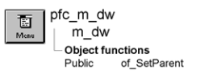

# m_dw

**Description**

Popup menu displayed when the user releases the right mouse button over a u_dw based DataWindow control.

**Ancestry**



**Library**

- PFCMAIN.PBL
- PFEMAIN.PBL

## Menu bar items

M_dw is a popup menu and has a single menu bar item:

Table

### Table menu

| Menu items Menu item | Description |
| --- | --- |
| Cut | Calls the pfc_Cut event |
| Copy | Calls the pfc_Copy |
| Paste | Calls the pfc_Paste event |
| Select All | Calls the pfc_SelectAll event |
| Insert | Calls the pfc_InsertRow event |
| Add | Calls the pfc_AddRow event |
| Delete | Calls the pfc_DeleteRow event |
| Restore | Calls the pfc_RestoreRow event |
| Columns | Calls the pfc_Columns event |
| Functions | Calls the pfc_Functions event |
| Operators | Calls the pfc_Operators event |
| Values | Calls the pfc_Values event |
| DataWindow Properties | Calls the pfc_Debug event |
| Properties | Empty menu item. Add calls to functions or events that display properties for a DataWindow column |

**See also**

u_dw

## Instance variables

M_dw includes one instance variable:

| Instance variable | Description | Data type | Access | Usage |
| --- | --- | --- | --- | --- |
| ib_isobsolete |  | Boolean | Protected |  |
| idw_parent | Owning DataWindow control. | DataWindow | Protected | Used to access the current DataWindow control |

## Events

M_dw includes these events:

### pfc_isobsolete

**Description**

No description is available.

**Syntax**

```
instancename.EVENT pfc_isobsolete ( )
```

| Argument | Description |
| --- | --- |
| *instancename* | Instance name of m_dw |

**Return value**

Boolean.

## Functions

M_dw includes one precoded object function:

of_SetParent

### of_SetParent

**Description**

Establishes the current DataWindow control.

**Access**

Public

**Syntax**

```
instancename.of_SetParent ( currentdw )
```

| Argument | Description |
| --- | --- |
| *instancename* | Instance name of m_dw |
| *currentdw* | DataWindow variable identifying the DataWindow that opened this instance of m_dw |

**Return value**

Integer. Returns 1 if the function succeeds and -1 if an error occurs.

**Usage**

U_dw calls this function to establish a relationship with m_dw.

**Examples**

This example is from the u_dw RButtonUp event:

```
...
lm_dw = create m_dw
lm_dw.of_SetParent(this)
...
```
