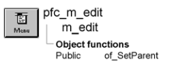

# m_edit

**Description**

Popup menu displayed when the user releases the right mouse button over certain PFC visual controls.

**Ancestry**



**Library**

- PFCMAIN.PBL
- PFEMAIN.PBL

## Menu bar items

M_edit is a popup menu and has a single menu bar item:

Edit

### Edit menu

**Menu items**

| Menu item | Description |
| --- | --- |
| Cut | Calls the pfc_Cut event for the current window or window control |
| Copy | Calls the pfc_Copy event for the current window or window control |
| Paste | Calls the pfc_Paste event for the current window or window control |
| Select All | Calls the pfc_SelectAll event for the current window or window control |

**See also**

- [u_mle](../06-standard-visual-user-objects/u_mle.md)
- [u_rte](../06-standard-visual-user-objects/u_rte.md)
- [u_sle](../06-standard-visual-user-objects/u_sle.md)

## Instance variables

M_edit includes one instance variable:

| Instance variable | Description | Data type | Access | Usage |
| --- | --- | --- | --- | --- |
| ib_IsObsolete |  | Boolean | Protected |  |
| idrg_current | Current window or window control | DragObject | Protected | Used to access the current control |
| idrg_parent |  | DragObject | Protected |  |

## Events

M_edit includes these events:

### pfc_isobsolete

**Description**

No description is available.

**Syntax**

```
instancename.EVENT pfc_isobsolete ( )
```

| Argument | Description |
| --- | --- |
| *instancename* | Instance name of m_edit |

**Return value**

Boolean.

## Functions

M_edit includes one precoded object function:

of_SetParent

### of_SetParent

**Description**

Establishes the current control.

**Access**

Public

**Syntax**

```
instancename.of_SetParent ( currentcontrol )
```

| Argument | Description |
| --- | --- |
| *instancename* | Instance name of m_edit |
| *currentcontrol* | DragObject containing the control that opened this instance of m_edit |

**Return value**

Integer. Returns 1 if the function succeeds and -1 if an error occurs.

**Usage**

PFC visual objects call this function to establish a relationship with m_edit.

**Examples**

This example is from the u_rte RButtonUp event:

```
Integer    li_rc
m_edit     lm_edit
Window     lw_parent
String     ls_selectedtext
...
lm_edit = create m_edit
lm_edit.of_SetParent(this)
...
```
