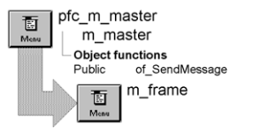

# m_frame

**Description**

The m_frame menu is a descendant of m_master with most items disabled and hidden. Use this menu as the frame menu for your application, modifying and adding menu items as necessary.

**Ancestry**

**Library**

PFEWNSRV.PBL

## Menu bar items

The m_frame menu has the following visible menu bar items:

- File
- Help

### File menu

**Menu items**

| Menu item | Description |
| --- | --- |
| New | Calls the pfc_New event for the frame window |
| Open | Calls the pfc_Open event for the frame window |
| Exit | Calls the pfc_Exit event for the frame window |

### Help menu

| Menu items Menu item | Description |
| --- | --- |
| Help Topics | Calls the pfc_Help event for the frame window |
| About | Calls the n_cst_appmanager of_About function |

**See also**

- [m_master](m_master.md)
- [w_frame](../02-window-objects/w_frame.md)
