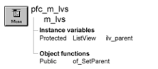

# m_lvs

**Description**

Popup menu displayed when the user releases the right mouse button over a ListView based on u_lvs.

**Ancestry**



**Library**

- PFCMAIN.PBL
- PFEMAIN.PBL

## Menu bar items

M_lvs is a popup menu and has a single menu bar item:

View

### View menu

| Menu items Menu item | Description |
| --- | --- |
| View | Changes the ListView display style. Options are: |
|  | • Large icon |
|  | • Small icon |
|  | • List |
|  | • Report |
| Arrange Icons | Sorts the display by the specified column |
| Select All | Calls the pfc_SelectAll event |
| Invert Selection | Calls the pfc_InvertSelection event |
| Cut | Calls the pfc_Cut event |
| Copy | Calls the pfc_Copy event |
| Paste | Calls the pfc_Paste event |
| Clear | Calls the pfc_Clear event |
| New | Calls the pfc_New event |
| Delete | Calls the pfc_Delete event |
| Rename | Calls the pfc_Rename event |
| Properties | Calls the pfc_Properties event |

**See also**

u_lvs

## Instance variables

M_lvs includes one instance variable:

| Instance variable | Description | Data type | Access | Usage |
| --- | --- | --- | --- | --- |
| ib_IsObsolete |  | Boolean | Protected |  |
| ilv_parent | ListView control displaying the popup menu. | ListView | Protected | Used to access the associated ListView control |

## Events

M_lvs includes these events:

### pfc_isobsolete

**Description**

No description is available.

**Syntax**

```
instancename.EVENT pfc_isobsolete ( )
```

| Argument | Description |
| --- | --- |
| *instancename* | Instance name of m_lvs |

**Return value**

Boolean.

## Functions

M_lvs includes one precoded object function:

of_SetParent

### of_SetParent

**Description**

Establishes the ListView control associated with an instance of the m_lvs popup menu.

**Access**

Public

**Syntax**

```
instancename.of_SetParent ( listview )
```

| Argument | Description |
| --- | --- |
| *instancename* | Instance name of m_lvs |
| *listview* | ListView variable containing the ListView that opened this instance of m_lvs |

**Return value**

Integer. Returns 1 if the function succeeds and -1 if an error occurs.

**Usage**

U_lvs calls this function to establish a relationship with m_lvs.

**Examples**

This example calls the of_SetParent function:

```
...
if IsNull(lm_view) Or not IsValid(lm_view) then
    lm_view = create m_lvs
    lm_view.of_SetParent(this)
end if

...
```
