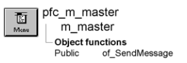

# m_master

**Description**

Master menu for all PFC applications. Use this menu as the ancestor for your application’s menus.

**Ancestry**



**Library**

- PFCWNSRV.PBL
- PFEWNSRV.PBL

## Menu bar items

The m_master menu has the following menu bar items:

- File
- Edit
- View
- Insert
- Tools
- Window
- Help

### File menu

| Menu items Menu item | Description |
| --- | --- |
| New | Calls the pfc_New event for the current window or window control |
| Open | Calls the pfc_Open event for the current window or window control |
| Close | Calls the pfc_Close event for the current window or window control |
| Save | Calls the pfc_Save event for the current window or window control |
| Save As | Calls the pfc_SaveAs event for the current window or window control |
| Print | Calls the pfc_Print event for the current window or window control |
| Print Preview | Calls the pfc_PrintPreview event for the current window or window control |
| Page Setup | Calls the pfc_PageSetup event for the current window or window control |
| Print Immediate | Calls the pfc_PrintImmediate event for the current window or window control |
| Delete | Empty menu item. Add calls to function or events that perform deletion |
| Properties | Empty menu item. Add calls to function or events that display properties |
| Exit | Calls the pfc_Exit event for the current window or window control |
| PFCMRU1 through PFCMRU5 | Calls the pfc_MRUClicked event for the current window or window control |

### Edit menu

| Menu items Menu item | Description |
| --- | --- |
| Undo | Calls the pfc_Undo event for the current window or window control |
| Cut | Calls the pfc_Cut event for the current window or window control |
| Copy | Calls the pfc_Copy event for the current window or window control |
| Paste | Calls the pfc_Paste event for the current window or window control |
| Paste Special | Calls the pfc_PasteSpecial event for the current window or window control |
| Clear | Calls the pfc_Clear event for the current window or window control |
| Select All | Calls the pfc_SelectAll event for the current window or window control |
| Find | Calls the pfc_FindDlg event for the current window or window control |
| Replace | Calls the pfc_ReplaceDlg event for the current window or window control |
| Update Links | Calls the pfc_UpdateLinks event for the current window or window control |
| Object>Edit | Calls the pfc_EditObject event for the current window or window control |
| Object>Open | Calls the pfc_OpenObject event for the current window or window control |

### View menu

**Menu items**

**Menu item Description**

|   |   |
| --- | --- |
| Ruler | Calls the pfc_Ruler event for the current window or window control |
| Large Icon | Empty menu item. Add calls to function or events that change ListView display |
| Small Icon | Empty menu item. Add calls to function or events that change ListView display |
| List | Empty menu item. Add calls to function or events that change ListView display |
| Details | Empty menu item. Add calls to function or events that change ListView display |
| Arrange Icons>By | Empty menu item. Add calls to function or events that arrange icons |
| Arrange Icons>Auto Arrange | Empty menu item. Add calls to function or events that arrange icons |
| First | Calls the pfc_FirstPage event for the current window or window control |
| Next | Calls the pfc_NextPage event for the current window or window control |
| Prior | Calls the pfc_PreviousPage event for the current window or window control |
| Last | Calls the pfc_LastPage event for the current window or window control |
| Sort | Calls the pfc_SortDlg event for the current window or window control |
| Filter | Calls the pfc_FilterDlg event for the current window or window control |
| Zoom | Calls the pfc_Zoom event for the current window or window control |

### Insert menu

**Menu items**

| Menu item | Description |
| --- | --- |
| File | Calls the pfc_InsertFile event for the current window or window control |
| Picture | Calls the pfc_InsertPicture event for the current window or window control |
| Object | Calls the pfc_InsertObject event for the current window or window control |

### Tools menu

| Menu items Menu item | Description |
| --- | --- |
| Customize Toolbars | Calls the pfc_Toolbars event for the current window or window control |

### Window menu

| Menu items Menu item | Description |
| --- | --- |
| Cascade | Calls the pfc_Cascade event for the frame window |
| Tile Horizontal | Calls the pfc_TileHorizontal event for the frame window |
| Tile Vertical | Calls the pfc_TileVertical event for the frame window |
| Layer | Calls the pfc_Layer event for the frame window |
| Minimize All | Calls the pfc_MinimizeAll event for the frame window |
| Undo Arrange | Calls the pfc_UndoArrange event for the frame window |

### Help menu

| Menu items Menu item | Description |
| --- | --- |
| Help Topics | Calls the pfc_Help event for the current window or window control |
| About | Calls the n_cst_appmanager of_About function |

**See also**

- [m_frame](m_frame.md)
- [w_frame](../02-window-objects/w_frame.md)
- [w_master](../02-window-objects/w_master.md)

## Functions

The m_master menu includes one precoded object function:

of_SendMessage

### of_SendMessage

**Description**

Calls the n_cst_menu of_SendMessage function, which sends the passed message to the current window through the pfc_MessageRouter event.

**Access**

Public

**Syntax**

```
instancename.of_SendMessage ( message )
```

| Argument | Description |
| --- | --- |
| *instancename* | Instance name of m_master |
| *message* | String specifying the user event to be triggered by the pfc_MessageRouter event |

**Return value**

Integer. Returns 1 if the function succeeds and -1 if an error occurs.

**Usage**

PFC menu items call this function to trigger events on the associated window and window controls.

**Examples**

This example is from the m_master File>Open menu item’s Clicked event.

```
SetPointer (hourglass!)
of_SendMessage("pfc_open")
```
