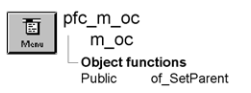

# m_oc

**Description**

Popup menu displayed when the user releases the right mouse button over an OLE control based on u_oc.

**Ancestry**



**Library**

- PFCMAIN.PBL
- PFEMAIN.PBL

## Menu bar items

M_oc is a popup menu and has a single menu bar item:

Object

### Object menu

| Menu items Menu item | Description |
| --- | --- |
| Edit | Calls the pfc_EditObject event for the OLE control |
| Open | Calls the pfc_OpenObject event for the OLE control |
| Cut | Calls the pfc_Cut event for the OLE control |
| Copy | Calls the pfc_Copy event for the OLE control |
| Paste | Calls the pfc_Paste event for the OLE control |

**See also**

u_oc

## Instance variables

M_oc includes one instance variable:

| Instance variable | Description | Data type | Access | Usage |
| --- | --- | --- | --- | --- |
| ioc_parent | OLE control displaying the popup menu. | OLEControl | Protected | Used to access the associated OLE control. |

## Functions

M_oc includes one precoded object function:

of_SetParent

### of_SetParent

**Description**

Establishes the OLE control associated with an instance of the m_oc popup menu.

**Access**

Public

**Syntax**

```
instancename.of_SetParent ( olecontrol )
```

| Argument | Description |
| --- | --- |
| *instancename* | Instance name of m_oc |
| *olecontrol* | OLEControl variable containing the OLE control that opened this instance of m_oc |

**Return value**

Integer. Returns 1 if the function succeeds and -1 if an error occurs.

**Usage**

U_oc calls this function to establish a relationship with m_oc.

**Examples**

This example calls the of_SetParent function:

```
m_oc     lm_oc
String   ls_selectedtext
...
lm_view = create m_oc
lm_view.of_SetParent(this)
...
```
