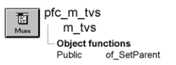

# m_tvs

**Description**

Popup menu displayed when the user releases the right mouse button over a TreeView based on u_tvs.

**Ancestry**



**Library**

- PFCMAIN.PBL
- PFEMAIN.PBL

## Menu bar items

M_tvs is a popup menu and has a single menu bar item:

View

### View menu

**Menu items**

**Menu item Description**

|   |   |
| --- | --- |
| Open | Calls the pfc_Open event |
| Find | Calls the pfc_FindDlg event |
| Cut | Calls the pfc_Cut event |
| Copy | Calls the pfc_Copy event |
| Paste | Calls the pfc_Paste event |
| Clear | Calls the pfc_Clear event |
| New | Calls the pfc_New event |
| Delete | Calls the pfc_Delete event |
| Rename | Calls the pfc_Rename event |
| Properties | Calls the pfc_Properties event |

**See also**

u_tvs

## Instance variables

M_tvs includes one instance variable:

| Instance variable | Description | Data type | Access | Usage |
| --- | --- | --- | --- | --- |
| ib_IsObsolete |  | Boolean | Protected |  |
| itv_parent | TreeView control displaying the popup menu. | TreeView | Protected | Used to access the associated TreeView control |

## Events

M_tvs includes these events:

### pfc_isobsolete

**Description**

No description is available.

**Syntax**

```
instancename.EVENT pfc_isobsolete ( )
```

| Argument | Description |
| --- | --- |
| *instancename* | Instance name of m_tvs |

**Return value**

Boolean.

## Functions

M_tvs includes one precoded object function:

of_SetParent

### of_SetParent

**Description**

Establishes the TreeView control associated with an instance of the m_tvs popup menu.

**Access**

Public

**Syntax**

```
instancename.of_SetParent ( listview )
```

| Argument | Description |
| --- | --- |
| *instancename* | Instance name of m_tvs |
| *listview* | TreeView variable containing the TreeView that opened this instance of m_tvs |

**Return value**

Integer. Returns 1 if the function succeeds and -1 if an error occurs.

**Usage**

U_tvs calls this function to establish a relationship with m_tvs.

**Examples**

This example calls the of_SetParent function:

```
...
im_view = CREATE m_tvs
im_view.of_SetParent(this)
...
```
