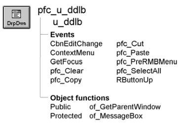

# u_ddlb

**Description**

DropDownListBox visual user object ancestor. This object provides:

- Integration with PFC menus for the cut, copy, paste, clear, and select all Edit menu choices
- A function to display a popup Edit menu when the user points at the DropDownListBox and right-clicks
- An event you can use to scroll to the matching letters in the list as the user types

**Ancestry**



**Library**

- PFCMAIN.PBL
- PFEMAIN.PBL

**Object relationships**

PFC visual user objects are designed to be used with windows that are descendants of w_master.

**Usage**

Use this visual object in windows instead of the standard PowerBuilder DropDownListBox. U_ddlb event scripts provide integration with PFC menus. Additionally, u_ddlb supports:

- **Cut, copy, paste, clear, and select all** These are triggered automatically by the message router.
- **Popup menu support** The ContextMenu event enables you to use the right mouse button to perform editing actions. To disable right mouse button support, set ib_rmbmenu to FALSE in the dropdown listbox’s Constructor event.
- **Autoselect** This means that text is selected when a user tabs to the dropdown listbox. To disable autoselect, set ib_autoselect to FALSE in the dropdown listbox’s Constructor event.
- **Autoscroll** This means that PFC scrolls to matching dropdown listbox entries as you type. To enable autoscroll, set ib_search to TRUE in the dropdown listbox’s Constructor event.

**See also**

- [m_master](../03-menus/m_master.md)
- [m_edit](../03-menus/m_edit.md)
- [u_ddplb](u_ddplb.md)

## Instance variables

U_ddlb includes instance variables:

| Instance variable | Description | Data type | Access | Usage |
| --- | --- | --- | --- | --- |
| ib_autoselect | Indicates whether PFC selects text automatically when the control receives focus | Boolean | Protected | Set this to TRUE to enable autoselect (default is FALSE) |
| ib_IsObsolete |  | Boolean | Protected |  |
| ib_rmbmenu | Indicates whether the m_edit menu displays when the user presses the right mouse button | Boolean | Protected | Set this to FALSE to disable right mouse button support (default is TRUE) |
| ib_search | Controls whether PFC automatically scrolls to matching entries as the user types | Boolean | Protected | Set this to TRUE to enable autoscroll (default is FALSE) |

## Events

U_ddlb includes precoded event scripts:

- CbnEditChange
- ContextMenu
- GetFocus
- pfc_Clear
- pfc_Copy
- pfc_Cut
- pfc_Paste
- pfc_PreRmbMenu
- pfc_SelectAll
- RButtonUp

### CbnEditChange

**Description**

Scrolls the DropDownListBox, based on the typed characters. For example, if you press *r*, the event scrolls to the first entry beginning with r; if you then press *i*, the event scrolls to the first entry beginning with ri.

This event maps to the pbm_cbneditchange event.

This capability differs from the default DropDownListBox behavior, which scrolls based on the first letter only. For example, if you press *r*, the list scrolls to the first entry beginning with r; if you then press *i*, the list scrolls to the first entry beginning with i.

**Usage**

To use this functionality, you must enable the Allow Edit property for the DropDownListBox. To disable this functionality, set ib_search to FALSE.

### ContextMenu

**Description**

Displays the m_edit popup menu.

**Usage**

This event executes when the user releases the right mouse button over a control based on u_ddlb.

### GetFocus

**Description**

Updates the parent window so it can set MicroHelp.

**Usage**

This event calls the pfc_ControlGotFocus event in the parent.

### pfc_Clear

**Description**

Deletes selected text.

**Return value**

Integer. Returns the number of characters deleted if the event succeeds and -1 if an error occurs.

**Usage**

The message router calls this event when a DropDownListBox based on u_ddlb has focus and the user selects Edit>Clear.

### pfc_Copy

**Description**

Copies selected text to the clipboard.

**Return value**

Integer. Returns the number of characters copied if the event succeeds and -1 if an error occurs.

**Usage**

The message router calls this event when a DropDownListBox based on u_ddlb has focus and the user selects Edit>Copy.

This event is also called by the m_edit popup menu.

### pfc_Cut

**Description**

Deletes selected text and stores it on the clipboard.

**Return value**

Integer. Returns the number of characters removed if the event succeeds and -1 if an error occurs.

**Usage**

The message router calls this event when a DropDownListBox based on u_ddlb has focus and the user selects Edit>Cut.

This event is also called by the m_edit popup menu.

### pfc_Paste

**Description**

Inserts (pastes) the contents of the clipboard at the insertion point.

**Return value**

Integer. Returns the number of characters that were pasted if the event succeeds and -1 if an error occurs.

**Usage**

The message router calls this event when a DropDownListBox based on u_ddlb has focus and the user selects Edit>Paste.

This event is also called by the m_edit popup menu.

### pfc_PreRmbMenu

**Description**

User event allowing you to modify m_edit contents before display.

**Syntax**

```
instancename.Event pfc_PreRmbMenu ( editmenu )
```

| Argument | Description |
| --- | --- |
| *instancename* | Instance name of u_ddlb |
| *editmenu* | M_edit variable containing the popup menu to be displayed (passed by reference) |

**Return value**

None

**Usage**

Optionally add logic to this event to selectively enable and disable m_edit menu items.

### pfc_SelectAll

**Description**

Selects all text in the DropDownListBox.

**Return value**

Integer. Returns the number of characters selected if the event succeeds and -1 if an error occurs.

**Usage**

The message router calls this event when a DropDownListBox based on u_ddlb has focus and the user selects Edit>Select All.

This event is also called by the m_edit popup menu.

### RButtonUp

**Description**

Empty user event. PFC code previously assigned to this event is now in the ContextMenu event.

**Usage**

This event executes when the user releases the right mouse button over a control based on u_ddlb.

## Functions

U_ddlb includes precoded object functions:

- of_additems
- of_GetParentWindow
- of_MessageBox

### of_additems

**Description**

Add the specified list of items in append mode or not.

**Syntax 1**

Access: Public

**Syntax**

```
instancename.of_additems ( as_items, ab_append )
```

| Argument | Description |
| --- | --- |
| *instancename* | Instance name of u_ddlb |
| *as_items* | String array. |
| *ab_append* | Boolean. TRUE, append entries to the existing ones, FALSE, reset control's contents before adding specifeid entries. |

**Return value**

Integer. The number of added items, or -1, if an error occurs.

**Syntax 2**

Add the specified list of items in default append mode.

Access: Public

**Syntax**

```
instancename.of_additems ( as_items )
```

| Argument | Description |
| --- | --- |
| *instancename* | Instance name of u_ddlb |
| *as_items* | String array. |

**Return value**

Integer. The number of added items, or -1, if an error occurs.

**Usage**

Call this method to add a list of items at once Call this method to add a list of items at once.

### of_GetParentWindow

**Description**

Retrieves a reference to the parent window.

**Access**

Public

**Syntax**

```
instancename.of_GetParentWindow ( window )
```

| Argument | Description |
| --- | --- |
| *instancename* | Instance name of u_ddlb |
| *window* | Window variable into which the function places a reference to the parent window (passed by reference) |

**Return value**

Integer. Returns 1 if the function succeeds and -1 if there is no parent window. If no parent window is found, *window* returns NULL.

**Usage**

The u_ddlb GetFocus event calls this function.

**Examples**

This example is from the u_ddlb GetFocus event:

```
Window  lw_parent

//Check for MicroHelp requirements.
IF gnv_app.of_GetMicrohelp() THEN
       //Notify the parent.
       of_GetParentWindow(lw_parent)
       IF IsValid(lw_parent) THEN
       lw_parent.Dynamic Event &
       pfc_ControlGotFocus (this)
       END IF
END IF
```

### of_MessageBox

**Description**

Displays a MessageBox.

**Access**

Protected

**Syntax 1**

```
instancename.of_MessageBox ( id, title, message, icon, button, default )
```

| Argument | Description |
| --- | --- |
| *instancename* | Instance name of u_ddlb |
| *id* | String specifying an ID for the message |
| *title* | String specifying the title of the MessageBox |
| *message* | String specifying the message text |
| *icon* | Icon enumerated data type indicating the icon you want to display on the left side of the message box. Values are: |
|  | • Information! |
|  | • StopSign! |
|  | • Exclamation! |
|  | • Question! |
|  | • None! |
| *button* | Button enumerated data type indicating the set of CommandButtons you want to display at the bottom of the message box. The buttons are numbered in the order listed in the enumerated data type. Values are: |
|  | • OK! |
|  | • OKCancel! |
|  | • YesNo! |
|  | • YesNoCancel! |
|  | • RetryCancel! |
|  | • AbortRetryIgnore! |
| *default* | Integer specifying the number of the button you want to be the default button |

**Syntax 2** For a message that contains values (PFC 2025 and later)

```
instancename.of_MessageBox ( id, title, message, values, icon, button, default )
```

| Argument | Description |
| --- | --- |
| *instancename* | Instance name of u_ddlb |
| *values* | String array. The values for the placeholders in *message* |

The other arguments are the same as in Syntax 1.

**Return value**

Integer. Returns 1 if the function succeeds and -1 if an error occurs.

**Usage**

Override this function to control MessageBox behavior in DropDownListBoxes.

**PFC 2025 and later** When the language service is enabled (see the n_cst_appmanager of_SetLanguage function), the message comes from the language file if it has an entry for *id*: the entry *id* replaces *message*, and the entry *id*.title replaces *title*. Without the service, or without an entry, *message* and *title* are used as they are.

Use Syntax 2 for a message that contains values: *message* is the English text with placeholders (%s, or %1 - %9 by position) and *values* holds the values. Syntax 2 calls Syntax 1 to display the message, so an override of Syntax 1 still sees every message.

**Examples**

This example calls the of_MessageBox function:

```
of_Messagebox(’ddlb_error’,’Save’, &
   as_error, StopSign!, Ok!, 1)
...
```
