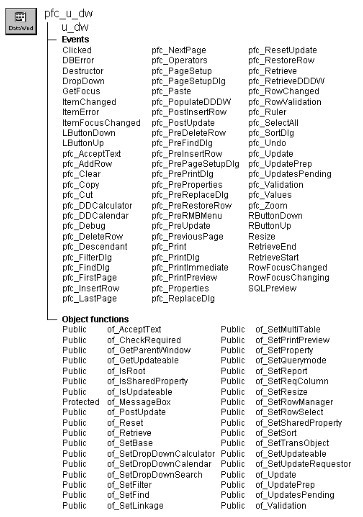

# u_dw

**Description**

Ancestor for all DataWindow controls in applications written using PFC. This DataWindow user object includes:

- Functions to enable and disable DataWindow services
- Events that automatically make use of enabled DataWindow services
- Precoded user events that provide basic editing functionality
- Template user events to which you can add application-specific functionality

U_dw is a self-updating object.

**Ancestry**



**Library**

- PFCMAIN.PBL
- PFEMAIN.PBL

**Object relationships**

- [m_dw](../03-menus/m_dw.md)
- [n_cst_conversion](../09-custom-class-user-objects/n_cst_conversion.md)
- [n_cst_dwpropertyattrib](../05-global-structures-and-structure-objects/n_cst_dwpropertyattrib.md)
- [n_cst_findattrib](../05-global-structures-and-structure-objects/n_cst_findattrib.md)
- [n_cst_platform](../09-custom-class-user-objects/n_cst_platform.md)
- [n_cst_restorerowattrib](../05-global-structures-and-structure-objects/n_cst_restorerowattrib.md)
- [n_cst_string](../09-custom-class-user-objects/n_cst_string.md)
- [s_pagesetupattrib](../05-global-structures-and-structure-objects/s_pagesetupattrib.md)

Although u_dw contains substantial standalone functionality, the DataWindow services user objects (those objects whose name starts with n_cst_dwsrv) must be available to get the most out of it.

**Usage**

To use u_dw:

1. Place a u_dw user object in your window.
2. In the window Open event (or some other appropriate place), enable DataWindow services as needed by your application.
3. Extend basic u_dw functionality by adding PowerScript code to events and user events.
4. Add application-specific functionality as needed.

**See also**

- [n_cst_dwsrv](../09-custom-class-user-objects/n_cst_dwsrv.md)
- [n_cst_dwsrv_dropdownsearch](../09-custom-class-user-objects/n_cst_dwsrv_dropdownsearch.md)
- [n_cst_dwsrv_filter](../09-custom-class-user-objects/n_cst_dwsrv_filter.md)
- [n_cst_dwsrv_find](../09-custom-class-user-objects/n_cst_dwsrv_find.md)
- [n_cst_dwsrv_linkage](../09-custom-class-user-objects/n_cst_dwsrv_linkage.md)
- [n_cst_dwsrv_multitable](../09-custom-class-user-objects/n_cst_dwsrv_multitable.md)
- [n_cst_dwsrv_printpreview](../09-custom-class-user-objects/n_cst_dwsrv_printpreview.md)
- [n_cst_dwsrv_property](../09-custom-class-user-objects/n_cst_dwsrv_property.md)
- [n_cst_dwsrv_querymode](../09-custom-class-user-objects/n_cst_dwsrv_querymode.md)
- [n_cst_dwsrv_report](../09-custom-class-user-objects/n_cst_dwsrv_report.md)
- [n_cst_dwsrv_reqcolumn](../09-custom-class-user-objects/n_cst_dwsrv_reqcolumn.md)
- [n_cst_dwsrv_resize](../09-custom-class-user-objects/n_cst_dwsrv_resize.md)
- [n_cst_dwsrv_rowmanager](../09-custom-class-user-objects/n_cst_dwsrv_rowmanager.md)
- [n_cst_dwsrv_rowselection](../09-custom-class-user-objects/n_cst_dwsrv_rowselection.md)
- [n_cst_dwsrv_sort](../09-custom-class-user-objects/n_cst_dwsrv_sort.md)
- [u_calculator](../07-custom-visual-user-objects/u_calculator.md)
- [u_calendar](../07-custom-visual-user-objects/u_calendar.md)

## Instance variables

U_dw contains instance variables and one shared variable:

| Instance variable | Description | Data type | Access | Usage |
| --- | --- | --- | --- | --- |
| CONTINUE_ACTION | Constant set to 1 | Integer | Public | Internal |
| FAILURE | Constant set to -1 | Integer | Public | Internal |
| ib_IsObsolete |  | Boolean | Protected |  |
| ib_isupdateable | Indicates whether the DataWindow can be updated | Boolean | Protected | Access through the of_GetUpdateable and of_SetUpdateable functions. Default is TRUE |
| ib_rmbfocuschange | Used to track focus change while the right mouse button is down | Boolean | Protected | Internal |
| ib_rmbmenu | Controls whether the m_dw menu displays when the user presses the right mouse button over the DataWindow control | Boolean | Protected | Set FALSE in the DataWindow’s Constructor event to disable right mouse button support |
| inv_base | Reference variable for basic DataWindow services | n_cst_dwsrv | Public | Use in dot notation to access n_cst_dwsrv functions and attributes |
| inv_dropdownsearch | Reference variable for the dropdown DataWindow search service | n_cst_dwsrv_dropdownsearch | Public | Use in dot notation to access dropdown DataWindow search functions and attributes |
| inv_filter | Reference variable for the DataWindow filter service | n_cst_dwsrv_filter | Public | Use in dot notation to access DataWindow filter service functions and attributes |
| inv_find | Reference variable for the DataWindow find service | n_cst_dwsrv_find | Public | Use in dot notation to access DataWindow find service functions and attributes |
| inv_Grid |  | n_cst_dwsrv_grid | Public |  |
| inv_linkage | Reference variable for the DataWindow linkage service | n_cst_dwsrv_linkage | Public | Use in dot notation to access n_cst_dwsrv_linkage functions and attributes |
| inv_multitable | Reference variable for the DataWindow multitable update service | n_cst_dwsrv_multitable | Public | Use in dot notation to access n_cst_dwsrv_multitable functions and attributes |
| inv_printpreview | Reference variable for the DataWindow print preview service | n_cst_dwsrv_printpreview | Public | Use in dot notation to access n_cst_dwsrv_printpreview functions and attributes |
| inv_property | Reference variable for the DataWindow property service | n_cst_dwsrv_property | Public | Internal |
| inv_querymode | Reference variable for the query mode service | n_cst_dwsrv_querymode | Public | Use in dot notation to access n_cst_dwsrv_querymode functions and attributes |
| inv_report | Reference variable for the reporting service | n_cst_dwsrv_report | Public | Use in dot notation to access n_cst_dwsrv_report functions and attributes |
| inv_reqcolumn | Reference variable for the required column service | n_cst_dwsrv_reqcolumn | Public | Use in dot notation to access n_cst_dwsrv_reqcolumn functions and attributes |
| inv_resize | Reference variable for the resize service | n_cst_dwsrv_resize | Public | Use in dot notation to access n_cst_dwsrv_resize functions and attributes |
| inv_rowmanager | Reference variable for the row manager service | n_cst_dwsrv_rowmanager | Public | Use in dot notation to access n_cst_dwsrv_rowmanager functions and attributes |
| inv_rowselect | Reference variable for the row selection service | n_cst_dwsrv_rowselection | Public | Use in dot notation to access n_cst_dwsrv_rowselection functions and attributes |
| inv_sort | Reference variable for the sort service | n_cst_dwsrv_sort | Public | Use in dot notation to access n_cst_dwsrv_sort functions and attributes |
| ipo_UpdateRequestor |  | PowerObject | Protected |  |
| is_updatesallowed | Specifies allowable update types | String | Protected | Internal |
| itr_object | Transaction object used by the DataWindow | n_tr | Public | DataWindow services use this instance variable to track the transaction object |
|  |  |  |  | Set with of_SetTransObject |
| iuo_calculator | Reference variable for dropdown calculator | u_calculator | Public | Use in dot notation to access u_calculator events, functions, and attributes |
| iuo_calendar | Reference variable for dropdown calendar | u_calendar | Public | Use in dot notation to access u_calendar events, functions, and attributes |
| NO_ACTION | Constant set to 0 | Integer | Public | Internal |
| PREVENT_ACTION | Constant set to 0 | Integer | Public | Internal |
| snv_property | Shared reference variable for the DataWindow property service | n_cst_dwsrv_property | Public | Internal |
| SUCCESS | Constant set to 1 | Integer | Public | Internal |

## Events

U_dw contains two types of events/user events:

- Precoded events and user events that PFC uses to provide functionality
- Template user events to which you optionally add PowerScript code to take advantage of DataWindow services

- Clicked
- DBError
- Destructor
- Dropdown
- GetFocus
- ItemChanged
- ItemError
- ItemFocusChanged
- LButtonDown
- LButtonUp
- pfc_AcceptText
- pfc_AddRow
- pfc_checkrequirederror
- pfc_Clear
- pfc_Copy
- pfc_Cut
- pfc_DDCalculator
- pfc_DDCalendar
- pfc_Debug
- pfc_DeleteRow
- pfc_Descendant
- pfc_FilterDlg
- pfc_FindDlg
- pfc_FirstPage
- pfc_InsertRow
- pfc_LastPage
- pfc_NextPage
- pfc_Operators
- pfc_PageSetup
- pfc_PageSetupDlg
- pfc_Paste
- pfc_PopulateDDDW
- pfc_PostInsertRow
- pfc_postlbuttonup
- pfc_PostUpdate
- pfc_PreDeleteRow
- pfc_PreFindDlg
- pfc_PreInsertRow
- pfc_PrePageSetupDlg
- pfc_PreProperties
- pfc_PreReplaceDlg
- pfc_PreRestoreRow
- pfc_PreRmbMenu
- pfc_prermbmenuproperty
- pfc_PreUpdate
- pfc_PreviousPage
- pfc_Print
- pfc_PrintImmediate
- pfc_PrintPreview
- pfc_Properties
- pfc_ReplaceDlg
- pfc_ResetUpdate
- pfc_RestoreRow
- pfc_Retrieve
- pfc_RetrieveDDDW
- pfc_RowChanged
- pfc_RowValidation
- pfc_Ruler
- pfc_SelectAll
- pfc_SortDlg
- pfc_Undo
- pfc_Update
- pfc_UpdatePrep
- pfc_UpdatesPending
- pfc_Validation
- pfc_Values
- pfc_Zoom
- RButtonDown
- RButtonUp
- Resize
- RetrieveEnd
- RetrieveStart
- RowFocusChanged
- Rowfocuschanging
- SQLPreview

### Clicked

**Description**

Notifies DataWindow selection service, linkage service, and sort service functions, if enabled.

**Usage**

This event executes when the user clicks in the DataWindow. The functions called in the Clicked event automatically handle row selection and sorting, if enabled.

For the selection service, you may need to add logic in other places to access selected rows and perform application specific processing.

### DBError

**Description**

Displays a message box informing the user that a database error occurred.

**Usage**

This event is called when there is a database error.

### Destructor

**Description**

Destroys all existing DataWindow service objects.

**Usage**

This event executes when the DataWindow closes.

### Dropdown

**Description**

Indicates whether the current dropdown object is associated with u_calculator or u_calendar.

**Usage**

This event executes when a DropDownListBox or DropDownDataWindow begins the dropdown process.

### GetFocus

**Description**

Notifies the parent window so it can track the current control.

**Usage**

This event executes when the DataWindow control gets focus. It triggers the pfc_ControlGotFocus event in the parent.

### ItemChanged

**Description**

Notifies the linkage service that an item has changed.

**Usage**

This event executes when a field in the DataWindow control has been modified and loses focus.

### ItemError

**Description**

When an error occurs, calls the required column service, if enabled, to set the ActionCode to 3, causing the DataWindow to accept the value.

**Usage**

Use this event to add application-specific error-handling functionality.

### ItemFocusChanged

**Description**

Notifies the linkage service that item focus has changed, Also, if MicroHelp is enabled for the application, this event calls the pfc_Microhelp event on the parent.

**Usage**

This event executes when the user moves to a different item within a DataWindow. It displays MicroHelp using text defined in the DataWindow column’s tag value. The column’s tag value must specify MICROHELP=*microhelptext*.

You enable MicroHelp display through the n_cst_appmanager of_SetMicrohelp function.

If you are using the dropdown DataWindow search service (n_cst_dwsrv_dropdownsearch), add code to this event that calls the n_cst_dwsrv_dropdownsearch pfc_ItemFocusChanged event.

**Examples**

This example shows the code you add to call the n_cst_dropdownsearch pfc_ItemFocusChanged event:

```
inv_dropdownsearch.Event pfc_ItemFocusChanged &
       (row, dwo)
```

### LButtonDown

**Description**

Calls the row selection service’s pfc_LButtonDown event.

**Usage**

This event executes when the user presses the left mouse button over a DataWindow.

### LButtonUp

**Description**

Calls the row selection service’s pfc_LButtonUp event.

**Usage**

This event executes when the user releases the left mouse button over a DataWindow.

### pfc_AcceptText

**Description**

Accepts text for the DataWindow control, optionally setting focus if an error occurs.

**Syntax**

```
instancename.Event pfc_AcceptText ( focusonerror )
```

| Argument | Description |
| --- | --- |
| *instancename* | Instance name of u_dw |
| *focusonerror* | Boolean indicating whether focus should be set if an error occurs. This argument is accessed through the *ab_focusonerror* argument |

**Return value**

Integer. Returns 1 if the event succeeds and -1 if an error occurs.

**Usage**

This event is called by the w_master event, as part of its default save process.

### pfc_AddRow

**Description**

Calls the row manager service to add a row at the end of the DataWindow. Also notifies the linkage service, if enabled.

**Return value**

Long. Returns the number of the new row if the event succeeds and -1 if an error occurs.

**Usage**

This event also calls the pfc_PreInsertRow and pfcPostInsertRow events.

### pfc_checkrequirederror

**Description**

No description is available.

**Syntax**

```
instancename.EVENT pfc_checkrequirederror ( al_row, as_columnname )
```

| Argument | Description |
| --- | --- |
| *instancename* | Instance name of u_dw |
| *al_row* | Long. |
| *as_columnname* | String, passed by reference. |

**Return value**

Integer.

### pfc_Clear

**Description**

Deletes selected text.

**Return value**

Integer. Returns the number of characters deleted if the event succeeds and -1 if an error occurs.

**Usage**

This event is triggered when the DataWindow has focus and the user selects Edit>Clear from the menu bar of a menu descended from the PFC m_master menu.

### pfc_Copy

**Description**

Copies selected text to the clipboard.

**Return value**

Integer. Returns the number of characters copied if the event succeeds and -1 if an error occurs.

**Usage**

This event is triggered when the DataWindow has focus and the user selects Edit>Copy from the menu bar of a menu descended from the PFC m_master menu. It is also triggered by the m_edit.m_copy clicked event.

### pfc_Cut

**Description**

Deletes selected text and stored it on the clipboard.

**Return value**

Integer. Returns the number of characters removed if the event succeeds and -1 if an error occurs.

**Usage**

This event is triggered when the DataWindow has focus and the user selects Edit>Cut from the menu bar of a menu descended from the PFC m_master menu. It is also triggered by the m_edit.m_cut clicked event.

### pfc_DDCalculator

**Description**

Displays the dropdown calculator if the current column has been registered and uses a numeric data type.

**Return value**

Integer. Returns 1 if the function succeeds, 0 if the current DataWindow column has not been registered, and -1 if an error occurs.

**Usage**

Call this event to display the dropdown calculator programmatically. If the current DataWindow column has been registered and uses a numeric data type, the dropdown calculator displays.

The Dropdown event displays the dropdown calculator automatically for registered columns.

**Examples**

This example calls the pfc_DDCalculator event:

```
Integer  li_return

li_return = dw_1.Event pfc_DDCalculator( )
...
```

### pfc_DDCalendar

**Description**

Displays the dropdown calendar if the current column has been registered and uses a Date data type.

**Return value**

Integer. Returns 1 if the function succeeds, 0 if the current DataWindow column has not been registered, and -1 if an error occurs.

**Usage**

Call this event to display the dropdown calendar programmatically. If the current DataWindow column has been registered and uses a Date data type, the dropdown calendar displays.

The Dropdown event displays the dropdown calendar automatically for registered columns.

**Examples**

This example calls the pfc_DDCalendar event:

```
Integer  li_return

li_return = dw_1.Event pfc_DDCalendar()
...
```

### pfc_Debug

**Description**

Calls the pfc_Properties event, which opens the DataWindow Properties window, using either the inv_properties instance variable or the snv_properties shared variable.

**Usage**

This event is called when the user selects DataWindow Properties from the m_dw popup menu.

### pfc_DeleteRow

**Description**

Deletes either the current row or, if the row manager service is enabled, all selected rows. If the linkage service is enabled, this event calls that service’s pfc_DeleteRow event.

**Return value**

Integer. Returns 1 if the event succeeds and -1 if an error occurs.

**Usage**

Call this event to delete one or more rows.

### pfc_Descendant

**Description**

PFC events and functions may trigger this event to determine if the DataWindow control is inherited from u_dw.

**Return value**

Boolean. Always returns TRUE.

**Usage**

Internal.

### pfc_FilterDlg

**Description**

Displays a filter dialog box by calling the n_cst_dwsrv_filter service’s pfc_FilterDlg event.

**Return value**

Integer. Returns 1 if the event succeeds and -1 if an error occurs.

**Usage**

This event is called when the user selects View>Filter from the menu bar of a menu descended from the PFC m_master menu.

### pfc_FindDlg

**Description**

Displays a find dialog box by calling the n_cst_dwsrv_find service’s pfc_FindDlg event.

**Return value**

Integer. Returns 1 if the event succeeds and -1 if an error occurs.

**Usage**

This event is called when the user selects Edit>Find from the menu bar of a menu descended from the PFC m_master menu.

### pfc_FirstPage

**Description**

Scrolls to the first page of the DataWindow.

**Return value**

Integer. Returns 1 if the event succeeds and -1 if an error occurs.

**Usage**

Call this event to scroll the DataWindow to the first page.

### pfc_InsertRow

**Description**

Inserts a row just before the current row and calls the n_cst_dwsrv_linkage pfc_InsertRow event. It calls the pfc_PostInsertRow event for post-insert functionality.

**Return value**

Integer. Returns the number of the inserted row if the event succeeds and -1 if an error occurs.

**Usage**

Call this event to insert a row.

### pfc_LastPage

**Description**

Scrolls to the last page of the DataWindow.

**Return value**

Long. Returns the row number displayed at the top of the last page if the event succeeds and -1 if an error occurs.

**Usage**

Call this event to scroll the DataWindow to the last page.

### pfc_NextPage

**Description**

Scrolls to the next page of the DataWindow.

**Return value**

Long. Returns the row number at the top of the page if the event succeeds and -1 if an error occurs.

**Usage**

Call this event to scroll the DataWindow to the next page.

### pfc_Operators

**Description**

Calls the n_cst_dwsrv_querymode pfc_Operators event, which displays a w_selection dialog box containing operators.

**Return value**

Integer. Returns 1 if the event succeeds, 0 if the user cancels out of the dialog box, and -1 if an error occurs.

**Usage**

This event is called by the m_dw popup menu.

### pfc_PageSetup

**Description**

Calls the pfc_PageSetupDlg event to display the Page Setup dialog box.

**Return value**

Integer. Returns 1 if the event succeeds, 0 if the user cancels out of the dialog box, and -1 if an error occurs.

**Usage**

This event is called when the user selects File>Page Setup from the menu bar of a menu descended from the PFC m_master menu.

### pfc_PageSetupDlg

**Description**

Displays the Page Setup dialog box by calling the n_cst_platform of_PageSetupDlg function, passing the DataWindow’s page display properties.

**Syntax**

```
instancename.Event pfc_PageSetupDlg ( attributes )
```

| Argument | Description |
| --- | --- |
| *instancename* | Instance name of u_dw |
| *attributes* | S_pagesetupattrib variable into which the event places page setup information. This argument is accessed through the *astr_pagesetup* argument (passed by reference) |

**Return value**

Integer. Returns 1 if the event succeeds, 0 if the user cancels out of the dialog box, and -1 if an error occurs.

**Usage**

This event is called by the pfc_PageSetup event.

### pfc_Paste

**Description**

Inserts (pastes) the contents of the clipboard at the insertion point.

**Return value**

Integer. Returns the number of characters that were pasted if the event succeeds and -1 if an error occurs.

**Usage**

This event is triggered when the DataWindow has focus and the user selects Edit>Paste from the menu bar of a menu descended from the PFC m_master menu. It is also triggered by the m_edit.m_paste Clicked event.

### pfc_PopulateDDDW

**Description**

Empty user event that you extend to populate the specified DropDownDataWindow.

**Syntax**

```
instancename.Event pfc_PopulateDDDW ( column, dddw )
```

| Argument | Description |
| --- | --- |
| *instancename* | Instance name of u_dw |
| *column* | String specifying the column containing the dropdown DataWindow for which rows are retrieved. Access this value through the *as_colname* argument |
| *dddw* | DataWindowChild instance referencing the DropDownDataWindow column. This argument is accessed through the *adwc_obj* argument (passed by reference) |

**Return value**

Long. Returns the number of rows populated if the event succeeds and -1 if an error occurs.

**Usage**

The code you add to this event can populate the DropDownDataWindow in any manner, including database retrieval, DataWindow caching, and retrieving from a file.

**Examples**

This example shows code you might add to the pfc_PopulateDDDW event:

```
IF adwc_obj.SetTransObject(SQLCA) = -1 THEN
       Return -1
ELSE
       Return adwc_obj.Retrieve()
END IF
```

### pfc_PostInsertRow

**Description**

Empty user event allowing you to perform post-insert processing.

**Syntax**

```
instancename.Event pfc_PostInsertRow ( row )
```

| Argument | Description |
| --- | --- |
| *instancename* | Instance name of u_dw |
| *row* | Number of row added or inserted |

**Usage**

This event is posted from the pfc_AddRow and pfc_InsertRow events.

### pfc_postlbuttonup

**Description**

No description is available.

**Syntax**

```
instancename.EVENT pfc_postlbuttonup ( flags, xpos, ypos )
```

| Argument | Description |
| --- | --- |
| *instancename* | Instance name of u_dw |
| *flags* | UnsignedLong. |
| *xpos* | Integer. |
| *ypos* | Integer. |

**Return value**

None.

### pfc_PostUpdate

**Description**

Clears the DataWindow update flags.

**Return value**

Integer. Returns 1 if the event succeeds and -1 if an error occurs.

**Usage**

You can extend this event to code additional post-update processing.

**Examples**

This example is from the of_PostUpdate function:

```
...
If IsValid(inv_linkage) Then
       li_rc = inv_linkage.of_PostUpdate()
Else
       li_rc = this.Event pfc_postupdate()
End If
...
```

### pfc_PreDeleteRow

**Description**

Calls the n_cst_dwsrv_linkage pfc_PreDeleteRow event to allow for linkage processing. This may include database updates as well as the prevention of deletion processing.

**Syntax**

```
instancename.Event pfc_PreDeleteRow ( )
```

| Argument | Description |
| --- | --- |
| *instancename* | Instance name of u_dw |

**Return value**

Return 1 to continue deletion, 0 to prevent deletion, and -1 if an error occurs.

**Usage**

You can extend this event to perform additional predelete processing.

### pfc_PreFindDlg

**Description**

Empty user event allowing you to modify the properties passed to the pfc_FindDlg event.

**Syntax**

```
instancename.Event pfc_PreFindDlg ( attributes )
```

| Argument | Description |
| --- | --- |
| *instancename* | Instance name of u_dw |
| *attributes* | N_cst_findattrib variable into which the event places additional information. This argument is accessed through the *anv_findattrib* argument (passed by reference) |

**Usage**

Use this event to modify or extend the information passed in the n_cst_findattrib object.

### pfc_PreInsertRow

**Description**

Calls the n_cst_dwsrv_linkage pfc_PreInsertRow event to allow for linkage processing. This may include prevention of insert processing.

**Syntax**

```
instancename.Event pfc_PreInsertRow ( )
```

| Argument | Description |
| --- | --- |
| *instancename* | Instance name of u_dw |

**Return value**

Return 1 to continue insertion, 0 to prevent insertion, and -1 if an error occurs.

**Usage**

You can extend this event to perform additional preinsert processing.

### pfc_PrePageSetupDlg

**Description**

Empty user event allowing you to modify the properties passed to the n_cst_platform of_PageSetupDlg function.

**Syntax**

```
instancename.Event pfc_PrePageSetupDlg ( attributes )
```

| Argument | Description |
| --- | --- |
| *instancename* | Instance name of u_dw |
| *attributes* | S_pagesetupattrib variable into which the event places additional page setup information. This argument is accessed through the *astr_pagesetup* argument (passed by reference) |

**Usage**

This event is called by the pfc_PageSetupDlg event before calling the n_cst_platform of_PageSetupDlg function.

You can use this event to modify or extend the information passed in the s_pagesettupattrib structure.

**Examples**

This example contains code you might add to the pfc_PrePageSetupDlg event:

```
// Sets page setup to portrait
astr_pagesetup.b_portraitorientation = TRUE
```

### pfc_PreProperties

**Description**

Empty user event allowing you to modify the properties passed to the DataWindow Properties dialog box.

**Syntax**

```
instancename.Event pfc_PreProperties ( attributes )
```

| Argument | Description |
| --- | --- |
| *instancename* | Instance name of u_dw |
| *attributes* | N_cst_dwpropertyattrib variable into which the event places additional information. This argument is accessed through the *anv_dwpropertyattrib* argument (passed by reference) |

**Usage**

This event is called by the pfc_Debug event before calling the n_cst_property of_OpenProperty function.

You can use this event to modify or extend the information passed in the n_cst_propertyattrib object.

### pfc_PreReplaceDlg

**Description**

Empty user event allowing you to modify the properties passed to the pfc_ReplaceDlg event.

**Syntax**

```
instancename.Event pfc_PreReplaceDlg ( attributes )
```

| Argument | Description |
| --- | --- |
| *instancename* | Instance name of u_dw |
| *attributes* | N_cst_findattrib variable into which the event places additional information. This argument is accessed through the *anv_findattrib* argument (passed by reference) |

**Usage**

Use this event to modify or extend the information passed in the n_cst_findattrib object.

### pfc_PreRestoreRow

**Description**

Prepares the w_restorerow dialog box for display.

**Syntax**

```
instancename.Event pfc_PreRestoreRow ( attributes )
```

| Argument | Description |
| --- | --- |
| *instancename* | Instance name of u_dw |
| *attributes* | N_cst_restorerowattrib variable into which the event places additional information. This argument is accessed through the *anv_restorerowattrib* argument (passed by reference) |

**Return value**

Integer. Returns 1 if the function succeeds and -1 if an error occurs.

**Usage**

The n_cst_rowmanager of_UnDelete function calls this event before opening the w_restorerow window. It adds filter and sort information to the n_cst_restorerowattrib structure.

You can extend this event to modify the information passed to the w_restorerow window.

**Examples**

This example is from the n_cst_dwsrv_rowmanager of_UnDelete function:

```
n_cst_restorerowattrib   lnv_restorerowattrib

lnv_restorerowattrib.idw_active = idw_requestor
idw_requestor.Event pfc_PreRestoreRow &
       (lnv_restorerowattrib)
OpenWithParm(w_restorerow, lnv_restorerowattrib)
...
```

### pfc_PreRmbMenu

**Description**

Empty user event allowing you to modify m_dw contents before display.

**Syntax**

```
instancename.Event pfc_PreRmbMenu ( editmenu )
```

| Argument | Description |
| --- | --- |
| *instancename* | Instance name of u_dw |
| *editmenu* | M_dw variable containing the popup menu to be displayed. This argument, which is accessed through the *am_dw* argument, is passed by reference |

**Usage**

Optionally add logic to this event to selectively enable and disable m_edit menu items.

**Examples**

This example contains code you might add to the pfc_PreRmbMenu event:

```
// Always disable delete
am_dw.m_table.m_delete.Enabled = FALSE
```

### pfc_prermbmenuproperty

**Description**

No description is available.

**Syntax**

```
instancename.EVENT pfc_prermbmenuproperty ( am_dw )
```

| Argument | Description |
| --- | --- |
| *instancename* | Instance name of u_dw |
| *am_dw* | m_dw, passed by reference. |

**Return value**

None.

### pfc_PreUpdate

**Description**

Empty user event called by pfc_Update before updating rows.

**Syntax**

```
instancename.Event pfc_PreUpdate ( )
```

| Argument | Description |
| --- | --- |
| *instancename* | Instance name of u_dw |

**Return value**

Return 1 if the event succeeds and -1 to terminate update processing.

**Usage**

Extend this event to add site-specific preupdate processing.

**Examples**

This example contains code you might add to the pfc_PreUpdate event:

```
// Sets page setup to portrait
astr_pagesetup.b_portraitorientation = TRUE
```

### pfc_PreviousPage

**Description**

Scrolls to the previous page of the DataWindow.

**Return value**

Long. Returns the row number at the top of the page if the event succeeds and -1 if an error occurs.

**Usage**

Call this event to scroll the DataWindow to the previous page.

### pfc_Print

**Description**

Calls the pfc_PrintDlg function and prints the DataWindow, as specified in the Print dialog box.

**Return value**

Integer. Returns 1 if the event succeeds and -1 if an error occurs.

**Usage**

This event is triggered when the DataWindow has focus and the user selects File>Print from the menu bar of a menu descended from the PFC m_master menu.

### pfc_PrintImmediate

**Description**

Prints the current DataWindow without displaying the Print dialog box.

**Return value**

Integer. Returns 1 if the event succeeds and -1 if an error occurs.

**Usage**

This event is called when the DataWindow has focus and the user selects File>Print Immediate from the menu bar of a menu descended from the PFC m_master menu.

**Hiding Print Immediate** Consider hiding the Print Immediate menu item but enabling its toolbar button. This provides functionality equivalent to many current software packages.

### pfc_PrintPreview

**Description**

Toggles the DataWindow between preview and edit modes.

**Return value**

Boolean. Returns TRUE if the DataWindow is placed in preview mode and FALSE if the DataWindow is placed in edit mode.

**Usage**

To use this event, you must enable the print preview service by calling the of_SetPrintPreview function.

This event is called when the DataWindow has focus and the user selects File>Print Preview from a menu that descends from the PFC m_master menu.

### pfc_Properties

**Description**

Displays the DataWindow properties window.

**Return value**

None.

**Usage**

To use this event, you must enable the DataWindow property service by calling either of_SetProperty or of_SetSharedProperty.

This event is called when the user selects Properties from the m_dw popup menu.

### pfc_ReplaceDlg

**Description**

Displays a Replace dialog box by calling the n_cst_dwsrv_find service’s pfc_ReplaceDlg event.

**Return value**

Integer. Returns 1 if the event succeeds and -1 if an error occurs.

**Usage**

This event is called when the user selects View>Replace from the menu bar of a menu descended from the PFC m_master menu.

### pfc_ResetUpdate

**Description**

Clears the DataWindow’s update flags.

**Return value**

Integer. Returns 1 if the event succeeds and -1 if an error occurs.

**Usage**

This event is called as part of the default pfc_Save process.

### pfc_RestoreRow

**Description**

Calls the row manager pfc_RestoreRow event, which displays the w_restorerow dialog box.

**Return value**

Integer. Returns 1 if the event succeeds and -1 if an error occurs.

**Usage**

This event is called by the m_dw popup menu.

### pfc_Retrieve

**Description**

Empty user event to contain all database retrieve logic. PFC calls this event for all database retrieves.

**Return value**

Long. Returns the result of the Retrieve function.

**Usage**

Add code to this event to retrieve rows for the DataWindow.

This event is called by the u_dw of_Retrieve function and by the n_cst_dwsrv_linkage of_Retrieve function.

**Examples**

This example shows the code you add to this event:

```
Return this.Retrieve()
```

### pfc_RetrieveDDDW

**Description**

Obsolete. Use pfc_PopulateDDDW instead.

**Syntax**

```
instancename.Event pfc_RetrieveDDDW ( column )
```

| Argument | Description |
| --- | --- |
| *instancename* | Instance name of u_dw |
| *column* | String specifying the column containing the dropdown DataWindow for which rows are retrieved. Access this value through the *as_column* argument |

**Return value**

Long. Returns the result of the Retrieve function.

### pfc_RowChanged

**Description**

Calls the linkage service’s pfc_RowFocusChanged function.

**Usage**

This event is called whenever the DataWindow buffer has been sorted, filtered, or otherwise modified such that the current row has not changed but the actual row at that location is different.

### pfc_RowValidation

**Description**

Empty user event that you extend to perform site-specific row validation.

**Syntax**

```
instancename.Event pfc_RowValidation ( row )
```

| Argument | Description |
| --- | --- |
| *instancename* | Instance name of u_dw |
| *row* | Long specifying the row to validate. Access this value through the *al_row* argument |

**Return value**

Integer. Returns 1 if validation succeeds and -1 if an error occurs.

**Usage**

Extend this event to perform additional row validation.

The n_cst_dwsrv_linkage of_Save function calls this event.

### pfc_Ruler

**Description**

Toggles the DataWindow between displaying and hiding rulers in print preview mode.

**Return value**

Boolean. Returns TRUE if print preview rulers are displayed and FALSE if they are hidden.

**Usage**

To use this event, you must enable the print preview service by calling the of_SetPrintPreview function.

This event is called when the DataWindow has focus and the user selects View>Ruler from the menu bar of a menu descended from the PFC m_master menu.

### pfc_SelectAll

**Description**

Selects all text in the current DataWindow cell.

**Return value**

Integer. Returns the number of characters selected if the event succeeds and -1 if an error occurs.

**Usage**

This event is triggered when the DataWindow has focus and the user selects Edit>Select All from the menu bar of a menu descended from the PFC m_master menu.

### pfc_SortDlg

**Description**

Displays a sort dialog box by calling the n_cst_dwsrv_sort service’s pfc_SortDlg event.

**Return value**

Integer. Returns 1 if the event succeeds and -1 if an error occurs.

**Usage**

This event is called when the user selects View>Sort from the menu bar of a menu descended from the PFC m_master menu.

### pfc_Undo

**Description**

Cancels the last edit to the DataWindow.

**Return value**

Integer. Returns 1 if the event succeeds and -1 if an error occurs or there is nothing to undo.

**Usage**

This event is triggered when the DataWindow has focus and the user selects Edit>Undo from the menu bar of a menu descended from the PFC m_master menu.

### pfc_Update

**Description**

Updates the DataWindow. If the multitable update service is enabled, this event updates all specified tables.

**Syntax**

```
instancename.Event pfc_Update ( accepttext, resetflags )
```

| Argument | Description |
| --- | --- |
| *instancename* | Instance name of u_dw |
| *accepttext* | Boolean specifying whether the DataWindow control should automatically perform an AcceptText before performing the update (TRUE) or not (FALSE) |
| *resetflags* | Boolean specifying whether the DataWindow control should automatically reset the update flags (TRUE) or not (FALSE) |

**Return value**

Integer. Returns 1 if the function succeeds and -1 if an error occurs.

**Usage**

This event calls the pfc_PreUpdate event before updating rows.

### pfc_UpdatePrep

**Description**

Empty user event to which you can add code that prepares for update.

**Return value**

Long. Return 1 if the update preparation succeeds and -1 to halt the update process.

**Usage**

The of_UpdatePrep function calls this function.

### pfc_UpdatesPending

**Description**

Determines if there are pending updates for the DataWindow.

**Return value**

Integer. Returns 1 if there are pending updates for the DataWindow and 0 if there are no pending updates.

**Usage**

This event is called by the of_UpdatesPending function and by the n_cst_dwsrv_linkage of_GetUpdatesPending function.

### pfc_Validation

**Description**

Checks for required fields.

**Return value**

Integer. Returns 1 if the event succeeds and -1 if an error occurs.

**Usage**

This event is called by the of_Validation function. You can extend this event to perform additional validation.

### pfc_Values

**Description**

Calls the n_cst_dwsrv_querymode pfc_Values event, which displays a w_selection dialog box containing a list of values.

**Return value**

Integer. Returns 1 if the event succeeds, 0 if the user cancels out of the dialog box, and -1 if an error occurs.

**Usage**

This event is called by the m_dw popup menu.

### pfc_Zoom

**Description**

Displays the w_zoom dialog box, allowing the user to control DataWindow display while in print preview mode.

**Return value**

Integer. Returns the zoom level chosen by the user if the event succeeds, 0 if the user cancels out of the w_zoom dialog box, and -1 if an error occurs.

**Usage**

To use this event, you must enable the print preview service by calling the of_SetPrintPreview function.

This event is called when the DataWindow has focus and the user selects View>Zoom from the menu bar of a menu descended from the PFC m_master menu.

### RButtonDown

**Description**

Calls the linkage service and row selection service’s pfc_RButtonDown event.

**Usage**

This event executes when the user presses the right mouse button over a DataWindow. The n_cst_dwsrv_linkage pfc_RButtonDown event can cancel right-click processing.

### RButtonUp

**Description**

Displays the m_dw popup menu.

**Usage**

This event executes when the user releases the right mouse button over the DataWindow control.

### Resize

**Description**

Calls the DataWindow resize service’s pfc_Resize event, if the service is enabled.

**Usage**

This event executes when the DataWindow control resizes, either because it is itself resizable or because it is registered as resizable with the window resize service.

### RetrieveEnd

**Description**

Calls the linkage service’s pfc_RetrieveEnd event, if the service is enabled.

**Usage**

This event executes when a retrieval process completes.

### RetrieveStart

**Description**

Calls the linkage service’s pfc_RetrieveStart event, if the service is enabled.

**Usage**

This event executes when a retrieval process begins.

### RowFocusChanged

**Description**

Used by the linkage service, if enabled, to coordinate scrolling among the linkage chain.

**Usage**

This event executes when the DataWindow first displays and again when the user changes rows.

This event calls the n_cst_dwsrv_linkage pfc_RowFocusChanged event.

### Rowfocuschanging

**Description**

Send rowfocuschanging notification to services.

**Syntax**

```
instancename.EVENT Rowfocuschanging ( )
```

| Argument | Description |
| --- | --- |
| *instancename* | Instance name of u_dw |

**Return value**

None.

### SQLPreview

**Description**

Calls SQL Spy functions, if enabled for the application.

**Usage**

This event executes just before accessing the database.

## Functions

U_dw includes precoded object functions to control DataWindow services:

- of_AcceptText
- of_CheckRequired
- of_GetParentWindow
- of_GetUpdateable
- of_IsRoot
- of_IsSharedProperty
- of_IsUpdateable
- of_MessageBox
- of_PostUpdate
- of_Reset
- of_Retrieve
- of_SetBase
- of_SetDropDownCalculator
- of_SetDropDownCalendar
- of_SetDropDownSearch
- of_SetFilter
- of_SetFind
- of_SetGrid
- of_SetLinkage
- of_SetMultiTable
- of_SetPrintPreview
- of_SetProperty
- of_SetQuerymode
- of_SetReport
- of_SetReqColumn
- of_SetResize
- of_SetRowManager
- of_SetRowSelect
- of_SetSharedProperty
- of_SetSort
- of_SetTransObject
- of_SetUpdateable
- of_SetUpdateRequestor
- of_Update
- of_UpdatePrep
- of_UpdatesPending
- of_Validation

### of_AcceptText

**Description**

Performs an AcceptText function for the DataWindow.

**Access**

Public

**Syntax**

```
instancename.of_AcceptText ( focusonerror )
```

| Argument | Description |
| --- | --- |
| *instancename* | Instance name of u_dw |
| *focusonerror* | Boolean indicating whether PFC sets focus to the DataWindow when an error occurs (TRUE) or not (FALSE) |

**Return value**

Integer. Returns 1 if the function succeeds and -1 if an error occurs.

**Usage**

N_cst_luw calls this function as part of the default save process. This function is part of the self-updating object API. To customize accept text processing, extend the pfc_AcceptText event.

**Examples**

This example is from the n_cst_luw of_AcceptText function:

```
...
If lb_defined Then
       li_rc =  &
      lpo_tocheck.Function Dynamic of_AcceptText &
         (ab_focusonerror)
       If li_rc < 0 Then Return -1

...
```

### of_CheckRequired

**Description**

Determines if any required columns contain NULL values.

**Access**

Public

**Syntax**

```
instancename.of_CheckRequired ( buffer, row, column, colname,
updateonly )
```

| Argument | Description |
| --- | --- |
| *instancename* | Instance name of u_dw |
| *buffer* | DWBuffer enumerated data type specifying the DataWindow buffer to check |
| *row* | Long specifying the first row to check and into which the function places the number of the row in error (passed by reference) |
| *column* | Integer specifying the first column to check and into which the function places the number of the column in error (passed by reference) |
| *colname* | String specifying the first column to check and into which the function places the name of the column in error (passed by reference) |
| *updateonly* | Boolean indicating whether to validate only those rows and columns that have changed (TRUE) or validate all rows and columns |

**Return value**

Integer. Returns 1 if the function succeeds and -1 if there is no parent window.

**Usage**

The u_dw pfc_Validation event calls this function.

**Examples**

This example is from the u_dw pfc_Validation event:

```
...
li_rc = &
       of_CheckRequired(Primary!, ll_checkrow, &
       li_checkcolumn, ls_checkcolname, &
          ib_updateonly)
...
```

### of_GetParentWindow

**Description**

Retrieves a reference to the parent window.

**Access**

Public

**Syntax**

```
instancename.of_GetParentWindow ( window )
```

| Argument | Description |
| --- | --- |
| *instancename* | Instance name of u_dw |
| *window* | Window variable into which the function places a reference to the parent window (passed by reference) |

**Return value**

Integer. Returns 1 if the function succeeds and -1 if there is no parent window.

**Usage**

The u_dw GetFocus event calls this function.

**Examples**

This example is from the u_dw GetFocus event:

```
...
of_GetParentWindow(lw_parent)
If IsValid(lw_parent) Then
...
```

### of_GetUpdateable

**Description**

Obsolete. Call of_IsUpdateable instead.

**Access**

Public

**Syntax**

```
instancename.of_GetUpdateable ( )
```

| Argument | Description |
| --- | --- |
| *instancename* | Instance name of u_dw |

**Return value**

Boolean. Returns TRUE if the DataWindow is updatable and FALSE if it is not.

### of_IsRoot

**Description**

Reports whether the DataWindow is a root DataWindow. A root DataWindow does not have a master DataWindow.

**Access**

Public

**Syntax**

```
instancename.of_IsRoot ( )
```

| Argument | Description |
| --- | --- |
| *instancename* | Instance name of u_dw |

**Return value**

Boolean. Returns TRUE if the DataWindow is a root and FALSE if it is not.

**Examples**

This example calls the of_IsRoot function:

```
IF dw_1.of_IsRoot() THEN
       MessageBox("dw_1", "DW is a root")
ELSE
       MessageBox("dw_1", "DW is not a root")
END IF
```

### of_IsSharedProperty

**Description**

Reports whether the DataWindow shared property service is enabled.

**Access**

Public

**Syntax**

```
instancename.of_IsSharedProperty ( )
```

| Argument | Description |
| --- | --- |
| *instancename* | Instance name of u_dw |

**Return value**

Boolean. Returns TRUE if the DataWindow shared property service is enabled and FALSE if it is not.

**Examples**

This example calls the of_IsSharedProperty function:

```
IF dw_1.of_IsSharedProperty() THEN
       MessageBox("DW", "Shared property enabled")
ELSE
       MessageBox("DW", "Shared property disabled")
END IF
```

### of_IsUpdateable

**Description**

Reports whether the DataWindow is updatable.

**Access**

Public

**Syntax**

```
instancename.of_IsUpdateable ( )
```

| Argument | Description |
| --- | --- |
| *instancename* | Instance name of u_dw |

**Return value**

Boolean. Returns TRUE if the DataWindow is updatable and FALSE if it is not.

**Usage**

The pfc_UpdatesPending event calls this function.

**Examples**

This example is from the pfc_UpdatesPending event:

```
...
IF NOT of_IsUpdateable( ) THEN
       Return 0
END IF
...
```

### of_MessageBox

**Description**

Displays a MessageBox.

**Access**

Protected

**Syntax 1**

```
instancename.of_MessageBox ( id, title, message, icon, button, default )
```

| Argument | Description |
| --- | --- |
| *instancename* | Instance name of u_dw |
| *id* | String specifying an ID for the message |
| *title* | String specifying the title of the MessageBox |
| *message* | String specifying the message text |
| *icon* | Icon enumerated data type indicating the icon you want to display on the left side of the message box. Values are: |
|  | • Information! |
|  | • StopSign! |
|  | • Exclamation! |
|  | • Question! |
|  | • None! |
| *button* | Button enumerated data type indicating the set of CommandButtons you want to display at the bottom of the message box. The buttons are numbered in the order listed in the enumerated data type. Values are: |
|  | • OK! |
|  | • OKCancel! |
|  | • YesNo! |
|  | • YesNoCancel! |
|  | • RetryCancel! |
|  | • AbortRetryIgnore! |
| *default* | Integer specifying the number of the button you want to be the default button |

**Syntax 2** For a message that contains values (PFC 2025 and later)

```
instancename.of_MessageBox ( id, title, message, values, icon, button, default )
```

| Argument | Description |
| --- | --- |
| *instancename* | Instance name of u_dw |
| *values* | String array. The values for the placeholders in *message* |

The other arguments are the same as in Syntax 1.

**Return value**

Integer. Returns 1 if the function succeeds and -1 if an error occurs.

**Usage**

Override this function to control MessageBox behavior in DataWindow controls.

**PFC 2025 and later** When the language service is enabled (see the n_cst_appmanager of_SetLanguage function), the message comes from the language file if it has an entry for *id*: the entry *id* replaces *message*, and the entry *id*.title replaces *title*. Without the service, or without an entry, *message* and *title* are used as they are.

Use Syntax 2 for a message that contains values: *message* is the English text with placeholders (%s, or %1 - %9 by position) and *values* holds the values. Syntax 2 calls Syntax 1 to display the message, so an override of Syntax 1 still sees every message.

**Examples**

This example calls the of_MessageBox function:

```
of_Messagebox(’dw_dberror’,’Save’, &
   as_error, StopSign!, Ok!, 1)
...
```

### of_PostUpdate

**Description**

Calls the pfc_PostUpdate event, which clears update flags and allows you to code additional post-update processing.

**Access**

Public

**Syntax**

```
instancename.of_PostUpdate ( )
```

| Argument | Description |
| --- | --- |
| *instancename* | Instance name of u_dw |

**Return value**

Integer. Returns 1 if the function succeeds and -1 if an error occurs.

**Usage**

N_cst_luw calls this function as part of the default save process. This function is part of the self-updating object API. To customize post update processing, extend the pfc_PostUpdate event.

**Examples**

This example is from the n_cst_luw of_PostUpdate function:

```
...
If lb_defined Then
  li_rc =  &
    lpo_tocheck.Function Dynamic of_PostUpdate()
...
```

### of_Reset

**Description**

Resets either a single DataWindow or all DataWindows in a linkage chain.

**Access**

Public

**Syntax**

```
instancename.of_Reset ( )
```

| Argument | Description |
| --- | --- |
| *instancename* | Instance name of u_dw |

**Return value**

Integer. Returns 1 if the function succeeds and -1 if an error occurs.

**Examples**

This example calls the of_Reset function:

```
...
dw_1.of_Reset()
...
```

### of_Retrieve

**Description**

Retrieves rows for either a single DataWindow or all DataWindows in a linkage chain. This function calls the pfc_Retrieve event.

**Access**

Public

**Syntax**

```
instancename.of_Retrieve ( )
```

| Argument | Description |
| --- | --- |
| *instancename* | Instance name of u_dw |

**Return value**

Integer. Returns the number of rows retrieved if the function succeeds and -1 if an error occurs.

**Usage**

Call this function to retrieve rows in a DataWindow. You code the actual Retrieve function in the pfc_Retrieve event.

**Examples**

This example calls the of_Retrieve function:

```
dw_emplist.of_Retrieve()
```

### of_SetBase

**Description**

Enables or disables n_cst_dwsrv, which provides basic DataWindow services.

**Access**

Public

**Syntax**

```
instancename.of_SetBase ( boolean )
```

| Argument | Description |
| --- | --- |
| *instancename* | Instance name of u_dw |
| *boolean* | Boolean specifying whether to enable (TRUE) or disable (FALSE) basic DataWindow services |

**Return value**

Integer. Returns 1 if the function succeeds, 0 if the service is already enabled, and -1 if an error occurs.

**Usage**

Use this function to create or destroy an instance of n_cst_dwsrv. This instance is named inv_base.

Because all DataWindow services are descendants of n_cst_dwsrv (and have n_cst_dwsrv functions available to them), use this object when you require basic DataWindow services only.

**Examples**

This example calls the of_SetBase function to enable basic DataWindow services:

```
dw_employee.of_SetBase(TRUE)
```

### of_SetDropDownCalculator

**Description**

Enables or disables u_calculator, which provides a dropdown calculator for registered columns.

**Access**

Public

**Syntax**

```
instancename.of_SetDropDownCalculator ( boolean )
```

| Argument | Description |
| --- | --- |
| *instancename* | Instance name of u_dw |
| *boolean* | Boolean specifying whether to enable (TRUE) or disable (FALSE) the dropdown calculator service |

**Return value**

Integer. Returns 1 if the function succeeds, 0 if the service is already enabled, and -1 if an error occurs.

**Usage**

Call this function to enable or disable the dropdown calculator. The u_dw instance variable for this service is iuo_calculator.

**Examples**

This example calls the of_SetDropDownCalculator function to enable an instance of the dropdown calculator:

```
dw_employee.of_SetDropDownCalculator(TRUE)
```

### of_SetDropDownCalendar

**Description**

Enables or disables u_calendar, which provides a dropdown calendar for registered columns.

**Access**

Public

**Syntax**

```
instancename.of_SetDropDownCalendar ( boolean )
```

| Argument | Description |
| --- | --- |
| *instancename* | Instance name of u_dw |
| *boolean* | Boolean specifying whether to enable (TRUE) or disable (FALSE) the dropdown calendar service |

**Return value**

Integer. Returns 1 if the function succeeds, 0 if the service is already enabled, and -1 if an error occurs.

**Usage**

Call this function to enable or disable the dropdown calendar. The u_dw instance variable for this service is iuo_calendar.

**Examples**

This example calls the of_SetDropDownCalendar function to enable an instance of the dropdown calendar:

```
dw_employee.of_SetDropDownCalendar(TRUE)
```

### of_SetDropDownSearch

**Description**

Enables or disables n_cst_dwsrv_dropdownsearch, which provides dropdown DataWindow search services.

**Access**

Public

**Syntax**

```
instancename.of_SetDropDownSearch ( boolean )
```

| Argument | Description |
| --- | --- |
| *instancename* | Instance name of u_dw |
| *boolean* | Boolean specifying whether to enable (TRUE) or disable (FALSE) the dropdown DataWindow search service |

**Return value**

Integer. Returns 1 if the function succeeds, 0 if the service is already enabled, and -1 if an error occurs.

**Usage**

Call this function to enable or disable DropDownDataWindow search services. The u_dw instance variable for DropDownDataWindow search services is inv_dropdownsearch.

**Examples**

This example calls the of_SetDropDownSearch function to enable the dropdown DataWindow search service:

```
dw_employee.of_SetDropDownSearch(TRUE)
```

### of_SetFilter

**Description**

Controls or destroys an instance of n_cst_dwsrv_filter, which provides filtering services.

**Access**

Public

**Syntax**

```
instancename.of_SetFilter ( boolean )
```

| Argument | Description |
| --- | --- |
| *instancename* | Instance name of u_dw |
| *boolean* | Boolean specifying whether to enable (TRUE) or disable (FALSE) the filter service |

**Return value**

Integer. Returns 1 if the function succeeds, 0 if the service is already enabled, and -1 if an error occurs.

**Usage**

Use this function to create or destroy an instance of n_cst_dwsrv_filter. This instance is named inv_filter.

**Examples**

This example calls the of_SetFilter function to enable the filter service:

```
dw_employee.of_SetFilter(TRUE)
```

### of_SetFind

**Description**

Enables or disables n_cst_dwsrv_find, which provides the DataWindow find service.

**Access**

Public

**Syntax**

```
instancename.of_SetFind ( boolean )
```

| Argument | Description |
| --- | --- |
| *instancename* | Instance name of u_dw |
| *boolean* | Boolean specifying whether to enable (TRUE) or disable (FALSE) the DataWindow find service |

**Return value**

Integer. Returns 1 if the function succeeds, 0 if the service is already enabled, and -1 if an error occurs.

**Usage**

Call this function to enable or disable the DataWindow find service. The u_dw instance variable for the DataWindow find service is inv_find.

**Examples**

This example calls the of_SetFind function to enable the DataWindow find service:

```
dw_employee.of_SetFind(TRUE)
```

### of_SetGrid

**Description**

Starts or stops theGrid Service. This service provides the ability to store/restore columns visibility, order & width.

**Access**

Public

**Syntax**

```
instancename.of_SetGrid ( ab_switch )
```

| Argument | Description |
| --- | --- |
| *instancename* | Instance name of u_dw |
| *ab_switch* | Boolean. |

**Return value**

Integer. 1 if Successful operation, 0 = No action taken and -1 if an error occured.

### of_SetLinkage

**Description**

Enables or disables an instance of n_cst_dwsrv_linkage, which provides master/detail services.

**Access**

Public

**Syntax**

```
instancename.of_SetLinkage ( boolean )
```

| Argument | Description |
| --- | --- |
| *instancename* | Instance name of u_dw |
| *boolean* | Boolean specifying whether to enable (TRUE) or disable (FALSE) the linkage service |

**Return value**

Integer. Returns 1 if the function succeeds, 0 if the service is already enabled, and -1 if an error occurs.

**Usage**

Use this function to create or destroy an instance of n_cst_dwsrv_linkage. This instance is named inv_linkage.

**Examples**

This example calls the of_SetLinkage function to enable the linkage service:

```
dw_employee.of_SetLinkage(TRUE)
```

### of_SetMultiTable

**Description**

Enables or disables an instance of n_cst_dwsrv_multitable, which provides multitable update services.

**Access**

Public

**Syntax**

```
instancename.of_SetMultiTable ( boolean )
```

| Argument | Description |
| --- | --- |
| *instancename* | Instance name of u_dw |
| *boolean* | Boolean specifying whether to enable (TRUE) or disable (FALSE) the multitable update service |

**Return value**

Integer. Returns 1 if the function succeeds, 0 if the service is already enabled, and -1 if an error occurs.

**Usage**

Use this function to create or destroy an instance of n_cst_dwsrv_multitable. This instance is named inv_multitable.

**Examples**

This example calls the of_SetMultiTable function to enable the multitable update service:

```
dw_employee.of_SetMultiTable(TRUE)
```

### of_SetPrintPreview

**Description**

Enables or disables an instance of n_cst_dwsrv_printpreview, which provides the print preview service.

**Access**

Public

**Syntax**

```
instancename.of_SetPrintPreview ( boolean )
```

| Argument | Description |
| --- | --- |
| *instancename* | Instance name of u_dw |
| *boolean* | Boolean specifying whether to enable (TRUE) or disable (FALSE) the print preview service |

**Return value**

Integer. Returns 1 if the function succeeds, 0 if the service is already enabled, and -1 if an error occurs.

**Usage**

Use this function to create or destroy an instance of n_cst_dwsrv_printpreview. This instance is named inv_printpreview.

**Examples**

This example calls the of_SetPrintPreview function to enable the print preview service:

```
dw_employee.of_SetPrintPreview(TRUE)
```

### of_SetProperty

**Description**

Enables or disables an instance of n_cst_dwsrv_property, which provides the DataWindow property service.

**Access**

Public

**Syntax**

```
instancename.of_SetProperty ( boolean )
```

| Argument | Description |
| --- | --- |
| *instancename* | Instance name of u_dw |
| *boolean* | Boolean specifying whether to enable (TRUE) or disable (FALSE) the DataWindow property service |

**Return value**

Integer. Returns 1 if the function succeeds, 0 if the service is already enabled, and -1 if an error occurs.

**Usage**

Use this function to create or destroy an instance of n_cst_dwsrv_property. This instance is named inv_property.

**Examples**

This example calls the of_SetProperty function to enable the DataWindow property service:

```
dw_employee.of_SetProperty(TRUE)
```

### of_SetQuerymode

**Description**

Enables or disables an instance of n_cst_dwsrv_querymode, which provides querymode services.

**Access**

Public

**Syntax**

```
instancename.of_SetQuerymode ( boolean )
```

| Argument | Description |
| --- | --- |
| *instancename* | Instance name of u_dw |
| *boolean* | Boolean specifying whether to enable (TRUE) or disable (FALSE) the querymode service |

**Return value**

Integer. Returns 1 if the function succeeds, 0 if the service is already enabled, and -1 if an error occurs.

**Usage**

Use this function to create or destroy an instance of n_cst_dwsrv_querymode. This instance is named inv_querymode.

**Examples**

This example calls the of_SetQuerymode function to enable the querymode service:

```
dw_employee.of_SetQuerymode(TRUE)
```

### of_SetReport

**Description**

Enables or disables an instance of n_cst_dwsrv_report, which provides reporting services.

**Access**

Public

**Syntax**

```
instancename.of_SetReport ( boolean )
```

| Argument | Description |
| --- | --- |
| *instancename* | Instance name of u_dw |
| *boolean* | Boolean specifying whether to enable (TRUE) or disable (FALSE) the report service |

**Return value**

Integer. Returns 1 if the function succeeds, 0 if the service is already enabled, and -1 if an error occurs.

**Usage**

Use this function to create or destroy an instance of n_cst_dwsrv_report. This instance is named inv_report.

**Examples**

This example calls the of_SetReport function to enable the reporting service:

```
dw_employee.of_SetReport(TRUE)
```

### of_SetReqColumn

**Description**

Enables or disables an instance of n_cst_dwsrv_reqcolumn, which provides DataWindow required-field services.

**Access**

Public

**Syntax**

```
instancename.of_SetReqColumn ( boolean )
```

| Argument | Description |
| --- | --- |
| *instancename* | Instance name of u_dw |
| *boolean* | Boolean specifying whether to enable (TRUE) or disable (FALSE) the required column service |

**Return value**

Integer. Returns 1 if the function succeeds, 0 if the service is already enabled, and -1 if an error occurs.

**Usage**

Use this function to create or destroy an instance of n_cst_dwsrv_reqcolumn. This instance is named inv_reqcolumn.

**Examples**

This example calls the of_SetReqColumn function to enable the required column service:

```
dw_employee.of_SetReqColumn(TRUE)
```

### of_SetResize

**Description**

Enables or disables an instance of n_cst_dwsrv_resize, which provides the DataWindow resize service.

**Access**

Public

**Syntax**

```
instancename.of_SetResize ( boolean )
```

| Argument | Description |
| --- | --- |
| *instancename* | Instance name of u_dw |
| *boolean* | Boolean specifying whether to enable (TRUE) or disable (FALSE) the DataWindow resize service |

**Return value**

Integer. Returns 1 if the function succeeds, 0 if the service is already enabled, and -1 if an error occurs.

**Usage**

Use this function to create or destroy an instance of n_cst_dwsrv_resize. This instance is named inv_resize.

**Examples**

This example calls the of_SetResize function to enable the DataWindow resize service:

```
dw_employee.of_SetResize(TRUE)
```

### of_SetRowManager

**Description**

Enables or disables an instance of n_cst_dwsrv_rowmanager, which provides row management services.

**Access**

Public

**Syntax**

```
instancename.of_SetRowManager ( boolean )
```

| Argument | Description |
| --- | --- |
| *instancename* | Instance name of u_dw |
| *boolean* | Boolean specifying whether to enable (TRUE) or disable (FALSE) the row management service |

**Return value**

Integer. Returns 1 if the function succeeds, 0 if the service is already enabled, and -1 if an error occurs.

**Usage**

Use this function to create or destroy an instance of n_cst_dwsrv_rowmanager. This instance is named inv_rowmanager.

**Examples**

This example calls the of_SetRowManager function to enable the row management service:

```
dw_employee.of_SetRowManager(TRUE)
```

### of_SetRowSelect

**Description**

Enables or disables an instance of n_cst_dwsrv_rowselection, which provides row-selection services.

**Access**

Public

**Syntax**

```
instancename.of_SetRowSelect ( boolean )
```

| Argument | Description |
| --- | --- |
| *instancename* | Instance name of u_dw |
| *boolean* | Boolean specifying whether to enable (TRUE) or disable (FALSE) the row selection service |

**Return value**

Integer. Returns 1 if the function succeeds, 0 if the service is already enabled, and -1 if an error occurs.

**Usage**

Use this function to create or destroy an instance of n_cst_dwsrv_rowselection. This instance is named inv_rowselect.

**Examples**

This example calls the of_SetRowSelect function to enable the row selection service:

```
dw_employee.of_SetRowSelect(TRUE)
```

### of_SetSharedProperty

**Description**

Enables or disables a shared instance of n_cst_dwsrv_property, which provides the DataWindow property service.

**Access**

Public

**Syntax**

```
instancename.of_SetSharedProperty ( boolean )
```

| Argument | Description |
| --- | --- |
| *instancename* | Instance name of u_dw |
| *boolean* | Boolean specifying whether to enable (TRUE) or disable (FALSE) the DataWindow property service |

**Return value**

Integer. Returns 1 if the function succeeds, 0 if the service is already enabled, and -1 if an error occurs.

**Usage**

Use this function to create or destroy a shared instance of n_cst_dwsrv_property. This instance is named snv_property.

**Examples**

This example calls the of_SetSharedProperty function to enable the DataWindow property service:

```
dw_employee.of_SetSharedProperty(TRUE)
```

### of_SetSort

**Description**

Enables or disables an instance of n_cst_dwsrv_sort, which provides sorting services.

**Access**

Public

**Syntax**

```
instancename.of_SetSort ( boolean )
```

| Argument | Description |
| --- | --- |
| *instancename* | Instance name of u_dw |
| *boolean* | Boolean specifying whether to enable (TRUE) or disable (FALSE) the sort service |

**Return value**

Integer. Returns 1 if the function succeeds, 0 if the service is already enabled, and -1 if an error occurs.

**Usage**

Use this function to create or destroy an instance of n_cst_dwsrv_sort. This instance is named inv_sort.

**Examples**

This example calls the of_SetSort function to enable the sort service:

```
dw_employee.of_SetSort(TRUE)
```

### of_SetTransObject

**Description**

Sets the transaction object for either a single DataWindow or all DataWindows in a linkage chain. This function also initializes instance variables for use by DataWindow services.

**Access**

Public

**Syntax**

```
instancename.of_SetTransObject ( transaction )
```

| Argument | Description |
| --- | --- |
| *instancename* | Instance name of u_dw |
| *transaction* | N_tr variable specifying the Transaction object to use for the DataWindow |

**Return value**

Integer. Returns 1 if the function succeeds and -1 if an error occurs.

**Usage**

Call this function to establish a Transaction object for a DataWindow that uses DataWindow services.

**Examples**

This example calls the of_SetTransObject function. It assumes you have associated n_tr with SQLCA in the Application painter:

```
dw_employee.of_SetTransObject(SQLCA)
```

### of_SetUpdateable

**Description**

Specifies whether the DataWindow is updatable.

**Access**

Public

**Syntax**

```
instancename.of_SetUpdateable ( boolean )
```

| Argument | Description |
| --- | --- |
| *instancename* | Instance name of u_dw |
| *boolean* | Boolean indicating whether the DataWindow is updatable. All updatable DataWindows are included in w_master’s default save processing |

**Return value**

Integer. Returns 1 if the function succeeds and -1 if an error occurs.

**Usage**

Call this function to disable default save processing for DataWindows that are not updatable.

**Shared DataWindows** If your application uses shared data, be sure that only one of the DataWindows using the shared data is declared as updatable.

**Examples**

This example disables default save processing for the dw_report DataWindow:

```
dw_report.of_SetUpdateable(FALSE)
```

### of_SetUpdateRequestor

**Description**

Creates a reference to the object requesting an update within a logical unit of work.

**Access**

Public

**Syntax**

```
instancename.of_SetUpdateRequestor ( requestor )
```

| Argument | Description |
| --- | --- |
| *instancename* | Instance name of u_dw |
| *requestor* | PowerObject containing the object requesting the update |

**Return value**

Integer. Returns 1 if the function succeeds and -1 if an error occurs.

**Usage**

Internal.

**Examples**

This example is from the of_Update function:

```
...
Else
  If this.of_SetUpdateRequestor(apo_requestor) <0 Then
    Return FAILURE
  End If
  li_rc = this.of_Update(ab_accepttext, ab_resetflag)
...
```

### of_Update

Updates either a single DataWindow or all DataWindows in a linkage chain. There are two syntaxes:

| To | Use |
| --- | --- |
| Update data, optionally controlling update type | Syntax 1 |
| Update data passing the requestor object | Syntax 2 |

| Syntax 1 | Update data, optionally controlling update type |
| --- | --- |

**Description**

Updates rows in the DataWindow. With this syntax, you can optionally control the update types:

- Insert
- Update
- Delete

**Access**

Public

**Syntax**

```
instancename.of_Update ( accepttext, resetflags {, insert, update, delete } )
```

| Argument | Description |
| --- | --- |
| *instancename* | Instance name of u_dw |
| *accepttext* | Boolean indicating whether the DataWindow should automatically perform an AcceptText before performing the update: |
|  | TRUE—Perform AcceptText (default) FALSE—Do not perform AcceptText |
| *resetflags* | Boolean indicating whether *instancename* should automatically reset the update flags: |
|  | TRUE—Reset the flags (default) FALSE—Do not reset the flags |
| *insert* (optional) | Boolean indicating whether to insert rows: TRUE—Insert rows (default) FALSE—Do not insert rows |
| *update* (optional) | Boolean indicating whether to modify changed rows: TRUE—Modify rows (default) FALSE—Do not modify rows |
| *delete* (optional) | Boolean indicating whether to delete rows: TRUE—Delete rows (default) FALSE—Do not delete rows |

**Return value**

Integer. Returns 1 if the function succeeds and -1 if an error occurs.

**Usage**

This function calls the pfc_Update event.

For more information on update flags, see the Update function in the *PowerScript Reference*.

**Examples**

This example calls the of_Update function:

```
Integer  li_return

li_return = dw_emp.of_Update(TRUE, TRUE)
```

| Syntax 2 | Update data passing the requestor object |
| --- | --- |

**Description**

Updates rows in the DataWindow, passing a reference to the requestor object.

**Access**

Public

**Syntax**

```
instancename.of_Update ( accepttext, resetflags, requestor )
```

| Argument | Description |
| --- | --- |
| *instancename* | Instance name of u_dw |
| *accepttext* | Boolean indicating whether the DataWindow should automatically perform an AcceptText before performing the update: |
|  | TRUE—Perform AcceptText (default) FALSE—Do not perform AcceptText |
| *resetflags* | Boolean indicating whether *instancename* should automatically reset the update flags: |
|  | TRUE—Reset the flags (default) FALSE—Do not reset the flags |
| *requestor* | PowerObject containing the requestor object |

**Return value**

Integer. Returns 1 if the function succeeds and -1 if an error occurs.

**Usage**

N_cst_luw calls this function as part of the default save process. This function is part of the self-updating object API. To customize update processing, extend the pfc_Update event.

**Examples**

This example is from the n_cst_luw of_Update function:

```
...
If lb_defined Then
  li_rc = lpo_tocheck.Function Dynamic of_Update &
    (ab_accepttext,  ab_resetflag, &
      lpo_updaterequestor)
  If li_rc < 0 Then Return -1
  Continue
End If
...
```

### of_UpdatePrep

**Description**

Perform update preparation for either a single DataWindow or all DataWindows in a linkage chain. This function calls the pfc_UpdatePrep event, which allows you to code additional update preparation logic.

**Access**

Public

**Syntax**

```
instancename.of_UpdatePrep ( )
```

| Argument | Description |
| --- | --- |
| *instancename* | Instance name of u_dw |

**Return value**

Integer. Returns 1 if the function succeeds and -1 if an error occurs.

**Usage**

N_cst_luw calls this function as part of the default save process. This function is part of the self-updating object API. To customize update preparation processing, extend the pfc_UpdatePrep event.

**Examples**

This example is from the n_cst_luw of_UpdatePrep function:

```
...
If lb_defined Then
  li_rc =  &
    lpo_tocheck.Function Dynamic of_UpdatePrep()
  If li_rc < 0 Then Return -1
  Continue
End If
...
```

### of_UpdatesPending

**Description**

Determines if there are updates pending for either a single DataWindow or all DataWindows in a linkage chain.

**Access**

Public

**Syntax**

```
instancename.of_UpdatesPending ( )
```

| Argument | Description |
| --- | --- |
| *instancename* | Instance name of u_dw |

**Return value**

Integer. Returns values as follows:

- **1** Updates are pending
- **0** No updates pending
- **-1** An error occurred

**Usage**

N_cst_luw calls this function as part of the default save process. This function is part of the self-updating object API. To customize pending updates processing, extend the pfc_UpdatesPending event.

**Examples**

This example calls the of_UpdatesPending function:

```
...
If lb_defined Then
       la_rc = lpo_tocheck.Dynamic of_UpdatesPending ()
...
```

### of_Validation

**Description**

Performs validation for either a single DataWindow or all DataWindows in a linkage chain.

**Access**

Public

**Syntax**

```
instancename.of_Validation ( )
```

| Argument | Description |
| --- | --- |
| *instancename* | Instance name of u_dw |

**Return value**

Integer. Returns 1 if the function succeeds and -1 if a validation error occurs.

**Usage**

N_cst_luw calls this function as part of the default save process. This function is part of the self-updating object API. To customize validation processing, extend the pfc_Validation event.

**Examples**

This example calls the of_Validation function:

```
...
If lb_defined Then
  li_rc =  &
    lpo_tocheck.Function Dynamic of_Validation()
...
```
