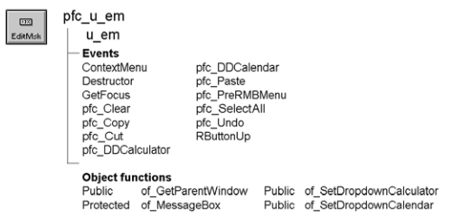

# u_em

**Description**

EditMask visual user object ancestor.

**Ancestry**



**Library**

- PFCMAIN.PBL
- PFEMAIN.PBL

**Object relationships**

PFC visual user objects are designed to be used with windows that are descendants of w_master.

**Usage**

Use this visual object in windows instead of the standard PowerBuilder EditMask. U_em event scripts provide integration with PFC menus. Additionally, u_em supports:

- **Cut, copy, paste, clear, and select all** These are triggered automatically by the message router.
- **Popup menu support** The ContextMenu event enables you to use the right mouse button to perform editing actions. To disable right mouse button support, set ib_rmbmenu to FALSE in the edit mask’s Constructor event.
- **Autoselect** This means that text is selected when a user tabs to the edit mask. To disable autoselect, set ib_autoselect to FALSE in the edit mask’s Constructor event.
- **Dropdown calculator** You can enable the display of u_calculator, the dropdown calculator, to enable enhanced input for numeric fields.
- **Dropdown calendar** You can enable the display of u_calendar, the dropdown calendar, to enable enhanced input for date fields.

**See also**

- [m_edit](../03-menus/m_edit.md)
- [u_calculator](../07-custom-visual-user-objects/u_calculator.md)
- [u_calendar](../07-custom-visual-user-objects/u_calendar.md)

## Instance variables

U_em has instance variables:

| Instance variable | Description | Data type | Ancestry | Usage |
| --- | --- | --- | --- | --- |
| ib_autoselect | Indicates whether PFC selects text when the control receives focus | Boolean | Protected | Set to FALSE to disable autoselect |
| ib_IsObsolete |  | Boolean | Protected |  |
| ib_rmbmenu | Indicates whether the m_edit menu displays when the user presses the right mouse button | Boolean | Protected | Set to FALSE to disable right mouse button support |
| iuo_calculator | Reference variable for dropdown calculator | u_calculator | Public | Use in dot notation to access u_calculator events, functions, and attributes |
| iuo_calendar | Reference variable for dropdown calendar | u_calendar | Public | Use in dot notation to access u_calendar events, functions, and attributes |

## Events

U_em includes precoded events:

- ContextMenu
- Destructor
- GetFocus
- pfc_Clear
- pfc_Copy
- pfc_Cut
- pfc_DDCalculator
- pfc_DDCalendar
- pfc_Paste
- pfc_PreRmbMenu
- pfc_SelectAll
- pfc_Undo
- RButtonUp

### ContextMenu

**Description**

Displays the m_edit popup menu.

**Usage**

This event executes when the user releases the right mouse button over a control based on u_em.

### Destructor

**Description**

Destroys instances of u_calculator and u_calendar.

**Usage**

This event executes when the DataWindow closes.

### GetFocus

**Description**

Updates the parent window so it can set MicroHelp.

**Usage**

This event calls the pfc_ControlGotFocus event in the parent.

### pfc_Clear

**Description**

Deletes selected text.

**Return value**

Integer. Returns the number of characters deleted if the event succeeds and -1 if an error occurs.

**Usage**

The message router calls this event when an EditMask based on u_em has focus and the user selects Edit>Clear.

### pfc_Copy

**Description**

Copies selected text to the clipboard.

**Return value**

Integer. Returns the number of characters copied if the event succeeds and -1 if an error occurs.

**Usage**

The message router calls this event when an EditMask based on u_em has focus and the user selects Edit>Copy.

This event is also called by the m_edit popup menu.

### pfc_Cut

**Description**

Deletes selected text and stores it on the clipboard.

**Return value**

Integer. Returns the number of characters removed if the event succeeds and - 1 if an error occurs.

**Usage**

The message router calls this event when an EditMask based on u_em has focus and the user selects Edit>Cut.

This event is also called by the m_edit popup menu.

### pfc_DDCalculator

**Description**

Displays the dropdown calculator.

**Return value**

Integer. Returns 1 if the function succeeds and -1 if an error occurs.

**Usage**

Call this event to display the dropdown calculator.

**Examples**

This example calls the pfc_DDCalculator event:

```
Integer  li_return

li_return = em_1.Event pfc_DDCalculator()
...
```

### pfc_DDCalendar

**Description**

Displays the dropdown calendar.

**Return value**

Integer. Returns 1 if the function succeeds and -1 if an error occurs.

**Usage**

Call this event to display the dropdown calendar.

**Examples**

This example calls the pfc_DDCalendar event:

```
Integer  li_return

li_return = em_1.Event pfc_DDCalendar()
...
```

### pfc_Paste

**Description**

Inserts (pastes) the contents of the clipboard at the insertion point.

**Return value**

Integer. Returns the number of characters that were pasted if the event succeeds and -1 if an error occurs.

**Usage**

The message router calls this event when an EditMask based on u_em has focus and the user selects Edit>Paste.

This event is also called by the m_edit popup menu.

### pfc_PreRmbMenu

**Description**

User event allowing you to modify m_edit contents before display.

**Syntax**

```
instancename.Event pfc_PreRmbMenu ( editmenu )
```

| Argument | Description |
| --- | --- |
| *instancename* | Instance name of u_em |
| *editmenu* | M_edit variable containing the popup menu to be displayed (passed by reference) |

**Return value**

None

**Usage**

Optionally add logic to this event to selectively enable and disable m_edit menu items.

### pfc_SelectAll

**Description**

Selects all text in the EditMask.

**Return value**

Integer. Returns the number of characters selected if the event succeeds and -1 if an error occurs.

**Usage**

The message router calls this event when an EditMask based on u_em has focus and the user selects Edit>Select All.

This event is also called by the m_edit popup menu.

### pfc_Undo

**Description**

Cancels the last change to the EditMask, restoring the text to the content before the last change.

**Return value**

Integer. Returns 1 if the event succeeds and -1 if an error occurs.

**Usage**

The message router calls this event when an EditMask based on u_em has focus and the user selects Edit>Undo.

### RButtonUp

**Description**

Empty user event. PFC code previously assigned to this event is now in the ContextMenu event.

**Usage**

This event executes when the user releases the right mouse button over a control based on u_em.

## Functions

U_em includes precoded object functions:

- of_GetParentWindow
- of_MessageBox
- of_SetDropDownCalculator
- of_SetDropDownCalendar

### of_GetParentWindow

**Description**

Retrieves a reference to the parent window.

**Access**

Public

**Syntax**

```
instancename.of_GetParentWindow ( window )
```

| Argument | Description |
| --- | --- |
| *instancename* | Instance name of u_em |
| *window* | Window variable into which the function places a reference to the parent window (passed by reference) |

**Return value**

Integer. Returns 1 if the function succeeds and -1 if there is no parent window. If no parent window is found, *window* returns NULL.

**Usage**

The u_em GetFocus event calls this function.

**Examples**

This example is from the u_em GetFocus event:

```
Window   lw_parent
IF gnv_app.of_GetMicrohelp() THEN
       of_GetParentWindow(lw_parent)
       IF IsValid(lw_parent) THEN
      lw_parent.Dynamic Event &
         pfc_ControlGotFocus (this)
       END IF
END IF
```

### of_MessageBox

**Description**

Displays a MessageBox.

**Access**

Protected

**Syntax**

```
instancename.of_MessageBox ( id, title, message, icon, button, default )
```

| Argument | Description |
| --- | --- |
| *instancename* | Instance name of u_em |
| *id* | String specifying an ID for the message |
| *title* | String specifying the title of the MessageBox |
| *message* | String specifying the message text |
| *icon* | Icon enumerated data type indicating the icon you want to display on the left side of the message box. Values are: |
|  | • Information! |
|  | • StopSign! |
|  | • Exclamation! |
|  | • Question! |
|  | • None! |
| *button* | Button enumerated data type indicating the set of CommandButtons you want to display at the bottom of the message box. The buttons are numbered in the order listed in the enumerated data type. Values are: |
|  | • OK! |
|  | • OKCancel! |
|  | • YesNo! |
|  | • YesNoCancel! |
|  | • RetryCancel! |
|  | • AbortRetryIgnore! |
| *default* | Integer specifying the number of the button you want to be the default button |

**Return value**

Integer. Returns 1 if the function succeeds and -1 if an error occurs.

**Usage**

Override this function to control MessageBox behavior in EditMasks.

The *id* argument is not used in the default implementation.

**Examples**

This example calls the of_MessageBox function:

```
of_Messagebox(’em_error’,’Save’, &
   as_error, StopSign!, Ok!, 1)
```

### of_SetDropDownCalculator

**Description**

Enables or disables u_calculator, which provides a dropdown calculator.

**Access**

Public

**Syntax**

```
instancename.of_SetDropDownCalculator ( boolean )
```

| Argument | Description |
| --- | --- |
| *instancename* | Instance name of u_em |
| *boolean* | Boolean specifying whether to enable (TRUE) or disable (FALSE) the dropdown calculator service |

**Return value**

Integer. Returns 1 if the function succeeds and -1 if an error occurs.

**Usage**

Call this function to enable or disable the dropdown calculator. The u_em instance variable for this service is iuo_calculator.

**Examples**

This example calls the of_SetDropDownCalculator function to enable an instance of the dropdown calculator:

```
em_1.of_SetDropDownCalculator(TRUE)
```

### of_SetDropDownCalendar

**Description**

Enables or disables u_calendar, which provides a dropdown calendar for registered columns.

**Access**

Public

**Syntax**

```
instancename.of_SetDropDownCalendar ( boolean )
```

| Argument | Description |
| --- | --- |
| *instancename* | Instance name of u_em |
| *boolean* | Boolean specifying whether to enable (TRUE) or disable (FALSE) the dropdown calendar service |

**Return value**

Integer. Returns 1 if the function succeeds and -1 if an error occurs.

**Usage**

Call this function to enable or disable the dropdown calendar.

**Examples**

This example calls the of_SetDropDownCalendar function to enable an instance of the dropdown calendar:

```
em_1.of_SetDropDownCalendar(TRUE)
```
