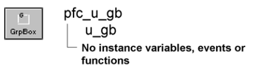

# u_gb

**Description**

GroupBox visual user object ancestor.

**Ancestry**

**Library**

- PFCMAIN.PBL
- PFEMAIN.PBL

**Usage**

Use this visual object in windows instead of the standard PowerBuilder GroupBox.

## Instance variables

U_gb includes instance variables:

| Instance variable | Description | Data type | Access |
| --- | --- | --- | --- |
| ib_IsObsolete |  | Boolean | Protected |

