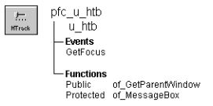

# u_htb

**Description**

HorizontalTrackBar visual user object ancestor.

**Ancestry**



**Library**

- PFCMAIN.PBL
- PFEMAIN.PBL

**Object relationships**

PFC visual user objects are designed to be used with windows that are descendants of w_master.

**Usage**

Use this visual object in windows instead of the standard PowerBuilder HorizonalTrackBar. U_htb event scripts provide integration with PFC menus.

**See also**

- [w_master](../02-window-objects/w_master.md)
- [u_vtb](u_vtb.md)

## Instance variables

U_htb includes instance variables:

| Instance variable | Description | Data type | Access |
| --- | --- | --- | --- |
| CST_LINE_LEFT | Constant set to 1 | Integer | Public |
| CST_LINE_RIGHT | Constant set to 2 | Integer | Public |
| CST_MOVED | Constant set to 5 | Integer | Public |
| CST_PAGE_LEFT | Constant set to 3 | Integer | Public |
| CST_PAGE_RIGHT | Constant set to 4 | Integer | Public |
| ib_IsObsolete |  | Boolean | Protected |
| LP_MW_down | Constant set to 18023255 | Long | Public |
| LP_MW_UP | Constant set to 18285400 | Long | Public |
| WM_MOUSEWHEEL | Constant set to 522 | Integer | Public |
| WP_MW_down | Constant set to 4287102976 | Long | Public |
| WP_MW_UP | Constant set to 7864320 | Long | Public |

## Events

U_htb includes one precoded event:

GetFocus

### GetFocus

**Description**

Updates the parent window so it can set MicroHelp.

**Usage**

This event calls the pfc_ControlGotFocus event in the parent.

### Lineleft

**Description**

Propagates event to pfc_positionchanged() event.

**Syntax**

```
instancename.EVENT Lineleft ( )
```

| Argument | Description |
| --- | --- |
| *instancename* | Instance name of u_htb |

**Return value**

None.

### Lineright

**Description**

Propagates event to pfc_positionchanged() event.

**Syntax**

```
instancename.EVENT Lineright ( )
```

| Argument | Description |
| --- | --- |
| *instancename* | Instance name of u_htb |

**Return value**

None.

### Moved

**Description**

Propagates event to pfc_positionchanged() event.

**Syntax**

```
instancename.EVENT Moved ( )
```

| Argument | Description |
| --- | --- |
| *instancename* | Instance name of u_htb |

**Return value**

None.

### Other

**Description**

Handle Mouse Wheel actions and propagates results to pfc_positionchanged() event with type = CST_MOVED.

**Syntax**

```
instancename.EVENT Other ( )
```

| Argument | Description |
| --- | --- |
| *instancename* | Instance name of u_htb |

**Return value**

None.

### Pageleft

**Description**

Propagates event to pfc_positionchanged() event.

**Syntax**

```
instancename.EVENT Pageleft ( )
```

| Argument | Description |
| --- | --- |
| *instancename* | Instance name of u_htb |

**Return value**

None.

### Pageright

**Description**

Propagates event to pfc_positionchanged() event.

**Syntax**

```
instancename.EVENT Pageright ( )
```

| Argument | Description |
| --- | --- |
| *instancename* | Instance name of u_htb |

**Return value**

None.

### pfc_positionchanged

**Description**

No description is available.

**Syntax**

```
instancename.EVENT pfc_positionchanged ( ai_type, ai_scrollpos )
```

| Argument | Description |
| --- | --- |
| *instancename* | Instance name of u_htb |
| *ai_type* | Integer. |
| *ai_scrollpos* | Integer. |

**Return value**

None.

## Functions

U_htb includes precoded object functions:

- of_GetParentWindow
- of_MessageBox

### of_GetParentWindow

**Description**

Retrieves a reference to the parent window.

**Access**

Public

**Syntax**

```
instancename.of_GetParentWindow ( window )
```

| Argument | Description |
| --- | --- |
| *instancename* | Instance name of u_htb |
| *window* | Window variable into which the function places a reference to the parent window (passed by reference) |

**Return value**

Integer. Returns 1 if the function succeeds and -1 if there is no parent window. If no parent window is found, *window* returns NULL.

**Usage**

The u_htb GetFocus event calls this function.

**Examples**

This example is from the u_htb GetFocus event:

```
Window  lw_parent

//Check for MicroHelp requirements.
IF gnv_app.of_GetMicrohelp() THEN
       //Notify the parent.
       of_GetParentWindow(lw_parent)
       IF IsValid(lw_parent) THEN
      lw_parent.Dynamic Event &
         pfc_ControlGotFocus (this)
       END IF
END IF
```

### of_MessageBox

**Description**

Displays a MessageBox.

**Access**

Protected

**Syntax**

```
instancename.of_MessageBox ( id, title, message, icon, button, default )
```

| Argument | Description |
| --- | --- |
| *instancename* | Instance name of u_htb |
| *id* | String specifying an ID for the message |
| *title* | String specifying the title of the MessageBox |
| *message* | String specifying the message text |
| *icon* | Icon enumerated data type indicating the icon you want to display on the left side of the message box. Values are: |
|  | • Information! |
|  | • StopSign! |
|  | • Exclamation! |
|  | • Question! |
|  | • None! |
| *button* | Button enumerated data type indicating the set of CommandButtons you want to display at the bottom of the message box. The buttons are numbered in the order listed in the enumerated data type. Values are: |
|  | • OK! |
|  | • OKCancel! |
|  | • YesNo! |
|  | • YesNoCancel! |
|  | • RetryCancel! |
|  | • AbortRetryIgnore! |
| *default* | Integer specifying the number of the button you want to be the default button |

**Return value**

Integer. Returns 1 if the function succeeds and -1 if an error occurs.

**Usage**

Override this function to control MessageBox behavior in HorizontalTrackBars.

The *id* argument is not used in the default implementation.

**Examples**

This example calls the of_MessageBox function:

```
of_Messagebox(’htb_error’,’Save’, &
   as_error, StopSign!, Ok!, 1)
...
```
