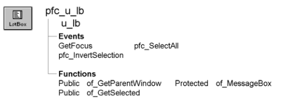

# u_lb

**Description**

ListBox visual user object ancestor.

**Ancestry**



**Library**

- PFCMAIN.PBL
- PFEMAIN.PBL

**Object relationships**

PFC visual user objects are designed to be used with windows that are descendants of w_master.

**Usage**

Use this visual user object in windows instead of the standard PowerBuilder ListBox control. U_lb event scripts provide integration with PFC menus.

**See also**

- [w_master](../02-window-objects/w_master.md)
- [u_ddlb](u_ddlb.md)
- [u_ddplb](u_ddplb.md)
- [u_plb](u_plb.md)

## Events

U_lb includes precoded events:

|   |
| --- |
| GetFocus pfc_SelectAll |
| pfc_InvertSelection |

### GetFocus

**Description**

Updates the parent window so it can set MicroHelp.

**Usage**

This event calls the pfc_ControlGotFocus event in the parent.

### pfc_InvertSelection

**Description**

Inverts the rows selected in the ListBox. Unselected rows become selected; selected rows are unselected.

**Return value**

Integer. Returns the number of selected rows if the event succeeds and 0 if this is an invalid operation.

**Usage**

To use this event, add a menu item that uses the message router to call pfc_InvertSelection.

### pfc_SelectAll

**Description**

Selects all rows in the ListBox.

**Return value**

Integer. Returns the number of selected rows if the event succeeds and 0 if this is an invalid operation.

**Usage**

The message router calls this event when the user selects Edit>Select All from the menu bar.

## Functions

U_lb includes precoded object functions:

|   |
| --- |
| of_GetParentWindow of_MessageBox |
| of_GetSelected |

### of_GetParentWindow

**Description**

Retrieves a reference to the parent window.

**Access**

Public

**Syntax**

```
instancename.of_GetParentWindow ( window )
```

| Argument | Description |
| --- | --- |
| *instancename* | Instance name of u_lb |
| *window* | Window variable into which the function places a reference to the parent window (passed by reference) |

**Return value**

Integer. Returns 1 if the function succeeds and -1 if there is no parent window. If no parent window is found, *window* returns NULL.

**Usage**

The u_lb GetFocus event calls this function.

**Examples**

This example is from the u_lb GetFocus event:

```
Window  lw_parent
IF gnv_app.of_GetMicrohelp() THEN
       of_GetParentWindow(lw_parent)
       IF IsValid(lw_parent) THEN
      lw_parent.Dynamic Event &
         pfc_ControlGotFocus (this)
       END IF
END IF
```

### of_GetSelected

**Description**

Populates the passed structure object with the selected entries in the ListBox.

**Access**

Public

**Syntax**

```
instancename.of_GetSelected ( itemattrib )
```

| Argument | Description |
| --- | --- |
| *instancename* | Instance name of u_lb |
| *itemattrib* | N_cst_itemattrib array into which the function places text and an item index (passed by reference) |

**Return value**

Integer. Returns the number of elements in the *itemattrib* array if the function succeeds and 0 if this is not a valid operation.

**Examples**

This example calls the of_GetSelected function:

```
n_cst_itemattrib   lnv_items[ ]
Integer  li_selected

li_selected = lb_list.of_GetSelected(lnv_items)
IF li_selected = 0 THEN
       MessageBox("LB", "Invalid LB operation")
       Return
END IF
// Logic to read lnv_items follows
...
```

### of_MessageBox

**Description**

Displays a MessageBox.

**Access**

Protected

**Syntax**

```
instancename.of_MessageBox ( id, title, message, icon, button, default )
```

| Argument | Description |
| --- | --- |
| *instancename* | Instance name of u_lb |
| *id* | String specifying an ID for the message |
| *title* | String specifying the title of the MessageBox |
| *message* | String specifying the message text |
| *icon* | Icon enumerated data type indicating the icon you want to display on the left side of the message box. Values are: |
|  | • Information! |
|  | • StopSign! |
|  | • Exclamation! |
|  | • Question! |
|  | • None! |
| *button* | Button enumerated data type indicating the set of CommandButtons you want to display at the bottom of the message box. The buttons are numbered in the order listed in the enumerated data type. Values are: |
|  | • OK! |
|  | • OKCancel! |
|  | • YesNo! |
|  | • YesNoCancel! |
|  | • RetryCancel! |
|  | • AbortRetryIgnore! |
| *default* | Integer specifying the number of the button you want to be the default button |

**Return value**

Integer. Returns 1 if the function succeeds and -1 if an error occurs.

**Usage**

Override this function to control MessageBox behavior in ListBoxes.

The *id* argument is not used in the default implementation.

**Examples**

This example calls the of_MessageBox function:

```
of_Messagebox(’lb_error’,’Save’, &
   as_error, StopSign!, Ok!, 1)
...
```
