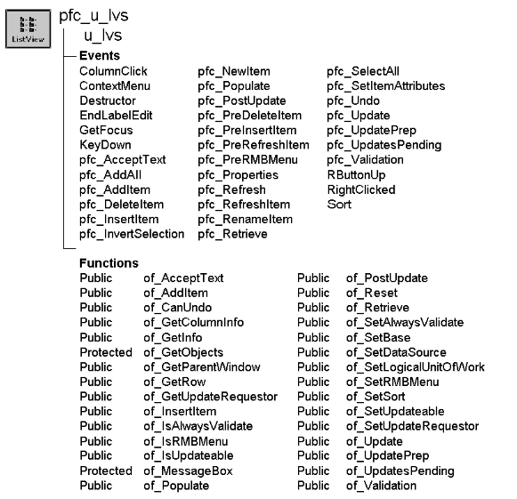

# u_lvs

**Description**

Service-based ListView visual user object ancestor. This object uses DataStores to display data in a ListView.

U_lvs is a self-updating object.

**U_lvs replaces u_lv** U_lv is the ListView control supported in earlier PFC versions. Although PFC still provides u_lv, it’s best to use u_lvs.

**Ancestry**



**Library**

- PFCMAIN.PBL
- PFEMAIN.PBL

**Object relationships**

PFC visual user objects are designed to be used with windows that are descendants of w_master. U_lvs also uses:

- [m_lvs](../03-menus/m_lvs.md)
- [n_cst_infoattrib](../05-global-structures-and-structure-objects/n_cst_infoattrib.md)
- [n_cst_luw](../09-custom-class-user-objects/n_cst_luw.md)
- [n_cst_lvsrv](../09-custom-class-user-objects/n_cst_lvsrv.md)
- [n_cst_lvsrv_datasource](../09-custom-class-user-objects/n_cst_lvsrv_datasource.md)
- [n_cst_lvsrv_sort](../09-custom-class-user-objects/n_cst_lvsrv_sort.md)
- [n_ds](../08-standard-class-user-objects/n_ds.md)

**Usage**

Use this visual user object in windows instead of the standard PowerBuilder ListView control. U_lvs functions make it easy for you to populate a ListView from rows in a DataWindow. U_lvs event scripts also provide integration with PFC menus.

U_lvs includes right mouse button support. If the user clicks the right mouse button over a u_lvs-based ListView control, the m_lvs menu displays. M_lvs allows you to control ListView icon display.

To use u_lvs:

1. Place a u_lvs user object in your window.
2. In the window pfc_PreOpen event (or some other appropriate place), enable ListView services as needed by your application:

   ```
   lv_1.of_SetDataSource(TRUE)
   lv_1.of_SetSort(TRUE)
   ```

3. Specify sorting information:

   ```
   String  ls_exclude[ ]

   lv_1.inv_sort.of_SetColumnHeader(TRUE)
   ls_exclude[1] = "emp_phone_number"
   lv_1.inv_sort.of_SetExclude(ls_exclude)
   ```

4. Specify data source information:

   ```
   Integer li_count

   lv_1.inv_datasource.of_Register("emp_lname",  &
      "d_emplist", SQLCA)
   li_count =  &
      lv_1.inv_datasource.of_RegisterReportColumn()
   lv_1.inv_datasource.of_SetPictureColumn("1")
   ```

5. Populate the ListView with information from the registered data source:

   ```
   lv_1.Event pfc_Populate()
   ```

6. Extend the pfc_Retrieve event to retrieve rows:

   ```
   Any  la_args[20]

   la_args[1] = "windows"    // Retrieval argument
   this.of_Retrieve(la_args, ads_data)
   ```

7. Extend basic u_lvs functionality by adding PowerScript code to events and user events.

For more information on the ListView control, see the *PowerBuilder User’s Guide*.

**See also**

- [m_lvs](../03-menus/m_lvs.md)
- [n_ds](../08-standard-class-user-objects/n_ds.md)
- [u_tvs](u_tvs.md)

## Instance variables

U_lvs includes instance variables:

| Instance variable | Description | Data type | Access | Usage |
| --- | --- | --- | --- | --- |
| CONTINUE_ACTION | Constant set to 1 | Integer | Public | Internal |
| ib_alwaysvalidate | Controls whether the save process includes all objects in the validation process | Boolean | Protected | Set with of_SetAlwaysValidate (default is FALSE) |
| ib_IsObsolete |  | Boolean | Protected |  |
| ib_isupdateable | Indicates whether the ListView can be updated | Boolean | Protected | Set with of_SetUpdateable (default is FALSE) |
| ib_rmbmenu | Controls right mouse button support | Boolean | Protected | Use to enable or disable right mouse button support (default is TRUE) |
|  |  |  |  | Set with of_SetRMBMenu |
| il_rightclicked | Contains the handle of the right-clicked ListView item | Long | Protected | PFC uses this instance variable to track the right-clicked item |
| INSERT_AFTER | Constant set to "after" | String | Public | Internal |
| INSERT_BEFORE | Constant set to "before" | String | Public | Internal |
| INSERT_FIRST | Constant set to "first" | String | Public | Internal |
| INSERT_LAST | Constant set to "last" | String | Public | Internal |
| inv_base | Reference variable for basic ListView services | n_cst_lvsrv | Public | Use in dot notation to access n_cst_lvsrv functions and attributes |
| inv_datasource | Reference variable for the ListView data source service | n_cst_lvsrv_datasource | Public | Use in dot notation to access n_cst_lvsrv_datasource functions and attributes |
| inv_luw | Reference variable for logical unit of work service | n_cst_luw | Protected | Implements the save process |
| inv_sort | Reference variable for ListView sort service | n_cst_lvsrv_sort | Public | Use in dot notation to access n_cst_lvsrv_sort functions and attributes |
| ipo_pendingupdates[ ] | Objects that could be updated | PowerObject | Protected | Internal |
| ipo_updaterequestor | Owner of the save process | PowerObject | Protected | Internal |
| NO_ACTION | Constant set to 0 | Integer | Public | Internal |
| PREVENT_ACTION | Constant set to 0 | Integer | Public | Internal |

## Events

U_lvs includes precoded event scripts:

- ColumnClick
- Constructor
- ContextMenu
- Destructor
- EndLabelEdit
- GetFocus
- KeyDown
- pfc_AcceptText
- pfc_AddAll
- pfc_AddItem
- pfc_DeleteItem
- pfc_InsertItem
- pfc_InvertSelection
- pfc_NewItem
- pfc_Populate
- pfc_PostUpdate
- pfc_PreDeleteItem
- pfc_PreInsertItem
- pfc_PreRefreshItem
- pfc_PreRmbMenu
- pfc_Properties
- pfc_Refresh
- pfc_RefreshItem
- pfc_RenameItem
- pfc_Retrieve
- pfc_SelectAll
- pfc_SetItemAttributes
- pfc_Undo
- pfc_Update
- pfc_UpdatePrep
- pfc_UpdatesPending
- pfc_Validation
- RButtonUp
- RightClicked
- Sort

### ColumnClick

**Description**

Sorts the ListView contents, using the column whose heading was clicked. If the column is already sorted, this event reverses the sort order.

**Usage**

To use this event, n_cst_lvsrv_sort must be enabled. This event executes when the user clicks a ListView control’s column heading.

### Constructor

**Description**

Service Based ListView Control.

**Syntax**

```
instancename.EVENT Constructor ( )
```

| Argument | Description |
| --- | --- |
| *instancename* | Instance name of u_lvs |

**Return value**

None.

### ContextMenu

**Description**

Displays the m_lvs popup menu.

**Usage**

This event executes when the user releases the right mouse button.

### Destructor

**Description**

Destroys all existing ListView service objects.

**Usage**

This event executes when the ListView is destroyed or the window closes.

### EndLabelEdit

**Description**

Updates the DataStore with user edits to the item label.

This function updates the DataStore only. You must update the database explicitly, using the of_Update or the n_cst_luw of_Save function.

**Return value**

Integer. Returns 0 if the label update is allowed and 1 if PowerBuilder should prevent the label update.

**Usage**

This event executes when the user finishes editing an item label.

PFC allows label update only when the associated label column is updatable. If the label column is a computed column, you must override this event or the n_cst_lvsrv_datasource pfc_EndLabelEdit event to update the computed column and return a 0.

### GetFocus

**Description**

Updates the parent window so it can set MicroHelp.

**Usage**

This event calls the pfc_ControlGotFocus event in the parent.

### KeyDown

**Description**

Checks to see if the DELETE key was pressed.

**Usage**

This event executes when the user presses a key and is not editing a label.

### pfc_AcceptText

**Description**

Accepts text for the ListView control data source, optionally setting focus if an error occurs.

**Syntax**

```
instancename.EVENT pfc_AcceptText ( controls, focusonerror )
```

| Argument | Description |
| --- | --- |
| *instancename* | Instance name of u_lvs |
| *controls* | PowerObject array containing the objects on which to accept text. This argument is accessed through the *apo_control* argument |
| *focusonerror* | Boolean indicating whether focus should be set if an error occurs. This argument is accessed through the *ab_focusonerror* argument |

**Return value**

Integer. Returns 1 if the event succeeds and -1 if an error occurs.

**Usage**

Extend this event to perform additional accept text processing.

### pfc_AddAll

**Description**

Adds all rows in the passed DataStore to the ListView.

**Syntax**

```
instancename.EVENT pfc_AddAll ( data )
```

| Argument | Description |
| --- | --- |
| *instancename* | Instance name of u_lvs |
| *data* | N_ds-based DataStore containing rows to be added. This argument is accessed through the *ads_source* argument |

**Return value**

Integer. Returns the number of items added if the event succeeds and -1 if an error occurs.

**Examples**

This example is from the pfc_Refresh event:

```
...
inv_datasource.of_getdatasource(lds_source)
       return this.event pfc_AddAll(lds_source)
...
```

### pfc_AddItem

**Description**

Adds the specified row in the data source to the end of the ListView.

**Syntax**

```
instancename.EVENT pfc_AddItem ( data, row )
```

| Argument | Description |
| --- | --- |
| *instancename* | Instance name of u_lvs |
| *data* | N_ds-based DataStore containing rows to be added. This argument is accessed through the *ads_source* argument |
| *row* | Long specifying the row containing the data to be added to the ListView. This argument is accessed through the *al_row* argument |

**Return value**

Long. Returns the ListView index of the new row if the event succeeds and -1 if an error occurs.

**Examples**

This example is from the of_AddItem function:

```
...
li_newindex = this.event pfc_additem &
   (lds_datastore, ll_row)
...
```

### pfc_DeleteItem

**Description**

Deletes the selected rows from the ListView and the DataStore.

**Return value**

Integer. Returns the number of rows deleted if the event succeeds and -1 if an error occurs.

**Examples**

This example calls the pfc_DeleteItem event:

```
...
li_return = lv_1.Event pfc_DeleteItem()
...
```

### pfc_InsertItem

**Description**

Inserts a new item into the ListView at the specified position.

**Syntax**

```
instancename.EVENT pfc_InsertItem (datastore, row, position, item )
```

| Argument | Description |
| --- | --- |
| *instancename* | Instance name of u_lvs |
| *datastore* | N_ds containing the data for the new item. This can be either the DataStore maintained by n_cst_lvsrv_datasource or another DataStore. If this is another DataStore, the associated DataWindow objects must be the same and the function also adds the row to the DataStore maintained by n_cst_lvsrv_datasource. This argument is accessed through the *ads_source* argument |
| *row* | Long specifying the row containing the item. This argument is accessed through the *al_row* argument |
| *position* | String specifying the position or location in which to insert the new item. Valid values are: |
|  | • First |
|  | • Last |
|  | • Before |
|  | • After |
|  | This argument is accessed through the *as_position* argument |
| *item* | Integer containing an index relative to the current position. The function uses this argument if you specify Before or After for *position*. This argument is accessed through the *ai_index* argument |

**Return value**

Integer. Returns the index of the new item if the function succeeds and -1 if an error occurs.

**Usage**

This event calls the pfc_SetItemAttributes and pfc_PreInsertItem events before inserting the item.

**Examples**

This example is from the pfc_AddAll event:

```
...
For ll_row = 1 to ll_rowcount
       If this.event pfc_insertitem(ads_source,  &
      ll_row, "last", 0) < 1 then
       Return -1
       End If
...
```

### pfc_InvertSelection

**Description**

Inverts the rows selected in the ListView. Unselected rows become selected; selected rows are unselected.

**Return value**

Integer. Returns the number of selected rows if the event succeeds and -1 if this is an invalid operation.

**Usage**

To use this event, add a menu item that uses the message router to call pfc_InvertSelection.

### pfc_NewItem

**Description**

Empty user event that you extend to add information to both the data source and the ListView.

**Return value**

Integer. Returns 1 if the event succeeds and -1 if an error occurs.

**Usage**

You typically use this event to open a dialog box prompting the user for complete information, adding it to the data source and the ListView (via the pfc_InsertItem event) when it closes.

### pfc_Populate

**Description**

Retrieves the data source and uses it to populate the ListView.

**Return value**

Integer. Returns the number of items added to the ListView if the event succeeds and -1 of an error occurs.

**Usage**

You must add code to the pfc_Retrieve event to retrieve the data.

**Examples**

This example calls the pfc_Populate event:

```
String  ls_exclude[ ]
Integer li_count

// ListView Constructor event
this.of_SetDataSource(TRUE)
this.of_SetSort(TRUE)
this.inv_sort.of_SetColumnHeader(TRUE)
ls_exclude[1] = "emp_phone_number"
this.inv_sort.of_SetExclude(ls_exclude)
this.inv_datasource.of_Register("emp_lname",  &
   "d_emplist", SQLCA)
li_count =  &
   this.inv_datasource.of_RegisterReportColumn()
this.inv_datasource.of_SetPictureColumn("1")
this.Event pfc_Populate()
```

### pfc_PostUpdate

**Description**

Calls the n_cst_luw of_PostUpdate function to perform post-update processing on the specified controls.

**Syntax**

```
instancename.EVENT pfc_PostUpdate ( controls )
```

| Argument | Description |
| --- | --- |
| *instancename* | Instance name of u_lvs |
| *controls* | PowerObject array containing the objects on which to perform postupdate processing. This argument is accessed through the *apo_control* argument |

**Return value**

Integer. Returns 1 if the event succeeds and -1 if an error occurs.

**Usage**

Extend this event to perform additional post-update processing.

### pfc_PreDeleteItem

**Description**

Empty user event to which you add logic to perform predelete processing.

**Syntax**

```
instancename.EVENT pfc_PreDeleteItem ( index )
```

| Argument | Description |
| --- | --- |
| *instancename* | Instance name of u_lvs |
| *index* | Integer specifying the index of the ListView item to be deleted. This argument is accessed through the *ai_index* argument |

**Usage**

The pfc_DeleteItem event calls this event.

### pfc_PreInsertItem

**Description**

Empty user event to which you add logic to perform pre-insert processing.

**Syntax**

```
instancename.Event pfc_PreInsertItem ( data, row, lvitem )
```

| Argument | Description |
| --- | --- |
| *instancename* | Instance name of u_lvs |
| *data* | N_ds containing the data for the new item. This argument is accessed through the *ads_obj* argument |
| *row* | Long specifying the row containing the new item. This argument is accessed through the *al_row* argument |
| *lvitem* | ListViewItem to be inserted. This argument is accessed through the *alvi_item* argument (passed by reference) |

**Usage**

The pfc_InsertItem event calls this event.

### pfc_PreRefreshItem

**Description**

Empty user event to which you add logic that changes ListView item properties before a ListView item is refreshed.

**Syntax**

```
instancename.EVENT pfc_PreRefreshItem ( index, data, row, lvitem )
```

| Argument | Description |
| --- | --- |
| *instancename* | Instance name of u_lvs |
| *index* | Integer specifying the index of the refreshed item. This argument is accessed through the *ai_index* argument |
| *data* | N_ds containing the data for the refreshed item. This argument is accessed through the *ads_obj* argument |
| *row* | Long specifying the row containing the refreshed item. This argument is accessed through the *al_row* argument |
| *lvitem* | ListViewItem to be refreshed. This argument is accessed through the *alvi_item* argument (passed by reference) |

**Usage**

The pfc_RefreshItem event calls this event.

### pfc_PreRmbMenu

**Description**

Empty user event allowing you to modify m_lvs contents before display.

**Syntax**

```
instancename.Event pfc_PreRmbMenu ( editmenu )
```

| Argument | Description |
| --- | --- |
| *instancename* | Instance name of u_lvs |
| *editmenu* | M_lvs variable containing the popup menu to be displayed (passed by reference) |

**Usage**

Optionally add logic to this event to selectively enable and disable m_lvs menu items.

### pfc_Properties

**Description**

Empty user event to which you might add logic to display a Properties dialog.

**Return value**

Integer. Return 1 if the event succeeds and -1 if an error occurs.

### pfc_Refresh

**Description**

Refresh the ListView items with data from the data source.

**Return value**

Integer. Returns the number of items refreshed if the event succeeds and -1 if an error occurs.

**Examples**

This example is from the pfc_Populate event:

```
...
If this.event pfc_refresh() <> 1 Then Return -3
...
```

### pfc_RefreshItem

**Description**

Refreshes the specified ListView item, resetting all properties to the defaults specified in the data source.

**Syntax**

```
instancename.EVENT pfc_RefreshItem ( index )
```

| Argument | Description |
| --- | --- |
| *instancename* | Instance name of u_lvs |
| *index* | Integer specifying the ListView index of the item to refresh |

**Return value**

Integer. Returns 1 if the event succeeds and -1 if an error occurs.

**Examples**

This example calls the pfc_RefreshItem event:

```
...
lv_1.Event pfc_RefreshItem(1)
...
```

### pfc_RenameItem

**Description**

Renames the selected item.

**Usage**

To use this event, the Edit Labels property must be enabled for the ListView.

### pfc_Retrieve

**Description**

Retrieves rows into the ListView’s data source.

**Syntax**

```
instancename.EVENT pfc_Retrieve ( datasource )
```

| Argument | Description |
| --- | --- |
| *instancename* | Instance name of u_lvs |
| *datasource* | N_ds into which rows are retrieved. This argument is accessed through the *ads_data* argument (passed by reference) |

**Return value**

Long. Return the number of items retrieved if the event succeeds and -1 if an error occurs.

**Usage**

Add code to this event that calls the of_Retrieve function to retrieve rows for the data source.

**Examples**

This example shows code you might add to the pfc_Retrieve event:

```
Any  la_args[20]

la_args[1] = "windows"    // Retrieval argument
this.of_Retrieve(la_args, ads_data)
```

### pfc_SelectAll

**Description**

Selects all rows in the ListView.

**Return value**

Integer. Returns 1 if the event succeeds and -1 if an error occurs.

**Usage**

The message router calls this event when the user selects Edit>Select All from the menu bar.

### pfc_SetItemAttributes

**Description**

Sets default properties for the ListView item before insertion.

**Syntax**

```
instancename.EVENT pfc_SetItemAttributes ( data, row, lvitem )
```

| Argument | Description |
| --- | --- |
| *instancename* | Instance name of u_lvs |
| *data* | N_ds containing the data for the item. This argument is accessed through the *ads_obj* argument |
| *row* | Long specifying the row containing the item. This argument is accessed through the *al_row* argument |
| *lvitem* | ListViewItem to be inserted. This argument is accessed through the *alvi_item* argument (passed by reference) |

**Usage**

Optionally extend this event to change ListView item properties before insertion.

### pfc_Undo

**Description**

Cancels the last change to the ListView, restoring the text to the content before the last change.

**Return value**

Integer. Returns 1 if the event succeeds and -1 if an error occurs.

**Usage**

The message router calls this event when a ListView based on u_lvs has focus and the user selects Edit>Undo.

### pfc_Update

**Description**

Calls the n_cst_luw of_Update function to update the specified controls.

**Syntax**

```
instancename.EVENT pfc_Update ( controls, accepttext, resetflags )
```

| Argument | Description |
| --- | --- |
| *instancename* | Instance name of u_lvs |
| *controls* | PowerObject array containing the objects to update. This argument is accessed through the *apo_control* argument |
| *accepttext* | Boolean specifying whether n_cst_luw should automatically perform an AcceptText before performing the Update (TRUE) or not (FALSE) |
| *resetflags* | Boolean specifying whether n_cst_luw should automatically reset DataWindow update flags (TRUE) or not (FALSE) |

**Return value**

Integer. Returns 1 if the function succeeds and -1 if an error occurs.

**Usage**

The of_Update function calls this event.

### pfc_UpdatePrep

**Description**

Empty user event to which you can add code that prepares for update.

**Syntax**

```
instancename.EVENT pfc_UpdatePrep ( controls )
```

| Argument | Description |
| --- | --- |
| *instancename* | Instance name of u_lvs |
| *controls* | PowerObject array containing the objects to update. This argument is accessed through the *apo_control* argument |

**Return value**

Long. Return 1 if the update preparation succeeds and -1 to halt the update process.

**Usage**

The of_UpdatePrep function calls this function.

### pfc_UpdatesPending

**Description**

Determines if there are pending updates for the ListView.

**Syntax**

```
instancename.EVENT pfc_UpdatesPending ( controls, pending )
```

| Argument | Description |
| --- | --- |
| *instancename* | Instance name of u_lvs |
| *controls* | PowerObject array containing the objects to update. This argument is accessed through the *apo_control* argument |
| *pending* | PowerObject array into which the event places objects with pending updates. This argument is accessed through the *apo_pending* argument (passed by reference) |

**Return value**

Integer. Returns 1 if there are pending updates, 0 if there are no pending updates, and -1 if an error occurs.

**Usage**

This event is called by the of_GetUpdatesPending function.

### pfc_Validation

**Description**

Checks for required fields.

**Syntax**

```
instancename.EVENT pfc_Validation ( controls )
```

| Argument | Description |
| --- | --- |
| *instancename* | Instance name of u_lvs |
| *controls* | PowerObject array containing the objects to validate. This argument is accessed through the *apo_control* argument |

**Return value**

Integer. Returns 1 if the event succeeds and -1 if an error occurs.

**Usage**

This event is called by the of_Validation function.

### RButtonUp

**Description**

Empty user event. PFC code previously assigned to this event is now in the ContextMenu event.

**Usage**

This event executes when the user releases the right mouse button.

### RightClicked

**Description**

Tracks the clicked item and displays the m_lvs popup menu.

**Usage**

This event executes when the user presses the right mouse button.

### Sort

**Description**

Performs the sort comparison when the sort type is UserDefined!.

**Return value**

Integer. Returns 1 if the event succeeds and -1 if an error occurs.

**Usage**

Extend the n_cst_lvsrv_sort pfc_Sort event to create site-specific sort logic.

## Functions

U_lvs includes precoded object functions:

- of_AcceptText
- of_AddItem
- of_CanUndo
- of_GetInfo
- of_GetColumnInfo
- of_GetObjects
- of_GetParentWindow
- of_GetRow
- of_GetUpdateRequestor
- of_InsertItem
- of_IsAlwaysValidate
- of_IsRMBMenu
- of_IsUpdateable
- of_MessageBox
- of_Populate
- of_PostUpdate
- of_Reset
- of_Retrieve
- of_SetAlwaysValidate
- of_SetBase
- of_SetDataSource
- of_SetLogicalUnitOfWork
- of_SetRMBMenu
- of_SetSort
- of_SetUpdateable
- of_SetUpdateRequestor
- of_Update
- of_UpdatePrep
- of_UpdatesPending
- of_Validation

### of_AcceptText

**Description**

Performs an AcceptText function for the data source.

**Access**

Public

**Syntax**

```
instancename.of_AcceptText ( focusonerror )
```

| Argument | Description |
| --- | --- |
| *instancename* | Instance name of u_lvs |
| *focusonerror* | Boolean indicating whether PFC sets focus to the first item in error when an error occurs |

**Return value**

Integer. Returns 1 if the function succeeds and -1 if an error occurs.

**Usage**

N_cst_luw calls this function as part of the default save process. This function is part of the self-updating object API. To customize accept text processing, extend the pfc_AcceptText event.

**Examples**

This example is from the n_cst_luw of_AcceptText function:

```
...
If lb_defined Then
       li_rc =  &
      lpo_tocheck.Function Dynamic of_AcceptText &
         (ab_focusonerror)
       If li_rc < 0 Then Return -1

...
```

### of_AddItem

**Description**

Adds a new item to the end of the ListView control.

**Access**

Public

**Syntax**

```
instancename.of_AddItem ( rowinfo )
```

| Argument | Description |
| --- | --- |
| *instancename* | Instance name of u_lvs |
| *rowinfo* | Any array containing data for the row |

**Return value**

Long. Returns the index of the added item if the functions succeeds and -1 if an error occurs.

**Usage**

If the information in *rowinfo* is not already in the data source, this function adds the new row to the data source. If you are using the ListView data source service, the data types of the elements in *rowinfo* must match those in the DataWindow object specified in the n_cst_lvsrv_datasource of_Register function.

**Examples**

This example calls the of_AddItem function:

```
Any  la_row[ ]

la_row[1] = 500
la_row[2] = "Nelsen"
la_row[3] = "Rodney"
lv_1.of_AddItem(la_row)
```

### of_CanUndo

**Description**

Reports whether the ListView can undo the last edit, insertion, or deletion, returning the operation type.

**Access**

Public

**Syntax**

```
instancename.of_CanUndo ( undotype )
```

| Argument | Description |
| --- | --- |
| *instancename* | Instance name of u_lvs |
| *undotype* | String into which the function places the type of the last operation (passed by reference): |
|  | **• "Edit"** Edit |
|  | **• "Insert"** Insertion |
|  | **• "Delete"** Deletion |

**Return value**

Boolean. Returns TRUE if the last operation can be undone and FALSE if it cannot.

**Examples**

This example calls the of_CanUndo function:

```
String  ls_undotype

IF lv_1.of_CanUndo(ls_undotype) THEN
   MessageBox("ListView", "Can undo")
ELSE
   MessageBox("ListView", "Cannot undo")
END IF
```

### of_GetColumnInfo

**Description**

Retrieves column information from the ListView.

**Access**

Public

**Syntax**

```
instancename.of_GetColumnInfo ( column, colattrib )
```

| Argument | Description |
| --- | --- |
| *instancename* | Instance name of the u_lvs-based ListView control |
| *column* | Integer specifying the column from the ListView |
| *colattrib* | N_cst_columnattrib into which the function places column information (passed by reference) |

**Return value**

Integer. Returns 1 if the function succeeds and -1 if an error occurs.

**Usage**

Column information is used in detail view only.

**Examples**

This example calls the of_GetColumnInfo:

```
n_cst_columnattrib  lnv_colinfo

lv_1.of_GetColumnInfo(3, lnv_colinfo)
...
```

### of_GetInfo

**Description**

Retrieves object information.

**Access**

Public

**Syntax**

```
instancename.of_GetInfo ( infoobject )
```

| Argument | Description |
| --- | --- |
| *instancename* | Instance name of u_lvs |
| *infoobject* | N_cst_infoattrib instance into which the function places information (passed by reference) |

**Return value**

Integer. Returns 1 if the function succeeds and -1 if an error occurs.

**Examples**

This example calls the of_GetInfo function:

```
n_cst_infoattrib  lnv_info

lv_1.of_GetInfo(lnv_info)
MessageBox("Info",  &
  "Description: " + lnv_info.is_description  &
    + ". Name: " + lnv_info.is_name)
```

### of_GetObjects

**Description**

Retrieves the objects to be updated.

**Access**

Protected

**Syntax**

```
instancename.of_GetObjects ( objects )
```

| Argument | Description |
| --- | --- |
| *instancename* | Instance name of u_lvs |
| *objects* | PowerObject array into which the function places objects to be updated (passed by reference) |

**Return value**

Integer. Returns the number of elements in the *objects* array if the function succeeds and -1 if an error occurs.

**Usage**

Internal.

**Examples**

This example is from the of_AcceptText function:

```
...
Else
   this.of_Getobjects(lpo_updatearray)
End If
...
```

### of_GetParentWindow

**Description**

Retrieves a reference to the parent window.

**Access**

Public

**Syntax**

```
instancename.of_GetParentWindow ( window )
```

| Argument | Description |
| --- | --- |
| *instancename* | Instance name of u_lvs |
| *window* | Window variable into which the function places a reference to the parent window (passed by reference) |

**Return value**

Integer. Returns 1 if the function succeeds and -1 if there is no parent window. If no parent window is found, *window* returns NULL.

**Usage**

The u_lvs GetFocus event calls this function.

**Examples**

This example is from the u_lvs GetFocus event:

```
Window   lw_parent

IF gnv_app.of_GetMicrohelp() THEN
       of_GetParentWindow(lw_parent)
       IF IsValid(lw_parent) THEN
       lw_parent.Dynamic Event &
          pfc_ControlGotFocus (this)
       END IF
END IF
```

### of_GetRow

**Description**

Retrieves the DataStore and DataStore row for the specified ListView index.

**Access**

Public

**Syntax**

```
instancename.of_GetRow ( index, data, row )
```

| Argument | Description |
| --- | --- |
| *instancename* | Instance name of u_lvs |
| *index* | Integer specifying the index for the row to be retrieved |
| *data* | N_ds into which the function places a reference to the DataStore (passed by reference) |
| *row* | Long into which the function places the row number that corresponds to *index* (passed by reference) |

**Return value**

Integer. Returns 1 if the function succeeds and -1 if an error occurs.

**Examples**

This example calls the of_GetRow function:

```
n_ds  lds_data
Long  ll_row

lv_1.of_GetRow(1, lds_data, ll_row)
MessageBox("ListView",  &
   "DataObject is: " + lds_data.DataObject  &
   + " Row is: " + String(ll_row))
```

### of_GetUpdateRequestor

**Description**

Retrieves a reference to the object requesting an update.

**Access**

Public

**Syntax**

```
instancename.of_GetUpdateRequestor ( requestor )
```

| Argument | Description |
| --- | --- |
| *instancename* | Instance name of u_lvs |
| *requestor* | PowerObject into which the function places a reference to the object requesting the update (passed by reference) |

**Return value**

Integer. Returns 1 if the function succeeds, 0 if there is no update requestor, and -1 if an error occurs.

**Usage**

Call this function if you are extending the pfc_Save process and need to access the update requestor.

### of_InsertItem

Inserts an item into the ListView. There are two syntaxes:

| To | Use |
| --- | --- |
| Insert from a DataStore | Syntax 1 |
| Insert from an array | Syntax 2 |

| Syntax 1 | Insert an item from a DataStore |
| --- | --- |

**Description**

Adds a new item to the ListView using a row from a DataStore.

**Access**

Public

**Syntax**

```
instancename.of_InsertItem ( datastore, row {, position, index } )
```

| Argument | Description |
| --- | --- |
| *instancename* | Instance name of u_lvs |
| *datastore* | N_ds containing the data for the new item. This can be either the DataStore maintained by n_cst_lvsrv_datasource or another DataStore. If this is another DataStore, the associated DataWindow objects must be the same and the function also adds the row to the DataStore maintained by n_cst_lvsrv_datasource (passed by reference) |
| *row* | Long specifying the row containing data for the new item |
| *position* (optional) | String specifying the position under the current parent in which to insert the new item. Valid values are: |
|  | • First |
|  | • Last (default) |
|  | • Before |
|  | • After |
| *index* (optional) | Integer containing an index relative to the current position. The function uses this argument if you specify Before or After for *position* |

**Return value**

Integer. Returns the index of the new item if the function succeeds and -1 if an error occurs.

**Examples**

This example calls the of_InsertItem function:

```
Long  ll_row

ll_row = ids_data.GetRow()
lv_1.of_InsertItem(ids_data, ll_row)
```

| Syntax 2 | Insert an item from an array |
| --- | --- |

**Description**

Adds a new item to the ListView using a value from an array.

**Access**

Public

**Syntax**

```
instancename.of_InsertItem ( colvalues {, position, index } )
```

| Argument | Description |
| --- | --- |
| *instancename* | Instance name of u_lvs |
| *colvalues* | Any array containing data for the ListView |
| *position* (optional) | String specifying the position or location in which to insert the new item. Valid values are: |
|  | • First |
|  | • Last (default) |
|  | • Before |
|  | • After |
| *index* (optional) | Integer containing an index relative to the current position. The function uses this argument if you specify Before or After for *position* |

**Return value**

Integer. Returns the index of the new item if the function succeeds and -1 if an error occurs.

**Examples**

This example calls the of_InsertItem function:

```
Any  la_row[ ]

la_row[1] = 500
la_row[2] = "Nelsen"
la_row[3] = "Rodney"
lv_1.of_InsertItem(la_row, "First", 0)
```

### of_IsAlwaysValidate

**Description**

Reports whether the default save process always performs validation.

**Access**

Public

**Syntax**

```
instancename.of_IsAlwaysValidate ( )
```

| Argument | Description |
| --- | --- |
| *instancename* | Instance name of u_lvs |

**Return value**

Boolean. Returns TRUE if the default save process always performs validation and FALSE if it does not.

**Examples**

This example calls the of_IsAlwaysValidate function:

```
IF lv_1.of_IsAlwaysValidate() = TRUE THEN
   MessageBox("LV", "Always validate")
ELSE
   MessageBox("LV", "Sometimes validate")
END IF
```

### of_IsRMBMenu

**Description**

Reports whether the popup menu is enabled.

**Access**

Public

**Syntax**

```
instancename.of_IsRMBMenu ( )
```

| Argument | Description |
| --- | --- |
| *instancename* | Instance name of u_lvs |

**Return value**

Boolean. Returns TRUE if the m_lvs popup menu is enabled and FALSE if it is not.

**Examples**

This example calls the of_IsRMBMenu function:

```
IF lv_1.of_IsRMBMenu() = TRUE THEN
   MessageBox("LV", "RMB enabled")
ELSE
   MessageBox("LV", "RMB disabled")
END IF
```

### of_IsUpdateable

**Description**

Reports whether the ListView’s data source is updatable and should be included in a window's default save processing.

**Access**

Public

**Syntax**

```
instancename.of_IsUpdateable ( )
```

| Argument | Description |
| --- | --- |
| *instancename* | Instance name of u_lvs |

**Return value**

Boolean. Returns TRUE if the ListView’s data source is updatable and FALSE if it is not.

**Usage**

The pfc_UpdatesPending event calls this function.

**Examples**

This example is from the pfc_UpdatesPending event:

```
...
If Not of_IsUpdateable() Then Return NO_UPDATESPENDING
...
```

### of_MessageBox

**Description**

Displays a MessageBox.

**Access**

Protected

**Syntax**

```
instancename.of_MessageBox ( id, title, message, icon, button, default )
```

| Argument | Description |
| --- | --- |
| *instancename* | Instance name of u_lvs |
| *id* | String specifying an ID for the message |
| *title* | String specifying the title of the MessageBox |
| *message* | String specifying the message text |
| *icon* | Icon enumerated data type indicating the icon you want to display on the left side of the message box. Values are: |
|  | • Information! |
|  | • StopSign! |
|  | • Exclamation! |
|  | • Question! |
|  | • None! |
| *button* | Button enumerated data type indicating the set of CommandButtons you want to display at the bottom of the message box. The buttons are numbered in the order listed in the enumerated data type. Values are: |
|  | • OK! |
|  | • OKCancel! |
|  | • YesNo! |
|  | • YesNoCancel! |
|  | • RetryCancel! |
|  | • AbortRetryIgnore! |
| *default* | Integer specifying the number of the button you want to be the default button |

**Return value**

Integer. Returns 1 if the function succeeds and -1 if an error occurs.

**Usage**

Override this function to control MessageBox behavior in ListViews.

The *id* argument is not used in the default implementation.

**Examples**

This example calls the of_MessageBox function:

```
of_Messagebox(’lv_error’,’Save’, &
   as_error, StopSign!, Ok!, 1)
```

### of_Populate

**Description**

Retrieves the data source and populates a ListView.

**Access**

Public

**Syntax**

```
instancename.of_Populate ( )
```

| Argument | Description |
| --- | --- |
| *instancename* | Instance name of u_lvs |

**Return value**

Integer. Returns the number of items added if the function succeeds and -1 if an error occurs.

**Usage**

Internal.

**Examples**

The example is from the pfc_Populate event:

```
Return of_populate()
```

### of_PostUpdate

**Description**

Calls the pfc_PostUpdate event, which clears update flags and allows you to code additional post-update processing.

**Access**

Public

**Syntax**

```
instancename.of_PostUpdate ( )
```

| Argument | Description |
| --- | --- |
| *instancename* | Instance name of u_lvs |

**Return value**

Integer. Returns 1 if the function succeeds and -1 if an error occurs.

**Usage**

N_cst_luw calls this function as part of the default save process. This function is part of the self-updating object API. To customize post-update processing, extend the pfc_PostUpdate event.

**Examples**

This example is from the n_cst_luw of_PostUpdate function:

```
...
If lb_defined Then
  li_rc =  &
    lpo_tocheck.Function Dynamic of_PostUpdate()
...
```

### of_Reset

**Description**

Deletes all items from both the ListView and the data source.

**Access**

Public

**Syntax**

```
instancename.of_Reset ( )
```

| Argument | Description |
| --- | --- |
| *instancename* | Instance name of u_lvs |

**Return value**

Integer. Returns 1 if the event succeeds and -1 if an error occurs.

**Examples**

This example calls the of_Reset function:

```
lv_1.of_Reset()
```

### of_Retrieve

**Description**

Retrieves rows into a DataStore.

**Syntax**

```
instancename.EVENT of_Retrieve ( args, data )
```

| Argument | Description |
| --- | --- |
| *instancename* | Instance name of u_lvs |
| *args* | 20-element Any array specifying retrieval arguments |
| *data* | N_ds into which the function places the retrieved rows (passed by reference) |

**Return value**

Long. Returns the number of items retrieved if the function succeeds, 0 if no action was taken, and -1 if an error occurs.

**Examples**

This example (from a pfc_Retrieve event) calls the of_Retrieve function:

```
Long  ll_count
Any  la_args[20]

ll_count = this.of_Retrieve(la_args, ads_data)
Return ll_count
```

### of_SetAlwaysValidate

**Description**

Specifies whether the default save process always performs validation.

**Access**

Public

**Syntax**

```
instancename.of_SetAlwaysValidate ( boolean )
```

| Argument | Description |
| --- | --- |
| *instancename* | Instance name of u_lvs |
| *boolean* | Boolean specifying whether the default save process always perform validation (TRUE) or only performs validation if a control has pending updates |

**Return value**

Integer. Returns 1 if the function succeeds and -1 if an error occurs.

**Examples**

This example calls the of_SetAlwaysValidate function:

```
lv_1.of_SetAlwaysValidate(TRUE)
```

### of_SetBase

**Description**

Enables or disables n_cst_lvsrv, which provides basic ListView services.

**Access**

Public

**Syntax**

```
instancename.of_SetBase ( boolean )
```

| Argument | Description |
| --- | --- |
| *instancename* | Instance name of u_lvs |
| *boolean* | Boolean specifying whether to enable (TRUE) or disable (FALSE) basic ListView services |

**Return value**

Integer. Returns 1 if the function succeeds, 0 if the service is already enabled, and -1 if an error occurs.

**Usage**

Use this function to create or destroy an instance of n_cst_lvsrv. This instance is named inv_base.

Because all ListView services are descendants of n_cst_lvsrv (and have n_cst_lvsrv functions available to them), use this object when you require basic ListView services only.

**Examples**

This example calls the of_SetBase function to enable basic ListView services:

```
lv_1.of_SetBase(TRUE)
```

### of_SetDataSource

**Description**

Enables or disables n_cst_lvsrv_datasource, which provides data access for ListViews.

**Access**

Public

**Syntax**

```
instancename.of_SetDataSource ( boolean )
```

| Argument | Description |
| --- | --- |
| *instancename* | Instance name of u_lvs |
| *boolean* | Boolean specifying whether to enable (TRUE) or disable (FALSE) n_cst_lvsrv_datasource |

**Return value**

Integer. Returns 1 if the function succeeds, 0 if the service is already enabled, and -1 if an error occurs.

**Usage**

Use this function to create or destroy an instance of n_cst_lvsrv_datasource. This instance is named inv_datasource.

**Examples**

This example calls the of_SetDataSource function:

```
lv_1.of_SetDataSource(TRUE)
```

### of_SetLogicalUnitOfWork

**Description**

Enables or disables n_cst_luw, which provides the logical unit of work service.

**Access**

Public

**Syntax**

```
instancename.of_SetLogicalUnitOfWork ( boolean )
```

| Argument | Description |
| --- | --- |
| *instancename* | Instance name of u_lvs |
| *boolean* | Boolean specifying whether to enable (TRUE) or disable (FALSE) n_cst_luw |

**Return value**

Integer. Returns 1 if the function succeeds, 0 if the service is already enabled, and -1 if an error occurs.

**Usage**

Use this function to create or destroy an instance of n_cst_luw. This instance is named inv_luw. If you do not enable n_cst_luw, u_lvs enables it automatically.

**Examples**

This example calls the of_SetLogicalUnitOfWork function:

```
lv_1.of_SetLogicalUnitOfWork(TRUE)
```

### of_SetRMBMenu

**Description**

Enables or disables right mouse button support for m_lvs, the ListView popup menu.

**Access**

Public

**Syntax**

```
instancename.of_SetRMBMenu ( boolean )
```

| Argument | Description |
| --- | --- |
| *instancename* | Instance name of u_lvs |
| *boolean* | Boolean specifying whether to enable (TRUE) or disable (FALSE) right mouse button support |

**Return value**

Integer. Returns 1 if the function succeeds and -1 if an error occurs.

**Examples**

This example calls the of_SetRMBMenu function:

```
lv_1.of_SetRMBMenu(TRUE)
```

### of_SetSort

**Description**

Enables or disables n_cst_lvsrv_sort, which provides the ListView sort service.

**Access**

Public

**Syntax**

```
instancename.of_SetSort ( boolean )
```

| Argument | Description |
| --- | --- |
| *instancename* | Instance name of u_lvs |
| *boolean* | Boolean specifying whether to enable (TRUE) or disable (FALSE) the ListView sort service |

**Return value**

Integer. Returns 1 if the function succeeds, 0 if the service is already enabled, and -1 if an error occurs.

**Usage**

Use this function to create or destroy an instance of n_cst_lvsrv_sort. This instance is named inv_sort.

**Examples**

This example calls the of_SetSort function:

```
lv_1.of_SetSort(TRUE)
```

### of_SetUpdateable

**Description**

Specifies whether the ListView is updatable and should be included in the default save process.

**Access**

Public

**Syntax**

```
instancename.of_SetUpdateable ( boolean )
```

| Argument | Description |
| --- | --- |
| *instancename* | Instance name of u_lvs |
| *boolean* | Boolean indicating whether the ListView is updatable. All updatable ListViews are included in the default save processing |

**Return value**

Integer. Returns 1 if the function succeeds and -1 if an error occurs.

**Usage**

Call this function to enable default save processing for ListViews (by default, they are not updatable).

**Examples**

This example calls the of_SetUpdateable function:

```
lv_1.of_SetUpdateable(TRUE)
```

### of_SetUpdateRequestor

**Description**

Creates a reference to the object requesting an update within a logical unit of work.

**Access**

Public

**Syntax**

```
instancename.of_SetUpdateRequestor ( requestor )
```

| Argument | Description |
| --- | --- |
| *instancename* | Instance name of u_lvs |
| *requestor* | PowerObject containing the object requesting the update |

**Return value**

Integer. Returns 1 if the function succeeds and -1 if an error occurs.

**Usage**

Internal.

**Examples**

This example calls the of_SetUpdateRequestor function:

```
...
lv_1.of_SetUpdateRequestor(lv_1)
...
```

### of_Update

**Description**

Saves all rows in the DataStore associated with the ListView.

**Access**

Public

**Syntax**

```
instancename.of_Update ( accept, resetflag {, requestor } )
```

| Argument | Description |
| --- | --- |
| *instancename* | Instance name of u_lvs |
| *accept* | Boolean indicating whether the Update function performs an AcceptText before saving rows to the database |
| *resetflag* | Boolean indicating whether the Update function resets the update flags |
| *requestor* | PowerObject containing the requestor object |

**Return value**

Integer. Returns 1 if the update succeeds and -1 if an error occurs.

**Usage**

N_cst_luw calls this function as part of the default save process. This function is part of the self-updating object API. To customize update processing, extend the pfc_Update event.

**Examples**

This example is from the n_cst_luw of_Update function:

```
...
If lb_defined Then
  li_rc = lpo_tocheck.Function Dynamic of_Update &
    (ab_accepttext, ab_resetflag, &
      lpo_updaterequestor)
  If li_rc < 0 Then Return -1
  Continue
End If
...
```

### of_UpdatePrep

**Description**

Calls the pfc_UpdatePrep event, which allows you to code additional update preparation logic.

**Access**

Public

**Syntax**

```
instancename.of_UpdatePrep ( )
```

| Argument | Description |
| --- | --- |
| *instancename* | Instance name of u_lvs |

**Return value**

Integer. Returns 1 if the function succeeds and -1 if an error occurs.

**Usage**

Internal.

**Examples**

This example is from the n_cst_luw of_UpdatePrep function:

```
...
If lb_defined Then
  li_rc =  &
    lpo_tocheck.Function Dynamic of_UpdatePrep ()
  If li_rc < 0 Then Return -1
  Continue
End If
...
```

### of_UpdatesPending

**Description**

Determines if there are updates pending in the ListView.

**Access**

Public

**Syntax**

```
instancename.of_UpdatesPending ( )
```

| Argument | Description |
| --- | --- |
| *instancename* | Instance name of u_lvs |

**Return value**

Integer. Returns values as follows:

- **1** Updates are pending
- **0** No updates pending
- **-1** An error occurred

**Usage**

N_cst_luw calls this function as part of the default save process. This function is part of the self-updating object API. To customize pending updates processing, extend the pfc_UpdatesPending event.

**Examples**

This example calls the of_UpdatesPending function:

```
...
If lb_defined Then
   la_rc = lpo_tocheck.Dynamic of_UpdatesPending()
...
```

### of_Validation

**Description**

Performs validation on the ListView data source.

**Access**

Public

**Syntax**

```
instancename.of_Validation ( )
```

| Argument | Description |
| --- | --- |
| *instancename* | Instance name of u_lvs |

**Return value**

Integer. Returns 1 if the function succeeds and -1 if a validation error occurs.

**Usage**

N_cst_luw calls this function as part of the default save process. This function is part of the self-updating object API. To customize validation processing, extend the pfc_Validation event.

**Examples**

This example calls the of_Validation function:

```
...
If lb_defined Then
  li_rc =  &
    lpo_tocheck.Function Dynamic of_Validation()
...
```
