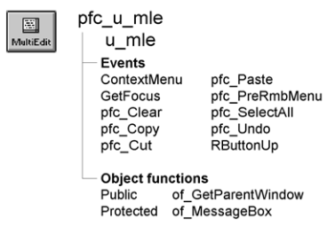

# u_mle

**Description**

MultiLineEdit visual user object ancestor.

**Ancestry**



**Library**

- PFCMAIN.PBL
- PFEMAIN.PBL

**Object relationships**

PFC visual user objects are designed to be used with windows that are descendants of w_master.

**Usage**

Use this visual object in windows instead of the standard PowerBuilder MultiLineEdit. U_mle event scripts provide integration with PFC menus. Additionally, u_mle supports:

- **Cut, copy, paste, clear, and select all** These are triggered automatically by the message router.
- **Popup menu support** The ContextMenu event enables you to use the right mouse button to perform editing actions. To disable right mouse button support, set ib_rmbmenu to FALSE in the MultiLineEdit’s Constructor event.
- **Autoselect** This means that text is selected when a user tabs to the edit mask. To disable autoselect, set ib_autoselect to FALSE in the MultiLineEdit’s Constructor event.

**See also**

m_edit

## Instance variables

U_mle includes instance variables:

| Instance variable | Description | Data type | Access | Usage |
| --- | --- | --- | --- | --- |
| ib_autoselect | Indicates whether PFC selects text automatically when the control receives focus | Boolean | Protected | Set this to TRUE to enable autoselect (default is FALSE) |
| ib_IsObsolete |  | Boolean | Protected |  |
| ib_rmbmenu | Indicates whether the m_edit menu displays when the user presses the right mouse button | Boolean | Protected | Set this to FALSE to disable right mouse button support (default is TRUE) |

## Events

U_mle includes precoded events:

- ContextMenu
- GetFocus
- pfc_Clear
- pfc_Copy
- pfc_Cut
- pfc_Paste
- pfc_PreRmbMenu
- pfc_SelectAll
- pfc_Undo
- RButtonUp

### ContextMenu

**Description**

Displays the m_edit popup menu.

**Usage**

This event executes when the user releases the right mouse button over a control based on u_mle.

### GetFocus

**Description**

Updates the parent window so it can set MicroHelp.

**Usage**

This event calls the pfc_ControlGotFocus event in the parent.

### pfc_Clear

**Description**

Deletes selected text.

**Return value**

Integer. Returns the number of characters deleted if the event succeeds and -1 if an error occurs.

**Usage**

The message router calls this event when a MultiLineEdit based on u_mle has focus and the user selects Edit>Clear from the menu bar.

### pfc_Copy

**Description**

Copies selected text to the clipboard.

**Return value**

Integer. Returns the number of characters copied if the event succeeds and -1 if an error occurs.

**Usage**

The message router calls this event when a MultiLineEdit based on u_mle has focus and the user selects Edit>Copy from the menu bar. This event is also called by the m_edit popup menu.

### pfc_Cut

**Description**

Deletes selected text and stored it on the clipboard.

**Return value**

Integer. Returns the number of characters removed if the event succeeds and - 1 if an error occurs.

**Usage**

The message router calls this event when a MultiLineEdit based on u_mle has focus and the user selects Edit>Cut from the menu bar. This event is also called by the m_edit popup menu.

### pfc_Paste

**Description**

Inserts (pastes) the contents of the clipboard at the insertion point.

**Return value**

Integer. Returns the number of characters that were pasted if the event succeeds and -1 if an error occurs.

**Usage**

The message router calls this event when a MultiLineEdit based on u_mle has focus and the user selects Edit>Paste from the menu bar. This event is also called by the m_edit popup menu.

### pfc_PreRmbMenu

**Description**

User event allowing you to modify m_edit contents before display.

**Syntax**

```
instancename.EVENT pfc_PreRmbMenu ( editmenu )
```

| Argument | Description |
| --- | --- |
| *instancename* | Instance name of u_mle |
| *editmenu* | M_edit variable containing the popup menu to be displayed (passed by reference) |

**Usage**

Add logic to this event to selectively enable and disable m_edit menu items.

### pfc_SelectAll

**Description**

Selects all text in the MultiLineEdit.

**Return value**

Integer. Returns the number of characters selected if the event succeeds and -1 if an error occurs.

**Usage**

The message router calls this event when a MultiLineEdit based on u_mle has focus and the user selects Edit>Select All from the menu bar. This event is also called by the m_edit popup menu.

### pfc_Undo

**Description**

Cancels the last change to the MultiLineEdit, restoring the text to the content before the last change.

**Return value**

Integer. Returns 1 if the event succeeds 0 and -1 if an error occurs.

**Usage**

The message router calls this event when a MultiLineEdit based on u_mle has focus and the user selects Edit>Undo.

### RButtonUp

**Description**

Empty user event. PFC code previously assigned to this event is now in the ContextMenu event.

**Usage**

This event executes when the user releases the right mouse button over a control based on u_mle.

## Functions

U_mle includes precoded object functions:

- of_GetParentWindow
- of_MessageBox

### of_GetParentWindow

**Description**

Retrieves a reference to the parent window.

**Access**

Public

**Syntax**

```
instancename.of_GetParentWindow ( window )
```

| Argument | Description |
| --- | --- |
| *instancename* | Instance name of u_mle |
| *window* | Window variable into which the function places a reference to the parent window (passed by reference) |

**Return value**

Integer. Returns 1 if the function succeeds and -1 if there is no parent window.

**Usage**

The u_mle GetFocus event calls this function.

**Examples**

This example is from the u_mle GetFocus event:

```
Window  lw_parent

IF gnv_app.of_GetMicrohelp() THEN
       of_GetParentWindow(lw_parent)
       IF IsValid(lw_parent) THEN
       lw_parent.Dynamic Event pfc_ControlGotFocus &
          (this)
       END IF
END IF
```

### of_MessageBox

**Description**

Displays a MessageBox.

**Access**

Protected

**Syntax**

```
instancename.of_MessageBox ( id, title, message, icon, button, default )
```

| Argument | Description |
| --- | --- |
| *instancename* | Instance name of u_mle |
| *id* | String specifying an ID for the message |
| *title* | String specifying the title of the MessageBox |
| *message* | String specifying the message text |
| *icon* | Icon enumerated data type indicating the icon you want to display on the left side of the message box. Values are: |
|  | • Information! |
|  | • StopSign! |
|  | • Exclamation! |
|  | • Question! |
|  | • None! |
| *button* | Button enumerated data type indicating the set of CommandButtons you want to display at the bottom of the message box. The buttons are numbered in the order listed in the enumerated data type. Values are: |
|  | • OK! |
|  | • OKCancel! |
|  | • YesNo! |
|  | • YesNoCancel! |
|  | • RetryCancel! |
|  | • AbortRetryIgnore! |
| *default* | Integer specifying the number of the button you want to be the default button |

**Return value**

Integer. Returns 1 if the function succeeds and -1 if an error occurs.

**Usage**

Override this function to control MessageBox behavior in MultiLineEdits.

The *id* argument is not used in the default implementation.

**Examples**

This example calls the of_MessageBox function:

```
of_Messagebox(’mle_error’,’Save’, &
   as_error, StopSign!, Ok!, 1)
...
```
