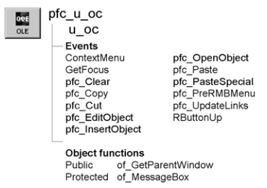

# u_oc

**Description**

OLE visual user object ancestor.

**Ancestry**



**Library**

- PFCMAIN.PBL
- PFEMAIN.PBL

**Object relationships**

PFC visual user objects are designed to be used with windows that are descendants of w_master.

**Usage**

Use this visual object in windows instead of the standard PowerBuilder OLE 2.0 window control. U_oc event scripts provide integration with PFC menus. Additionally, u_oc supports:

- **Cut, copy, paste, paste special, clear, and select all** These are triggered automatically by the message router.
- **Popup menu support** The ContextMenu event enables you to use the right mouse button to perform editing actions. To disable right mouse button support, set ib_rmbmenu to FALSE in the OLE control’s Constructor event.
- **Object actions** U_oc provides events to activate the object (inplace and offsite), update links, and insert an object into the OLE control.

**See also**

m_oc

## Instance variables

U_oc contains one instance variable:

| Instance variable | Description | Data type | Ancestry | Usage |
| --- | --- | --- | --- | --- |
| ib_rmbmenu | Indicates whether the m_oc menu displays when the user presses the right mouse button | Boolean | Protected | Set this to FALSE to disable right mouse button support |

## Events

U_oc includes precoded events:

- ContextMenu
- GetFocus
- pfc_Clear
- pfc_Copy
- pfc_Cut
- pfc_EditObject
- pfc_InsertObject
- pfc_OpenObject
- pfc_Paste
- pfc_PasteSpecial
- pfc_PreRmbMenu
- pfc_UpdateLinks
- RButtonUp

### ContextMenu

**Description**

Displays the m_oc popup menu.

**Usage**

This event executes when the user releases the right mouse button over a control based on u_oc.

### GetFocus

**Description**

Updates the parent window so it can set MicroHelp.

**Usage**

This event calls the pfc_ControlGotFocus event in the parent.

### pfc_Clear

**Description**

Deletes the OLE object.

**Return value**

Integer. Returns 0 if the event succeeds and -9 if an error occurs.

**Usage**

The message router calls this event when an OLE control based on u_oc has focus and the user selects Edit>Clear from a menu that descends from the PFC m_master menu.

### pfc_Copy

**Description**

Copies the OLE object to the clipboard.

**Return value**

Integer. Returns one of the following values:

0 Success -1 Container is empty -2 Copy failed -9 Other error

**Usage**

The message router calls this event when an OLE control based on u_oc has focus and the user selects Edit>Copy from a menu that descends from the PFC m_master menu. This event is also called by the m_oc popup menu.

### pfc_Cut

**Description**

Deletes the selected item or text and stores it on the clipboard.

**Return value**

Integer. Returns values as follows:

-1 Container is empty -2 Cut failed -9 Other error

**Usage**

The message router calls this event when an OLE control based on u_oc has focus and the user selects Edit>Cut. This event is also called by the m_oc popup menu.

### pfc_EditObject

**Description**

Activates the object in place.

**Return value**

Integer. Returns values as follows:

0 Success -1 Control is empty -2 Invalid verb for the object -3 Verb not implemented by the object -4 No verbs supported by the object -5 Object can’t execute the verb now -9 Other error

**Usage**

Call this event to activate an object in-place.

The message router calls this event when an OLE control based on u_oc has focus and the user selects Edit>Object>Edit from a menu that descends from the PFC m_master menu. This event is also called by the m_oc popup menu.

### pfc_InsertObject

**Description**

Displays the Insert Object dialog box, which allows you to insert an object into the OLE control.

**Return value**

Integer. Returns values as follows:

0 Success 1 The user canceled out of the dialog box -9 Other error

**Usage**

Call this event to insert an object into the OLE control.

The message router triggers this event when an OLE control based on u_oc has focus and the user selects Edit>Insert Object from a menu that descends from the PFC m_master menu.

### pfc_OpenObject

**Description**

Activates the object offsite.

**Return value**

Integer. Returns values as follows:

0 Success -1 Control is empty -2 Invalid verb for the object -3 Verb not implemented by the object -4 No verbs supported by the object -5 Object can’t execute the verb now -9 Other error

**Usage**

Call this event to activate an object offsite.

The message router calls this event when an OLE control based on u_oc has focus and the user selects Edit>Object>Open from a menu that descends from the PFC m_master menu. This event is also called by the m_oc popup menu.

### pfc_Paste

**Description**

Inserts (pastes) the contents of the clipboard at the insertion point.

**Return value**

Integer. Returns values as follows:

0 Success -1 No data or clipboard contents cannot be embedded -9 Other error

**Usage**

The message router calls this event when an OLE control based on u_oc has focus and the user selects Edit>Paste from a menu that descends from the PFC m_master menu. This event is also called by the m_oc popup menu.

### pfc_PasteSpecial

**Description**

Displays a standard OLE 2.0 dialog box allowing the user to choose whether to embed or link the OLE object on the clipboard when pasting it in the specified control. Embedding is the equivalent of calling the Paste function and linking is the same as calling PasteLink.

**Return value**

Integer. Returns values as follows:

0 Success 1 User canceled out of the OLE 2.0 dialog box -1 No data found -9 Other error

**Usage**

The message router calls this event when an OLE control based on u_oc has focus and the user selects Edit>Paste Special from a menu that descends from the PFC m_master menu.

### pfc_PreRmbMenu

**Description**

User event allowing you to modify m_oc contents prior to display.

**Syntax**

```
instancename.Event pfc_PreRmbMenu ( editmenu )
```

| Argument | Description |
| --- | --- |
| *instancename* | Instance name of u_oc |
| *editmenu* | M_oc variable containing the popup menu to be displayed (passed by reference) |

**Usage**

Optionally add logic to this event to selectively enable and disable m_oc menu items.

### pfc_UpdateLinks

**Description**

Attempts to find a file linked to an OLE container. If the linked file is not found, a dialog tells the user and lets them bring up a second dialog for find the file or changing the link.

**Return value**

Integer. Returns 0 if the event succeeds and -1 if an error occurs.

**Usage**

Call this event to update links for an OLE control.

The message router triggers this event when an OLE control based on u_oc has focus and the user selects Edit>Update Links from a menu that descends from the PFC m_master menu.

### RButtonUp

**Description**

Empty user event. PFC code previously assigned to this event is now in the ContextMenu event.

**Usage**

This event executes when the user releases the right mouse button over a control based on u_oc.

## Functions

U_oc includes precoded object functions:

- of_GetParentWindow
- of_MessageBox

### of_GetParentWindow

**Description**

Retrieves a reference to the parent window.

**Access**

Public

**Syntax**

```
instancename.of_GetParentWindow ( window )
```

| Argument | Description |
| --- | --- |
| *instancename* | Instance name of u_oc |
| *window* | Window variable into which the function places a reference to the parent window (passed by reference) |

**Return value**

Integer. Returns 1 if the function succeeds and -1 if there is no parent window.

**Usage**

The u_oc GetFocus event calls this function.

**Examples**

This example is from the u_oc GetFocus event:

```
Window   lw_parent

IF gnv_app.of_GetMicrohelp() THEN
       of_GetParentWindow(lw_parent)
       IF IsValid(lw_parent) THEN
       lw_parent.Dynamic Event pfc_ControlGotFocus &
          (this)
       END IF
END IF
```

### of_MessageBox

**Description**

Displays a MessageBox.

**Access**

Protected

**Syntax**

```
instancename.of_MessageBox ( id, title, message, icon, button, default )
```

| Argument | Description |
| --- | --- |
| *instancename* | Instance name of u_oc |
| *id* | String specifying an ID for the message |
| *title* | String specifying the title of the OLEControl |
| *message* | String specifying the message text |
| *icon* | Icon enumerated data type indicating the icon you want to display on the left side of the message box. Values are: |
|  | • Information! |
|  | • StopSign! |
|  | • Exclamation! |
|  | • Question! |
|  | • None! |
| *button* | Button enumerated data type indicating the set of CommandButtons you want to display at the bottom of the message box. The buttons are numbered in the order listed in the enumerated data type. Values are: |
|  | • OK! |
|  | • OKCancel! |
|  | • YesNo! |
|  | • YesNoCancel! |
|  | • RetryCancel! |
|  | • AbortRetryIgnore! |
| *default* | Integer specifying the number of the button you want to be the default button |

**Return value**

Integer. Returns 1 if the function succeeds and -1 if an error occurs.

**Usage**

Override this function to control MessageBox behavior in OLE controls.

The *id* argument is not used in the default implementation.

**Examples**

This example calls the of_MessageBox function:

```
of_Messagebox(’oc_error’,’Save’, &
   as_error, StopSign!, Ok!, 1)
...
```
