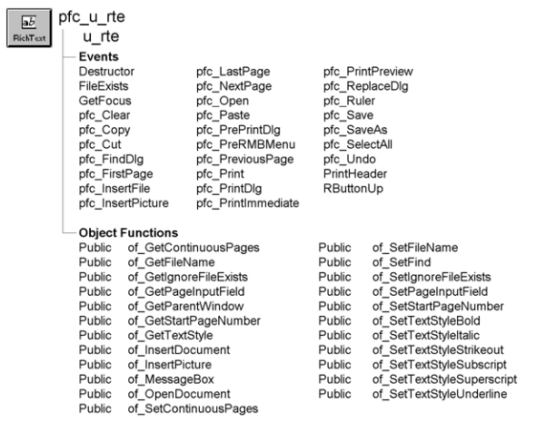

# u_rte

**Description**

RichTextEdit visual user object ancestor.

**Ancestry**



**Library**

- PFCMAIN.PBL
- PFEMAIN.PBL

**Object relationships**

PFC visual user objects are designed to be used with windows that are descendants of w_master. U_rte also uses:

- [F_SetFileSrv](../04-global-functions/f_setfilesrv.md)
- [M_edit](../03-menus/m_edit.md)
- [N_cst_filesrv](../09-custom-class-user-objects/n_cst_filesrv.md)
- [N_cst_rtefind](../09-custom-class-user-objects/n_cst_rtefind.md)
- [N_cst_textstyleattrib](../05-global-structures-and-structure-objects/n_cst_textstyleattrib.md)
- [S_printdlgattrib](../05-global-structures-and-structure-objects/s_printdlgattrib.md)

**Usage**

Use this visual user object in windows instead of the standard PowerBuilder RichTextEdit control. U_rte event scripts provide integration with PFC menus.

**U_rte is a window control** U_rte is a subclassed version of the RichTextEdit window control. It is not a DataWindow control using the Rich Text presentation style.

U_rte is fully integrated with menus that descend from PFC’s m_master menu, including events that respond to the appropriate menu items. Additionally, u_rte includes right mouse button support. If the user clicks the right mouse button over a u_rte-based RichTextEdit control, the m_edit menu displays. M_edit allows you to perform basic editing functions.

To use u_rte:

1. Place a u_rte user object in your window.
2. (Optional) Enable the find service:

   ```
   rte_doc.of_SetFind(TRUE)
   ```

3. Associate a document with the RichTextEdit control. This example uses the of_OpenDocument function to display a dialog box prompting the user for the file:

   ```
   String  ls_document

   rte_doc.of_OpenDocument(ls_document)
   ```

4. Call additional u_rte events and functions, as needed.

For more information on the RichTextEdit control, see the *PowerBuilder User’s Guide*.

**See also**

- [n_cst_rtefind](../09-custom-class-user-objects/n_cst_rtefind.md)
- [u_dw](u_dw.md)

## Instance variables

U_rte includes instance variables:

| Instance variable | Description | Data type | Access | Usage |
| --- | --- | --- | --- | --- |
| ib_continuouspages | Indicates whether continuous page numbering is enabled when printing | Boolean | Protected | Use of_GetContinuousPages and of_SetContinuousPages to access |
| ib_ignorefileexists | Indicates whether u_rte asks the user to confirm when saving a file that already exists | Boolean | Protected | Use of_GetIgnoreFileExists and of_SetIgnoreFileExists to access |
| ib_ongoingfind | Indicates whether a find operation is in progress | Boolean | Protected | Internal |
| ib_rmbmenu | Indicates whether right mouse button support is enabled | Boolean | Protected | When this is TRUE, PFC displays the m_edit popup menu when a user presses the right mouse button over this control |
|  |  |  |  | To disable right mouse button support, set this variable to FALSE in the control’s Constructor event |
| il_currentinstance | Tracks continuous printing | Long | Protected | Internal |
| il_currentprintpage | Tracks current page number | Long | Protected | Internal |
| il_startpagenumber | Specifies the first page that receives a page number | Boolean | Protected | Use of_GetStartPageNumber and of_SetStartPageNumber to access |
| inv_filesrv | Reference variable for the file service | n_cst_filesrv | Protected | Internal |
| inv_find | Structure containing information used in find and replace processing | n_cst_rtefind | Public | Internal |
| is_filename | Name of the current file | String | Protected | Use the of_GetFileName and of_SetFileName functions to access |
| is_pageinputfield | Specifies the name of the field that PFC uses to place the page number | String | Protected | Use of_GetPageInputField and of_SetPageInputField to access |

## Events

U_rte includes precoded event scripts:

- Destructor
- FileExists
- GetFocus
- pfc_Clear
- pfc_Copy
- pfc_Cut
- pfc_FindDlg
- pfc_FirstPage
- pfc_InsertFile
- pfc_InsertPicture
- pfc_LastPage
- pfc_NextPage
- pfc_Open
- pfc_Paste
- pfc_PrePrintDlg
- pfc_PreRmbMenu
- pfc_PreviousPage
- pfc_Print
- pfc_PrintDlg
- pfc_PrintImmediate
- pfc_PrintPreview
- pfc_ReplaceDlg
- pfc_Ruler
- pfc_Save
- pfc_SaveAs
- pfc_SelectAll
- pfc_Undo
- PrintHeader
- RButtonUp

### Destructor

**Description**

Destroys the inv_filesrv instance.

**Usage**

This event executes when the u_rte-based control is destroyed or the window closes.

### FileExists

**Description**

Prompts the user that the file to be saved already exists. If the ib_ignorefileexists instance variable is TRUE, PFC does not prompt the user.

**Usage**

This event executes when the user saves a file that already exists.

### GetFocus

**Description**

Updates the parent window so it can set MicroHelp.

**Usage**

This event calls the pfc_ControlGotFocus event in the parent.

### pfc_Clear

**Description**

Deletes selected text.

**Return value**

Integer. Returns the number of characters deleted if the event succeeds and -1 if an error occurs.

**Usage**

This event is triggered when a RichTextEdit control based on u_rte has focus and the user selects Edit>Clear from the menu bar of a menu descended from the PFC m_master menu.

### pfc_Copy

**Description**

Copies selected text to the clipboard.

**Return value**

Integer. Returns the number of characters copied if the event succeeds and -1 if an error occurs.

**Usage**

The message router calls this event when a RichTextEdit control based on u_rte has focus and the user selects Edit>Copy from the menu bar of a menu descended from the PFC m_master menu. This event is also called by the m_edit popup menu.

### pfc_Cut

**Description**

Deletes selected text and stores it on the clipboard.

**Return value**

Integer. Returns the number of characters removed if the event succeeds and - 1 if an error occurs.

**Usage**

The message router calls this event when a RichTextEdit control based on u_rte has focus and the user selects Edit>Cut from the menu bar of a menu descended from the PFC m_master menu. This event is also called by the m_edit popup menu.

### pfc_FindDlg

**Description**

Displays a Find dialog box by calling the n_cst_rtefind service’s pfc_FindDlg event.

**Return value**

Integer. Returns 1 if the event succeeds and -1 if an error occurs.

**Usage**

This event is called when the user selects Edit>Find from the menu bar of a menu descended from the PFC m_master menu.

### pfc_FirstPage

**Description**

Scrolls to the first page.

**Return value**

Integer. Returns 1 if the event succeeds and -1 if an error occurs.

**Usage**

The message router calls this event when a RichTextEdit control based on u_rte has focus and the user selects View>First Page from the menu bar of a menu descended from the PFC m_master menu.

### pfc_InsertFile

**Description**

Displays a dialog box prompting the user to choose a file to be copied at the current insertion point.

**Return value**

Integer. Returns 1 if the event succeeds, 0 if the user cancels out of the dialog box, and -1 if an error occurs.

**Usage**

The message router calls this event when a RichTextEdit control based on u_rte has focus and the user selects Insert>File from the menu bar of a menu descended from the PFC m_master menu.

### pfc_InsertPicture

**Description**

Displays a dialog box prompting the user to choose a bitmap to be copied at the current insertion point.

**Return value**

Integer. Returns 1 if the event succeeds, 0 if the user cancels out of the dialog box, and -1 if an error occurs.

**Usage**

The message router calls this event when a RichTextEdit control based on u_rte has focus and the user selects Insert>Picture from the menu bar of a menu descended from the PFC m_master menu.

### pfc_LastPage

**Description**

Scrolls to the last page.

**Return value**

Integer. Returns the number of the last page if the event succeeds and -1 if an error occurs.

**Usage**

The message router calls this event when a RichTextEdit control based on u_rte has focus and the user selects View>Last Page from the menu bar of a menu descended from the PFC m_master menu.

### pfc_NextPage

**Description**

Scrolls to the next page.

**Return value**

Integer. Returns 1 if the event succeeds and -1 if an error occurs.

**Usage**

The message router calls this event when a RichTextEdit control based on u_rte has focus and the user selects View>Next Page from the menu bar of a menu descended from the PFC m_master menu.

### pfc_Open

**Description**

Prompts the user for a file to open and places the specified file in the RichTextEdit control. If there is already a document in the control, the function prompts the user to save it.

**Return value**

Integer. Returns 1 if the event succeeds, 0 if the user cancels out of the dialog box, and -1 if an error occurs.

**Usage**

The message router calls this event when a RichTextEdit control based on u_rte has focus and the user selects File>Open from the menu bar of a menu descended from the PFC m_master menu.

### pfc_Paste

**Description**

Inserts (pastes) the contents of the clipboard at the insertion point.

**Return value**

Integer. Returns the number of characters that were pasted if the event succeeds and -1 if an error occurs.

**Usage**

The message router calls this event when a RichTextEdit control based on u_rte has focus and the user selects Edit>Paste from the menu bar of a menu descended from the PFC m_master menu.

### pfc_PrePrintDlg

**Description**

Empty user event allowing you to modify the properties passed to the n_cst_platform of_PrintDlg function.

**Syntax**

```
instancename.EVENT pfc_PrePrintDlg ( attributes )
```

| Argument | Description |
| --- | --- |
| *instancename* | Instance name of u_rte |
| *attributes* | S_printdlgattrib variable into which the event places additional printing information. This argument is accessed through the *astr_printdlg* argument (passed by reference) |

**Usage**

This event is called by pfc_PrintDlg before calling the n_cst_platform of_PrintDlg function.

You can use this event to modify or extend the information passed in the s_printdlgattrib structure.

**Examples**

This example contains code you might add to the pfc_PrePrintDlg event:

```
// Default copies to 1
astr_printdlg.l_copies = 1
```

### pfc_PreRmbMenu

**Description**

User event allowing you to modify m_edit contents before display.

**Syntax**

```
instancename.EVENT pfc_PreRmbMenu ( editmenu )
```

| Argument | Description |
| --- | --- |
| *instancename* | Instance name of u_rte |
| *editmenu* | M_edit variable containing the popup menu to be displayed (passed by reference) |

**Usage**

You can add logic to this event to selectively enable and disable m_edit menu items.

### pfc_PreviousPage

**Description**

Scrolls to the Previous page.

**Return value**

Integer. Returns 1 if the function succeeds and -1 if an error occurs.

**Usage**

The message router calls this event when a RichTextEdit control based on u_rte has focus and the user selects View>Previous Page from the menu bar of a menu descended from the PFC m_master menu.

### pfc_Print

**Description**

Calls the pfc_PrintDlg function and prints the RichTextEdit control, as specified in the Print dialog box.

**Return value**

Integer. Returns 1 if the event succeeds and -1 if an error occurs.

**Usage**

This event is triggered when the RichTextEdit control has focus and the user selects File>Print from the menu bar of a menu descended from the PFC m_master menu.

### pfc_PrintDlg

**Description**

Initializes the s_printdlgattrib structure with the RichTextEdit control’s current settings, displays the Print dialog box by calling the n_cst_platform of_PrintDlg function, and resets the settings, as specified by the user.

**Syntax**

```
instancename.EVENT pfc_PrintDlg ( attributes )
```

| Argument | Description |
| --- | --- |
| *instancename* | Instance name of u_rte |
| *attributes* | S_printdlgattrib variable into which the event places printing information. This argument is accessed through the *astr_printdlg* argument (passed by reference) |

**Return value**

Integer. Returns 1 if the event succeeds and -1 if an error occurs.

**Usage**

This event is called by the pfc_Print event.

### pfc_PrintImmediate

**Description**

Prints the current RichTextEdit control without displaying the Print dialog box.

**Return value**

Integer. Returns 1 if the event succeeds and -1 if an error occurs.

**Usage**

This event is called when the RichTextEdit control has focus and the user selects File>Print Immediate from the menu bar of a menu descended from the PFC m_master menu.

### pfc_PrintPreview

**Description**

Toggles between print preview and edit mode.

**Return value**

Boolean. Returns TRUE if the RichTextEdit control has been placed in preview mode and FALSE if it has been placed in edit mode.

**Usage**

The message router calls this event when a RichTextEdit control based on u_rte has focus and the user selects File>Print Preview from the menu bar of a menu descended from the PFC m_master menu.

### pfc_ReplaceDlg

**Description**

Displays a Replace dialog box by calling the n_cst_rtefind service’s pfc_ReplaceDlg event.

**Return value**

Integer. Returns 1 if the event succeeds and -1 if an error occurs.

**Usage**

This event is called when the user selects View>Replace from the menu bar of a menu descended from the PFC m_master menu.

### pfc_Ruler

**Description**

Toggles display of the ruler and tab bar.

**Return value**

Boolean. Returns TRUE if the ruler has been displayed and FALSE if it has been hidden.

**Usage**

The message router calls this event when a RichTextEdit control based on u_rte has focus and the user selects View>Ruler from the menu bar of a menu descended from the PFC m_master menu.

### pfc_Save

**Description**

Saves the current contents of the RichTextEdit control. If the current contents is not associated with a file, the function displays a dialog box prompting the user to specify a filename.

**Return value**

Integer. Returns 1 if the event succeeds, 0 if the user cancels out of the dialog box, and -1 if an error occurs.

**Usage**

The message router calls this event when a RichTextEdit control based on u_rte has focus and the user selects File>Save from the menu bar of a menu descended from the PFC m_master menu.

### pfc_SaveAs

**Description**

Saves the current contents of the RichTextEdit control, prompting the user to specify a filename.

**Return value**

Integer. Returns 1 if the event succeeds, 0 if the user cancels out of the dialog box, and -1 if an error occurs.

**Usage**

The message router calls this event when a RichTextEdit control based on u_rte has focus and the user selects File>Save As from the menu bar of a menu descended from the PFC m_master menu.

### pfc_SelectAll

**Description**

Selects all text in the RichTextEdit control.

**Return value**

Integer. Returns the number of characters selected if the event succeeds and -1 if an error occurs.

**Usage**

The message router calls this event when a RichTextEdit control based on u_rte has focus and the user selects Edit>Select All from the menu bar of a menu descended from the PFC m_master menu.

### pfc_Undo

**Description**

Cancels the last change to the RichTextEdit control, restoring the text to the content before the last change.

**Return value**

Integer. Returns 1 if the event succeeds and -1 if an error occurs.

**Usage**

The message router calls this event when a RichTextEdit control based on u_rte has focus and the user selects Edit>Undo from the menu bar of a menu descended from the PFC m_master menu.

### PrintHeader

**Description**

Sets page numbers for printing.

**Usage**

This event executes when you print the RichTextEdit control.

### RButtonUp

**Description**

Displays the m_edit popup menu.

**Usage**

This event executes when the user releases the right mouse button over a control based on u_rte.

## Functions

U_rte includes precoded object functions:

- of_GetContinuousPages
- of_GetFileName
- of_GetIgnoreFileExists
- of_GetPageInputField
- of_GetParentWindow
- of_GetStartPageNumber
- of_GetTextStyle
- of_InsertDocument
- of_InsertPicture
- of_MessageBox
- of_OpenDocument
- of_SetContinuousPages
- of_SetFileName
- of_SetFind
- of_SetIgnoreFileExists
- of_SetPageInputField
- of_SetStartPageNumber
- of_SetTextStyleBold
- of_SetTextStyleItalic
- of_SetTextStyleStrikeout
- of_SetTextStyleSubscript
- of_SetTextStyleSuperscript
- of_SetTextStyleUnderline

### of_GetContinuousPages

**Description**

Reports whether PFC uses continuous page numbering when the RichTextEdit control is shared to a DataWindow.

**Access**

Public

**Syntax**

```
instancename.of_GetContinuousPages ( )
```

| Argument | Description |
| --- | --- |
| *instancename* | Instance name of u_rte |

**Return value**

Boolean. Returns TRUE if continuous page numbering is enabled and FALSE if it is not.

**Examples**

This example calls the of_GetContinuousPages function:

```
IF rte_doc.of_GetContinuousPages() THEN
       MessageBox("RTE", &
      "Continuous page numbering is enabled")
ELSE
       MessageBox("RTE", &
      "Continuous page numbering is disabled")
END IF
```

### of_GetFileName

**Description**

Retrieves the name of the file associated with the RichTextEdit control.

**Access**

Public

**Syntax**

```
instancename.of_GetFileName ( )
```

| Argument | Description |
| --- | --- |
| *instancename* | Instance name of u_rte |

**Return value**

String. Returns the current filename or an empty string if one has not been set with the of_SetFilename function.

**Examples**

This example calls the of_GetFileName function:

```
String   ls_filename

ls_filename = rte_doc.of_GetFileName()
MessageBox("RTE", "Filename is " + ls_filename)
```

### of_GetIgnoreFileExists

**Description**

Reports whether PFC displays a message before overwriting an existing file.

**Access**

Public

**Syntax**

```
instancename.of_GetIgnoreFileExists ( )
```

| Argument | Description |
| --- | --- |
| *instancename* | Instance name of u_rte |

**Return value**

Boolean. Returns TRUE if PFC displays no message before overwriting an existing file and FALSE if PFC prompts the user before overwriting an existing file.

**Examples**

This example calls the of_GetIgnoreFileExists function:

```
IF rte_doc.of_GetIgnoreFileExists() THEN
  MessageBox("RTE", "No prompt before overwriting")
ELSE
  MessageBox("RTE", "PFC prompts before overwriting")
END IF
```

### of_GetPageInputField

**Description**

Retrieves the name of the field PFC uses to place the page number.

**Access**

Public

**Syntax**

```
instancename.of_GetPageInputField ( )
```

| Argument | Description |
| --- | --- |
| *instancename* | Instance name of u_rte |

**Return value**

String. Returns the name of the field PFC uses to place the page number.

**Examples**

This example calls the of_GetPageInputField function:

```
String   ls_field

ls_field = rte_doc.of_GetPageInputField( )
MessageBox("RTE", "Page input field is " + ls_field)
```

### of_GetParentWindow

**Description**

Returns the parent of the current window.

**Access**

Public

**Syntax**

```
instancename.of_GetParentWindow ( parent )
```

| Argument | Description |
| --- | --- |
| *instancename* | Instance name of u_rte |
| *parent* | Window variable into which the function places the parent of the current window (passed by reference) |

**Return value**

Integer. Returns 1 if the function succeeds and -1 if an error occurs.

**Usage**

Internal.

**Examples**

This example is from the GetFocus event.

```
Window  lw_parent

IF gnv_app.of_GetMicrohelp() THEN
       of_GetParentWindow(lw_parent)
       IF IsValid(lw_parent) THEN
      lw_parent.Dynamic Event &
         pfc_ControlGotFocus (this)
       END IF
END IF
```

### of_GetStartPageNumber

**Description**

Retrieves the number of the page on which page numbers are initially displayed. For example, if this value is 3, the first two pages do not display page numbers and the third page displays a 3.

**Access**

Public

**Syntax**

```
instancename.of_GetStartPageNumber ( )
```

| Argument | Description |
| --- | --- |
| *instancename* | Instance name of u_rte |

**Return value**

Long. Returns the number of the page upon which page numbers are initially displayed

**Examples**

This example calls the of_GetStartPageNumber function:

```
Long   ll_return

ll_return = rte_doc.of_GetStartPageNumber()
MessageBox("RTE", &
   "Start page number is " + String(ll_return))
```

### of_GetTextStyle

**Description**

Calculates all text style settings for the currently selected text.

**Access**

Public

**Syntax**

```
instancename.of_GetTextStyle ( textstyle )
```

| Argument | Description |
| --- | --- |
| *instancename* | Instance name of u_rte |
| *textstyle* | N_cst_textstyleattrib instance into which the function places text style settings (passed by reference) |

**Return value**

Integer. Returns 1 if the function succeeds and -1 if an error occurs.

**Usage**

Call this function to determine text style settings for the currently selected text.

**Examples**

This example calls the of_GetTextStyle function:

```
n_cst_textstyleattrib  lnv_style
Integer  li_return
n_cst_conversion  lnv_conv

li_return = rte_doc.of_GetTextStyle &
       (lnv_style)
IF li_return = -1 THEN
       MessageBox("RTE", "GetTextStyle error")
ELSE
       MessageBox("RTE", &
      + "Text styles are as follows:~r~n" &
      + "Bold: " &
      +lnv_conv.of_String(lnv_style.ib_bold) &
      + "~r~nItalic: " &
      + lnv_conv.of_String(lnv_style.ib_italic) &
      + "~r~nStrikeout: " &
      + lnv_conv.of_String(lnv_style.ib_strikeout) &
      + "~r~nSubscript: " &
      + lnv_conv.of_String(lnv_style.ib_subscript) &
      + "~r~nSuperscript: " &
      + lnv_conv.of_String(lnv_style.ib_superscript) &
      + "~r~nUnderlined: " &
      + lnv_conv.of_String(lnv_style.ib_underlined))
END IF
```

### of_InsertDocument

**Description**

Displays the Insert File dialog box, prompting the user for the name of the file to copy into the current document, placing it at the current insertion point.

**Access**

Public

**Syntax**

```
instancename.of_InsertDocument ( filename )
```

| Argument | Description |
| --- | --- |
| *instancename* | Instance name of u_rte |
| *filename* | String into which the function places the fully qualified name of the file inserted into the document |

**Return value**

Integer. Returns 1 if the function succeeds, 0 if the user cancels out of the dialog box, and -1 if an error occurs.

**Examples**

This example calls the of_InsertDocument function:

```
Integer  li_return
String   ls_filename
li_return = rte_doc.of_InsertDocument(ls_filename)
IF li_return = -1 THEN
       MessageBox("RTE", "Insert file error")
ELSE
       gnv_app.of_GetFrame().SetMicroHelp &
      ("Inserted file: " + String(ls_filename))
END IF
```

### of_InsertPicture

**Description**

Displays the Insert Picture dialog box, prompting the user for the name of the bitmap to copy into the current document, placing it at the current insertion point.

**Access**

Public

**Syntax**

```
instancename.of_InsertPicture ( bitmap )
```

| Argument | Description |
| --- | --- |
| *instancename* | Instance name of u_rte |
| *bitmap* | String into which the function places the fully qualified name of the bitmap inserted into the document |

**Return value**

Integer. Returns 1 if the function succeeds, 0 if the user cancels out of the dialog box, and -1 if an error occurs.

**Examples**

This example calls the of_InsertPicture function:

```
Integer  li_return
String   ls_filename

li_return = rte_doc.of_InsertPicture(ls_filename)
IF li_return = -1 THEN
       MessageBox("RTE", "Insert file error")
ELSE
       gnv_app.of_GetFrame().SetMicroHelp &
      ("Inserted file: " + String(ls_filename))
END IF
```

### of_MessageBox

**Description**

Displays a MessageBox.

**Access**

Protected

**Syntax**

```
instancename.of_MessageBox ( id, title, message, icon, button, default )
```

| Argument | Description |
| --- | --- |
| *instancename* | Instance name of u_rte |
| *id* | String specifying an ID for the message |
| *title* | String specifying the title of the RichTexEdit control |
| *message* | String specifying the message text |
| *icon* | Icon enumerated data type indicating the icon you want to display on the left side of the message box. Values are: |
|  | • Information! |
|  | • StopSign! |
|  | • Exclamation! |
|  | • Question! |
|  | • None! |
| *button* | Button enumerated data type indicating the set of CommandButtons you want to display at the bottom of the message box. The buttons are numbered in the order listed in the enumerated data type. Values are: |
|  | • OK! |
|  | • OKCancel! |
|  | • YesNo! |
|  | • YesNoCancel! |
|  | • RetryCancel! |
|  | • AbortRetryIgnore! |
| *default* | Integer specifying the number of the button you want to be the default button |

**Return value**

Integer. Returns 1 if the function succeeds and -1 if an error occurs.

**Usage**

Override this function to control MessageBox behavior in RichTextEdit controls.

The *id* argument is not used in the default implementation.

**Examples**

This example calls the of_MessageBox function:

```
of_Messagebox(’rte_error’,’Save’, &
   as_error, StopSign!, Ok!, 1)
...
```

### of_OpenDocument

**Description**

Displays the Open dialog box, prompting the user for the name of the file to place into the RichTextEdit control. This function prompts you before discarding the control’s current contents.

**Access**

Public

**Syntax**

```
instancename.of_OpenDocument ( filename )
```

| Argument | Description |
| --- | --- |
| *instancename* | Instance name of u_rte |
| *filename* | String into which the function places the fully qualified name of the selected file |

**Return value**

Integer. Returns 1 if the function succeeds, 0 if the user cancels out of the dialog box, and -1 if an error occurs.

**Examples**

This example calls the of_OpenDocument function:

```
String   ls_filename
Integer  li_return

li_return = rte_doc.of_OpenDocument(ls_filename)
IF li_return = -1 THEN
       MessageBox("RTE", "File open error")
       Return
END IF
```

### of_SetContinuousPages

**Description**

Specifies whether PFC uses continuous page numbering when the RichTextEdit control is shared to a DataWindow.

**Access**

Public

**Syntax**

```
instancename.of_SetContinuousPages ( boolean )
```

| Argument | Description |
| --- | --- |
| *instancename* | Instance name of u_rte |
| *boolean* | Boolean specifying whether continuous page numbering is used (TRUE) or not (FALSE) |

**Return value**

None

**Examples**

This example calls the of_SetContinuousPages function:

```
rte_doc.of_SetContinuousPages(TRUE)
```

### of_SetFileName

**Description**

Specifies the name of the file associated with the RichTextEdit control.

**Access**

Public

**Syntax**

```
instancename.of_SetFileName ( filename )
```

| Argument | Description |
| --- | --- |
| *instancename* | Instance name of u_rte |
| *filename* | String specifying the fully qualified name of the file displayed in the RichTextEdit control |

**Return value**

None

**Usage**

The of_OpenDocument function automatically specifies the name of the file associated with the RichTextEdit control. But if you open a document with of_InsertDocument or the PowerScript InsertDocument function, you should call this function to set the filename.

**Examples**

This example calls the of_SetFileName function:

```
Integer  li_return
String   ls_filename

li_return = rte_doc.of_InsertDocument(ls_filename)
IF li_return = -1 THEN
       MessageBox("RTE", "Insert file error")
ELSE
       rte_doc.of_SetFileName(ls_filename)
END IF
```

### of_SetFind

**Description**

Enables or disables n_cst_rtefind, which provides the find and replace service.

**Access**

Public

**Syntax**

```
instancename.of_SetFind ( boolean )
```

| Argument | Description |
| --- | --- |
| *instancename* | Instance name of u_rte |
| *boolean* | Boolean specifying whether to enable (TRUE) or disable (FALSE) the find and replace service |

**Return value**

Integer. Returns 1 if the function succeeds and -1 if an error occurs.

**Usage**

Use this function to create or destroy an instance of n_cst_rtefind. This instance is named inv_find.

**Examples**

This example calls the of_SetFind function to enable the RichTextEdit find and replace service:

```
rte_doc.of_SetFind(TRUE)
```

### of_SetIgnoreFileExists

**Description**

Specifies whether PFC displays a message before overwriting an existing file.

**Access**

Public

**Syntax**

```
instancename.of_SetIgnoreFileExists ( boolean )
```

| Argument | Description |
| --- | --- |
| *instancename* | Instance name of u_rte |
| *boolean* | Boolean specifying whether PFC displays a message before overwriting an existing file (TRUE) or not (FALSE) |

**Return value**

None

**Examples**

This example calls the of_SetIgnoreFileExists function:

```
String   ls_filename
Integer  li_return

li_return = &
       rte_doc.of_OpenDocument(ls_filename)
IF li_return = -1 THEN
       MessageBox("RTE", "File open error")
       Return
ELSE
       rte_doc.of_SetIgnoreFileExists(TRUE)
END IF
```

### of_SetPageInputField

**Description**

Specifies the name of the field PFC uses to place the page number.

**Access**

Public

**Syntax**

```
instancename.of_SetPageInputField ( )
```

| Argument | Description |
| --- | --- |
| *instancename* | Instance name of u_rte |

**Return value**

None

**Examples**

This example calls the of_SetPageInputField function:

```
rte_doc.of_SetContinuousPages(TRUE)
rte_doc.of_SetPageInputField("PAGE NUMBER")
rte_doc.of_SetStartPageNumber(2)
```

### of_SetStartPageNumber

**Description**

Specifies the number of the page upon which page numbers are initially displayed. For example, if this value is 3, the first two pages do not display page numbers and the third page displays a 3.

**Access**

Public

**Syntax**

```
instancename.of_SetStartPageNumber ( firstpage )
```

| Argument | Description |
| --- | --- |
| *instancename* | Instance name of u_rte |
| *firstpage* | Long specifying the number of the page upon which page numbers are initially displayed |

**Return value**

None

**Examples**

This example calls the of_SetStartPageNumber function:

```
rte_doc.of_SetContinuousPages(TRUE)
rte_doc.of_SetPageInputField("PAGE NUMBER")
rte_doc.of_SetStartPageNumber(2)
```

### of_SetTextStyleBold

**Description**

Sets the currently selected text to bold, leaving all other text attributes as they were.

**Access**

Public

**Syntax**

```
instancename.of_SetTextStyleBold ( boolean )
```

| Argument | Description |
| --- | --- |
| *instancename* | Instance name of u_rte |
| *boolean* | Boolean indicating whether to add the bold attribute (TRUE) or remove it (FALSE) |

**Return value**

Integer. Returns 1 if the function succeeds and -1 if an error occurs.

**Examples**

This example calls the of_SetTextStyleBold function:

```
Integer  li_return

li_return = rte_doc.of_SetTextStyleBold(TRUE)
IF li_return = -1 THEN
       MessageBox("RTE","Error setting text style")
END IF
```

### of_SetTextStyleItalic

**Description**

Sets the currently selected text to italic, leaving all other text attributes as they were.

**Access**

Public

**Syntax**

```
instancename.of_SetTextStyleItalic ( boolean )
```

| Argument | Description |
| --- | --- |
| *instancename* | Instance name of u_rte |
| *boolean* | Boolean indicating whether to add the italic attribute (TRUE) or remove it (FALSE) |

**Return value**

Integer. Returns 1 if the function succeeds and -1 if an error occurs.

**Examples**

This example calls the of_SetTextStyleItalic function:

```
Integer  li_return

li_return = rte_doc.of_SetTextStyleItalic(TRUE)
IF li_return = -1 THEN
       MessageBox("RTE","Error setting text style")
END IF
```

### of_SetTextStyleStrikeout

**Description**

Sets the currently selected text to strikeout, leaving all other text attributes as they were.

**Access**

Public

**Syntax**

```
instancename.of_SetTextStyleStrikeout ( boolean )
```

| Argument | Description |
| --- | --- |
| *instancename* | Instance name of u_rte |
| *boolean* | Boolean indicating whether to add the strikeout attribute (TRUE) or remove it (FALSE) |

**Return value**

Integer. Returns 1 if the function succeeds and -1 if an error occurs.

**Examples**

This example calls the of_SetTextStyleStrikeout function:

```
Integer   li_return

li_return = rte_doc.of_SetTextStyleStrikeout(TRUE)
IF li_return = -1 THEN
       MessageBox("RTE","Error setting text style")
END IF
```

### of_SetTextStyleSubscript

**Description**

Sets the currently selected text to subscript, leaving all other text attributes as they were.

**Access**

Public

**Syntax**

```
instancename.of_SetTextStyleSubscript ( boolean )
```

| Argument | Description |
| --- | --- |
| *instancename* | Instance name of u_rte |
| *boolean* | Boolean indicating whether to add the subscript attribute (TRUE) or remove it (FALSE) |

**Return value**

Integer. Returns 1 if the function succeeds and -1 if an error occurs.

**Examples**

This example calls the of_SetTextStyleSubscript function:

```
Integer   li_return

li_return = rte_doc.of_SetTextStyleSubscript(TRUE)
IF li_return = -1 THEN
       MessageBox("RTE","Error setting text style")
END IF
```

### of_SetTextStyleSuperscript

**Description**

Sets the currently selected text to superscript, leaving all other text attributes as they were.

**Access**

Public

**Syntax**

```
instancename.of_SetTextStyleSuperscript ( boolean )
```

| Argument | Description |
| --- | --- |
| *instancename* | Instance name of u_rte |
| *boolean* | Boolean indicating whether to add the superscript attribute (TRUE) or remove it (FALSE) |

**Return value**

Integer. Returns 1 if the function succeeds and -1 if an error occurs.

**Examples**

This example calls the of_SetTextStyleSuperscript function:

```
Integer   li_return

li_return = rte_doc.of_SetTextStyleSuperscript(TRUE)
IF li_return = -1 THEN
       MessageBox("RTE","Error setting text style")
END IF
```

### of_SetTextStyleUnderline

**Description**

Sets the currently selected text to underline, leaving all other text attributes as they were.

**Access**

Public

**Syntax**

```
instancename.of_SetTextStyleUnderline ( boolean )
```

| Argument | Description |
| --- | --- |
| *instancename* | Instance name of u_rte |
| *boolean* | Boolean indicating whether to add the underline attribute (TRUE) or remove it (FALSE) |

**Return value**

Integer. Returns 1 if the function succeeds and -1 if an error occurs.

**Examples**

This example calls the of_SetTextStyleUnderline function:

```
Integer  li_return

li_return = rte_doc.of_SetTextStyleUnderline(TRUE)
IF li_return = -1 THEN
       MessageBox("RTE","Error setting text style")
END IF
```
