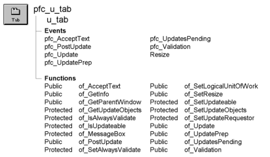

# u_tab

**Description**

Tab control visual user object ancestor.

**Ancestry**



**Library**

- PFCMAIN.PBL
- PFEMAIN.PBL

**Usage**

Use descendants of this visual user object in the User Object painter instead of the visual standard tab user object. Using the User Object painter, add u_tabpg-based tab pages, coding events and functions as needed.

U_tab is a self-updating object.

You typically do not place this object directly into the Window painter.

**See also**

- [n_cst_resize](../09-custom-class-user-objects/n_cst_resize.md)
- [u_tabpg](../07-custom-visual-user-objects/u_tabpg.md)

## Instance variables

U_tab includes instance variables:

| Instance variable | Description | Data type | Access | Usage |
| --- | --- | --- | --- | --- |
| CONTINUE_ACTION | Constant set to 1 | Integer | Public |  |
| FAILURE | Constant set to -1 | Integer | Public |  |
| ib_alwaysvalidate | Controls whether the save process includes all objects in the validation process | Boolean | Protected | Set with of_SetAlwaysValidate (default is FALSE) |
| ib_IsObsolete |  | Boolean | Protected |  |
| ib_isupdateable | Indicates whether the Tab control can be updated | Boolean | Protected | Set with of_SetUpdateable (default is FALSE) |
| inv_luw | Reference variable for logical unit of work service | n_cst_luw | Protected | Implements the update process |
| inv_resize | Reference variable for the resize service | n_cst_resize | Public | Use in dot notation to access n_cst_resize functions and attributes |
| ipo_pendingupdates[ ] | Objects that could be updated | PowerObject | Protected | Internal |
| ipo_updateobjects[ ] | Objects to be updated | PowerObject | Protected | Internal |
| ipo_updaterequestor | Owner of the save process | PowerObject | Protected | Internal |
| NO_ACTION | Constant set to 0 | Integer | Public | Internal |
| PREVENT_ACTION | Constant set to 0 | Integer | Public |  |
| SUCCESS | Constant set to 1 | Integer | Public |  |

## Events

U_tab includes a precoded event:

- Destructor
- pfc_AcceptText
- pfc_PostUpdate
- pfc_Update
- pfc_UpdatePrep
- pfc_UpdatesPending
- pfc_Validation
- Resize

### Destructor

**Description**

Perform cleanup.

**Syntax**

```
instancename.EVENT Destructor ( )
```

| Argument | Description |
| --- | --- |
| *instancename* | Instance name of u_tab |

**Return value**

None.

### pfc_AcceptText

**Description**

Calls the n_cst_luw of_AcceptText function.

**Syntax**

```
instancename.Event pfc_AcceptText ( controls, focusonerror )
```

| Argument | Description |
| --- | --- |
| *instancename* | Instance name of u_tab |
| *controls* | PowerObject array containing the objects on which to accept text. This argument is accessed through the *apo_control* argument |
| *focusonerror* | Boolean indicating whether focus should be set if an error occurs. This argument is accessed through the *ab_focusonerror* argument |

**Return value**

Integer. Returns 1 if the event succeeds and -1 if an error occurs.

**Usage**

The of_AcceptText function calls this event.

### pfc_PostUpdate

**Description**

Calls the n_cst_luw of_PostUpdate function.

**Syntax**

```
instancename.Event pfc_PostUpdate ( controls )
```

| Argument | Description |
| --- | --- |
| *instancename* | Instance name of u_tab |
| *controls* | PowerObject array containing the objects on which to perform post-update processing. This argument is accessed through the *apo_control* argument |

**Return value**

Integer. Returns 1 if the event succeeds and -1 if an error occurs.

**Usage**

Internal.

### pfc_Update

**Description**

Calls the n_cst_luw of_Update function to update the specified controls.

**Syntax**

```
instancename.Event pfc_Update ( controls, accepttext, resetflags )
```

| Argument | Description |
| --- | --- |
| *instancename* | Instance name of u_tab |
| *controls* | PowerObject array containing the objects to update. This argument is accessed through the *apo_control* argument |
| *accepttext* | Boolean specifying whether n_cst_luw should automatically perform an AcceptText prior to performing the Update (TRUE) or not (FALSE) |
| *resetflags* | Boolean specifying whether n_cst_luw should automatically reset DataWindow update flags (TRUE) or not (FALSE) |

**Return value**

Integer. Returns 1 if the function succeeds and -1 if an error occurs.

**Usage**

The of_Update function calls this event.

### pfc_UpdatePrep

**Description**

Calls the n_cst_luw of_UpdatePrep function.

**Syntax**

```
instancename.Event pfc_UpdatePrep ( controls )
```

| Argument | Description |
| --- | --- |
| *instancename* | Instance name of u_tab |
| *controls* | PowerObject array containing the objects to update. This argument is accessed through the *apo_control* argument |

**Return value**

Long. Return 1 if the update preparation succeeds and -1 to halt the update process.

**Usage**

The of_UpdatePrep function calls this function.

### pfc_UpdatesPending

**Description**

Calls the n_cst_luw of_GetUpdatesPending function.

**Syntax**

```
instancename.Event pfc_UpdatesPending ( controls, pending )
```

| Argument | Description |
| --- | --- |
| *instancename* | Instance name of u_tab |
| *controls* | PowerObject array containing the objects to update. This argument is accessed through the *apo_control* argument |
| *pending* | PowerObject array into which the event places objects with pending updates. This argument is accessed through the *apo_pending* argument (passed by reference) |

**Return value**

Integer. Returns 1 if there are pending updates, 0 if there are no pending updates, and -1 if an error occurs.

**Usage**

This event is called by the of_GetUpdatesPending function.

### pfc_Validation

**Description**

Calls the n_cst_luw of_Validation function.

**Syntax**

```
instancename.Event pfc_Validation ( controls )
```

| Argument | Description |
| --- | --- |
| *instancename* | Instance name of u_tab |
| *controls* | PowerObject array containing the objects to validate. This argument is accessed through the *apo_control* argument |

**Return value**

Integer. Returns 1 if the event succeeds and -1 if an error occurs.

**Usage**

This event is called by the of_Validation function.

### Resize

**Description**

Triggers automatic resize processing, if enabled in n_cst_resize.

**Usage**

This event executes when the user resizes the window.

## Functions

U_tab includes precoded object functions:

- of_AcceptText
- of_GetInfo
- of_GetParentWindow
- of_GetUpdateObjects
- of_IsAlwaysValidate
- of_IsUpdateable
- of_MessageBox
- of_PostUpdate
- of_SetAlwaysValidate
- of_SetLogicalUnitOfWork
- of_SetResize
- of_SetUpdateable
- of_SetUpdateObjects
- of_SetUpdateRequestor
- of_Update
- of_UpdatePrep
- of_UpdatesPending
- of_Validation

### of_AcceptText

**Description**

Performs an AcceptText function for controls on the tab’s tab pages.

**Access**

Public

**Syntax**

```
instancename.of_AcceptText ( focusonerror )
```

| Argument | Description |
| --- | --- |
| *instancename* | Instance name of u_tab |
| *focusonerror* | Boolean indicating whether PFC sets focus to the first item in error when an error occurs |

**Return value**

Integer. Returns 1 if the function succeeds and -1 if an error occurs.

**Usage**

N_cst_luw calls this function as part of the default save process. This function is part of the self-updating object API. To customize accept text processing, extend the pfc_AcceptText event.

**Examples**

This example is from the n_cst_luw of_AcceptText function:

```
...
If lb_defined Then
       li_rc =  &
      lpo_tocheck.Function Dynamic of_AcceptText &
         (ab_focusonerror)
       If li_rc < 0 Then Return -1

...
```

### of_GetInfo

**Description**

Retrieves object information.

**Access**

Public

**Syntax**

```
instancename.of_GetInfo ( infoobject )
```

| Argument | Description |
| --- | --- |
| *instancename* | Instance name of u_tab |
| *infoobject* | N_cst_infoattrib instance into which the function places information (passed by reference) |

**Return value**

Integer. Returns 1 if the function succeeds and -1 if an error occurs.

**Examples**

This example calls the of_GetInfo function:

```
n_cst_infoattrib  lnv_info

tab_1.of_GetInfo(lnv_info)
MessageBox("Info",  &
  "Description: " + lnv_info.is_description  &
    + ". Name: " + lnv_info.is_name)
```

### of_GetParentWindow

**Description**

Returns a reference to the parent window.

**Access**

Public

**Syntax**

```
instancename.of_GetParentWindow ( window )
```

| Argument | Description |
| --- | --- |
| *instancename* | Instance name of u_tab |
| *window* | Window variable into which the function places a reference to the parent window |

**Return value**

Integer. Returns 1 if the function succeeds and -1 if there is no parent window. If no parent window is found, *window* returns NULL.

**Usage**

Call this function from within a tab to determine the parent window.

**Examples**

This example calls the of_GetParentWindow function:

```
Window  lw_parent

of_GetParentWindow(lw_parent)
IF IsValid(lw_parent) THEN
       ... // Continue processing
END IF
```

### of_GetUpdateObjects

**Description**

Retrieves the current default array of objects affected by the update process.

**Access**

Protected

**Syntax**

```
instancename.of_GetUpdateObjects ( objects )
```

| Argument | Description |
| --- | --- |
| *instancename* | Instance name of u_tab |
| *objects* | PowerObject array into which the function places objects to be updated (passed by reference) |

**Return value**

Integer. Returns the number of elements in the *objects* array if the function succeeds and -1 if an error occurs.

**Examples**

This example calls the of_GetUpdateObjects function:

```
PowerObject  lpo_objs[ ]
Integer  li_return, li_count

li_return = this.of_GetUpdateObjects(lpo_objs)
FOR li_count = 1 to li_return
       IF lpo_objs[li_count] = ids_data THEN
       Return 1
       END IF
NEXT
li_return++
lpo_objs[li_return] = ids_data
Return this.of_SetUpdateObjects(lpo_objs)
```

### of_IsAlwaysValidate

**Description**

Reports whether the default save process always performs validation, regardless of whether objects have updates pending.

**Access**

Public

**Syntax**

```
instancename.of_IsAlwaysValidate ( )
```

| Argument | Description |
| --- | --- |
| *instancename* | Instance name of u_tab |

**Return value**

Boolean. Returns TRUE if the default save process always performs validation and FALSE if it does not.

**Examples**

This example calls the of_IsAlwaysValidate function:

```
IF tab_1.of_IsAlwaysValidate() = TRUE THEN
   MessageBox("Tab", "Always validate")
ELSE
   MessageBox("Tab", "Sometimes validate")
END IF
```

### of_IsUpdateable

**Description**

Reports whether controls on the Tab control’s tab pages are updatable.

**Access**

Public

**Syntax**

```
instancename.of_IsUpdateable ( )
```

| Argument | Description |
| --- | --- |
| *instancename* | Instance name of u_tab |

**Return value**

Boolean. Returns TRUE if controls are updatable and FALSE if they is not.

**Examples**

This example is from the pfc_UpdatesPending event:

```
...
If Not of_IsUpdateable() Then Return NO_UPDATESPENDING
...
```

### of_MessageBox

**Description**

Displays a MessageBox.

**Access**

Protected

**Syntax**

```
instancename.of_MessageBox ( id, title, message, icon, button, default )
```

| Argument | Description |
| --- | --- |
| *instancename* | Instance name of u_tab |
| *id* | String specifying an ID for the message |
| *title* | String specifying the title of the MessageBox |
| *message* | String specifying the message text |
| *icon* | Icon enumerated data type indicating the icon you want to display on the left side of the message box. Values are: |
|  | • Information! |
|  | • StopSign! |
|  | • Exclamation! |
|  | • Question! |
|  | • None! |
| *button* | Button enumerated data type indicating the set of CommandButtons you want to display at the bottom of the message box. The buttons are numbered in the order listed in the enumerated data type. Values are: |
|  | • OK! |
|  | • OKCancel! |
|  | • YesNo! |
|  | • YesNoCancel! |
|  | • RetryCancel! |
|  | • AbortRetryIgnore! |
| *default* | Integer specifying the number of the button you want to be the default button |

**Return value**

Integer. Returns 1 if the function succeeds and -1 if an error occurs.

**Usage**

Override this function to control MessageBox behavior in Tab controls.

The *id* argument is not used in the default implementation.

**Examples**

This example calls the of_MessageBox function:

```
of_Messagebox(’tab_error’,’Save’, &
   as_error, StopSign!, Ok!, 1)
```

### of_PostUpdate

**Description**

Calls the pfc_PostUpdate event, which clears update flags and allows you to code additional post update processing.

**Access**

Public

**Syntax**

```
instancename.of_PostUpdate ( )
```

| Argument | Description |
| --- | --- |
| *instancename* | Instance name of u_tab |

**Return value**

Integer. Returns 1 if the function succeeds and -1 if an error occurs.

**Usage**

To customize post update processing, extend the pfc_PostUpdate event.

N_cst_luw calls this function as part of the default save process. This function is part of the self-updating object API. To customize post-update processing, extend the pfc_PostUpdate event.

**Examples**

This example is from the n_cst_luw of_PostUpdate function:

```
...
If lb_defined Then
  li_rc =  &
    lpo_tocheck.Function Dynamic of_PostUpdate()
...
```

### of_SetAlwaysValidate

**Description**

Specifies whether the default save process always performs validation, regardless of whether there are pending updates.

**Access**

Public

**Syntax**

```
instancename.of_SetAlwaysValidate ( boolean )
```

| Argument | Description |
| --- | --- |
| *instancename* | Instance name of u_tab |
| *boolean* | Boolean specifying whether the default save process always perform validation (TRUE) or only performs validation if a control has pending updates (FALSE) |

**Return value**

Integer. Returns 1 if the function succeeds and -1 if an error occurs.

**Examples**

This example calls the of_SetAlwaysValidate function:

```
tab_1.of_SetAlwaysValidate(TRUE)
```

### of_SetLogicalUnitOfWork

**Description**

Enables or disables n_cst_luw, which provides the logical unit of work service.

**Access**

Public

**Syntax**

```
instancename.of_SetLogicalUnitOfWork ( boolean )
```

| Argument | Description |
| --- | --- |
| *instancename* | Instance name of u_tab |
| *boolean* | Boolean specifying whether to enable (TRUE) or disable (FALSE) n_cst_luw |

**Return value**

Integer. Returns 1 if the function succeeds, 0 if the service is already enabled, and -1 if an error occurs.

**Usage**

Use this function to create or destroy an instance of n_cst_luw. This instance is named inv_luw. If you do not enable n_cst_luw, u_tab enables it automatically.

**Examples**

This example calls the of_SetLogicalUnitOfWork function:

```
tab_1.of_SetLogicalUnitOfWork(TRUE)
```

### of_SetResize

**Description**

Enables or disables n_cst_resize, the resize service.

**Access**

Public

**Syntax**

```
instancename.of_SetResize ( boolean )
```

| Argument | Description |
| --- | --- |
| *instancename* | Instance name of u_tab |
| *boolean* | Boolean specifying whether to enable (TRUE) or disable (FALSE) an instance of n_cst_resize |

**Return value**

Integer. Returns 1 if the function succeeds and -1 if an error occurs.

**Usage**

Use this function to create or destroy an instance of n_cst_resize. This instance is named inv_resize.

**Examples**

This example calls the of_SetResize function in a window Open event to enable the resize service for tab_1:

```
tab_1.of_SetResize(TRUE)
```

### of_SetUpdateable

**Description**

Specifies whether the Tab is updatable.

**Access**

Public

**Syntax**

```
instancename.of_SetUpdateable ( boolean )
```

| Argument | Description |
| --- | --- |
| *instancename* | Instance name of u_tab |
| *boolean* | Boolean indicating whether the Tab is updatable. All updatable Tabs are included in the default save processing |

**Return value**

Integer. Returns 1 if the function succeeds and -1 if an error occurs.

**Examples**

This example calls the of_SetUpdateable function:

```
tab_1.of_SetUpdateable(FALSE)
```

### of_SetUpdateObjects

**Description**

Sets a new default array containing objects for which updates are attempted.

**Access**

Protected

**Syntax**

```
instancename.of_SetUpdateObjects ( requester )
```

| Argument | Description |
| --- | --- |
| *instancename* | Instance name of u_tab |
| *requester* | PowerObject array containing the object to be updated |

**Return value**

Integer. Returns 1 if the function succeeds and -1 if an error occurs.

**Usage**

Internal.

### of_SetUpdateRequestor

**Description**

Creates a reference to the object requesting an update within a logical unit of work.

**Access**

Public

**Syntax**

```
instancename.of_SetUpdateRequestor ( requester )
```

| Argument | Description |
| --- | --- |
| *instancename* | Instance name of u_tab |
| *requester* | PowerObject containing the object requesting the update |

**Return value**

Integer. Returns 1 if the function succeeds and -1 if an error occurs.

**Usage**

Internal.

**Examples**

This example is from the of_Update function:

```
...
If IsValid(inv_luw) Then
       inv_luw.of_SetUpdateRequestor(apo_requestor)
End If
...
```

### of_Update

**Description**

Calls the pfc_Update event.

**Access**

Public

**Syntax**

```
instancename.of_Update ( accept, resetflag {, requestor} )
```

| Argument | Description |
| --- | --- |
| *instancename* | Instance name of u_tab |
| *accept* | Boolean indicating whether the Update function performs an AcceptText before saving rows to the database |
| *resetflag* | Boolean indicating whether the Update function resets the update flags |
| *requestor* | PowerObject containing the requestor object |

**Return value**

Integer. Returns 1 if the update succeeds and -1 if an error occurs.

**Usage**

N_cst_luw calls this function as part of the default save process. This function is part of the self-updating object API. To customize update processing, extend the pfc_Update event.

**Examples**

This example is from the n_cst_luw of_Update function:

```
...
If lb_defined Then
  li_rc = lpo_tocheck.Function Dynamic of_Update &
    (ab_accepttext,  ab_resetflag, &
      lpo_updaterequestor)
  If li_rc < 0 Then Return -1
  Continue
End If
...
```

### of_UpdatePrep

**Description**

Calls the pfc_UpdatePrep event.

**Access**

Public

**Syntax**

```
instancename.of_UpdatePrep ( )
```

| Argument | Description |
| --- | --- |
| *instancename* | Instance name of u_tab |

**Return value**

Integer. Returns 1 if the function succeeds and -1 if an error occurs.

**Usage**

N_cst_luw calls this function as part of the default save process. This function is part of the self-updating object API. To customize update preparation processing, extend the pfc_UpdatePrep event.

**Examples**

This example is from the n_cst_luw of_UpdatePrep function:

```
...
If lb_defined Then
  li_rc =  &
    lpo_tocheck.Function Dynamic of_UpdatePrep ()
  If li_rc < 0 Then Return -1
  Continue
End If
...
```

### of_UpdatesPending

**Description**

Calls the pfc_UpdatesPending event.

**Access**

Public

**Syntax**

```
instancename.of_UpdatesPending ( )
```

| Argument | Description |
| --- | --- |
| *instancename* | Instance name of u_tab |

**Return value**

Integer. Returns values as follows:

- **1** Updates are pending
- **0** No updates pending
- **-1** An error occurred

**Usage**

N_cst_luw calls this function as part of the default save process. This function is part of the self-updating object API. To customize pending updates processing, extend the pfc_UpdatesPending event.

**Examples**

This example calls the of_UpdatesPending function:

```
...
If lb_defined Then
       la_rc = lpo_tocheck.Dynamic of_UpdatesPending ()
...
```

### of_Validation

**Description**

Calls the pfc_Validation event.

**Access**

Public

**Syntax**

```
instancename.of_Validation ( )
```

| Argument | Description |
| --- | --- |
| *instancename* | Instance name of u_tab |

**Return value**

Integer. Returns 1 if the function succeeds and -1 if a validation error occurs.

**Usage**

N_cst_luw calls this function as part of the default save process. This function is part of the self-updating object API. To customize validation processing, extend the pfc_Validation event.

**Examples**

This example calls the of_Validation function:

```
...
If lb_defined Then
  li_rc =  &
    lpo_tocheck.Function Dynamic of_Validation()
...
```
