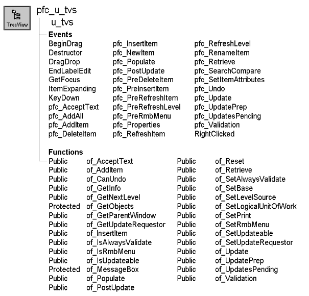

# u_tvs

**Description**

Service-based TreeView visual user object ancestor. This object uses DataStores to display data in a TreeView.

U_tvs is a self-updating object.

**Ancestry**



**Library**

- PFCMAIN.PBL
- PFEMAIN.PBL

**Object relationships**

PFC visual user objects are designed to be used with windows that are descendants of w_master. U_tvs also uses:

- m_tv
- [n_cst_infoattrib](../05-global-structures-and-structure-objects/n_cst_infoattrib.md)
- [n_ds](../08-standard-class-user-objects/n_ds.md)
- [n_cst_luw](../09-custom-class-user-objects/n_cst_luw.md)
- [n_cst_tvsrv](../09-custom-class-user-objects/n_cst_tvsrv.md)
- [n_cst_tvsrv_levelsource](../09-custom-class-user-objects/n_cst_tvsrv_levelsource.md)
- n_cst_print

**Usage**

Use this visual user object in windows instead of the standard PowerBuilder TreeView control. U_tvs event scripts provide integration with PFC menus.

To use u_tvs:

1. Place a u_tvs user object in your window.
2. Enable TreeView services as needed:

   ```
   this.of_SetPrint(TRUE)
   this.of_SetLevelSource(TRUE)
   this.of_SetBase(TRUE)
   ```

3. Specify the data source for each TreeView level:

   ```
   String  ls_sql
   Integer  li_return

   ls_keys[1] = "dept_id"
   this.inv_levelsource.of_Register(1,  &
      "dept_name", "", "d_deptlist", SQLCA, "")
         ls_keys[1] = "emp_id"
   this.inv_levelsource.of_Register(2,   &
      "emp_lname", ":parent.1.dept_id",  &
         "d_empbydept", SQLCA, "")
   ```

4. Specify additional TreeView display information as needed:

   ```
   this.inv_levelsource.of_SetPictureColumn(1, "1")
   this.inv_levelsource.of_SetSelectedPictureColumn &
      (1, "2")
   this.inv_levelsource.of_SetPictureColumn(2, "4")
   this.inv_levelsource.of_SetSelectedPictureColumn &
      (2, "5")
   ```

5. Retrieve rows for the first level of the TreeView:

   ```
   this.event pfc_populate(0)
   ```

6. Extend the pfc_Retrieve event to implement retrieval arguments:

   ```
   Any   la_args[20]
   Integer   li_level

   IF IsValid(inv_levelsource) THEN
          li_level = this.of_GetNextLevel(al_parent)
          this.inv_levelsource.of_GetArgs(al_parent,
   &
         li_level, la_args)
   END IF
   Return this.of_Retrieve(al_parent, la_args,  &
      ads_data)
   ```

7. Call additional u_tvs functions as needed.

For more information on the TreeView control, see the *PowerBuilder User’s Guide*.

**See also**

- [m_tvs](../03-menus/m_tvs.md)
- [u_lvs](u_lvs.md)
- [n_cst_tvsrv](../09-custom-class-user-objects/n_cst_tvsrv.md)
- [n_cst_tvsrv_levelsource](../09-custom-class-user-objects/n_cst_tvsrv_levelsource.md)
- [n_cst_tvsrv_print](../09-custom-class-user-objects/n_cst_tvsrv_print.md)

## Instance variables

U_tvs includes instance variables:

| Instance variable | Description | Data type | Access | Usage |
| --- | --- | --- | --- | --- |
| CONTINUE_ACTION | Constant set to 1 | Integer | Public |  |
| FIND_DATA | Constant set to "data" | String | Public |  |
| FIND_LABEL | Constant set to "label" | String | Public |  |
| ib_alwaysvalidate | Controls whether the save process includes all objects in the validation process | Boolean | Protected | Set with of_SetAlwaysValidate (default is FALSE) |
| ib_IsObsolete |  | Boolean | Protected |  |
| ib_isupdateable | Indicates whether the TreeView can be updated | Boolean | Protected | Set with of_SetUpdateable (default is FALSE) |
| ib_rmbmenu | Controls right mouse button support | Boolean | Protected | Set with of_SetRmbMenu |
| il_dragsource | Handle of the dragged item | Long | Public | PFC uses this instance variable to track a dragged TreeView item |
| il_dragtarget | Handle of drag target | Long | Public | PFC uses this instance variable to track a dragged TreeView item |
| il_rightclicked | Item clicked with the right mouse button | Long | Protected | Internal |
| im_view | Popup menu | m_tvs | Protected | Internal |
| INSERT_AFTER | Constant set to "after" | String | Public |  |
| INSERT_FIRST | Constant set to "first" | String | Public |  |
| INSERT_LAST | Constant set to "last" | String | Public |  |
| INSERT_SORT | Constant set to "sort" | String | Public |  |
| inv_base | Reference variable for basic TreeView services | n_cst_tvsrv | Public | Use in dot notation to access n_cst_tvsrv functions and attributes |
| inv_levelsource | Reference variable for the TreeView data source service | n_cst_tvsrv_levelsource | Public | Use in dot notation to access n_cst_tvsrv_levelsource functions and attributes |
| inv_luw | Reference variable for logical unit of work service | n_cst_luw | Protected | Implements the save process |
| inv_print | Reference variable for TreeView print service | n_cst_tvsrv_print | Public | Use in dot notation to access n_cst_tvsrv_print functions and attributes |
| ipo_pendingupdates[ ] | Objects that could be updated | PowerObject | Protected | Internal |
| ipo_updaterequestor | Owner of the save process | PowerObject | Protected | Internal |
| NO_ACTION | Constant set to 0 | Integer | Public |  |
| PREVENT_ACTION | Constant set to 0 | Integer | Public |  |

## Events

U_tvs includes precoded events:

- BeginDrag
- Constructor
- Destructor
- DragDrop
- EndLabelEdit
- GetFocus
- KeyDown
- ItemExpanding
- pfc_AcceptText
- pfc_AddAll
- pfc_AddItem
- pfc_DeleteItem
- pfc_InsertItem
- pfc_NewItem
- pfc_Populate
- pfc_PostUpdate
- pfc_PreDeleteItem
- pfc_PreInsertItem
- pfc_PreRefreshItem
- pfc_PreRefreshLevel
- pfc_PreRmbMenu
- pfc_Properties
- pfc_RefreshItem
- pfc_RefreshLevel
- pfc_RenameItem
- pfc_Retrieve
- pfc_SearchCompare
- pfc_SetItemAttributes
- pfc_Undo
- pfc_Update
- pfc_UpdatePrep
- pfc_UpdatesPending
- pfc_Validation
- RightClicked

### BeginDrag

**Description**

Saves the handle of a dragged item in the il_dragsource public instance variable.

**Usage**

This event executes when the user drags a label.

### Constructor

**Description**

Service Based TreeView Control.

**Syntax**

```
instancename.EVENT Constructor ( )
```

| Argument | Description |
| --- | --- |
| *instancename* | Instance name of u_tvs |

**Return value**

None.

### Destructor

**Description**

Destroys all enabled service objects.

**Usage**

This event executes when the TreeView is destroyed or the window closes.

### DragDrop

**Description**

Saves the handle of the dropped item in the il_dragtarget instance variable.

**Usage**

This event executes when the user releases a dragged object over the TreeView.

You should extend this event to allow dragging and dropping of TreeView items from one branch to another. Be sure to verify that the drag source is the current TreeView control.

### EndLabelEdit

**Description**

Updates the DataStore with user edits to the item label.

This function updates the DataStore only. You must update the database explicitly, using the of_Update function or the w_master pfc_Save process.

**Usage**

This event executes when the user finishes editing an item label.

If you are using computed columns to display item labels, override this event to update DataStore rows as appropriate.

### GetFocus

**Description**

Updates the parent window so it can set MicroHelp.

**Usage**

This event executes when the control receives focus. It triggers the pfc_ControlGotFocus event in the parent.

### KeyDown

**Description**

Checks to see if the DELETE key was pressed.

**Usage**

This event executes when the user presses a key and is not editing a label.

### ItemExpanding

**Description**

Populates an item with its children.

**Usage**

This event executes when the user expands an item.

### pfc_AcceptText

**Description**

Accepts text for the data displayed in a TreeView control, optionally setting focus if an error occurs.

**Syntax**

```
instancename.EVENT pfc_AcceptText ( controls, focusonerror )
```

| Argument | Description |
| --- | --- |
| *instancename* | Instance name of u_tvs |
| *controls* | PowerObject array containing the objects on which to accept text. This argument is accessed through the *apo_control* argument |
| *focusonerror* | Boolean indicating whether focus should be set if an error occurs. This argument is accessed through the *ab_focusonerror* argument |

**Return value**

Integer. Returns 1 if the event succeeds and -1 if an error occurs.

**Usage**

Extend this event to perform additional accept text processing.

### pfc_AddAll

**Description**

Adds all rows in the passed DataStore under the specified TreeView item.

**Syntax**

```
instancename.EVENT pfc_AddAll ( parent, data )
```

| Argument | Description |
| --- | --- |
| *instancename* | Instance name of u_tvs |
| *parent* | Long specifying the handle of the TreeView item under which the new items are added. This argument is accessed through the *al_parent* argument |
| *data* | N_ds-based DataStore containing rows to be added. This argument is accessed through the *ads_source* argument |

**Return value**

Long. Returns the number of items added if the event succeeds and -1 if an error occurs.

**Examples**

This example is from the of_Populate function:

```
...
Return this.event pfc_AddAll(al_parent, lds_data)
...
```

### pfc_AddItem

**Description**

Adds the specified row as the last item under the specified parent.

**Syntax**

```
instancename.EVENT pfc_AddItem ( parent, data, row )
```

| Argument | Description |
| --- | --- |
| *instancename* | Instance name of u_tvs |
| *parent* | Long specifying the handle of the TreeView item under which the new item is added. This argument is accessed through the *al_parent* argument |
| *data* | N_ds-based DataStore containing the row to be added. This argument is accessed through the *ads_source* argument |
| *row* | Long specifying the row containing the data to be added to the TreeView. This argument is accessed through the *al_row* argument |

**Return value**

Long. Returns the handle of the new item if the event succeeds and -1 if an error occurs.

**Examples**

This example is from the of_AddItem function:

```
...
ll_newindex = this.event pfc_additem  &
   (al_parent, lds_datastore, ll_row)
...
```

### pfc_DeleteItem

**Description**

Deletes the selected item from the TreeView and the DataStore.

**Return value**

Integer. Returns 1 if the event succeeds and -1 if an error occurs.

**Examples**

This example calls the pfc_DeleteItem event:

```
...
li_return = tv_1.Event pfc_DeleteItem()
...
```

### pfc_InsertItem

**Description**

Inserts a new item into the TreeView.

**Syntax**

```
instancename.EVENT pfc_InsertItem ( parent, datastore, row, position,
item )
```

| Argument | Description |
| --- | --- |
| *instancename* | Instance name of u_tvs |
| *parent* | Long specifying the handle of the TreeView item under which the new item is added. This argument is accessed through the *al_parent* argument |
| *datastore* | N_ds containing the data for the new item. This can be either the DataStore maintained by n_cst_tvsrv_levelsource or another DataStore. If this is another DataStore, the associated DataWindow objects must be the same and the function also adds the row to the DataStore maintained by n_cst_tvsrv_levelsource. This argument is accessed through the *ads_source* argument |
| *row* | Long specifying the row containing the item to be inserted. This argument is accessed through the *al_row* argument |
| *position* | String specifying the position under the current parent in which to insert the new item Values are: |
|  | • First |
|  | • Last |
|  | • Sort |
|  | • After |
|  | This argument is accessed through the *as_position* argument |
| *item* | Long containing the handle to the item before the item to be inserted. The function uses this argument if you specify After for *position*. This argument is accessed through the *al_handle* argument |

**Return value**

Integer. Returns the handle of the new item if the function succeeds and -1 if an error occurs.

**Usage**

This event calls the pfc_SetItemAttributes and pfc_PreInsertItem events before inserting the item.

**Examples**

This example is from the pfc_AddAll event:

```
...
For ll_row = 1 to ll_rowcount
       If this.event pfc_insertitem(al_parent,  &
      ads_source, ll_row, "last", 0) < 1 then
         Return -1
       End If
       ll_count++
...
```

### pfc_NewItem

**Description**

Empty user event that you extend to add information to both the data source and the TreeView.

**Return value**

Integer. Returns 1 if the event succeeds and -1 if an error occurs.

**Usage**

You typically use this event to open a dialog box prompting the user for complete information, adding it to the data source and the TreeView (via the n_cst_tvsrv_levelsource of_InsertItem function) when it closes.

### pfc_Populate

**Description**

Retrieves the data source and uses it to populate the TreeView as children of the specified parent.

**Syntax**

```
instancename.EVENT pfc_Populate ( parent )
```

| Argument | Description |
| --- | --- |
| *instancename* | Instance name of u_tvs |
| *parent* | Long specifying the handle of the TreeView item under which the new items are added. This argument is accessed through the *al_parent* argument |

**Return value**

Long. Returns the number of items added if the event succeeds and -1 if an error occurs.

**Usage**

You must also add code to the pfc_Retrieve event.

**Examples**

This example is from the ItemExpanding event:

```
...
If This.FindItem(ChildTreeItem!, handle) = -1 Then
       if this.GetItem(handle, ltvi_This) = 1 then
       li_rc = this.event pfc_Populate(handle)
       If li_rc < 1 Then
...
```

### pfc_PostUpdate

**Description**

Calls the n_cst_luw of_PostUpdate function to perform post-update processing on the specified controls.

**Syntax**

```
instancename.EVENT pfc_PostUpdate ( controls )
```

| Argument | Description |
| --- | --- |
| *instancename* | Instance name of u_tvs |
| *controls* | PowerObject array containing the objects on which to perform post-update processing. This argument is accessed through the *apo_control* argument |

**Return value**

Integer. Returns 1 if the event succeeds and -1 if an error occurs.

**Usage**

Extend this event to perform additional post-update processing.

### pfc_PreDeleteItem

**Description**

Empty user event to which you add logic to perform pre-delete processing.

**Syntax**

```
instancename.EVENT pfc_PreDeleteItem ( handle )
```

| Argument | Description |
| --- | --- |
| *instancename* | Instance name of u_tvs |
| *handle* | Long specifying the handle of the TreeView item to be deleted. This argument is accessed through the *al_handle* argument |

**Usage**

The pfc_DeleteItem event calls this event.

### pfc_PreInsertItem

**Description**

Empty user event to which you add logic to perform pre-insert processing.

**Syntax**

```
instancename.EVENT pfc_PreInsertItem ( parent, data, row, tvitem )
```

| Argument | Description |
| --- | --- |
| *instancename* | Instance name of u_tvs |
| *parent* | Long specifying the handle of the TreeView item under which the new item is added. This argument is accessed through the *al_parent* argument |
| *data* | N_ds containing the data for the new item. This argument is accessed through the *ads_obj* argument |
| *row* | Long specifying the row containing the new item. This argument is accessed through the *al_row* argument |
| *tvitem* | TreeViewItem to be inserted. This argument is accessed through the *atvi_item* argument (passed by reference) |

**Usage**

The pfc_InsertItem event calls this event.

### pfc_PreRefreshItem

**Description**

Empty user event to which you add logic that changes properties before a TreeView item is refreshed.

**Syntax**

```
instancename.EVENT pfc_PreRefreshItem ( handle, data, row, tvitem )
```

| Argument | Description |
| --- | --- |
| *instancename* | Instance name of u_tvs |
| *handle* | Long specifying the handle of the TreeView item to be refreshed. This argument is accessed through the *al_handle* argument |
| *data* | N_ds containing the data for the refreshed item. This argument is accessed through the *ads_obj* argument |
| *row* | Long specifying the row containing the refreshed item. This argument is accessed through the *al_row* argument |
| *tvitem* | TreeViewItem to be refreshed. This argument is accessed through the *atvi_item* argument (passed by reference) |

**Usage**

The pfc_RefreshItem event calls this event. The code you add here will likely be the same as code you add to pfc_PreInsertItem.

### pfc_PreRefreshLevel

**Description**

Empty user event to which you add logic that executes before a TreeView level is refreshed.

**Syntax**

```
instancename.EVENT pfc_PreRefreshLevel ( level )
```

| Argument | Description |
| --- | --- |
| *instancename* | Instance name of u_tvs |
| *level* | Integer specifying the TreeView level to refresh. This argument is accessed through the *ai_level* argument |

**Usage**

The pfc_RefreshLevel event calls this event.

### pfc_PreRmbMenu

**Description**

Empty user event allowing you to modify m_tvs contents before display.

**Syntax**

```
instancename.EVENT pfc_PreRmbMenu ( editmenu )
```

| Argument | Description |
| --- | --- |
| *instancename* | Instance name of u_tvs |
| *editmenu* | M_tvs variable containing the popup menu to be displayed (passed by reference) |

**Usage**

Optionally add logic to this event to selectively enable and disable m_lvs menu items.

### pfc_Properties

**Description**

Empty user event to which you might add logic to display a Properties dialog.

**Return value**

Integer. Return 1 if the event succeeds and -1 if an error occurs.

### pfc_RefreshItem

**Description**

Refreshes the specified TreeView item, resetting all properties to the defaults specified in the data source.

**Syntax**

```
instancename.EVENT pfc_RefreshItem ( handle )
```

| Argument | Description |
| --- | --- |
| *instancename* | Instance name of u_tvs |
| *handle* | Long specifying the handle of the TreeView item to refresh. This argument is accessed through the *ai_level* argument |

**Return value**

Integer. Returns 1 if the event succeeds and -1 if an error occurs.

**Examples**

This example is from the pfc_RefreshLevel event:

```
...
For ll_row = 1 to ll_rowcount
       ll_handle = inv_levelsource.of_GetHandle  &
     (lds_source, ll_row, ai_level)
       If ll_handle < 1 Then Continue
       If this.event pfc_RefreshItem  &
     (ll_Handle) = -1 Then Return -1
Next
...
```

### pfc_RefreshLevel

**Description**

Refreshes the specified TreeView level., resetting all properties to the defaults specified in the data source.

**Syntax**

```
instancename.EVENT pfc_RefreshLevel ( level )
```

| Argument | Description |
| --- | --- |
| *instancename* | Instance name of u_tvs |
| *level* | Integer specifying the TreeView level to refresh |

**Return value**

Integer. Returns 1 if the event succeeds and -1 if an error occurs.

**Examples**

This example calls the pfc_RefreshLevel event:

```
...
tv_1.Event pfc_RefreshLevel(1)
...
```

### pfc_RenameItem

**Description**

Renames the selected item.

**Return value**

Integer. Returns 1 if the event succeeds and -1 if an error occurs.

**Usage**

Internal.

### pfc_Retrieve

**Description**

Retrieves rows into a data source.

**Syntax**

```
instancename.EVENT pfc_Retrieve ( parent, data )
```

| Argument | Description |
| --- | --- |
| *instancename* | Instance name of u_tvs |
| *parent* | Long specifying the handle of the TreeView item under which new items are retrieved. This argument is accessed through the *al_parent* argument |
| *data* | N_ds into which the event places the retrieved rows. This argument is accessed through the *ads_data* argument (passed by reference) |

**Return value**

Long. Returns the number of items retrieved if the event succeeds and -1 if an error occurs.

**Usage**

Extend this event to perform retrieval.

**Examples**

This example shows code you might add to the pfc_Retrieve event:

```
Any   la_args[20]
Integer   li_level

IF IsValid(inv_levelsource) THEN
       li_level = this.of_GetNextLevel(al_parent)
       this.inv_levelsource.of_GetArgs(al_parent,  &
      li_level, la_args)
END IF
Return this.of_Retrieve(al_parent, la_args,  &
   ads_data)
```

### pfc_SearchCompare

**Description**

Compares TreeView data or item text with a target string.

**Syntax**

```
instancename.EVENT pfc_SearchCompare ( handle, attribute, target,
respectcase, fullcompare )
```

| Argument | Description |
| --- | --- |
| *instancename* | Instance name of u_tvs |
| *handle* | Long containing the handle of the item being compared |
| *attribute* | String specifying the TreeView attribute to compare. Valid values are: |
|  | • Data |
|  | • Label |
| *target* | Any data type specifying the search target |
| *respectcase* | Boolean indicating whether the search is case-sensitive |
| *fullcompare* | Boolean indicating whether the specified attribute must match *target* exactly (TRUE) or the attribute can simply contain *target* (FALSE). This argument only applies when *target* is a string |

**Return value**

Boolean. Returns TRUE if a match is found and FALSE if no match is found.

**Usage**

This event is called by the n_cst_tvsrv of_SearchChild function, which is called by of_FindItem.

If your application requires a more complex comparison, override this event.

### pfc_SetItemAttributes

**Description**

Sets default properties for the TreeView item before insertion.

**Syntax**

```
instancename.EVENT pfc_SetItemAttributes ( parent, data, row, tvitem )
```

| Argument | Description |
| --- | --- |
| *instancename* | Instance name of u_tvs |
| *parent* | Long specifying the handle of the TreeView item under which the new item is inserted. This argument is accessed through the *al_parent* argument |
| *data* | N_ds containing the data for the item. This argument is accessed through the *ads_obj* argument |
| *row* | Long specifying the row from which to populate the item. This argument is accessed through the *al_row* argument |
| *tvitem* | TreeViewItem to be inserted. This argument is accessed through the *atvi_item* argument (passed by reference) |

**Usage**

Optionally extend this event to change TreeView item properties before insertion.

### pfc_Undo

**Description**

Cancels the last edit, insert, or delete to the TreeView, restoring the text to the content before the last change.

**Return value**

Integer. Returns 1 if the event succeeds and -1 if an error occurs.

**Usage**

The message router calls this event when a TreeView based on u_tvs has focus and the user selects Edit>Undo.

### pfc_Update

**Description**

Calls the n_cst_luw of_Update function to update the specified controls.

**Syntax**

```
instancename.EVENT pfc_Update ( controls, accepttext, resetflags )
```

| Argument | Description |
| --- | --- |
| *instancename* | Instance name of u_tvs |
| *controls* | PowerObject array containing the objects to update. This argument is accessed through the *apo_control* argument |
| *accepttext* | Boolean specifying whether n_cst_luw should automatically perform an AcceptText before performing the Update (TRUE) or not (FALSE) |
| *resetflags* | Boolean specifying whether n_cst_luw should automatically reset DataWindow update flags (TRUE) or not (FALSE) |

**Return value**

Integer. Returns 1 if the function succeeds and -1 if an error occurs.

**Usage**

The of_Update function calls this event.

### pfc_UpdatePrep

**Description**

Empty user event to which you can add code that prepares for update.

**Syntax**

```
instancename.EVENT pfc_UpdatePrep ( controls )
```

| Argument | Description |
| --- | --- |
| *instancename* | Instance name of u_tvs |
| *controls* | PowerObject array containing the objects to update. This argument is accessed through the *apo_control* argument |

**Return value**

Long. Return 1 if the update preparation succeeds and -1 to halt the update process.

**Usage**

The of_UpdatePrep function calls this function.

### pfc_UpdatesPending

**Description**

Determines if there are pending updates for the TreeView data sources.

**Syntax**

```
instancename.EVENT pfc_UpdatesPending ( controls, pending )
```

| Argument | Description |
| --- | --- |
| *instancename* | Instance name of u_tvs |
| *controls* | PowerObject array containing the objects to update. This argument is accessed through the *apo_control* argument |
| *pending* | PowerObject array into which the event places objects with pending updates. This argument is accessed through the *apo_pending* argument (passed by reference) |

**Return value**

Integer. Returns 1 if there are pending updates, 0 if there are no pending updates, and -1 if an error occurs.

**Usage**

This event is called by the of_GetUpdatesPending function.

### pfc_Validation

**Description**

Checks for required fields.

**Syntax**

```
instancename.EVENT pfc_Validation ( controls )
```

| Argument | Description |
| --- | --- |
| *instancename* | Instance name of u_tvs |
| *controls* | PowerObject array containing the objects to validate. This argument is accessed through the *apo_control* argument |

**Return value**

Integer. Returns 1 if the event succeeds and -1 if an error occurs.

**Usage**

This event is called by the of_Validation function.

### RightClicked

**Description**

Tracks the clicked item and displays the m_tvs popup menu.

**Usage**

This event executes when the user presses the right mouse button.

## Functions

U_tvs includes precoded object functions:

- of_AcceptText
- of_AddItem
- of_CanUndo
- of_GetInfo
- of_GetNextLevel
- of_GetObjects
- of_GetParentWindow
- of_GetUpdateRequestor
- of_InsertItem
- of_IsAlwaysValidate
- of_IsRMBMenu
- of_IsUpdateable
- of_MessageBox
- of_Populate
- of_PostUpdate
- of_Reset
- of_Retrieve
- of_SetAlwaysValidate
- of_SetBase
- of_SetLevelSource
- of_SetLogicalUnitOfWork
- of_SetPrint
- of_SetRMBMenu
- of_SetUpdateable
- of_SetUpdateRequestor
- of_Update
- of_UpdatePrep
- of_UpdatesPending
- of_Validation

### of_AcceptText

**Description**

Performs an AcceptText function for each level’s data source.

**Access**

Public

**Syntax**

```
instancename.of_AcceptText ( focusonerror )
```

| Argument | Description |
| --- | --- |
| *instancename* | Instance name of u_tvs |
| *focusonerror* | Boolean indicating whether PFC sets focus to the first item in error when an error occurs |

**Return value**

Integer. Returns 1 if the function succeeds and -1 if an error occurs.

**Usage**

N_cst_luw calls this function as part of the default save process. This function is part of the self-updating object API. To customize accept text processing, extend the pfc_AcceptText event.

**Examples**

This example is from the n_cst_luw of_AcceptText function:

```
...
If lb_defined Then
       li_rc =  &
      lpo_tocheck.Function Dynamic of_AcceptText &
         (ab_focusonerror)
       If li_rc < 0 Then Return -1

...
```

### of_AddItem

**Description**

Adds a new item as the last item under the specified parent.

**Access**

Public

**Syntax**

```
instancename.of_AddItem ( parent, rowinfo )
```

| Argument | Description |
| --- | --- |
| *instancename* | Instance name of u_tvs |
| *parent* | Long specifying the handle of the TreeView item under which the new item is inserted |
| *rowinfo* | Any array containing data for the row |

**Return value**

Long. Returns the index of the added item if the function succeeds and -1 if an error occurs.

**Usage**

If the information in *rowinfo* is not already in the data source, this function adds the new row to the data source. If you are using the TreeView level source service, the data types of the elements in *rowinfo* must match those in the DataWindow object specified in the n_cst_tvsrv_levelsource of_Register function.

**Examples**

This example is from the of_Refresh function:

```
Long  ll_return
Long  ll_handle
Any  la_row[ ]
TreeViewItem  ltvi_item

ll_handle = tv_1.FindItem(CurrentTreeItem! , 0)
tv_1.GetItem(ll_handle, ltvi_item)
IF ltvi_item.Level = 1 THEN
    la_row[1] = 1100
    la_row[2] = "Department of Defense"
    ll_return = tv_1.of_AddItem(ll_handle, la_row)
    tv_1.Event pfc_RefreshLevel(ltvi_item.Level)
END IF
```

### of_CanUndo

**Description**

Reports whether the TreeView can undo the last edit, insertion, or deletion, returning the operation type.

**Access**

Public

**Syntax**

```
instancename.of_CanUndo ( undotype )
```

| Argument | Description |
| --- | --- |
| *instancename* | Instance name of u_tvs |
| *undotype* | String into which the function places the type of the last operation (passed by reference): |
|  | **• UNDO_EDIT or "Edit"** Edit |
|  | **• UNDO_INSERT or "Insert"** Insertion |
|  | **• UNDO_DELETE or "Delete"** Deletion |

**Return value**

Boolean. Returns TRUE if the last operation can be undone and FALSE if it cannot.

**Examples**

This example calls the of_CanUndo function:

```
String  ls_undotype

IF tv_1.of_CanUndo(ls_undotype) THEN
   MessageBox("TreeView", "Can undo")
ELSE
   MessageBox("TreeView", "Cannot undo")
END IF
```

### of_GetInfo

**Description**

Retrieves object information.

**Access**

Public

**Syntax**

```
instancename.of_GetInfo ( infoobject )
```

| Argument | Description |
| --- | --- |
| *instancename* | Instance name of u_tvs |
| *infoobject* | N_cst_infoattrib instance into which the function places information (passed by reference) |

**Return value**

Integer. Returns 1 if the function succeeds and -1 if an error occurs.

**Examples**

This example calls the of_GetInfo function:

```
n_cst_infoattrib  lnv_info

tv_1.of_GetInfo(lnv_info)
MessageBox("Info",  &
  "Description: " + lnv_info.is_description  &
    + ". Name: " + lnv_info.is_name)
```

### of_GetNextLevel

**Description**

Determines the DataStore level below the passed parent.

**Access**

Public

**Syntax**

```
instancename.of_GetNextLevel ( parent )
```

| Argument | Description |
| --- | --- |
| *instancename* | Instance name of u_tvs |
| *parent* | Long specifying the handle of the TreeView item for which the next lowest level is returned |

**Return value**

Long. Returns the number of the level below *parent* if the function succeeds and -1 if an error occurs.

**Examples**

This example is from the pfc_PreRetrieve event:

```
...
If isvalid(inv_levelsource) then
       li_level = of_GetNextLevel(al_parent)
       If li_level < 1 then Return
...
```

### of_GetObjects

**Description**

Retrieves the objects to be updated.

**Access**

Protected

**Syntax**

```
instancename.of_GetObjects ( objects )
```

| Argument | Description |
| --- | --- |
| *instancename* | Instance name of u_tvs |
| *objects* | PowerObject array into which the function places objects to be updated (passed by reference) |

**Return value**

Integer. Returns the number of elements in the *objects* array if the function succeeds and -1 if an error occurs.

**Usage**

Internal.

**Examples**

This example is from the of_AcceptText function:

```
...
Else
       this.of_Getobjects(lpo_updatearray)
End If
...
```

### of_GetParentWindow

**Description**

Returns the parent of the current window.

**Access**

Public

**Syntax**

```
instancename.of_GetParentWindow ( parent )
```

| Argument | Description |
| --- | --- |
| *instancename* | Instance name of u_tvs |
| *parent* | Window variable into which the function places the parent of the current window (passed by reference) |

**Return value**

Integer. Returns 1 if the function succeeds and -1 if an error occurs.

**Usage**

Internal.

**Examples**

This example is from the GetFocus event.

```
Window  lw_parent

IF gnv_app.of_GetMicrohelp() THEN
       of_GetParentWindow(lw_parent)
       IF IsValid(lw_parent) THEN
      lw_parent.Dynamic Event &
         pfc_ControlGotFocus (this)
       END IF
END IF
```

### of_GetUpdateRequestor

**Description**

Retrieves a reference to the object requesting an update.

**Access**

Public

**Syntax**

```
instancename.of_GetUpdateRequestor ( requestor )
```

| Argument | Description |
| --- | --- |
| *instancename* | Instance name of u_tvs |
| *requestor* | PowerObject into which the function places a reference to the object requesting the update (passed by reference) |

**Return value**

Integer. Returns 1 if the function succeeds, 0 if there is no update requestor and -1 if an error occurs.

**Usage**

Call this function if you are extending the pfc_Save process and need to access the update requestor.

### of_InsertItem

Inserts an item into the TreeView. There are two syntaxes:

| To | Use |
| --- | --- |
| Insert from a DataStore | Syntax 1 |
| Insert from an array | Syntax 2 |

| Syntax 1 | Insert an item from a DataStore |
| --- | --- |

**Description**

Adds a new item to the TreeView using a row from a DataStore.

**Access**

Public

**Syntax**

```
instancename.of_InsertItem ( parent, datastore, row {, position, handle } )
```

| Argument | Description |
| --- | --- |
| *instancename* | Instance name of u_tvs |
| *parent* | Long specifying the handle of the TreeView item under which the new item is inserted |
| *datastore* | N_ds containing the data for the new item. This can be either the DataStore maintained by n_cst_tvsrv_levelsource or another DataStore. If this is another DataStore, the associated DataWindow objects must be the same and the function also adds the row to the DataStore maintained by n_cst_tvsrv_levelsource (passed by reference) |
| *row* | Long specifying the row from which to populate the new item |
| *position* (optional) | String specifying the position under the current parent in which to insert the new item Values are: |
|  | • First |
|  | • Last (default) |
|  | • Sort |
|  | • After |
| *handle* (optional) | Long containing the handle of the TreeView item after which the item is added. The function uses this argument if you specify After for *position* |

**Return value**

Long. Returns the handle of the new item if the function succeeds and -1 if an error occurs.

**Examples**

This example calls the of_InsertItem function:

```
Long  ll_row, ll_handle
TreeViewItem  ltvi_item

ll_handle = tv_1.FindItem(CurrentTreeItem! , 0)
tv_1.GetItem(ll_handle, ltvi_item)
ll_row = ids_datastore.GetRow()
IF ltvi_item.Level = 1 THEN
   ll_return = tv_1.of_InsertItem  &
      (ll_handle, ids_data, ll_row, "Sorted", 0)
END IF
```

| Syntax 2 | Insert an item from an array |
| --- | --- |

**Description**

Adds a new item to the TreeView using a value from an array.

**Access**

Public

**Syntax**

```
instancename.of_InsertItem ( parent, colvalues {, position, handle } )
```

| Argument | Description |
| --- | --- |
| *instancename* | Instance name of u_tvs |
| *parent* | Long specifying the handle of the TreeView item under which the new item is inserted |
| *colvalues* | Any array containing data for the TreeView |
| *position* (optional) | String specifying the position under the current parent in which to insert the new item Values are: |
|  | • First |
|  | • Last (default) |
|  | • Before |
|  | • After |
| *handle* (optional) | Long containing the handle of the TreeView item after which the item is added. The function uses this argument if you specify After for *position* |

**Return value**

Integer. Returns the index of the new item if the function succeeds and -1 if an error occurs.

**Usage**

If you are using the TreeView level source service, the data types of the elements in *colvalues* must match those in the DataWindow object specified in the n_cst_tvsrv_levelsource of_Register function.

**Examples**

This example calls the of_InsertItem function:

```
Any  la_row[ ]
Long  ll_handle
TreeViewItem ltvi_item

ll_handle = tv_1.FindItem(CurrentTreeItem! , 0)
la_row[1] = 1200
la_row[2] = "Commerce"
tv_1.of_InsertItem(ll_handle, la_row, "First", 0)
```

### of_IsAlwaysValidate

**Description**

Reports whether the default save process always performs validation.

**Access**

Public

**Syntax**

```
instancename.of_IsAlwaysValidate ( )
```

| Argument | Description |
| --- | --- |
| *instancename* | Instance name of u_tvs |

**Return value**

Boolean. Returns TRUE if the default save process always performs validation and FALSE if it does not.

**Examples**

This example calls the of_IsAlwaysValidate function:

```
IF tv_1.of_IsAlwaysValidate() = TRUE THEN
   MessageBox("TV", "Always validate")
ELSE
   MessageBox("TV", "Sometimes validate")
END IF
```

### of_IsRMBMenu

**Description**

Reports whether the popup menu is enabled.

**Access**

Public

**Syntax**

```
instancename.of_IsRMBMenu ( )
```

| Argument | Description |
| --- | --- |
| *instancename* | Instance name of u_tvs |

**Return value**

Boolean. Returns TRUE if the m_tvs popup menu is enabled and FALSE if it is not.

**Examples**

This example calls the of_IsRmbMenu function:

```
IF tv_1.of_IsRMBMenu() = TRUE THEN
   MessageBox("TV", "RMB enabled")
ELSE
   MessageBox("TV", "RMB disabled")
END IF
```

### of_IsUpdateable

**Description**

Reports whether the TreeView’s data source is updatable.

**Access**

Public

**Syntax**

```
instancename.of_IsUpdateable ( )
```

| Argument | Description |
| --- | --- |
| *instancename* | Instance name of u_tvs |

**Return value**

Boolean. Returns TRUE if the TreeView’s data source is updatable and FALSE if it is not.

**Usage**

The pfc_UpdatesPending event calls this function.

**Examples**

This example is from the pfc_UpdatesPending event:

```
...
If Not of_IsUpdateable() Then Return NO_UPDATESPENDING
...
```

### of_MessageBox

**Description**

Displays a MessageBox.

**Access**

Protected

**Syntax**

```
instancename.of_MessageBox ( id, title, message, icon, button, default )
```

| Argument | Description |
| --- | --- |
| *instancename* | Instance name of u_tvs |
| *id* | String specifying an ID for the message |
| *title* | String specifying the title of the MessageBox |
| *message* | String specifying the message text |
| *icon* | Icon enumerated data type indicating the icon you want to display on the left side of the message box. Values are: |
|  | • Information! |
|  | • StopSign! |
|  | • Exclamation! |
|  | • Question! |
|  | • None! |
| *button* | Button enumerated data type indicating the set of CommandButtons you want to display at the bottom of the message box. The buttons are numbered in the order listed in the enumerated data type. Values are: |
|  | • OK! |
|  | • OKCancel! |
|  | • YesNo! |
|  | • YesNoCancel! |
|  | • RetryCancel! |
|  | • AbortRetryIgnore! |
| *default* | Integer specifying the number of the button you want to be the default button |

**Return value**

Integer. Returns 1 if the function succeeds and -1 if an error occurs.

**Usage**

Override this function to control MessageBox behavior in TreeViews.

The *id* argument is not used in the default implementation.

**Examples**

This example calls the of_MessageBox function:

```
of_Messagebox(’tv_error’,’Save’, &
   as_error, StopSign!, Ok!, 1)
```

### of_Populate

**Description**

Populates a TreeView item with its child items.

**Access**

Public

**Syntax**

```
instancename.of_Populate ( parent )
```

| Argument | Description |
| --- | --- |
| *instancename* | Instance name of u_tvs |
| *parent* | Long specifying the handle of the handle of the TreeView item to be populated |

**Return value**

Integer. Returns the number of items added if the function succeeds and -1 if an error occurs.

**Usage**

Internal.

**Examples**

The example is from the pfc_Populate event:

```
IF (al_parent < 0) or IsNull(al_parent) then Return -1
Return of_populate(al_parent)
```

### of_PostUpdate

**Description**

Calls the pfc_PostUpdate event, which clears update flags and allows you to code additional post-update processing.

**Access**

Public

**Syntax**

```
instancename.of_PostUpdate ( )
```

| Argument | Description |
| --- | --- |
| *instancename* | Instance name of u_tvs |

**Return value**

Integer. Returns 1 if the function succeeds and -1 if an error occurs.

**Usage**

To customize post update processing, extend the pfc_PostUpdate event.

N_cst_luw calls this function as part of the default save process. This function is part of the self-updating object API. To customize post-update processing, extend the pfc_PostUpdate event.

**Examples**

This example is from the n_cst_luw of_PostUpdate function:

```
...
If lb_defined Then
  li_rc =  &
    lpo_tocheck.Function Dynamic of_PostUpdate()
...
```

### of_Reset

**Description**

Deletes all items from both the TreeView and the data source.

**Access**

Public

**Syntax**

```
instancename.of_Reset ( )
```

| Argument | Description |
| --- | --- |
| *instancename* | Instance name of u_tvs |

**Return value**

Integer. Returns 1 if the event succeeds and -1 if an error occurs.

**Examples**

This example calls the of_Reset function:

```
tv_1.of_Reset()
```

### of_Retrieve

**Description**

Retrieves rows into a DataStore.

**Syntax**

```
instancename.EVENT of_Retrieve ( parent, args, data )
```

| Argument | Description |
| --- | --- |
| *instancename* | Instance name of u_tvs |
| *parent* | Long specifying the handle of the TreeView item under which new items are retrieved |
| *args* | 20-element Any array specifying retrieval arguments |
| *data* | N_ds into which the function places the retrieved rows (passed by reference) |

**Return value**

Long. Returns the number of items retrieved if the function succeeds, 0 if no action was taken, and -1 if an error occurs.

**Examples**

This example (from a pfc_Retrieve event) calls the of_Retrieve function:

```
Any   la_args[20]
Integer   li_level

IF IsValid(inv_levelsource) THEN
       li_level = this.of_GetNextLevel(al_parent)
       this.inv_levelsource.of_GetArgs(al_parent,  &
      li_level, la_args)
END IF

Return this.of_Retrieve(al_parent, la_args,  &
   ads_data)
```

### of_SetAlwaysValidate

**Description**

Specifies whether the default save process always performs validation.

**Access**

Public

**Syntax**

```
instancename.of_SetAlwaysValidate ( boolean )
```

| Argument | Description |
| --- | --- |
| *instancename* | Instance name of u_tvs |
| *boolean* | Boolean specifying whether the default save process always perform validation (TRUE) or only performs validation if a control has pending updates (FALSE) |

**Return value**

Integer. Returns 1 if the function succeeds and -1 if an error occurs.

**Examples**

This example calls the of_SetAlwaysValidate function:

```
tv_1.of_SetAlwaysValidate(TRUE)
```

### of_SetBase

**Description**

Enables or disables n_cst_tvsrv, which provides basic TreeView services.

**Access**

Public

**Syntax**

```
instancename.of_SetBase ( boolean )
```

| Argument | Description |
| --- | --- |
| *instancename* | Instance name of u_tvs |
| *boolean* | Boolean specifying whether to enable (TRUE) or disable (FALSE) basic TreeView services |

**Return value**

Integer. Returns 1 if the function succeeds, 0 if the service is already enabled, and -1 if an error occurs.

**Usage**

Use this function to create or destroy an instance of n_cst_tvsrv. This instance is named inv_base.

Because all TreeView services are descendants of n_cst_tvsrv (and have n_cst_tvsrv functions available to them), use this object when you require basic TreeView services only.

**Examples**

This example calls the of_SetBase function to enable basic TreeView services:

```
tv_1.of_SetBase(TRUE)
```

### of_SetLevelSource

**Description**

Enables or disables n_cst_tvsrv_levelsource, which provides data access for TreeView levels.

**Access**

Public

**Syntax**

```
instancename.of_SetLevelSource ( boolean )
```

| Argument | Description |
| --- | --- |
| *instancename* | Instance name of u_tvs |
| *boolean* | Boolean specifying whether to enable (TRUE) or disable (FALSE) n_cst_tvsrv_levelsource |

**Return value**

Integer. Returns 1 if the function succeeds, 0 if the service is already enabled, and -1 if an error occurs.

**Usage**

Use this function to create or destroy an instance of n_cst_tvsrv_levelsource. This instance is named inv_levelsource.

**Examples**

This example calls the of_SetLevelSource function:

```
tv_1.of_SetLevelSource(TRUE)
```

### of_SetLogicalUnitOfWork

**Description**

Enables or disables n_cst_luw, which provides the logical unit of work service.

**Access**

Protected

**Syntax**

```
instancename.of_SetLogicalUnitOfWork ( boolean )
```

| Argument | Description |
| --- | --- |
| *instancename* | Instance name of u_tvs |
| *boolean* | Boolean specifying whether to enable (TRUE) or disable (FALSE) n_cst_luw |

**Return value**

Integer. Returns 1 if the function succeeds, 0 if the service is already enabled, and -1 if an error occurs.

**Usage**

Use this function to create or destroy an instance of n_cst_luw. This instance is named inv_luw. If you do not enable n_cst_luw, u_tvs enables it automatically.

**Examples**

This example calls the of_SetLogicalUnitOfWork function:

```
tv_1.of_SetLogicalUnitOfWork(TRUE)
```

### of_SetPrint

**Description**

Enables or disables n_cst_tvsrv_print, which provides the TreeView print service.

**Access**

Public

**Syntax**

```
instancename.of_SetPrint ( boolean )
```

| Argument | Description |
| --- | --- |
| *instancename* | Instance name of u_tvs |
| *boolean* | Boolean specifying whether to enable (TRUE) or disable (FALSE) the TreeView print service |

**Return value**

Integer. Returns 1 if the function succeeds, 0 if the service is already enabled, and -1 if an error occurs.

**Usage**

Use this function to create or destroy an instance of n_cst_tvsrv_print. This instance is named inv_print.

**Examples**

This example calls the of_SetPrint function:

```
tv_1.of_SetPrint(TRUE)
```

### of_SetRMBMenu

**Description**

Enables or disables right mouse button support for m_tvs, the TreeView popup menu.

**Access**

Public

**Syntax**

```
instancename.of_SetRMBMenu ( boolean )
```

| Argument | Description |
| --- | --- |
| *instancename* | Instance name of u_tvs |
| *boolean* | Boolean specifying whether to enable (TRUE) or disable (FALSE) right mouse button support |

**Return value**

Integer. Returns 1 if the function succeeds and -1 if an error occurs.

**Examples**

This example calls the of_SetRMBMenu function:

```
tv_1.of_SetRMBMenu(TRUE)
```

### of_SetUpdateable

**Description**

Specifies whether the TreeView is updatable and should be included in the default save process.

**Access**

Public

**Syntax**

```
instancename.of_SetUpdateable ( boolean )
```

| Argument | Description |
| --- | --- |
| *instancename* | Instance name of u_tvs |
| *boolean* | Boolean indicating whether the TreeView is updatable. All updatable TreeViews are included in the default save processing |

**Return value**

Integer. Returns 1 if the function succeeds and -1 if an error occurs.

**Usage**

Call this function to enable default save processing for TreeViews that are updatable (by default, TreeViews are not updatable).

**Examples**

This example calls the of_SetUpdateable function:

```
tv_1.of_SetUpdateable(FALSE)
```

### of_SetUpdateRequestor

**Description**

Creates a reference to the object requesting an update within a logical unit of work.

**Access**

Public

**Syntax**

```
instancename.of_SetUpdateRequestor ( requestor )
```

| Argument | Description |
| --- | --- |
| *instancename* | Instance name of u_tvs |
| *requestor* | PowerObject containing the object requesting the update |

**Return value**

Integer. Returns 1 if the function succeeds and -1 if an error occurs.

**Usage**

Internal.

**Examples**

This example is from the of_Update function:

```
...
If IsValid(inv_luw) Then
       inv_luw.of_SetUpdateRequestor(apo_requestor)
End If

...
```

### of_Update

**Description**

Saves all rows in the DataStores associated with the TreeView.

**Access**

Public

**Syntax**

```
instancename.of_Update ( accept, resetflag {, requestor } )
```

| Argument | Description |
| --- | --- |
| *instancename* | Instance name of u_tvs |
| *accept* | Boolean indicating whether the Update function performs an AcceptText before saving rows to the database |
| *resetflag* | Boolean indicating whether the Update function resets the update flags |
| *requestor* | PowerObject containing the requestor object |

**Return value**

Integer. Returns 1 if the update succeeds and -1 if an error occurs.

**Usage**

N_cst_luw calls this function as part of the default save process. This function is part of the self-updating object API. To customize update processing, extend the pfc_Update event.

**Examples**

This example is from the n_cst_luw of_Update function:

```
...
If lb_defined Then
  li_rc = lpo_tocheck.Function Dynamic of_Update &
    (ab_accepttext,  ab_resetflag, &
      lpo_updaterequestor)
  If li_rc < 0 Then Return -1
  Continue
End If
...
```

### of_UpdatePrep

**Description**

Calls the pfc_UpdatePrep event, which allows you to code additional update preparation logic.

**Access**

Public

**Syntax**

```
instancename.of_UpdatePrep ( )
```

| Argument | Description |
| --- | --- |
| *instancename* | Instance name of u_tvs |

**Return value**

Integer. Returns 1 if the function succeeds and -1 if an error occurs.

**Usage**

N_cst_luw calls this function as part of the default save process. This function is part of the self-updating object API. To customize update preparation processing, extend the pfc_UpdatePrep event.

**Examples**

This example is from the n_cst_luw of_UpdatePrep function:

```
...
If lb_defined Then
  li_rc =  &
    lpo_tocheck.Function Dynamic of_UpdatePrep ()
  If li_rc < 0 Then Return -1
  Continue
End If
...
```

### of_UpdatesPending

**Description**

Determines if there are updates pending in the DataStores associated with the TreeView.

**Access**

Public

**Syntax**

```
instancename.of_UpdatesPending ( )
```

| Argument | Description |
| --- | --- |
| *instancename* | Instance name of u_tvs |

**Return value**

Integer. Returns values as follows:

- **1** Updates are pending
- **0** No updates pending
- **-1** An error occurred

**Usage**

N_cst_luw calls this function as part of the default save process. This function is part of the self-updating object API. To customize pending updates processing, extend the pfc_UpdatesPending event.

**Examples**

This example calls the of_UpdatesPending function:

```
...
If lb_defined Then
       la_rc = lpo_tocheck.Dynamic of_UpdatesPending ()
...
```

### of_Validation

**Description**

Performs validation on the TreeView data sources.

**Access**

Public

**Syntax**

```
instancename.of_Validation ( )
```

| Argument | Description |
| --- | --- |
| *instancename* | Instance name of u_tvs |

**Return value**

Integer. Returns 1 if the function succeeds and -1 if a validation error occurs.

**Usage**

N_cst_luw calls this function as part of the default save process. This function is part of the self-updating object API. To customize validation processing, extend the pfc_Validation event.

**Examples**

This example calls the of_Validation function:

```
...
If lb_defined Then
  li_rc =  &
    lpo_tocheck.Function Dynamic of_Validation()
...
```
