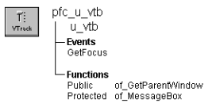

# u_vtb

**Description**

VerticalTrackBar visual user object ancestor.

**Ancestry**



**Library**

- PFCMAIN.PBL
- PFEMAIN.PBL

**Object relationships**

PFC visual user objects are designed to be used with windows that are descendants of w_master.

**Usage**

Use this visual object in windows instead of the standard PowerBuilder VerticalTrackBar control.

U_vtb event scripts provide integration with PFC menus.

**See also**

u_htb

## Instance variables

U_vtb includes instance variables:

| Instance variable | Description | Data type | Access |
| --- | --- | --- | --- |
| CST_LINE_DOWN | Constant set to 2 | Integer | Public |
| CST_LINE_UP | Constant set to 1 | Integer | Public |
| CST_MOVED | Constant set to 5 | Integer | Public |
| CST_PAGE_DOWN | Constant set to 4 | Integer | Public |
| CST_PAGE_UP | Constant set to 3 | Integer | Public |
| ib_IsObsolete |  | Boolean | Protected |
| LP_MW_down | Constant set to 18023255 | Long | Public |
| LP_MW_UP | Constant set to 18285400 | Long | Public |
| WM_MOUSEWHEEL | Constant set to 522 | Integer | Public |
| WP_MW_down | Constant set to 4287102976 | Long | Public |
| WP_MW_UP | Constant set to 7864320 | Long | Public |

## Events

U_vtb includes one precoded event script:

GetFocus

### GetFocus

**Description**

Updates the parent window so it can set MicroHelp.

**Usage**

This event calls the pfc_ControlGotFocus event in the parent.

### lineDOWN

**Description**

Propagates event to pfc_positionchanged() event.

**Syntax**

```
instancename.EVENT lineDOWN ( )
```

| Argument | Description |
| --- | --- |
| *instancename* | Instance name of u_vtb |

**Return value**

None.

### lineUP

**Description**

Propagates event to pfc_positionchanged() event.

**Syntax**

```
instancename.EVENT lineUP ( )
```

| Argument | Description |
| --- | --- |
| *instancename* | Instance name of u_vtb |

**Return value**

None.

### Moved

**Description**

Propagates event to pfc_positionchanged() event.

**Syntax**

```
instancename.EVENT Moved ( )
```

| Argument | Description |
| --- | --- |
| *instancename* | Instance name of u_vtb |

**Return value**

None.

### Other

**Description**

Handle Mouse Wheel actions and propagates results to pfc_positionchanged() event with type = CST_MOVED.

**Syntax**

```
instancename.EVENT Other ( )
```

| Argument | Description |
| --- | --- |
| *instancename* | Instance name of u_vtb |

**Return value**

None.

### pageDOWN

**Description**

Propagates event to pfc_positionchanged() event.

**Syntax**

```
instancename.EVENT pageDOWN ( )
```

| Argument | Description |
| --- | --- |
| *instancename* | Instance name of u_vtb |

**Return value**

None.

### pageUP

**Description**

Propagates event to pfc_positionchanged() event.

**Syntax**

```
instancename.EVENT pageUP ( )
```

| Argument | Description |
| --- | --- |
| *instancename* | Instance name of u_vtb |

**Return value**

None.

### pfc_positionchanged

**Description**

No description is available.

**Syntax**

```
instancename.EVENT pfc_positionchanged ( ai_type, ai_scrollpos )
```

| Argument | Description |
| --- | --- |
| *instancename* | Instance name of u_vtb |
| *ai_type* | Integer. |
| *ai_scrollpos* | Integer. |

**Return value**

None.

## Functions

U_vtb includes precoded object functions:

- of_GetParentWindow
- of_MessageBox

### of_GetParentWindow

**Description**

Retrieves a reference to the parent window.

**Access**

Public

**Syntax**

```
instancename.of_GetParentWindow ( window )
```

| Argument | Description |
| --- | --- |
| *instancename* | Instance name of u_vtb |
| *window* | Window variable into which the function places a reference to the parent window (passed by reference) |

**Return value**

Integer. Returns 1 if the function succeeds and -1 if there is no parent window. If no parent window is found, *window* returns NULL.

**Usage**

The u_vtb GetFocus event calls this function.

**Examples**

This example is from the u_vtb GetFocus event:

```
Window  lw_parent

IF gnv_app.of_GetMicrohelp() THEN
       of_GetParentWindow(lw_parent)
       IF IsValid(lw_parent) THEN
      lw_parent.Dynamic Event &
         pfc_ControlGotFocus (this)
       END IF
END IF
```

### of_MessageBox

**Description**

Displays a MessageBox.

**Access**

Protected

**Syntax 1**

```
instancename.of_MessageBox ( id, title, message, icon, button, default )
```

| Argument | Description |
| --- | --- |
| *instancename* | Instance name of u_vtb |
| *id* | String specifying an ID for the message |
| *title* | String specifying the title of the MessageBox |
| *message* | String specifying the message text |
| *icon* | Icon enumerated data type indicating the icon you want to display on the left side of the message box. Values are: |
|  | • Information! |
|  | • StopSign! |
|  | • Exclamation! |
|  | • Question! |
|  | • None! |
| *button* | Button enumerated data type indicating the set of CommandButtons you want to display at the bottom of the message box. The buttons are numbered in the order listed in the enumerated data type. Values are: |
|  | • OK! |
|  | • OKCancel! |
|  | • YesNo! |
|  | • YesNoCancel! |
|  | • RetryCancel! |
|  | • AbortRetryIgnore! |
| *default* | Integer specifying the number of the button you want to be the default button |

**Syntax 2** For a message that contains values (PFC 2025 and later)

```
instancename.of_MessageBox ( id, title, message, values, icon, button, default )
```

| Argument | Description |
| --- | --- |
| *instancename* | Instance name of u_vtb |
| *values* | String array. The values for the placeholders in *message* |

The other arguments are the same as in Syntax 1.

**Return value**

Integer. Returns 1 if the function succeeds and -1 if an error occurs.

**Usage**

Override this function to control MessageBox behavior in VerticalTrackBar controls.

**PFC 2025 and later** When the language service is enabled (see the n_cst_appmanager of_SetLanguage function), the message comes from the language file if it has an entry for *id*: the entry *id* replaces *message*, and the entry *id*.title replaces *title*. Without the service, or without an entry, *message* and *title* are used as they are.

Use Syntax 2 for a message that contains values: *message* is the English text with placeholders (%s, or %1 - %9 by position) and *values* holds the values. Syntax 2 calls Syntax 1 to display the message, so an override of Syntax 1 still sees every message.

**Examples**

This example calls the of_MessageBox function:

```
of_Messagebox(’vtb_error’,’Save’, &
   as_error, StopSign!, Ok!, 1)
...
```
