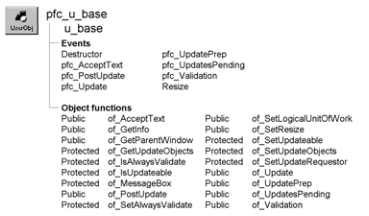

# u_base

**Description**

Base object for custom visual user objects (such as u_calculator and u_calendar).

U_base is a self-updating object.

**Ancestry**



**Library**

- PFCMAIN.PBL
- PFEMAIN.PBL

**Object relationships**

- [n_cst_infoattrib](../05-global-structures-and-structure-objects/n_cst_infoattrib.md)
- [n_cst_luw](../09-custom-class-user-objects/n_cst_luw.md)
- [n_cst_resize](../09-custom-class-user-objects/n_cst_resize.md)

**Usage**

Use this object as the base object for custom visual user objects. U_base contains all the events and functions necessary for a PFC self updating object.

For more on self updating objects see [n_cst_luw](../09-custom-class-user-objects/n_cst_luw.md).

To use u_base:

1. Use the User Object painter to create a descendant of u_base.
2. Add controls, events, and functions as necessary.

**Descendants**

- [u_calculator](u_calculator.md)
- [u_calendar](u_calendar.md)
- [u_progressbar](u_progressbar.md)
- [u_tabpg](u_tabpg.md)

**See also**

n_base

## Instance variables

U_base includes instance variables:

| Instance variable | Description | Data type | Access | Usage |
| --- | --- | --- | --- | --- |
| CONTINUE_ACTION | Constant set to 1 | Integer | Public | Internal |
| FAILURE | Constant set to -1 | Integer | Public | Internal |
| ib_alwaysvalidate | Controls whether the save process includes all objects in the validation process | Boolean | Protected | Set with of_SetAlwaysValidate (default is FALSE) |
| ib_IsObsolete |  | Boolean | Protected |  |
| ib_isupdateable | Indicates whether the object can be updated | Boolean | Protected | Set with of_SetUpdateable (default is FALSE) |
| inv_luw | Reference variable for logical unit of work service | n_cst_luw | Protected | Set with of_SetLogicalUnitOfWork |
| inv_resize | Reference variable for resize service | n_cst_resize | Public | Set with of_SetResize |
| ipo_pendingupdates[ ] | Default list of objects to be updated | PowerObject | Protected | Internal |
| ipo_updateobjects[ ] | Customized list of objects to be updated | PowerObject | Protected | Internal |
| ipo_tempupdateobjects[ ] | One-time list of objects to be updated | PowerObject | Protected | Internal |
| ipo_updaterequestor | Owner of the save process | PowerObject | Protected | Internal |
| NO_ACTION | Constant set to 0 | Integer | Public | Internal |
| PREVENT_ACTION | Constant set to 0 | Integer | Public | Internal |
| SUCCESS | Constant set to 1 | Integer | Public | Internal |

## Events

U_base includes precoded events:

- Constructor
- Destructor
- pfc_AcceptText
- pfc_PostUpdate
- pfc_Update
- pfc_UpdatePrep
- pfc_UpdatesPending
- pfc_Validation
- Resize

### Constructor

**Description**

The ancestor to all PFC object classes.

**Syntax**

```
instancename.EVENT Constructor ( )
```

| Argument | Description |
| --- | --- |
| *instancename* | Instance name of u_base |

**Return value**

None.

### Destructor

**Description**

Destroys all enabled service objects.

**Usage**

This event executes when the control is destroyed or the window closes.

### pfc_AcceptText

**Description**

Calls the n_cst_luw of_AcceptText function, which in turn calls the of_AcceptText function for all controls that implement it.

**Syntax**

```
instancename.EVENT pfc_AcceptText ( controlarray, focusonerror )
```

| Argument | Description |
| --- | --- |
| *instancename* | Instance name of the u_base descendant |
| *controlarray* | PowerObject array containing the controls for which to accept text. From within the pfc_AcceptText event, access this value through the *apo_control* argument |
| *focusonerror* | Boolean specifying whether to set focus on a DataWindow column with errors. From within the pfc_AcceptText event, access this value through the *ab_focusonerror* argument |

**Return value**

Integer. Returns 1 if the event succeeds and -1 if an error occurs.

**Usage**

The of_AcceptText function calls this event.

### pfc_PostUpdate

**Description**

Calls the n_cst_luw of_PostUpdate function, which in turn calls the of_PostUpdate function for all controls that implement it.

**Syntax**

```
instancename.EVENT pfc_PostUpdate ( controlarray )
```

| Argument | Description |
| --- | --- |
| *instancename* | Instance name of the u_base descendant |
| *controlarray* | PowerObject array containing the controls for which to perform post update processing. From within the pfc_AcceptText event, access this value through the *apo_control* argument |

**Return value**

Integer. Returns 1 if the event succeeds and -1 if an error occurs.

**Usage**

The of_PostUpdate function calls this event.

You can extend this event to perform additional post-update processing.

### pfc_Update

**Description**

Calls the n_cst_luw of_Update function, which in turn calls the of_Update function for all controls that implement it.

**Syntax**

```
instancename.EVENT pfc_Update ( controlarray, accepttext, resetflag )
```

| Argument | Description |
| --- | --- |
| *instancename* | Instance name of the u_base descendant |
| *controlarray* | PowerObject array containing the controls to be updated. From within the pfc_Update event, access this value through the *apo_control* argument |
| *accepttext* | Boolean specifying whether a control should perform an AcceptText before the update, where that applies. From within the pfc_Update event, access this value through the *ab_accepttext* argument |
| *resetflag* | Boolean specifying whether a control should automatically reset its update flags. From within the pfc_Update event, access this value through the *ab_resetflag* argument |

**Return value**

Integer. Returns 1 if all updates succeed, 0 if no action is taken, and -1 if one or more update errors occur.

**Usage**

The of_Update function calls this event.

### pfc_UpdatePrep

**Description**

Empty user event to which you can add code that prepares for update.

**Syntax**

```
instancename.EVENT pfc_UpdatePrep ( controls )
```

| Argument | Description |
| --- | --- |
| *instancename* | Instance name of the u_base descendant |
| *controls* | PowerObject array containing the objects to update. This argument is accessed through the *apo_control* argument |

**Return value**

Long. Return 1 if the update preparation succeeds and -1 to halt the update process.

**Usage**

The of_UpdatePrep function calls this event.

### pfc_UpdatesPending

**Description**

Calls the n_cst_luw of_UpdatesPending function, which in turn calls the of_UpdatesPending function for all controls that implement it.

**Syntax**

```
instancename.EVENT pfc_UpdatesPending ( controlarray, pending )
```

| Argument | Description |
| --- | --- |
| *instancename* | Instance name of the u_base descendant |
| *controlarray* | PowerObject array containing controls to be tested for pending updates |
| *pending* | PowerObject array, passed by reference, in which the event returns the controls that have updates pending. From within the pfc_UpdatesPending event, access this value through the *apo_pending* argument |

**Return value**

Integer. Returns values as follows:

1 Pending updates were found 0 No pending updates -1 AcceptText failed

**Usage**

The of_UpdatesPending function calls this event.

### pfc_Validation

**Description**

Calls the n_cst_luw of_Validation function, which in turn calls the of_Validation function for all controls that implement it.

**Syntax**

```
instancename.EVENT pfc_Validation ( controlarray )
```

| Argument | Description |
| --- | --- |
| *instancename* | Instance name of the u_base descendant |
| *controlarray* | PowerObject control array containing controls to be validate |

**Return value**

Integer. Returns 1 if there are no validation errors and -1 if a validation error occurs.

**Usage**

The of_Validation function calls this event.

### Resize

**Description**

Triggers resize processing, if enabled for the object.

**Usage**

This event executes when the user resizes the window and the custom visual user object instance has been registered with the window or tab on which it is placed.

To enable resize processing, you must enabled the resize service for the u_base descendant instance and for the window or tab containing the instance.

## Functions

U_base contains precoded object functions:

- of_AcceptText
- of_GetInfo
- of_GetParentWindow
- of_GetUpdateObjects
- of_IsAlwaysValidate
- of_IsUpdateable
- of_MessageBox
- of_PostUpdate
- of_SetAlwaysValidate
- of_SetLogicalUnitOfWork
- of_SetResize
- of_SetUpdateable
- of_SetUpdateObjects
- of_SetUpdateRequestor
- of_Update
- of_UpdatePrep
- of_UpdatesPending
- of_Validation

### of_AcceptText

**Description**

Calls the pfc_AcceptText event.

**Access**

Public

**Syntax**

```
instancename.of_AcceptText ( focusonerror )
```

| Argument | Description |
| --- | --- |
| *instancename* | Instance name of the u_base descendant |
| *focusonerror* | Boolean indicating whether PFC sets focus to the first item in error when an error occurs |

**Return value**

Integer. Returns 1 if the function succeeds and -1 if an error occurs.

**Usage**

N_cst_luw calls this function as part of the default save process. This function is part of the self-updating object API. To customize accept text processing, extend the pfc_AcceptText event.

**Examples**

This example is from the n_cst_luw of_AcceptText function:

```
...
If lb_defined Then
    li_rc =  &
      lpo_tocheck.Function Dynamic of_AcceptText &
         (ab_focusonerror)
    If li_rc < 0 Then Return -1

...
```

### of_GetInfo

**Description**

Retrieves object information.

**Access**

Public

**Syntax**

```
instancename.of_GetInfo ( infoobject )
```

| Argument | Description |
| --- | --- |
| *instancename* | Instance name of the u_base descendant |
| *infoobject* | N_cst_infoattrib instance into which the function places information (passed by reference) |

**Return value**

Integer. Returns 1 if the function succeeds and -1 if an error occurs.

**Examples**

This example calls the of_GetInfo function:

```
n_cst_infoattrib  lnv_info

w_emplist.of_GetInfo(lnv_info)
MessageBox("Info",  &
  "Description: " + lnv_info.is_description  &
    + ". Name: " + lnv_info.is_name)
```

### of_GetParentWindow

**Description**

Retrieves a reference to the parent window.

**Access**

Public

**Syntax**

```
instancename.of_GetParentWindow ( window )
```

| Argument | Description |
| --- | --- |
| *instancename* | Instance name of u_base |
| *window* | Window variable into which the function places a reference to the parent window (passed by reference) |

**Return value**

Integer. Returns 1 if the function succeeds, -1 if there is no parent window, and NULL if no parent window is found.

**Examples**

This example calls the of_GetParentWindow function:

```
Integer  li_return
Window  lw_window
...
li_return = uo_calc.of_GetParentWindow(lw_window)
...
```

### of_GetUpdateObjects

**Description**

Retrieves the current default array of objects affected by the update process.

**Access**

Protected

**Syntax**

```
instancename.of_GetUpdateObjects ( objects )
```

| Argument | Description |
| --- | --- |
| *instancename* | Instance name of the u_base descendant |
| *objects* | PowerObject array into which the function places objects to be updated (passed by reference) |

**Return value**

Integer. Returns the number of elements in the *objects* array if the function succeeds and -1 if an error occurs.

**Examples**

This example calls the of_GetUpdateObjects function:

```
PowerObject  lpo_objs[ ]
Integer  li_return, li_count

li_return = this.of_GetUpdateObjects(lpo_objs)
FOR li_count = 1 to li_return
       IF lpo_objs[li_count] = ids_data THEN
       Return 1
       END IF
       NEXT
li_return++
lpo_objs[li_return] = ids_data
Return this.of_SetUpdateObjects(lpo_objs)
```

### of_IsAlwaysValidate

**Description**

Reports whether the default save process always performs validation.

**Access**

Protected

**Syntax**

```
instancename.of_IsAlwaysValidate ( )
```

| Argument | Description |
| --- | --- |
| *instancename* | Instance name of the u_base descendant |

**Return value**

Boolean. Returns TRUE if the default save process always performs validation and FALSE if it does not.

**Examples**

This example calls the of_IsAlwaysValidate function:

```
IF this.of_IsAlwaysValidate() = TRUE THEN
   MessageBox("Base", "Always validate")
ELSE
   MessageBox("Base", "Sometimes validate")
END IF
```

### of_IsUpdateable

**Description**

Reports whether the object is updatable.

**Access**

Protected

**Syntax**

```
instancename.of_IsUpdateable ( )
```

| Argument | Description |
| --- | --- |
| *instancename* | Instance name of the u_base descendant |

**Return value**

Boolean. Returns TRUE if the window is updatable and FALSE if it is not.

**Usage**

Internal.

**Examples**

This example is from the pfc_UpdatesPendingRef event:

```
...
If Not of_IsUpdateable() Then Return NO_UPDATESPENDING
...
```

### of_MessageBox

**Description**

Displays a MessageBox.

**Access**

Protected

**Syntax 1**

```
instancename.of_MessageBox ( id, title, message, icon, button, default )
```

| Argument | Description |
| --- | --- |
| *instancename* | Instance name of the u_base descendant |
| *id* | String specifying an ID for the message |
| *title* | String specifying the title of the MessageBox |
| *message* | String specifying the message text |
| *icon* | Icon enumerated data type indicating the icon you want to display on the left side of the message box. Values are: |
|  | • Information! |
|  | • StopSign! |
|  | • Exclamation! |
|  | • Question! |
|  | • None! |
| *button* | Button enumerated data type indicating the set of CommandButtons you want to display at the bottom of the message box. The buttons are numbered in the order listed in the enumerated data type. Values are: |
|  | • OK! |
|  | • OKCancel! |
|  | • YesNo! |
|  | • YesNoCancel! |
|  | • RetryCancel! |
|  | • AbortRetryIgnore! |
| *default* | Integer specifying the number of the button you want to be the default button |

**Syntax 2** For a message that contains values (PFC 2025 and later)

```
instancename.of_MessageBox ( id, title, message, values, icon, button, default )
```

| Argument | Description |
| --- | --- |
| *instancename* | Instance name of the u_base descendant |
| *values* | String array. The values for the placeholders in *message* |

The other arguments are the same as in Syntax 1.

**Return value**

Integer. Returns 1 if the function succeeds and -1 if an error occurs.

**Usage**

Override this function to control MessageBox behavior in custom visual user objects.

**PFC 2025 and later** When the language service is enabled (see the n_cst_appmanager of_SetLanguage function), the message comes from the language file if it has an entry for *id*: the entry *id* replaces *message*, and the entry *id*.title replaces *title*. Without the service, or without an entry, *message* and *title* are used as they are.

Use Syntax 2 for a message that contains values: *message* is the English text with placeholders (%s, or %1 - %9 by position) and *values* holds the values. Syntax 2 calls Syntax 1 to display the message, so an override of Syntax 1 still sees every message.

**Examples**

This example calls the of_MessageBox function:

```
of_Messagebox(’cvuo_error’,’Save’, &
   as_error, StopSign!, Ok!, 1)
```

### of_PostUpdate

**Description**

Calls the pfc_PostUpdate event.

**Access**

Public

**Syntax**

```
instancename.of_PostUpdate ( )
```

| Argument | Description |
| --- | --- |
| *instancename* | Instance name of the u_base descendant |

**Return value**

Integer. Returns 1 if the function succeeds and -1 if an error occurs.

**Usage**

N_cst_luw calls this function as part of the default save process. This function is part of the self-updating object API. To customize post-update processing, extend the pfc_PostUpdate event.

**Examples**

This example is from the n_cst_luw of_PostUpdate function:

```
...
If lb_defined Then
  li_rc =  &
    lpo_tocheck.Function Dynamic of_PostUpdate()
...
```

### of_SetAlwaysValidate

**Description**

Specifies whether the default save process always performs validation.

**Access**

Protected

**Syntax**

```
instancename.of_SetAlwaysValidate ( boolean )
```

| Argument | Description |
| --- | --- |
| *instancename* | Instance name of the u_base descendant |
| *boolean* | Boolean specifying whether the default save process always performs validation (TRUE) or only performs validation if a control has pending updates (FALSE) |

**Return value**

Integer. Returns 1 if the function succeeds and -1 if an error occurs.

**Examples**

This example calls the of_SetAlwaysValidate function:

```
this.of_SetAlwaysValidate(TRUE)
```

### of_SetLogicalUnitOfWork

**Description**

Enables or disables n_cst_luw, which provides the logical unit of work service.

**Access**

Public

**Syntax**

```
instancename.of_SetLogicalUnitOfWork ( boolean )
```

| Argument | Description |
| --- | --- |
| *instancename* | Instance name of the u_base descendant |
| *boolean* | Boolean specifying whether to enable (TRUE) or disable (FALSE) n_cst_luw |

**Return value**

Integer. Returns 1 if the function succeeds, 0 if the service is already enabled, and -1 if an error occurs.

**Usage**

Use this function to create or destroy an instance of n_cst_luw. This instance is named inv_luw. If you do not enable n_cst_luw, u_base enables it automatically.

**Examples**

This example calls the of_SetLogicalUnitOfWork function:

```
this.of_SetLogicalUnitOfWork(TRUE)
```

### of_SetResize

**Description**

Enables or disables n_cst_resize (the resize service).

**Access**

Public

**Syntax**

```
instancename.of_SetResize ( boolean )
```

| Argument | Description |
| --- | --- |
| *instancename* | Instance name of u_base |
| *boolean* | Boolean specifying whether to enable (TRUE) or disable (FALSE) an instance of n_cst_resize |

**Return value**

Integer. Returns 1 if the function succeeds, 0 if the resize service is already enabled, and -1 if an error occurs.

**Usage**

After calling this function, apply n_cst_resize functions as necessary to the controls contained in the u_base descendant.

**Examples**

This example calls the of_SetResize function:

```
this.of_SetResize(TRUE)
```

### of_SetUpdateable

**Description**

Specifies whether the object is updatable.

**Access**

Protected

**Syntax**

```
instancename.of_SetUpdateable ( boolean )
```

| Argument | Description |
| --- | --- |
| *instancename* | Instance name of the u_base descendant |
| *boolean* | Boolean indicating whether the window is updatable |

**Return value**

Integer. Returns 1 if the function succeeds and -1 if an error occurs.

**Usage**

Call this function to enable default save processing. By default, u_base is not updatable.

**Examples**

This example calls the of_SetUpdateable function:

```
this.of_SetUpdateable(TRUE)
```

### of_SetUpdateObjects

**Description**

Sets a new default array containing objects for which updates are attempted.

**Access**

Protected

**Syntax**

```
instancename.of_SetUpdateObjects ( requestor )
```

| Argument | Description |
| --- | --- |
| *instancename* | Instance name of u_dw |
| *requestor* | PowerObject array containing the object to be updated |

**Return value**

Integer. Returns 1 if the function succeeds and -1 if an error occurs.

**Usage**

Call this function to customize the objects updated by the save process. You can even add other windows to the save process.

**Examples**

This example calls the of_SetUpdateObjects function:

```
PowerObject  lpo_objs[ ]
Integer  li_count

lpo_objs = this.control
li_count = UpperBound(lpo_objs)
li_count++
// Update w_other as well as this object
lpo_objs[li_count] = w_other
Return this.of_SetUpdateObjects(lpo_objs)
```

### of_SetUpdateRequestor

**Description**

Creates a reference to the object requesting an update within a logical unit of work.

**Access**

Protected

**Syntax**

```
instancename.of_SetUpdateRequestor ( requestor )
```

| Argument | Description |
| --- | --- |
| *instancename* | Instance name of the u_base descendant |
| *requestor* | PowerObject containing the object requesting the update |

**Return value**

Integer. Returns 1 if the function succeeds and -1 if an error occurs.

**Usage**

Internal.

### of_Update

**Description**

Calls the pfc_Update event.

**Access**

Public

**Syntax**

```
instancename.of_Update ( accept, resetflag {, requestor} )
```

| Argument | Description |
| --- | --- |
| *instancename* | Instance name of the u_base descendant |
| *accept* | Boolean indicating whether the Update function performs an AcceptText before saving rows to the database |
| *resetflag* | Boolean indicating whether the Update function resets the update flags |
| *requestor* (optional) | PowerObject containing the requestor object |

**Return value**

Integer. Returns 1 if the update succeeds and -1 if an error occurs.

**Usage**

N_cst_luw calls this function as part of the default save process. This function is part of the self-updating object API. To customize update processing, extend the pfc_Update event.

**Examples**

This example is from the n_cst_luw of_Update function:

```
...
If lb_defined Then
  li_rc = lpo_tocheck.Function Dynamic of_Update &
    (ab_accepttext,  ab_resetflag, &
      lpo_updaterequestor)
  If li_rc < 0 Then Return -1
  Continue
End If
...
```

### of_UpdatePrep

**Description**

Calls the pfc_UpdatePrep event, which allows you to code additional update preparation logic.

**Access**

Public

**Syntax**

```
instancename.of_UpdatePrep ( )
```

| Argument | Description |
| --- | --- |
| *instancename* | Instance name of the u_base descendant |

**Return value**

Integer. Returns 1 if the function succeeds and -1 if an error occurs.

**Usage**

N_cst_luw calls this function as part of the default save process. This function is part of the self-updating object API. To customize update preparation processing, extend the pfc_UpdatePrep event.

**Examples**

This example is from the n_cst_luw of_UpdatePrep function:

```
...
If lb_defined Then
  li_rc =  &
    lpo_tocheck.Function Dynamic of_UpdatePrep()
  If li_rc < 0 Then Return -1
  Continue
End If
...
```

### of_UpdatesPending

**Description**

Calls the pfc_UpdatesPending event.

**Access**

Public

**Syntax**

```
instancename.of_UpdatesPending ( )
```

| Argument | Description |
| --- | --- |
| *instancename* | Instance name of the u_base descendant |

**Return value**

Integer. Returns values as follows:

- **1** Updates are pending
- **0** No updates pending
- **-1** An error occurred

**Usage**

N_cst_luw calls this function as part of the default save process. This function is part of the self-updating object API. To customize pending updates processing, extend the pfc_UpdatesPending event.

**Examples**

This example calls the of_UpdatesPending function:

```
...
If lb_defined Then
       la_rc = lpo_tocheck.Dynamic of_UpdatesPending()
...
```

### of_Validation

**Description**

Calls the pfc_Validation event.

**Access**

Public

**Syntax**

```
instancename.of_Validation ( )
```

| Argument | Description |
| --- | --- |
| *instancename* | Instance name of the u_base descendant |

**Return value**

Integer. Returns 1 if the function succeeds and -1 if a validation error occurs.

**Usage**

N_cst_luw calls this function as part of the default save process. This function is part of the self-updating object API. To customize validation processing, extend the pfc_Validation event.

**Examples**

This example calls the of_Validation function:

```
...
If lb_defined Then  li_rc =  &
       lpo_tocheck.Function Dynamic of_Validation()
...
```
