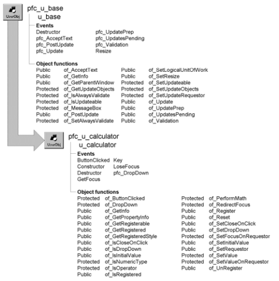

# u_calculator

**Description**

Calculator object for use with numeric values in DataWindow and EditMask controls. Users use the calculator to enter values and calculations, which the object displays in the associated DataWindow column or EditMask control.

You typically use the calculator object as a dropdown object, displaying when a DataWindow column gets focus or when the user clicks the dropdown arrow. However, you can also place the calculator object directly onto a window.

**Ancestry**



**Library**

- PFCAPSRV.PBL
- PFEAPSRV.PBL

**Object relationships**

- [n_cst_dropdown](../09-custom-class-user-objects/n_cst_dropdown.md)
- [n_cst_calculatorattrib](../05-global-structures-and-structure-objects/n_cst_calculatorattrib.md)
- [n_cst_infoattrib](../05-global-structures-and-structure-objects/n_cst_infoattrib.md)
- [n_cst_propertyattrib](../05-global-structures-and-structure-objects/n_cst_propertyattrib.md)
- [u_dw](../06-standard-visual-user-objects/u_dw.md)
- [u_em](../06-standard-visual-user-objects/u_em.md)

**Usage**

Use this object with EditMask controls that display numeric or decimal values or with DataWindow columns that display numeric values. For automatic calculator display, DataWindow columns must use the DropDownListBox edit style. For manual calculator display, DataWindow columns can use the DropDownListBox, Edit, or EditMask edit style.

To use this object for DataWindow columns:

1. Determine which columns in your DataWindow object are appropriate for a dropdown calculator. Use the DataWindow painter to assign the DropDownListBox, Edit, or EditMask edit style to these columns.
2. In the Window painter, define a DataWindow control based on u_dw.
3. Enable the dropdown calculator for the DataWindow by calling the of_SetDropDownCalculator function. This example is from the DataWindow control’s Constructor event:

   ```
   this.of_SetDropDownCalculator(TRUE)
   ```

4. Register one or more columns by calling the of_Register function:

   ```
   this.iuo_calculator.of_Register("salary", &
     this.iuo_calculator.DDLB_WITHARROW))
   ```

5. Specify whether the dropdown closes on a single-click by calling the of_SetCloseOnClick function:

   ```
   this.iuo_calculator.of_SetCloseOnClick(TRUE)
   ```

For information on using u_calculator with EditMask controls, see the *PFC User’s Guide*.

**See also**

- [n_cst_dropdown](../09-custom-class-user-objects/n_cst_dropdown.md)
- [u_calendar](u_calendar.md)
- [u_dw](../06-standard-visual-user-objects/u_dw.md)
- [u_em](../06-standard-visual-user-objects/u_em.md)

## Instance variables

U_calculator includes instance variables:

| Instance variable | Description | Data type | Access | Usage |
| --- | --- | --- | --- | --- |
| DDLB | Constant set to 2 | Integer | Public | Use with of_ Register |
| DDLB_WITHARROW | Constant set to 3 | Integer | Public | Use with of_ Register |
| EMPTY | Constant set to empty string | String | Protected | Internal |
| ib_closeonclick | Controls close on click | Boolean | Protected | Set with of_SetCloseOnClick |
| ib_initialvalue | Controls whether blank fields are initialized | Boolean | Protected | Set with of_SetInitialValue |
| ib_validresetvalue | Reports whether associated field contains a number | Boolean | Protected | Internal |
| idbl_repeatvalue | Repeat value | Double | Protected | Internal |
| idbl_value | Running total | Double | Protected | Internal |
| idrg_requestor | Generic reference | DragObject | Protected | Internal |
| idw_requestor | Associated DataWindow control | DataWindow | Protected | Internal |
| iem_requestor | Associated EditMask control | EditMask | Protected | Internal |
| ii_dwcolumnstyle[] | Edit styles of registered columns | Integer | Protected | Set with of_Register |
| inv_calculatorattrib | Calculator information | n_cst_calculatorattrib | Protected | Internal |
| inv_dropdown | Reference to dropdown service | n_cst_dropdown | Public | Internal |
| is_curroperator | Current operator | String | Protected | Internal |
| is_currvalue | Current value | String | Protected | Internal |
| is_dwcolumns[ ] | Registered columns | String | Protected | Set with of_Register |
| is_dwcolumnsexp[ ] | Original properties for registered columns | String | Protected | Set by of_Register |
| is_prevkeystroke | Previous key | String | Protected | Internal |
| is_repeatoperator | Repeat operator | String | Protected | Internal |
| NONE | Constant set to 1 | Integer | Public | Use with of_Register |

## Events

U_calculator includes precoded events:

- ButtonClicked
- Constructor
- Destructor
- GetFocus
- Key
- LoseFocus
- pfc_DropDown

### ButtonClicked

**Description**

Calls the of_ButtonClicked function.

**Applies to**

Dw_calculator

**Usage**

This event executes when the user clicks a command button, types a number, types an operator, or types a period.

### Constructor

**Description**

Initializes object settings.

**Applies to**

Dw_calculator and u_calculator

**Usage**

This event executes when the object is created.

### Destructor

**Description**

Destroys the inv_dropdown instance variable.

**Applies to**

U_calculator

**Usage**

This event executes when the u_calculator instance is destroyed.

### GetFocus

**Description**

Calls the of_RedirectFocus function.

**Applies to**

Dw_calculator

**Usage**

This event executes when a control receives focus, typically by clicking.

### Key

**Description**

Determines which key was pressed and calls the of_ButtonClicked function.

**Applies to**

Dw_calculator

**Usage**

This event executes when the user presses a key.

### LoseFocus

**Description**

Hides the calculator.

**Applies to**

Dw_calculator

**Usage**

This event executes when the calculator loses focus.

### pfc_DropDown

**Description**

Calls the of_DropDown function.

**Applies to**

U_calculator

**Return value**

Integer. Returns 1 if the event succeeds, 0 if the DataWindow column has not been registered, and -1 if an error occurs.

**Usage**

This event is called by the u_dw pfc_DDCalculator event.

## Functions

U_calculator contains precoded object functions:

- of_ButtonClicked
- of_DropDown
- of_GetInfo
- of_GetPropertyInfo
- of_GetRegisterable
- of_GetRegistered
- of_GetRegisteredStyle
- of_IsCloseOnClick
- of_IsDropDown
- of_IsInitialValue
- of_IsNumericType
- of_IsOperator
- of_IsRegistered
- of_PerformMath
- of_RedirectFocus
- of_Register
- of_Reset
- of_SetCloseOnClick
- of_SetDropDown
- of_SetFocusOnRequestor
- of_SetInitialValue
- of_SetRequestor
- of_SetValue
- of_SetValueOnRequestor
- of_UnRegister

### of_ButtonClicked

**Description**

Processes button clicks.

**Access**

Protected

**Syntax**

```
dwcontrol.instancename.of_ButtonClicked ( key )
```

| Argument | Description |
| --- | --- |
| *dwcontrol* | Instance name of the u_dw-based DataWindow control (not required when using u_calculator with an EditMask control) |
| *instancename* | Instance name of u_calculator (the u_dw and u_em default for this value is iuo_calculator) |
| *key* | String specifying the text of the clicked button |

**Return value**

Integer. Returns 1 if the function succeeds and -1 if an error occurs.

**Usage**

Internal.

**Examples**

This example is from a the u_calculator dw_employee ButtonClicked event:

```
...
If Len(ls_buttontext) > 0 Then
       of_ButtonClicked(ls_buttontext)
End If
...
```

### of_DropDown

**Description**

Displays the dropdown calculator in the appropriate location.

**Access**

Public

**Syntax**

```
dwcontrol.instancename.of_DropDown ( )
```

| Argument | Description |
| --- | --- |
| *dwcontrol* | Instance name of the u_dw-based DataWindow control (not required when using u_calculator with an EditMask control) |
| *instancename* | Instance name of u_calculator (the u_dw and u_em default for this value is iuo_calculator) |

**Return value**

Integer. Returns 1 if the function succeeds, 0 if the current DataWindow column has not been registered, and -1 if an error occurs.

**Usage**

The pfc_DropDown event calls this function. If the current DataWindow column is not registered, this function returns 0 and does not display the calculator.

**Examples**

This example is from the pfc_DropDown event:

```
Return of_DropDown()
```

### of_GetInfo

**Description**

Retrieves object information.

**Access**

Public

**Syntax**

```
dwcontrol.instancename.of_GetInfo ( infoobject )
```

| Argument | Description |
| --- | --- |
| *dwcontrol* | Instance name of the u_dw-based DataWindow control (not required when using u_calculator with an EditMask control) |
| *instancename* | Instance name of u_calculator (the u_dw and u_em default for this value is iuo_calculator) |
| *infoobject* | N_cst_infoattrib instance into which the function places information (passed by reference) |

**Return value**

Integer. Returns 1 if the function succeeds and -1 if an error occurs.

**Usage**

The DataWindow Properties window calls this function to access service information.

**Examples**

This example calls the of_GetInfo function:

```
n_cst_infoattrib  lnv_info

dw_1.iuo_calculator.of_GetInfo(lnv_info)
MessageBox("Info",  &
  "Description: " + lnv_info.is_description  &
    + ". Name: " + lnv_info.is_name)
```

### of_GetPropertyInfo

**Description**

Retrieves information about the service’s properties.

**Access**

Public

**Syntax**

```
dwcontrol.instancename.of_GetPropertyInfo ( propertyobject )
```

| Argument | Description |
| --- | --- |
| *dwcontrol* | Instance name of the u_dw-based DataWindow control |
| *instancename* | Instance name of u_calculator (the u_dw and u_em default for this value is iuo_calculator) |
| *propertyobject* | N_cst_propertyattrib instance into which the function places property information (passed by reference) |

**Return value**

Integer. Returns 1 if the function succeeds and -1 if an error occurs.

**Usage**

The DataWindow Properties window calls this function to access service information.

**Examples**

This example calls the of_GetPropertyInfo function:

```
n_cst_propertyattrib  lnv_prop

dw_1.iuo_calculator.of_GetPropertyInfo(lnv_prop)
MessageBox("Info",  &
  "Description: " + lnv_prop.is_description  &
    + ". Name: " + lnv_prop.is_name  &
      + ". Property tab text: " +  &
        lnv_prop.is_propertytabtext)
```

### of_GetRegisterable

**Description**

Retrieves an array of registerable DataWindow columns. Registerable DataWindow columns are numeric and use the DropDownListBox, Edit, or EditMask edit style.

**Access**

Public

**Syntax**

```
dwcontrol.instancename.of_GetRegisterable ( columns )
```

| Argument | Description |
| --- | --- |
| *dwcontrol* | Instance name of the u_dw-based DataWindow control |
| *instancename* | Instance name of u_calculator (the u_dw default for this value is iuo_calculator) |
| *columns* | Unbounded string array into which the function places the names of columns that have been registered with this instance of the dropdown calculator (passed by reference) |

**Return value**

Integer. Returns the number of entries in the *columns* array if the function succeeds and -1 if an error occurs.

**Examples**

This example calls the of_GetRegisterable function:

```
...
li_rc = &
  idw_requestor.iuo_calculator.of_GetRegisterable &
    (ls_allcols)
...
```

### of_GetRegistered

**Description**

Retrieves an array of registered DataWindow columns.

**Access**

Public

**Syntax**

```
dwcontrol.instancename.of_GetRegistered ( columns {, colstyle } )
```

| Argument | Description |
| --- | --- |
| *dwcontrol* | Instance name of the u_dw-based DataWindow control |
| *instancename* | Instance name of u_calculator (the u_dw default for this value is iuo_calculator) |
| *columns* | Unbounded string array into which the function places the names of columns that have been registered with this instance of the dropdown calculator (passed by reference) |
| *colstyle* (optional) | Unbounded Integer array into which the function places the styles of columns that have been registered with this instance of the dropdown calculator (passed by reference) |

**Return value**

Integer. Returns the number of entries in the *columns* array if the function succeeds and -1 if an error occurs.

**Examples**

This example calls the of_GetRegistered function:

```
String ls_columns[ ], ls_display
Integer li_return, li_count

li_return = &
dw_1.iuo_calculator. of_GetRegistered &
  (ls_columns)
FOR li_count = 1 to li_return
  ls_display += ls_columns[li_count] + "~r~n"
NEXT
MessageBox("Columns", ls_display)
```

### of_GetRegisteredStyle

**Description**

Retrieves the display style for a specified column.

**Access**

Public

**Syntax**

```
dwcontrol.instancename.of_GetRegisteredStyle ( column )
```

| Argument | Description |
| --- | --- |
| *dwcontrol* | Instance name of the u_dw-based DataWindow control |
| *instancename* | Instance name of u_calculator (the u_dw default for this value is iuo_calculator) |
| *column* | String containing the DataWindow column for which the function returns the display style |

**Return value**

Integer. Returns the column style if the function succeeds, 0 if the column is not registered, and -1 if an error occurs.

**Examples**

This example calls the of_GetRegisteredStyle function:

```
Integer li_return

li_return = &
  dw_1.iuo_calculator.of_GetRegisteredStyle &
    ("start_date")
MessageBox("Display Style", &
"Display style is " + String(li_return))
```

### of_IsCloseOnClick

**Description**

Reports whether the u_calculator instance closes when the user clicks the equal sign.

**Access**

Public

**Syntax**

```
dwcontrol.instancename.of_IsCloseOnClick ( )
```

| Argument | Description |
| --- | --- |
| *dwcontrol* | Instance name of the u_dw-based DataWindow control (not required when using u_calculator with an EditMask control) |
| *instancename* | Instance name of u_calculator (the u_dw and u_em default for this value is iuo_calculator) |

**Return value**

Boolean. Returns TRUE if the u_calculator instance closes when the user clicks the equal sign and FALSE if it does not.

**Examples**

This example calls the of_IsCloseOnClick function:

```
Boolean  lb_close
n_cst_conversion  lnv_conversion

lb_close = &
   dw_1.iuo_calculator.of_IsCloseOnClick()
MessageBox("Calculator", "Close on click is " &
   + lnv_conversion.of_String(lb_close))
```

### of_IsDropDown

**Description**

Reports whether the u_calculator instance has enabled n_cst_dropdown.

**Access**

Public

**Syntax**

```
dwcontrol.instancename.of_IsDropDown ( )
```

| Argument | Description |
| --- | --- |
| *dwcontrol* | Instance name of the u_dw-based DataWindow control (not required when using u_calculator with an EditMask control) |
| *instancename* | Instance name of u_calculator (the u_dw and u_em default for this value is iuo_calculator) |

**Return value**

Boolean. Returns TRUE if the u_calculator instance has enabled n_cst_dropdown and FALSE if it has not.

**Usage**

The dropdown service is referenced by the inv_dropdown instance variable.

**Examples**

This example calls the of_IsDropDown function:

```
Boolean  lb_dropdown
n_cst_conversion  lnv_conversion

lb_dropdown = &
  dw_1.iuo_calculator.of_IsDropDown()
MessageBox("Calculator", &
  "DropDown behavior is " &
    + lnv_conversion.of_String(lb_dropdown))
```

### of_IsInitialValue

**Description**

Reports whether the u_calculator instance initializes blank fields with zero when the calculator displays.

**Access**

Public

**Syntax**

```
dwcontrol.instancename.of_IsInitialValue ( )
```

| Argument | Description |
| --- | --- |
| *dwcontrol* | Instance name of the u_dw-based DataWindow control (not required when using u_calculator with an EditMask control) |
| *instancename* | Instance name of u_calculator (the u_dw and u_em default for this value is iuo_calculator) |

**Return value**

Boolean. Returns TRUE if the calculator initializes blank fields with a zero and FALSE if it does not.

**Examples**

This example calls the of_IsInitialValue function:

```
Boolean  lb_init
n_cst_conversion  lnv_conversion

lb_init = &
  dw_1.iuo_calculator.of_IsInitialValue()
MessageBox("Calculator", "Initialize is " &
  + lnv_conversion.of_String(lb_init))
```

### of_IsNumericType

**Description**

Reports whether a specified DataWindow column data type is numeric (decimal, long, or number).

**Access**

Protected

**Syntax**

```
dwcontrol.instancename.of_IsNumericType ( datatype )
```

| Argument | Description |
| --- | --- |
| *dwcontrol* | Instance name of the u_dw-based DataWindow control (not required when using u_calculator with an EditMask control) |
| *instancename* | Instance name of u_calculator (the u_dw and u_em default for this value is iuo_calculator) |
| *datatype* | String specifying the data type |

**Return value**

Boolean. Returns TRUE if *datatype* is numeric and FALSE if it is not.

**Usage**

Internal.

**Examples**

This example is from the of_DropDown function:

```
...
IF IsValid(idw_requestor) THEN
  ls_colname = idw_requestor.GetColumnName()
  IF NOT of_IsRegistered(ls_colname) THEN
    Return 0
  END IF
  ls_coltype = &
    idw_requestor.Describe(ls_colname+".coltype")
  IF NOT of_IsNumericType(ls_coltype) THEN
    Return -1
  END IF
END IF
...
```

### of_IsOperator

**Description**

Reports whether a passed value is an arithmetic operator (/, \*, +, or -).

**Access**

Protected

**Syntax**

```
dwcontrol.instancename.of_IsOperator ( operator )
```

| Argument | Description |
| --- | --- |
| *dwcontrol* | Instance name of the u_dw-based DataWindow control (not required when using u_calculator with an EditMask control) |
| *instancename* | Instance name of u_calculator (the u_dw and u_em default for this value is iuo_calculator) |
| *operator* | String containing the value to be tested |

**Return value**

Boolean. Returns TRUE if *operator* is /, \*, +, or - and FALSE if it is not.

**Usage**

Internal.

**Examples**

This example is from the of_ButtonClicked function:

```
...
CASE ’/’, ’*’, ’+’, ’-’, ’=’
IF of_IsOperator(as_key) AND &
  of_IsOperator(is_prevkeystroke) THEN
    is_prevkeystroke = as_key
    is_curroperator = as_key
    Return 1
END IF
...
```

### of_IsRegistered

**Description**

Reports whether a specified DataWindow column has been registered.

**Access**

Public

**Syntax**

```
dwcontrol.instancename.of_IsRegistered ( column )
```

| Argument | Description |
| --- | --- |
| *dwcontrol* | Instance name of the u_dw-based DataWindow control |
| *instancename* | Instance name of u_calculator (the u_dw default for this value is iuo_calculator) |
| *column* | String specifying the column to search for |

**Return value**

Boolean. Returns TRUE if *column* has been registered and FALSE if it has not.

**Examples**

This example calls the of_IsRegistered function:

```
...
IF NOT this.iuo_calculator.of_IsRegistered &
  ("salary") THEN
    this.iuo_calculator.of_Register("salary")
END IF
...
```

### of_PerformMath

**Description**

Updates the running total, using the specified operand and operator.

**Access**

Protected

**Syntax**

```
dwcontrol.instancename.of_PerformMath ( value, operator, operand )
```

| Argument | Description |
| --- | --- |
| *dwcontrol* | Instance name of the u_dw-based DataWindow control (not required when using u_calculator with an EditMask control) |
| *instancename* | Instance name of u_calculator (the u_dw and u_em default for this value is iuo_calculator) |
| *value* | Double into which the function places the running total (passed by reference) |
| *operator* | String specifying the operator |
| *operand* | Double containing the number to be used in the calculation |

**Return value**

Integer. Returns 1 if the function succeeds and -1 if an error occurs.

**Usage**

Internal.

**Examples**

This example is from the of_ButtonClicked function:

```
...
IF of_PerformMath(ldbl_value, &
  is_curroperator, ldbl_currvalue) < 0 THEN
    Return -1
END IF
...
```

### of_RedirectFocus

**Description**

Prevents the u_calculator instance from getting focus while it is hidden.

**Access**

Protected

**Syntax**

```
dwcontrol.instancename.of_RedirectFocus ( )
```

| Argument | Description |
| --- | --- |
| *dwcontrol* | Instance name of the u_dw-based DataWindow control (not required when using u_calculator with an EditMask control) |
| *instancename* | Instance name of u_calculator (the u_dw and u_em default for this value is iuo_calculator) |

**Return value**

Integer. Returns 1 if the function succeeds and -1 if an error occurs.

**Usage**

Internal.

**Examples**

This example is from the dw_employee GetFocus event:

```
Post of_RedirectFocus()
```

### of_Register

Registers columns that use the dropdown calculator. There are two syntaxes:

| To register | Use |
| --- | --- |
| One or all eligible columns, optionally specifying a display style | Syntax 1 |
| All eligible columns using a specified display style | Syntax 2 |

| Syntax 1 | Register columns with an optional display style |
| --- | --- |

**Description**

Registers one or all eligible columns in a DataWindow. Eligible columns use a numeric data type and have the Edit, EditMask, or DropDownListBox edit style.

**Access**

Public

**Syntax**

```
dwcontrol.instancename.of_Register ( { column {, style } } )
```

| Argument | Description |
| --- | --- |
| *dwcontrol* | Instance name of the u_dw-based DataWindow control |
| *instancename* | Instance name of u_calculator (the u_dw default for this is iuo_calculator) |
| *column* | (Optional) String specifying the column to be registered. This column must have a numeric data type. If you omit this argument, the function registers all numeric columns |
| *style* | (Optional) Integer or u_calculator constant specifying the display style of registered DataWindow columns: |
|  | **• 1 or NONE (default)** For columns that use the DropDownListBox edit style, the calculator displays automatically when the column gets focus. For columns that use the Edit and EditMask edit styles, the calculator does not display automatically; instead, you display the calculator by coding a call to the u_dw pfc_DDCalculator event |
|  | **• 2 or DDLB** The function converts registered columns to the DropDownListBox edit style. Users display the calculator by clicking the down arrow, which *disappears* when the calculator displays |
|  | **• 3 or DDLB_WITHARROW** The function converts registered columns to the DropDownListBox edit style. Users display the calculator by clicking the down arrow, which *remains* when the calculator displays |

**Return value**

Integer. Returns the number of columns registered if the function succeeds, 0 if the column was already registered, and -1 if an error occurs. The number of columns registered includes hidden columns.

**Usage**

Register all appropriate DataWindow columns. You typically call this function in the DataWindow Constructor event.

To register all eligible columns in a DataWindow using a specified display style, see Syntax 2.

**Examples**

This example from a DataWindow Constructor event calls the of_Register function:

```
this.of_SetTransObject(SQLCA)
this.of_SetDropDownCalculator(TRUE)
this.iuo_calculator.of_Register ("salary", &
  this.iuo_calculator.NONE)
this.Event pfc_Retrieve()
```

| Syntax 2 | Register columns with a display style |
| --- | --- |

**Description**

Registers all eligible columns in a DataWindow using the specified display style. Eligible columns use a numeric data type and have the Edit, EditMask, or DropDownListBox edit style.

**Access**

Public

**Syntax**

```
dwcontrol.instancename.of_Register (style )
```

| Argument | Description |
| --- | --- |
| *dwcontrol* | Instance name of the u_dw-based DataWindow control |
| *instancename* | Instance name of u_calculator (the u_dw and u_em default for this is iuo_calculator) |
| *style* | Integer or u_calculator constant specifying the display style of registered DataWindow columns: |
|  | **• 1 or NONE** For columns that use the DropDownListBox edit style, the calculator displays automatically when the column gets focus. For columns that use the Edit and EditMask edit styles, the calculator does not display automatically; instead, you display the calculator by coding a call to the u_dw pfc_DDCalculator event |
|  | **• 2 or DDLB** The function converts registered columns to the DropDownListBox edit style. Users display the calculator by clicking the down arrow, which *disappears* when the calculator displays |
|  | **• 3 or DDLB_WITHARROW** The function converts registered columns to the DropDownListBox edit style. Users display the calculator by clicking the down arrow, which *remains* when the calculator displays |

**Return value**

Integer. Returns the number of columns registered if the function succeeds and -1 if an error occurs. The number of columns registered includes hidden columns.

**Usage**

Register all appropriate DataWindow columns. You typically call this function in the DataWindow Constructor event.

To register one or all eligible columns in a DataWindow, optionally specifying a display style, see Syntax 1.

**Examples**

This example from a DataWindow Constructor event calls the of_Register function:

```
this.of_SetTransObject(SQLCA)
this.of_SetDropDownCalculator(TRUE)
this.iuo_calculator. of_Register &
  (this.iuo_calculator.NONE)
this.Event pfc_Retrieve()
```

### of_Reset

**Description**

Resets the u_calculator running total to that displayed in the DataWindow column or EditMask control (or to today’s date if the date displayed is not valid).

**Access**

Public

**Syntax**

```
dwcontrol.instancename.of_Reset ( )
```

| Argument | Description |
| --- | --- |
| *dwcontrol* | Instance name of the u_dw-based DataWindow control (not required when using u_calculator with an EditMask control) |
| *instancename* | Instance name of u_calculator (the u_dw and u_em default for this value is iuo_calculator) |

**Return value**

Integer. Returns 1 if the function succeeds and -1 if an error occurs.

**Usage**

Internal.

**Examples**

This example is from the of_DropDown function:

```
...
of_Reset()
...
```

### of_SetCloseOnClick

**Description**

Specifies whether to hide the u_calculator instance when the user clicks the equal sign.

**Access**

Public

**Syntax**

```
dwcontrol.instancename.of_SetCloseOnClick ( boolean )
```

| Argument | Description |
| --- | --- |
| *dwcontrol* | Instance name of the u_dw-based DataWindow control (not required when using u_calculator with an EditMask control) |
| *instancename* | Instance name of u_calculator (the u_dw and u_em default for this value is iuo_calculator) |
| *boolean* | Boolean specifying whether to hide the dropdown calculator when the user clicks the equal sign (TRUE) or leave it displayed (FALSE) |

**Return value**

Integer. Returns 1 if the function succeeds and -1 if an error occurs.

**Examples**

This example calls the of_SetCloseOnClick function:

```
this.of_SetTransObject(SQLCA)
this.of_SetDropDownCalculator(TRUE)
this.iuo_calculator.of_Register()
this.iuo_calculator.of_SetCloseOnClick(FALSE)
```

### of_SetDropDown

**Description**

Enables or disables the dropdown service (n_cst_dropdown).

**Access**

Public

**Syntax**

```
dwcontrol.instancename.of_SetDropDown ( boolean )
```

| Argument | Description |
| --- | --- |
| *dwcontrol* | Instance name of the u_dw-based DataWindow control (not required when using u_calculator with an EditMask control) |
| *instancename* | Instance name of u_calculator (the u_dw and u_em default for this value is iuo_calculator) |
| *boolean* | Boolean specifying whether to enable (TRUE) or disable (FALSE) the dropdown service |

**Return value**

Integer. Returns 1 if the function succeeds, -0 if the dropdown service already exists, and -1 if an error occurs.

**Examples**

This example is from the u_calculator Constructor event:

```
...
IF inv_calculatorattrib.ib_dropdown THEN
  this.Visible = FALSE
  of_SetDropDown(TRUE)
END IF
...
```

### of_SetFocusOnRequestor

**Description**

Retrieves focus to the associated DataWindow column or EditMask control.

**Access**

Protected

**Syntax**

```
dwcontrol.instancename.of_SetFocusOnRequestor ( )
```

| Argument | Description |
| --- | --- |
| *dwcontrol* | Instance name of the u_dw-based DataWindow control (not required when using u_calculator with an EditMask control) |
| *instancename* | Instance name of u_calculator (the u_dw and u_em default for this value is iuo_calculator) |

**Return value**

Integer. Returns 1 if the function succeeds and -1 if an error occurs.

**Usage**

Internal.

**Examples**

This example is from the of_RedirectFocus function:

```
If this.Visible = False Then
       Return of_SetFocusOnRequestor()
End If
Return 1
```

### of_SetInitialValue

**Description**

Specifies whether the u_calculator instance initializes blank fields with zero when the calculator displays.

**Access**

Public

**Syntax**

```
dwcontrol.instancename.of_SetInitialValue ( boolean )
```

| Argument | Description |
| --- | --- |
| *dwcontrol* | Instance name of the u_dw-based DataWindow control (not required when using u_calculator with an EditMask control) |
| *instancename* | Instance name of u_calculator (the u_dw and u_em default for this value is iuo_calculator) |
| *boolean* | Boolean indicating whether the calculator initializes blank fields with zero (TRUE) or not (FALSE) |

**Return value**

Integer. Returns 1 if the function succeeds and -1 if an error occurs.

**Usage**

For DataWindows that disable this option, if a user displays the dropdown calculator and moves directly to another column, the original column retains a status of NotModified!.

**Examples**

This example calls the of_SetInitialValue function:

```
this.of_SetTransObject(SQLCA)
this.of_SetDropDownCalculator(TRUE)
this.iuo_calculator.of_Register()
this.iuo_calculator.of_SetInitialValue(TRUE)
```

### of_SetRequestor

**Description**

Associates an instance of u_calculator with a DataWindow or EditMask control.

**Access**

Public

**Syntax**

```
dwcontrol.instancename.of_SetRequestor ( requestor )
```

| Argument | Description |
| --- | --- |
| *dwcontrol* | Instance name of the u_dw-based DataWindow control (not required when using u_calculator with an EditMask control) |
| *instancename* | Instance name of u_calculator (the u_dw and u_em default for this value is iuo_calculator) |
| *requestor* | DragObject referencing the DataWindow or EditMask control to associate with this instance of u_calculator |

**Return value**

Integer. Returns values as follows:

1 Success -1 An error occurred -2 The u_calculator instance has not enabled the dropdown service -3 The EditMask mask type is not numeric or decimal

**Usage**

EditMask controls must have a mask type of numeric or decimal.

If you are not using the u_calculator object as a dropdown object (displaying it permanently on a window, user object, or tab), call this function to associate the u_calculator instance with the EditMask control that displays the results.

**Examples**

This example is from the u_em of_SetDropDownCalculator function:

```
...
IF ab_switch THEN
  IF NOT IsValid (iuo_calculator) THEN
    lw_parent.OpenUserObject(iuo_calculator)
    iuo_calculator.of_SetRequestor(this)
    Return 1
  END IF
ELSE
  IF IsValid (iuo_calculator) THEN
    lw_parent.CloseUserObject(iuo_calculator)
    Return 1
  END IF
END IF
...
```

### of_SetValue

**Description**

Updates the running total with the specified value.

**Access**

Protected

**Syntax**

```
dwcontrol.instancename.of_SetValue ( value, sendtorequestor )
```

| Argument | Description |
| --- | --- |
| *dwcontrol* | Instance name of the u_dw-based DataWindow control (not required when using u_calculator with an EditMask control) |
| *instancename* | Instance name of u_calculator (the u_dw and u_em default for this value is iuo_calculator) |
| *value* | Double containing the new value |
| *sendtorequestor* | Boolean indicating whether to copy *value* to the requestor object (TRUE) or not (FALSE) |

**Return value**

Integer. Returns 1 if the function succeeds and -1 if an error occurs.

**Usage**

Internal.

**Examples**

This example is from the of_ButtonClicked function:

```
...
CHOOSE CASE as_key
CASE ’c’
// Clear the current variables.
is_curroperator = EMPTY
is_currvalue = EMPTY
// Clear the repeat variables.
is_repeatoperator = EMPTY
idbl_repeatvalue = 0
// Clear the Running value.
of_SetValue(0, True)
...
```

### of_SetValueOnRequestor

**Description**

Copies the running total to the current DataWindow column or associated EditMask control.

**Access**

Protected

**Syntax**

```
dwcontrol.instancename.of_SetValueOnRequestor ( value )
```

| Argument | Description |
| --- | --- |
| *dwcontrol* | Instance name of the u_dw-based DataWindow control (not required when using u_calculator with an EditMask control) |
| *instancename* | Instance name of u_calculator (the u_dw and u_em default for this value is iuo_calculator) |
| *value* | String containing the value to set on the requestor object |

**Return value**

Integer. Returns 1 if the function succeeds and -1 if an error occurs.

**Usage**

Internal.

**Examples**

This example is from the of_Value function:

```
...
IF ab_setrequestor THEN
  of_SetValueOnRequestor(is_value)
END IF
...
```

### of_UnRegister

**Description**

Removes one or all columns from the list of registered columns.

**Access**

Public

**Syntax**

```
dwcontrol.instancename.of_Register ( { column } )
```

| Argument | Description |
| --- | --- |
| *dwcontrol* | Instance name of the u_dw-based DataWindow control |
| *instancename* | Instance name of u_calculator (the u_dw default for this is iuo_calculator) |
| *column* (optional) | String specifying the column to be unregistered. If you omit this argument, the function unregisters all columns |

**Return value**

Integer. Returns 1 if the function succeeds and -1 if an error occurs.

**Examples**

This example calls the of_UnRegister function:

```
...
dw_emp.iuo_calculator.of_UnRegister("salary")
...
```
