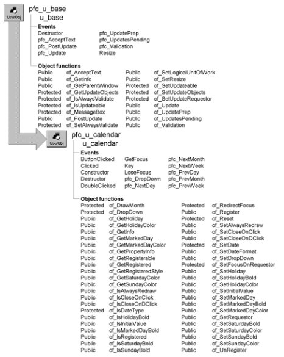

# u_calendar

**Description**

Calendar object. Users enter dates by clicking on the dropdown calendar, automatically entering the selected date in the associated field. They change months by clicking the >> and &lt;&lt; buttons and can also navigate the calendar with keyboard arrow keys.

U_calendar provides support for highlighting:

- Saturdays
- Sundays
- Holidays
- Marked days (any other special days that might apply to your application)

**Ancestry**



**Library**

- PFCAPSRV.PBL
- PFEAPSRV.PBL

**Object relationships**

- [n_cst_dropdown](../09-custom-class-user-objects/n_cst_dropdown.md)
- [u_cb](../06-standard-visual-user-objects/u_cb.md)
- [u_dw](../06-standard-visual-user-objects/u_dw.md)

**Usage**

Use this object to provide a dropdown calendar for date values in either of the following:

U_dw-based DataWindow control U_em-based EditMask control Standalone calendar, for use with or without an EditMask

To use this service with DataWindow columns:

1. Place a u_dw-based DataWindow control on the window or user object.
2. Enable the dropdown calendar by calling the u_dw of_SetDropDownCalendar function (this example is from a DataWindow Constructor event):

   ```
   this.of_SetDropDownCalendar(TRUE)
   ```

3. Register columns one by one or all at once by calling the of_Register function. Of_Register includes an argument specifying the dropdown style:

   ```
   this.iuo_calendar.of_Register("hire_date", &
     this.iuo_calendar.DDLB)
   ```

4. (Optional) Establish the font style and color for weekend days:

   ```
   n_cst_color  lnv_color

   this.iuo_calendar.of_SetSaturdayBold(TRUE)
   this.iuo_calendar.of_SetSaturdayColor &
     (lnv_color.GREEN)
   this.iuo_calendar.of_SetSundayBold(TRUE)
   this.iuo_calendar.of_SetSundayColor &
     (lnv_color.GREEN)
   ```

5. (Optional) Establish a list of holidays with their font style and color (this example shows holidays for one year only):

   ```
   Date ld_holidays[11]

   ld_holidays[1] = 1997-01-01
   ld_holidays[2] = 1997-02-17
   ld_holidays[3] = 1997-04-21
   ld_holidays[4] = 1997-05-26
   ld_holidays[5] = 1997-07-04
   ld_holidays[6] = 1997-09-01
   ld_holidays[7] = 1997-10-13
   ld_holidays[8] = 1997-11-27
   ld_holidays[9] = 1997-11-28
   ld_holidays[10] = 1997-12-25
   ld_holidays[11] = 1997-12-26
   ...
   this.iuo_calendar.of_SetHoliday(ld_holidays)
   this.iuo_calendar.of_SetHolidayBold(TRUE)
   this.iuo_calendar.of_SetHolidayColor &
     (lnv_color.GREEN)
   ```

6. (Optional) Establish a list of marked days with their font style and color:

   ```
   Date ld_marked_days[12]

   ld_marked_days[1] = 1996-06-13
   ld_marked_days[2] = 1996-03-16
   ld_marked_days[3] = 1996-09-23
   ld_marked_days[4] = 1996-09-14
   ld_marked_days[5] = 1997-06-13
   ld_marked_days[6] = 1997-03-16
   ld_marked_days[7] = 1997-09-23
   ld_marked_days[8] = 1997-09-14
   ld_marked_days[9] = 1998-06-13
   ld_marked_days[10] = 1998-03-16
   ld_marked_days[11] = 1998-09-23
   ld_marked_days[12] = 1998-09-14
   ...
   this.iuo_calendar.of_SetMarkedDay(ld_marked_days)
   this.iuo_calendar.of_SetMarkedDayBold(TRUE)
   this.iuo_calendar.of_SetMarkedDayColor &
     (lnv_color.RED)
   ```

7. (Optional) Call additional functions as necessary to customize calendar behavior:

   ```
   this.iuo_calendar.of_SetCloseOnClick(FALSE)
   this.iuo_calendar.of_SetCloseOnDClick(TRUE)
   this.iuo_calendar.of_SetInitialValue(TRUE)
   ```

For information on using u_calendar with EditMask controls and as a standalone calendar, see the *PFC User’s Guide*.

**See also**

- [u_calculator](u_calculator.md)
- [u_dw](../06-standard-visual-user-objects/u_dw.md)
- [u_em](../06-standard-visual-user-objects/u_em.md)

## Instance variables

U_calendar includes instance variables.

| Instance variable | Description | Data type | Access | Usage |
| --- | --- | --- | --- | --- |
| DDLB | Constant set to 2 | Integer | Public | Use with of_Register |
| DDLB_WITHARROW | Constant set to 3 | Integer | Public | Use with of_Register |
| ib_alwaysredraw | Controls redraw | Boolean | Protected | Internal |
| ib_closeonclick | Controls close on click | Boolean | Protected | Set with of_SetCloseOnClick |
| ib_closeondclick | Controls close on double-click | Boolean | Protected | Set with of_SetCloseOnDClick |
| ib_holidaybold | Controls whether holidays are bold | Boolean | Protected | Set with of_SetHolidayBold |
| ib_initialvalue | Controls whether blank fields are initialized | Boolean | Protected | Set with of_SetInitialValue |
| ib_markeddaybold | Controls whether marked days are bold | Boolean | Protected | Set with of_SetMarkedDayBold |
| ib_saturdaybold | Controls whether Saturdays are bold | Boolean | Protected | Set with of_SetSaturdayBold |
| ib_sundaybold | Controls whether Sundays are bold | Boolean | Protected | Set with of_SetSundayBold |
| id_date | Current date | Date | Protected | Internal |
| id_holiday[ ] | List of holidays | Date | Protected | Set with of_SetHoliday |
| id_markedday[ ] | List of marked days | Date | Protected | Set with of_SetMarkedDay |
| id_prevdate | Previous date | Date | Protected | Internal |
| id_resetdate | Date to use if invalid date is entered | Date | Protected | Internal |
| idrg_requestor | Generic reference | DragObject | Protected | Internal |
| idw_requestor | Associated DataWindow control | DataWindow | Protected | Internal |
| iem_requestor | Associated EditMask control | EditMask | Protected | Internal |
| ii_boldfontweight | Bold font weight | Integer | Protected | Internal (default is 700) |
| ii_dwcolumnstyle[ ] | Edit styles of registered columns | Integer | Protected | Set with of_Register |
| ii_normalfontweight | Normal font weight | Integer | Protected | Internal (default is 400) |
| il_fontcolor | Font color for normal days | Long | Protected | Internal |
| il_holidaycolor | Font color for holidays | Long | Protected | Set with of_SetHolidayColor |
| il_markeddaycolor | Font color for marked days | Long | Protected | Set with of_SetMarkedDayColor |
| il_saturdaycolor | Font color for Saturdays | Long | Protected | Set with of_SetSaturdayColor |
| il_sundaycolor | Font color for Sundays | Long | Protected | Set with of_SetSundayColor |
| inv_calendarattrib | Calendar attributes | n_cst_calendarattrib | Public | Internal |
| inv_datetime | Reference to date/time service | n_cst_datetime | Public | Internal |
| inv_dropdown | Reference to dropdown service | n_cst_dropdown | Public | Internal |
| is_dateformat | Date format | String | Protected | Set with of_SetDateFormat |
| is_dwcolumns[ ] | Registered columns | String | Protected | Set with of_Register |
| is_dwcolumnsexp[ ] | Original properties for registered columns | String | Protected | Set with of_Register |
| is_prevcell | Previous cell | String | Protected | Internal |
| NONE | Constant set to 1 | Integer | Public | Use with of_Register |

## Events

U_calendar includes precoded events:

- ButtonClicked
- Clicked
- Constructor
- Destructor
- DoubleClicked
- GetFocus
- Key
- LoseFocus
- pfc_DropDown
- pfc_NextDay
- pfc_NextMonth
- pfc_NextWeek
- pfc_PrevDay
- pfc_PrevMonth
- pfc_PrevWeek

### ButtonClicked

**Description**

Changes the month.

**Applies to**

Dw_cal

**Usage**

This event executes when the user clicks the next or previous month buttons.

### Clicked

**Description**

Changes the month or day.

**Applies to**

Dw_cal

**Usage**

This event executes when the user clicks a date.

### Constructor

**Description**

Initializes object settings.

**Applies to**

Dw_cal and u_calendar

**Usage**

This event executes when the object is created.

### Destructor

**Description**

Destroys the inv_dropdown instance variable.

**Applies to**

U_calendar

**Usage**

This event executes when the u_calendar instance is destroyed.

### DoubleClicked

**Description**

Hides the dropdown calendar if close on double-click has been set with the of_SetCloseOnDClick function.

**Applies to**

Dw_cal

**Usage**

This event executes when the user double-clicks on the dw_cal DataWindow control.

### GetFocus

**Description**

Calls the of_RedirectFocus function.

**Applies to**

Dw_cal

**Usage**

This event executes when a control receives focus, typically by clicking.

### Key

**Description**

Provides keyboard support.

**Applies to**

Dw_cal

**Usage**

This event executes when the user presses one of the following keys:

ESC TAB ENTER LEFT, RIGHT, UP, or DOWN ARROW PAGE UP or PAGE DOWN

### LoseFocus

**Description**

Hides the calendar.

**Applies to**

Dw_cal

**Usage**

This event executes when the calendar loses focus.

### pfc_DropDown

**Description**

Calls the of_DropDown function.

**Applies to**

U_calendar

**Return value**

Integer. Returns 1 if the event succeeds, 0 if the DataWindow column has not been registered, and -1 if an error occurs.

**Usage**

This event, which calls the of_DropDown function, is called by the u_dw pfc_DDCalendar event.

### pfc_NextDay

**Description**

Advances the current date by one day.

**Applies to**

Dw_cal

**Return value**

Integer. Returns 1 if the event succeeds and -1 if an error occurs.

**Usage**

This event is called by the Key event when the user presses the RIGHT ARROW key.

### pfc_NextMonth

**Description**

Advances the current date by one month.

**Applies to**

Dw_cal

**Return value**

Integer. Returns 1 if the event succeeds and -1 if an error occurs.

**Usage**

This event is called by the Key event when the user presses the PAGE DOWN key.

### pfc_NextWeek

**Description**

Advances the current date by one week.

**Applies to**

Dw_cal

**Return value**

Integer. Returns 1 if the event succeeds and -1 if an error occurs.

**Usage**

This event is called by the Key event when the user presses the DOWN ARROW key.

### pfc_PrevDay

**Description**

Sets the current date back by one day.

**Applies to**

Dw_cal

**Return value**

Integer. Returns 1 if the event succeeds and -1 if an error occurs.

**Usage**

This event is called by the Key event when the user presses the LEFT ARROW key.

### pfc_PrevMonth

**Description**

Sets the current date back by one month.

**Applies to**

Dw_cal

**Return value**

Integer. Returns 1 if the event succeeds and -1 if an error occurs.

**Usage**

This event is called by the Key event when the user presses the PAGE DOWN key.

### pfc_PrevWeek

**Description**

Sets the current date back by one week.

**Applies to**

Dw_cal

**Return value**

Integer. Returns 1 if the event succeeds and -1 if an error occurs.

**Usage**

This event is called by the Key event when the user presses the UP ARROW key.

## Functions

U_calendar contains precoded object functions:

- of_DrawMonth
- of_DropDown
- of_GetHoliday
- of_GetHolidayColor
- of_GetInfo
- of_GetMarkedDay
- of_GetMarkedDayColor
- of_GetPropertyInfo
- of_GetRegisterable
- of_GetRegistered
- of_GetRegisteredStyle
- of_GetSaturdayColor
- of_GetSundayColor
- of_IsAlwaysRedraw
- of_IsCloseOnClick
- of_IsCloseOnDClick
- of_IsDateType
- of_IsHolidayBold
- of_IsInitialValue
- of_IsMarkedDayBold
- of_IsRegistered
- of_IsSaturdayBold
- of_IsSundayBold
- of_RedirectFocus
- of_Register
- of_Reset
- of_SetAlwaysRedraw
- of_SetCloseOnClick
- of_SetCloseOnDClick
- of_SetDate
- of_SetDateFormat
- of_SetDropDown
- of_SetFocusOnRequestor
- of_SetHoliday
- of_SetHolidayBold
- of_SetHolidayColor
- of_SetInitialValue
- of_SetMarkedDay
- of_SetMarkedDayBold
- of_SetMarkedDayColor
- of_SetRequestor
- of_SetSaturdayBold
- of_SetSaturdayColor
- of_SetSundayBold
- of_SetSundayColor
- of_UnRegister

### of_DrawMonth

**Description**

Draws the specified month.

**Access**

Protected

**Syntax**

```
dwcontrol.instancename.of_DrawMonth ( date )
```

| Argument | Description |
| --- | --- |
| *dwcontrol* | Instance name of the u_dw-based DataWindow control (not required when using u_calendar with an EditMask control) |
| *instancename* | Instance name of u_calendar (the u_dw and u_em default for this value is iuo_calendar) |
| *date* | Date specifying the month to draw |

**Return value**

Integer. Returns 1 if the function succeeds and -1 if an error occurs.

**Usage**

Internal.

**Examples**

This example calls the of_DrawMonth function:

```
...
IF Year(ad_date) <> Year(id_prevdate) OR &
  Month(ad_date) <> Month(id_prevdate) THEN
    of_DrawMonth(ad_date)
END IF
...
```

### of_DropDown

**Description**

Displays the dropdown calendar in the appropriate location.

**Access**

Public

**Syntax**

```
dwcontrol.instancename.of_DropDown ( )
```

| Argument | Description |
| --- | --- |
| *dwcontrol* | Instance name of the u_dw-based DataWindow control (not required when using u_calendar with an EditMask control) |
| *instancename* | Instance name of u_calendar (the u_dw and u_em default for this value is iuo_calendar) |

**Return value**

Integer. Returns 1 if the function succeeds, 0 if the current DataWindow column has not been registered, and -1 if an error occurs.

**Usage**

The u_dw and u_em pfc_DDCalendar event calls this function.

**Examples**

This example is from the u_em pfc_DDCalendar event:

```
IF IsValid(iuo_calendar) THEN
  Return iuo_calendar.of_DropDown()
END IF
```

### of_GetHoliday

**Description**

Retrieves an array containing all specified holidays.

**Access**

Public

**Syntax**

```
dwcontrol.instancename.of_GetHoliday ( holidays )
```

| Argument | Description |
| --- | --- |
| *dwcontrol* | Instance name of the u_dw-based DataWindow control (not required when using u_calendar with an EditMask control) |
| *instancename* | Instance name of u_calendar (the u_dw and u_em default for this value is iuo_calendar) |
| *holidays* | Unbounded Date array into which the function places all specified holidays (passed by reference) |

**Return value**

Integer. Returns the number of entries in the *holidays* array.

**Examples**

This example calls the of_GetHoliday function:

```
String ls_display
Date ldt_holidays[ ]
Integer li_return, li_count

li_return = &
  dw_caltest.iuo_calendar.of_GetHoliday &
    (ldt_holidays)
FOR li_count = 1 to li_return
  ls_display += String(ldt_holidays[li_count])
  ls_display += "~r~n"
NEXT
MessageBox("Holidays", ls_display)
```

### of_GetHolidayColor

**Description**

Retrieves the display color for holidays.

**Access**

Public

**Syntax**

```
dwcontrol.instancename.of_GetHolidayColor ( )
```

| Argument | Description |
| --- | --- |
| *dwcontrol* | Instance name of the u_dw-based DataWindow control (not required when using u_calendar with an EditMask control) |
| *instancename* | Instance name of u_calendar (the u_dw and u_em default for this value is iuo_calendar) |

**Return value**

Long. Returns the color for holidays.

**Examples**

This example calls the of_GetHolidayColor function:

```
MessageBox("Holidays", "Holiday color is " + String &
  (dw_caltest.iuo_calendar.of_GetHolidayColor()))
```

### of_GetInfo

**Description**

Retrieves object information.

**Access**

Public

**Syntax**

```
dwcontrol.instancename.of_GetInfo ( infoobject )
```

| Argument | Description |
| --- | --- |
| *dwcontrol* | Instance name of the u_dw-based DataWindow control (not required when using u_calendar with an EditMask control) |
| *instancename* | Instance name of u_calendar (the u_dw and u_em default for this value is iuo_calendar) |
| *infoobject* | N_cst_infoattrib instance into which the function places information (passed by reference) |

**Return value**

Integer. Returns 1 if the function succeeds and -1 if an error occurs.

**Usage**

The DataWindow Properties window calls this function to access service information.

**Examples**

This example calls the of_GetInfo function:

```
n_cst_infoattrib  lnv_info

dw_1.iuo_calendar.of_GetInfo(lnv_info)
MessageBox("Info",  &
  "Description: " + lnv_info.is_description  &
    + ". Name: " + lnv_info.is_name)
```

### of_GetMarkedDay

**Description**

Retrieves an array containing all marked days.

**Access**

Public

**Syntax**

```
dwcontrol.instancename.of_GetMarkedDay ( markeddays )
```

| Argument | Description |
| --- | --- |
| *dwcontrol* | Instance name of the u_dw-based DataWindow control (not required when using u_calendar with an EditMask control) |
| *instancename* | Instance name of u_calendar (the u_dw and u_em default for this value is iuo_calendar) |
| *markeddays* | Unbounded Date array into which the function places all specified marked days (passed by reference) |

**Return value**

Integer. Returns the number of entries in the *markeddays* array.

**Examples**

This example calls the of_GetMarkedDay function:

```
String ls_display
Date ldt_marked_days[ ]
Integer li_return, li_count

li_return = &
  dw_caltest.iuo_calendar.of_GetMarkedDay &
    (ldt_marked_days)
FOR li_count = 1 to li_return
  ls_display += String(ldt_marked_days[li_count])
  ls_display += "~r~n"
NEXT
MessageBox("Marked Days", ls_display)
```

### of_GetMarkedDayColor

**Description**

Retrieves the display color for marked days.

**Access**

Public

**Syntax**

```
dwcontrol.instancename.of_GetMarkedDayColor ( )
```

| Argument | Description |
| --- | --- |
| *dwcontrol* | Instance name of the u_dw-based DataWindow control (not required when using u_calendar with an EditMask control) |
| *instancename* | Instance name of u_calendar (the u_dw and u_em default for this value is iuo_calendar) |

**Return value**

Long. Returns the color for marked days.

**Examples**

This example calls the of_GetMarkedDayColor function:

```
MessageBox("Marked Days", &
  "Marked day color is " + String &
    (dw_1.iuo_calendar.of_GetMarkedDayColor()))
```

### of_GetPropertyInfo

**Description**

Retrieves information about the service’s properties.

**Access**

Public

**Syntax**

```
dwcontrol.instancename.of_GetPropertyInfo ( propertyobject )
```

| Argument | Description |
| --- | --- |
| *dwcontrol* | Instance name of the u_dw-based DataWindow control |
| *instancename* | Instance name of u_calendar (the u_dw and u_em default for this value is iuo_calendar) |
| *propertyobject* | N_cst_propertyattrib instance into which the function places property information (passed by reference) |

**Return value**

Integer. Returns 1 if the function succeeds and -1 if an error occurs.

**Usage**

The DataWindow Properties window calls this function to access service information.

**Examples**

This example calls the of_GetPropertyInfo function:

```
n_cst_propertyattrib  lnv_prop

dw_1.iuo_calendar.of_GetPropertyInfo(lnv_prop)
MessageBox("Info",  &
  "Description: " + lnv_prop.is_description  &
    + ". Name: " + lnv_prop.is_name  &
      + ". Property tab text: " +  &
        lnv_prop.is_propertytabtext)
```

### of_GetRegisterable

**Description**

Retrieves an array of registerable DataWindow columns. Registerable DataWindow columns have the date data type and use the DropDownListBox, Edit, or EditMask edit style.

**Access**

Public

**Syntax**

```
dwcontrol.instancename.of_GetRegisterable ( columns )
```

| Argument | Description |
| --- | --- |
| *dwcontrol* | Instance name of the u_dw-based DataWindow control |
| *instancename* | Instance name of u_calendar (the u_dw default for this value is iuo_calendar) |
| *columns* | Unbounded string array into which the function places the names of columns that have been registered with this instance of the dropdown calendar (passed by reference) |

**Return value**

Integer. Returns the number of entries in the *columns* array if the function succeeds and -1 if an error occurs.

**Usage**

Call this function to determine which DataWindow columns could be registered with this instance of u_calendar.

**Examples**

This example calls the of_GetRegisterable function:

```
...
li_rc = &
  idw_requestor.iuo_calendar. of_GetRegisterable &
    (ls_allcols)
...
```

### of_GetRegistered

**Description**

Retrieves an array of registered DataWindow columns.

**Access**

Public

**Syntax**

```
dwcontrol.instancename.of_GetRegistered ( columns )
```

| Argument | Description |
| --- | --- |
| *dwcontrol* | Instance name of the u_dw-based DataWindow control |
| *instancename* | Instance name of u_calendar (the u_dw default for this value is iuo_calendar) |
| *columns* | Unbounded string array into which the function places the names of columns that have been registered with this instance of the dropdown calendar (passed by reference) |

**Return value**

Integer. Returns the number of entries in the *columns* array if the function succeeds and -1 if an error occurs.

**Examples**

This example calls the of_GetRegistered function:

```
String ls_columns[], ls_display
Integer li_return, li_count

li_return = &
   dw_1.iuo_calendar.of_GetRegistered(ls_columns)
FOR li_count = 1 to li_return
   ls_display += ls_columns[li_count] + "~r~n"
NEXT
MessageBox("Columns", ls_display)
```

### of_GetRegisteredStyle

**Description**

Retrieves the display style for a registered column.

**Access**

Public

**Syntax**

```
dwcontrol.instancename.of_GetRegisteredStyle ( column )
```

| Argument | Description |
| --- | --- |
| *dwcontrol* | Instance name of the u_dw-based DataWindow control |
| *instancename* | Instance name of u_calendar (the u_dw default for this value is iuo_calendar) |
| *column* | String containing the DataWindow column for which the function returns the display style |

**Return value**

Integer. Returns 1 if the function succeeds, 0 if the column is not registered, and -1 if an error occurs.

**Examples**

This example calls the of_GetRegisteredStyle function:

```
Integer li_return

li_return = &
  dw_1.iuo_calendar.of_GetRegisteredStyle &
    ("start_date")
MessageBox("Display Style", &
  "Display style is " + String(li_return))
```

### of_GetSaturdayColor

**Description**

Retrieves the display color for Saturdays.

**Access**

Public

**Syntax**

```
dwcontrol.instancename.of_GetSaturdayColor ( )
```

**Argument Description**

|   |   |
| --- | --- |
| *dwcontrol* | Instance name of the u_dw-based DataWindow control (not required when using u_calendar with an EditMask control) |
| *instancena me* | Instance name of u_calendar (the u_dw and u_em default for this value is iuo_calendar) |

**Return value**

Long. Returns the color for Saturdays.

**Examples**

This example calls the of_GetSaturdayColor function:

```
MessageBox("Saturdays", "Saturday color is " + &
  String &
    (dw_caltest.iuo_calendar.of_GetSaturdayColor()))
```

### of_GetSundayColor

**Description**

Retrieves the display color for Sundays.

**Access**

Public

**Syntax**

```
dwcontrol.instancename.of_GetSundayColor ( )
```

| Argument | Description |
| --- | --- |
| *dwcontrol* | Instance name of the u_dw-based DataWindow control (not required when using u_calendar with an EditMask control) |
| *instancename* | Instance name of u_calendar (the u_dw and u_em default for this value is iuo_calendar) |

**Return value**

Long. Returns the color for Sundays.

**Examples**

This example calls the of_GetSundayColor function:

```
MessageBox("Sundays", "Sunday color is " + &
  String &
    (dw_caltest.iuo_calendar.of_GetSundayColor()))
```

### of_IsAlwaysRedraw

**Description**

Reports whether the u_calendar instance forces calendar redraw when display properties change.

**Access**

Public

**Syntax**

```
dwcontrol.instancename.of_IsAlwaysRedraw ( )
```

| Argument | Description |
| --- | --- |
| *dwcontrol* | Instance name of the u_dw-based DataWindow control (not required when using u_calendar with an EditMask control) |
| *instancename* | Instance name of u_calendar (the u_dw and u_em default for this value is iuo_calendar) |

**Return value**

Boolean. Returns TRUE if the u_calendar instance forces redraw and FALSE if it does not.

**Examples**

This example calls the of_IsAlwaysRedraw function:

```
Boolean lb_redraw
n_cst_conversion lnv_conversion

lb_redraw = &
  dw_1.iuo_calendar.of_IsAlwaysRedraw()
MessageBox("Calendar", "Redraw is " &
  + lnv_conversion.of_String(lb_redraw))
```

### of_IsCloseOnClick

**Description**

Reports whether the u_calendar instance closes when the user clicks a date.

**Access**

Public

**Syntax**

```
dwcontrol.instancename.of_IsCloseOnClick ( )
```

| Argument | Description |
| --- | --- |
| *dwcontrol* | Instance name of the u_dw-based DataWindow control (not required when using u_calendar with an EditMask control) |
| *instancename* | Instance name of u_calendar (the u_dw and u_em default for this value is iuo_calendar) |

**Return value**

Boolean. Returns TRUE if the u_calendar instance closes when the user clicks a date and FALSE if it does not.

**Examples**

This example calls the of_IsCloseOnClick function:

```
Boolean lb_close
n_cst_conversion lnv_conversion

lb_close = &
  dw_1.iuo_calendar.of_IsCloseOnClick()
MessageBox("Calendar", "Close on click is " &
  + lnv_conversion.of_String(lb_close))
```

### of_IsCloseOnDClick

**Description**

Reports whether the u_calendar instance closes when the user double-clicks a date.

**Access**

Public

**Syntax**

```
dwcontrol.instancename.of_IsCloseOnDClick ( )
```

| Argument | Description |
| --- | --- |
| *dwcontrol* | Instance name of the u_dw-based DataWindow control (not required when using u_calendar with an EditMask control) |
| *instancename* | Instance name of u_calendar (the u_dw and u_em default for this value is iuo_calendar) |

**Return value**

Boolean. Returns TRUE if the u_calendar instance closes when the user double-clicks a date and FALSE if it does not.

**Examples**

This example calls the of_IsCloseOnDClick function:

```
Boolean lb_close
n_cst_conversion lnv_conversion

lb_close = &
  dw_1.iuo_calendar.of_IsCloseOnDClick()
MessageBox("Calendar", &
  "Close on double-click is " &
    + lnv_conversion.of_String(lb_close))
```

### of_IsDateType

**Description**

Reports whether a specified DataWindow column uses the date data type.

**Access**

Protected

**Syntax**

```
dwcontrol.instancename.of_IsDateType ( datatype )
```

| Argument | Description |
| --- | --- |
| *dwcontrol* | Instance name of the u_dw-based DataWindow control (not required when using u_calendar with an EditMask control) |
| *instancename* | Instance name of u_calendar (the u_dw and u_em default for this value is iuo_calendar) |
| *datatype* | String specifying the data type |

**Return value**

Boolean. Returns TRUE if *datatype* is date and FALSE if it is not.

**Usage**

Internal.

**Examples**

This example is from the of_DropDown function:

```
...
IF NOT of_IsDateType(idw_requestor.Describe &
  (ls_colname+".coltype")) THEN
    Return -1
END IF
...
```

### of_IsHolidayBold

**Description**

Reports whether holidays are bold.

**Access**

Public

**Syntax**

```
dwcontrol.instancename.of_IsHolidayBold ( )
```

| Argument | Description |
| --- | --- |
| *dwcontrol* | Instance name of the u_dw-based DataWindow control (not required when using u_calendar with an EditMask control) |
| *instancename* | Instance name of u_calendar (the u_dw and u_em default for this value is iuo_calendar) |

**Return value**

Boolean. Returns TRUE if holidays are bold and FALSE if they are not.

**Examples**

This example calls the of_IsHolidayBold function:

```
IF dw_caltest.iuo_calendar.of_IsHolidayBold() THEN
  MessageBox("Holidays", "Holidays are bold")
ELSE
  MessageBox("Holidays", "Holidays are not bold")
END IF
```

### of_IsInitialValue

**Description**

Reports whether the u_calendar instance initializes blank fields with the current date when the calendar displays.

**Access**

Public

**Syntax**

```
dwcontrol.instancename.of_IsInitialValue ( )
```

| Argument | Description |
| --- | --- |
| *dwcontrol* | Instance name of the u_dw-based DataWindow control (not required when using u_calendar with an EditMask control) |
| *instancename* | Instance name of u_calendar (the u_dw and u_em default for this value is iuo_calendar) |

**Return value**

Boolean. Returns TRUE if the calendar initializes blank fields with the current date and FALSE if it does not.

**Examples**

This example calls the of_IsInitialValue function:

```
Boolean lb_today
n_cst_conversion lnv_conversion

lb_today = &
  dw_caltest.iuo_calendar.of_IsInitialValue()
MessageBox("Calendar", &
  "Use today’s date value is " &
    + lnv_conversion.of_String(lb_today))
```

### of_IsMarkedDayBold

**Description**

Reports whether marked days are bold.

**Access**

Public

**Syntax**

```
dwcontrol.instancename.of_IsMarkedDayBold ( )
```

| Argument | Description |
| --- | --- |
| *dwcontrol* | Instance name of the u_dw-based DataWindow control (not required when using u_calendar with an EditMask control) |
| *instancename* | Instance name of u_calendar (the u_dw and u_em default for this value is iuo_calendar) |

**Return value**

Boolean. Returns TRUE if marked days are bold and FALSE if they are not.

**Examples**

This example calls the of_IsMarkedDayBold function:

```
IF dw_1.iuo_calendar.of_IsMarkedDayBold() THEN
  MessageBox("Marked Days", "Marked days are bold")
ELSE
  MessageBox("Marked Days",  &
    "Marked days are not bold")
END IF
```

### of_IsRegistered

**Description**

Reports whether a specified DataWindow column has been registered with this instance of u_calendar.

**Access**

Public

**Syntax**

```
dwcontrol.instancename.of_IsRegistered ( column )
```

| Argument | Description |
| --- | --- |
| *dwcontrol* | Instance name of the u_dw-based DataWindow control |
| *instancename* | Instance name of u_calendar (the u_dw default for this value is iuo_calendar) |
| *column* | String specifying the column to search for |

**Return value**

Boolean. Returns TRUE if *column* has been registered and FALSE if it has not.

**Examples**

This example calls the of_IsRegistered function:

```
...
IF NOT this.iuo_calendar.of_IsRegistered &
  ("birth_date") THEN
    this.iuo_calendar.of_Register("birth_date")
END IF
...
```

### of_IsSaturdayBold

**Description**

Reports whether Saturdays are bold.

**Access**

Public

**Syntax**

```
dwcontrol.instancename.of_IsSaturdayBold ( )
```

| Argument | Description |
| --- | --- |
| *dwcontrol* | Instance name of the u_dw-based DataWindow control (not required when using u_calendar with an EditMask control) |
| *instancename* | Instance name of u_calendar (the u_dw and u_em default for this value is iuo_calendar) |

**Return value**

Boolean. Returns TRUE if Saturdays are bold and FALSE if they are not.

**Examples**

This example calls the of_IsSaturdayBold function:

```
IF dw_caltest.iuo_calendar. of_IsSaturdayBold () THEN
  MessageBox("Saturdays", "Saturdays are bold")
ELSE
  MessageBox("Saturdays", "Saturdays are not bold")
END IF
```

### of_IsSundayBold

**Description**

Reports whether Sundays are bold.

**Access**

Public

**Syntax**

```
dwcontrol.instancename.of_IsSundayBold ( )
```

| Argument | Description |
| --- | --- |
| *dwcontrol* | Instance name of the u_dw-based DataWindow control (not required when using u_calendar with an EditMask control) |
| *instancename* | Instance name of u_calendar (the u_dw and u_em default for this value is iuo_calendar) |

**Return value**

Boolean. Returns TRUE if Sundays are bold and FALSE if they are not.

**Examples**

This example calls the of_IsSundayBold function:

```
IF dw_caltest.iuo_calendar. of_IsSundayBold () THEN
  MessageBox("Sundays", "Sundays are bold")
ELSE
  MessageBox("Sundays", "Sundays are not bold")
END IF
```

### of_RedirectFocus

**Description**

Prevents the u_calendar instance from getting focus while it is hidden.

**Access**

Protected

**Syntax**

```
dwcontrol.instancename.of_RedirectFocus ( )
```

| Argument | Description |
| --- | --- |
| *dwcontrol* | Instance name of the u_dw-based DataWindow control (not required when using u_calendar with an EditMask control) |
| *instancename* | Instance name of u_calendar (the u_dw and u_em default for this value is iuo_calendar) |

**Return value**

Integer. Returns 1 if the function succeeds and -1 if an error occurs.

**Usage**

Internal.

**Examples**

This example is from the dw_cal GetFocus event:

```
Post of_RedirectFocus()
```

### of_Register

Registers columns that use the dropdown calendar. There are two syntaxes:

| To register | Use |
| --- | --- |
| One or all eligible columns, optionally specifying a display style | Syntax 1 |
| All eligible columns using a specified display style | Syntax 2 |

| Syntax 1 | Register columns with an optional display style |
| --- | --- |

**Description**

Registers one or all eligible columns in a DataWindow. Eligible columns use the date data type and have the Edit, EditMask, or DropDownListBox edit style.

**Access**

Public

**Syntax**

```
dwcontrol.instancename.of_Register ( { column {, style } } )
```

| Argument | Description |
| --- | --- |
| *dwcontrol* | Instance name of the u_dw-based DataWindow control |
| *instancename* | Instance name of u_calendar (the u_dw default for this value is iuo_calendar) |
| *column* | (Optional) String specifying the column to be registered. This column must have a date data type. If you omit this argument, the function registers all columns that use the date data type |
| *style* | (Optional) Integer or u_calendar constant specifying the display style of registered DataWindow columns: |
|  | **• 1 or NONE (default)** For columns that use the DropDownListBox edit style, the calendar displays automatically when the column gets focus. For columns that use the Edit and EditMask edit styles, the calendar does not display automatically; instead, you display the calendar by coding a call to the u_dw pfc_DDCalendar event |
|  | **• 2 or DDLB** The function converts registered columns to the DropDownListBox edit style. Users display the calendar by clicking the down arrow, which *disappears* when the calendar displays |
|  | **• 3 or DDLB_WITHARROW** The function converts registered columns to the DropDownListBox edit style. Users display the calendar by clicking the down arrow, which *remains* when the calendar displays |

**Return value**

Integer. Returns the number of columns registered if the function succeeds, 0 if the column was already registered, and -1 if an error occurs. The number of columns registered includes hidden columns.

**Usage**

Call this function to register one or all date columns in a DataWindow.

To register all eligible columns in a DataWindow using a specified display style, use Syntax 2.

**Examples**

This example calls the of_Register function:

```
this.of_SetTransObject(SQLCA)
this.of_SetDropDownCalendar(TRUE)
this.iuo_calendar.of_Register("start_date", &
  this.iuo_calendar.DDLB)
this.iuo_calendar.of_Register("termination_date", &
  this.iuo_calendar.NONE)
this.iuo_calendar.of_Register("birth_date", &
  this.iuo_calendar.DDLB)
this.of_Retrieve()
```

| Syntax 2 | Register columns with a display style |
| --- | --- |

**Description**

Registers all eligible columns in a DataWindow using the specified display style. Eligible columns use the date data type and have the Edit, EditMask, or DropDownListBox edit style.

**Access**

Public

**Syntax**

```
dwcontrol.instancename.of_Register (style )
```

| Argument | Description |
| --- | --- |
| *dwcontrol* | Instance name of the u_dw-based DataWindow control |
| *instancename* | Instance name of u_calendar. The u_dw and u_em default for this is iuo_calendar |
| *style* | Integer or u_calendar constant specifying the display style of registered DataWindow columns: |
|  | **• 1 or NONE** For columns that use the DropDownListBox edit style, the calendar displays automatically when the column gets focus. For columns that use the Edit and EditMask edit styles, the calendar does not display automatically; instead, you display the calendar by coding a call to the u_dw pfc_DDCalendar event |
|  | **• 2 or DDLB** The function converts registered columns to the DropDownListBox edit style. Users display the calendar by clicking the down arrow, which *disappears* when the calendar displays |
|  | **• 3 or DDLB_WITHARROW** The function converts registered columns to the DropDownListBox edit style. Users display the calendar by clicking the down arrow, which *remains* when the calendar displays |

**Return value**

Integer. Returns the number of columns registered if the function succeeds and -1 if an error occurs. The number of columns registered includes hidden columns.

**Usage**

Call this function to register all Date columns in a DataWindow, using a specified display style.

To register one or all eligible columns in a DataWindow, optionally specifying a display style, use Syntax 1.

**Examples**

This example calls the of_Register function:

```
this.of_SetTransObject(SQLCA)
this.of_SetDropDownCalendar(TRUE)
this.iuo_calendar.of_Register &
  (this.iuo_calendar.NONE)
this.of_Retrieve()
```

### of_Reset

**Description**

Resets the u_calendar date to that displayed in the DataWindow column or EditMask control.

**Access**

Protected

**Syntax**

```
dwcontrol.instancename.of_Reset ( )
```

| Argument | Description |
| --- | --- |
| *dwcontrol* | Instance name of the u_dw-based DataWindow control (not required when using u_calendar with an EditMask control) |
| *instancename* | Instance name of u_calendar (the u_dw and u_em default for this value is iuo_calendar) |

**Return value**

Integer. Returns 1 if the function succeeds and -1 if an error occurs.

**Usage**

Internal.

**Examples**

This example is from the of_DropDown function:

```
...
li_rc = inv_dropdown.of_Position &
  (idrg_requestor, FALSE)
IF li_rc < 0 THEN Return -1
  of_Reset ()
  This.Visible = TRUE
  Return 1
...
```

### of_SetAlwaysRedraw

**Description**

Specifies whether the u_calendar instance forces calendar redraw when display properties change.

**Access**

Public

**Syntax**

```
dwcontrol.instancename.of_SetAlwaysRedraw ( boolean )
```

| Argument | Description |
| --- | --- |
| *dwcontrol* | Instance name of the u_dw-based DataWindow control (not required when using u_calendar with an EditMask control) |
| *instancename* | Instance name of u_calendar (the u_dw and u_em default for this value is iuo_calendar) |
| *boolean* | Boolean indicating whether the u_calendar instance forces a redraw when display properties change (TRUE) or not (FALSE) |

**Return value**

Integer. Returns 1 if the function succeeds and -1 if an error occurs.

**Usage**

You should enable automatic redraw if your application programmatically changes a calendar’s holidays, special days, or other display properties.

**Examples**

This example calls the of_SetAlwaysRedraw function:

```
dw_1.iuo_calendar.of_SetAlwaysRedraw(TRUE)
```

### of_SetCloseOnClick

**Description**

Specifies whether to hide the u_calendar instance when the user clicks a date.

**Access**

Public

**Syntax**

```
dwcontrol.instancename.of_SetCloseOnClick ( boolean )
```

| Argument | Description |
| --- | --- |
| *dwcontrol* | Instance name of the u_dw-based DataWindow control (not required when using u_calendar with an EditMask control) |
| *instancename* | Instance name of u_calendar (the u_dw and u_em default for this value is iuo_calendar) |
| *boolean* | Boolean specifying whether to hide the dropdown calendar when the user clicks a date (TRUE) or leave it displayed (FALSE) |

**Return value**

Integer. Returns 1 if the function succeeds and -1 if an error occurs.

**Examples**

This example calls the of_SetCloseOnClick function:

```
this.of_SetTransObject(SQLCA)
this.of_SetDropDownCalendar(TRUE)
this.iuo_calendar.of_Register("start_date", &
  this.iuo_calendar.DDLB)
this.iuo_calendar.of_Register("termination_date")
this.iuo_calendar.of_Register("birth_date", &
  this.iuo_calendar.DDLB)
this.iuo_calendar.of_SetCloseOnClick(FALSE)
this.iuo_calendar.of_SetInitialValue(TRUE)
```

### of_SetCloseOnDClick

**Description**

Specifies whether to hide the u_calendar instance when the user double-clicks a date.

**Access**

Public

**Syntax**

```
dwcontrol.instancename.of_SetCloseOnDClick ( boolean )
```

| Argument | Description |
| --- | --- |
| *dwcontrol* | Instance name of the u_dw-based DataWindow control (not required when using u_calendar with an EditMask control) |
| *instancename* | Instance name of u_calendar (the u_dw and u_em default for this value is iuo_calendar) |
| *boolean* | Boolean specifying whether to hide the dropdown calendar when the user double-clicks a date (TRUE) or leave it displayed (FALSE) |

**Return value**

Integer. Returns 1 if the function succeeds and -1 if an error occurs.

**Examples**

This example calls the of_SetCloseOnDClick function:

```
this.of_SetTransObject(SQLCA)
this.of_SetDropDownCalendar(TRUE)
this.iuo_calendar.of_Register("start_date")
this.iuo_calendar.of_Register("termination_date")
this.iuo_calendar.of_Register("birth_date")
this.iuo_calendar.of_SetCloseOnDClick(TRUE)
```

### of_SetDate

**Description**

Sets the current date, optionally updating the date in the associated DataWindow column or EditMask control.

**Access**

Protected

**Syntax**

```
dwcontrol.instancename.of_SetDate ( date, sendtorequestor )
```

| Argument | Description |
| --- | --- |
| *dwcontrol* | Instance name of the u_dw-based DataWindow control (not required when using u_calendar with an EditMask control) |
| *instancename* | Instance name of u_calendar (the u_dw and u_em default for this value is iuo_calendar) |
| *date* | Date variable containing the new date |
| *sendtorequestor* | Boolean indicating whether to copy *date* to the requestor object (TRUE) or not (FALSE) |

**Return value**

Integer. Returns 1 if the function succeeds and -1 if an error occurs.

**Usage**

Internal.

**Examples**

This example is from the of_Reset function:

```
...
id_resetdate = date(ls_date)
IF of_IsValid(id_resetdate) THEN
  of_SetDate(id_resetdate, FALSE)
ELSE
  of_SetDate(Today(), ib_InitialValue)
END IF
Return 1
```

### of_SetDateFormat

**Description**

Sets the format for dates converted to strings.

**Access**

Public

**Syntax**

```
dwcontrol.instancename.of_SetDateFormat ( format )
```

| Argument | Description |
| --- | --- |
| *dwcontrol* | Instance name of the u_dw-based DataWindow control (not required when using u_calendar with an EditMask control) |
| *instancename* | Instance name of u_calendar (the u_dw and u_em default for this value is iuo_calendar) |
| *format* | String specifying the format for dates converted to strings. Sample date formats include mm/dd/yy; m-d-yy; and mmm dd, yyyy |

**Return value**

Integer. Returns 1 if the function succeeds and -1 if an error occurs.

**Usage**

When using a calendar with an EditMask control, this format must match the date mask.

When you use this function for a DataWindow column, it overrides the DataWindow edit mask, if one was specified. Also, when applied to a DataWindow column, the format argument must be compatible with the client system default date format.

**Examples**

This example calls the of_SetDateFormat function:

```
...
this.iuo_calendar.of_SetInitialValue(TRUE)
this.iuo_calendar.of_SetDateFormat("dd/mm/yy")
```

### of_SetDropDown

**Description**

Enables or disables the dropdown service (n_cst_dropdown).

**Access**

Public

**Syntax**

```
dwcontrol.instancename.of_SetDropDown ( boolean )
```

| Argument | Description |
| --- | --- |
| *dwcontrol* | Instance name of the u_dw-based DataWindow control (not required when using u_calendar with an EditMask control) |
| *instancename* | Instance name of u_calendar (the u_dw and u_em default for this value is iuo_calendar) |
| *boolean* | Boolean specifying whether to enable (TRUE) or disable (TRUE) the dropdown service |

**Return value**

Integer. Returns 1 if the function succeeds, 0 if the dropdown service already exists, and -1 if an error occurs.

**Examples**

This example is from the u_calendar Constructor event:

```
...
this.Visible = FALSE
of_SetDropDown(TRUE)
...
```

### of_SetFocusOnRequestor

**Description**

Returns focus to the associated DataWindow column or EditMask control.

**Access**

Protected

**Syntax**

```
dwcontrol.instancename.of_SetFocusOnRequestor ( )
```

| Argument | Description |
| --- | --- |
| *dwcontrol* | Instance name of the u_dw-based DataWindow control (not required when using u_calendar with an EditMask control) |
| *instancename* | Instance name of u_calendar (the u_dw and u_em default for this value is iuo_calendar) |

**Return value**

Integer. Returns 1 if the function succeeds and -1 if an error occurs.

**Usage**

Internal.

**Examples**

This example is from the dw_cal DoubleClicked event:

```
...
IF IsValid(inv_dropdown) THEN
  IF ib_closeondclick THEN
    of_SetFocusOnRequestor()
  END IF
END IF
```

### of_SetHoliday

**Description**

Specifies the holidays displayed on the calendar.

**Access**

Public

**Syntax**

```
dwcontrol.instancename.of_SetHoliday ( holidays )
```

| Argument | Description |
| --- | --- |
| *dwcontrol* | Instance name of the u_dw-based DataWindow control (not required when using u_calendar with an EditMask control) |
| *instancename* | Instance name of u_calendar (the u_dw and u_em default for this value is iuo_calendar) |
| *holidays* | Date array containing holidays |

**Return value**

Integer. Returns 1 if the function succeeds and -1 if an error occurs.

**Examples**

This example calls the of_SetHoliday function:

```
Date ld_holidays[11]

ld_holidays[1] = 1997-01-01
ld_holidays[2] = 1997-02-17
ld_holidays[3] = 1997-04-21
ld_holidays[4] = 1997-05-26
ld_holidays[5] = 1997-07-04
ld_holidays[6] = 1997-09-01
ld_holidays[7] = 1997-10-13
ld_holidays[8] = 1997-11-27
ld_holidays[9] = 1997-11-28
ld_holidays[10] = 1997-12-25
ld_holidays[11] = 1997-12-26
this.iuo_calendar.of_SetHoliday(ld_holidays)
```

### of_SetHolidayBold

**Description**

Sets the Bold property for holidays.

**Access**

Public

**Syntax**

```
dwcontrol.instancename.of_SetHolidayBold ( boolean )
```

| Argument | Description |
| --- | --- |
| *dwcontrol* | Instance name of the u_dw-based DataWindow control (not required when using u_calendar with an EditMask control) |
| *instancename* | Instance name of u_calendar (the u_dw and u_em default for this value is iuo_calendar) |
| *boolean* | Boolean indicating whether holidays are bold (TRUE) or not (FALSE) |

**Return value**

Integer. Returns 1 if the function succeeds and -1 if an error occurs.

**Examples**

This example calls the of_SetHolidayBold function:

```
...
this.iuo_calendar.of_SetHoliday(ld_holidays)
this.iuo_calendar.of_SetHolidayBold (TRUE)
this.iuo_calendar.of_SetHolidayColor(RGB(0,255,0))
```

### of_SetHolidayColor

**Description**

Sets the display color for holidays.

**Access**

Public

**Syntax**

```
dwcontrol.instancename.of_SetHolidayColor ( color )
```

| Argument | Description |
| --- | --- |
| *dwcontrol* | Instance name of the u_dw-based DataWindow control (not required when using u_calendar with an EditMask control) |
| *instancename* | Instance name of u_calendar (the u_dw and u_em default for this value is iuo_calendar) |
| *color* | Long specifying the color for holidays |

**Return value**

Integer. Returns 1 if the function succeeds and -1 if an error occurs.

**Examples**

This example calls the of_SetHolidayColor function:

```
...
this.iuo_calendar.of_SetHoliday(ld_holidays)
this.iuo_calendar.of_SetHolidayBold(TRUE)
this.iuo_calendar.of_SetHolidayColor(RGB(0,255,0))
```

### of_SetInitialValue

**Description**

Specifies whether the u_calendar instance initializes blank fields with the current date when the calendar displays.

**Access**

Public

**Syntax**

```
dwcontrol.instancename.of_SetInitialValue ( boolean )
```

| Argument | Description |
| --- | --- |
| *dwcontrol* | Instance name of the u_dw-based DataWindow control (not required when using u_calendar with an EditMask control) |
| *instancename* | Instance name of u_calendar (the u_dw and u_em default for this value is iuo_calendar) |
| *boolean* | Boolean indicating whether the calendar initializes the blank fields with the current date when the calendar displays (TRUE) or not (FALSE) |

**Return value**

Integer. Returns 1 if the function succeeds and -1 if an error occurs.

**Examples**

This example calls the of_SetInitialValue function:

```
...
this.iuo_calendar.of_SetInitialValue(TRUE)
...
```

### of_SetMarkedDay

**Description**

Specifies a set of marked days. Marked days are not holidays but still require special display on the calendar.

**Access**

Public

**Syntax**

```
dwcontrol.instancename.of_SetMarkedDay ( markeddays )
```

| Argument | Description |
| --- | --- |
| *dwcontrol* | Instance name of the u_dw-based DataWindow control (not required when using u_calendar with an EditMask control) |
| *instancename* | Instance name of u_calendar (the u_dw and u_em default for this value is iuo_calendar) |
| *markeddays* | Date array containing marked days |

**Return value**

Integer. Returns 1 if the function succeeds and -1 if an error occurs.

**Examples**

This example calls the of_SetMarkedDay function:

```
Date ld_marked_days[12]

ld_marked_days[1] = 1996-06-13
ld_marked_days[2] = 1996-03-16
ld_marked_days[3] = 1996-09-23
ld_marked_days[4] = 1996-09-14
ld_marked_days[5] = 1997-06-13
ld_marked_days[6] = 1997-03-16
ld_marked_days[7] = 1997-09-23
ld_marked_days[8] = 1997-09-14
ld_marked_days[9] = 1998-06-13
ld_marked_days[10] = 1998-03-16
ld_marked_days[11] = 1998-09-23
ld_marked_days[12] = 1998-09-14

this.iuo_calendar.of_SetMarkedDay(ld_marked_days)
```

### of_SetMarkedDayBold

**Description**

Sets the Bold property for marked days.

**Access**

Public

**Syntax**

```
dwcontrol.instancename.of_SetMarkedDayBold ( boolean )
```

| Argument | Description |
| --- | --- |
| *dwcontrol* | Instance name of the u_dw-based DataWindow control (not required when using u_calendar with an EditMask control) |
| *instancename* | Instance name of u_calendar (the u_dw and u_em default for this value is iuo_calendar) |
| *boolean* | Boolean indicating whether marked days are bold (TRUE) or not (FALSE) |

**Return value**

Integer. Returns 1 if the function succeeds and -1 if an error occurs.

**Examples**

This example calls the of_SetMarkedDayBold function:

```
...
this.iuo_calendar.of_SetMarkedDayBold(TRUE)
this.iuo_calendar.of_SetMarkedDayColor &
   (RGB(255, 0, 0))
```

### of_SetMarkedDayColor

**Description**

Sets the display color for marked days.

**Access**

Public

**Syntax**

```
dwcontrol.instancename.of_SetMarkedDayColor ( color )
```

| Argument | Description |
| --- | --- |
| *dwcontrol* | Instance name of the u_dw-based DataWindow control (not required when using u_calendar with an EditMask control) |
| *instancename* | Instance name of u_calendar (the u_dw and u_em default for this value is iuo_calendar) |
| *color* | Long specifying the color for marked days |

**Return value**

Integer. Returns 1 if the function succeeds and -1 if an error occurs.

**Examples**

This example calls the of_SetMarkedDayColor function:

```
...
this.iuo_calendar.of_SetMarkedDayBold(TRUE)
this.iuo_calendar.of_SetMarkedDayColor &
  (RGB(255, 0, 0))
```

### of_SetRequestor

**Description**

Associates an instance of u_calendar with a DataWindow or EditMask control.

**Access**

Public

**Syntax**

```
dwcontrol.instancename.of_SetRequestor ( requestor )
```

| Argument | Description |
| --- | --- |
| *dwcontrol* | Instance name of the u_dw-based DataWindow control (not required when using u_calculator with an EditMask control) |
| *instancename* | Instance name of u_calendar (the u_dw and u_em default for this value is iuo_calendar) |
| *requestor* | DragObject referencing the DataWindow or EditMask control to associate with this instance of u_calendar |

**Return value**

Integer. Returns values as follows:

- 1 Success
- -1 An error occurred
- -2 The u_calendar instance has not enabled n_cst_dropdown
- -3 The EditMask mask type is not date

**Usage**

EditMask controls must have a mask type of date.

If you are not using the u_calendar object as a dropdown object (that is, displaying it permanently on a window, user object, or tab), call this function to associate the u_calendar instance with the EditMask control that displays the results.

**Examples**

This example is from the u_em of_SetDropDownCalendar function:

```
...
IF ab_switch THEN
  IF NOT IsValid (iuo_calendar) THEN
    lw_parent.OpenUserObject(iuo_calendar)
    iuo_calendar.of_SetRequestor(this)
    Return 1
  END IF
ELSE
  IF IsValid (iuo_calendar) THEN
    lw_parent.CloseUserObject(iuo_calendar)
    Return 1
  END IF
END IF
...
```

### of_SetSaturdayBold

**Description**

Sets the Bold property for Saturdays.

**Access**

Public

**Syntax**

```
dwcontrol.instancename.of_SetSaturdayBold ( boolean )
```

| Argument | Description |
| --- | --- |
| *dwcontrol* | Instance name of the u_dw-based DataWindow control (not required when using u_calendar with an EditMask control) |
| *instancename* | Instance name of u_calendar (the u_dw and u_em default for this value is iuo_calendar) |
| *boolean* | Boolean indicating whether Saturdays are bold (TRUE) or not (FALSE) |

**Return value**

Integer. Returns 1 if the function succeeds and -1 if an error occurs.

**Examples**

This example calls the of_SetSaturdayBold function:

```
this.iuo_calendar.of_SetSaturdayBold TRUE)
this.iuo_calendar.of_SetSaturdayColor &
   (RGB(0, 255, 0))
```

### of_SetSaturdayColor

**Description**

Sets the display color for Saturdays.

**Access**

Public

**Syntax**

```
dwcontrol.instancename.of_SetSaturdayColor ( color )
```

| Argument | Description |
| --- | --- |
| *dwcontrol* | Instance name of the u_dw-based DataWindow control (not required when using u_calendar with an EditMask control) |
| *instancename* | Instance name of u_calendar (the u_dw and u_em default for this value is iuo_calendar) |
| *color* | Long specifying the color for Saturdays |

**Return value**

Integer. Returns 1 if the function succeeds and -1 if an error occurs.

**Examples**

This example calls the of_SetSaturdayColor function:

```
this.iuo_calendar.of_SetSaturdayBold(TRUE)
this.iuo_calendar.of_SetSaturdayColor &
   (RGB(0, 255, 0))
```

### of_SetSundayBold

**Description**

Sets the Bold property for Sundays.

**Access**

Public

**Syntax**

```
dwcontrol.instancename.of_SetSundayBold ( boolean )
```

| Argument | Description |
| --- | --- |
| *dwcontrol* | Instance name of the u_dw-based DataWindow control (not required when using u_calendar with an EditMask control) |
| *instancename* | Instance name of u_calendar (the u_dw and u_em default for this value is iuo_calendar) |
| *boolean* | Boolean indicating whether Sundays are bold (TRUE) or not (FALSE) |

**Return value**

Integer. Returns 1 if the function succeeds and -1 if an error occurs.

**Examples**

This example calls the of_SetSundayBold function:

```
this.iuo_calendar.of_SetSundayBold(TRUE)
this.iuo_calendar.of_SetSundayColor(RGB(0, 255, 0))
```

### of_SetSundayColor

**Description**

Sets the display color for Sundays.

**Access**

Public

**Syntax**

```
dwcontrol.instancename.of_SetSundayColor ( color )
```

| Argument | Description |
| --- | --- |
| *dwcontrol* | Instance name of the u_dw-based DataWindow control (not required when using u_calendar with an EditMask control) |
| *instancename* | Instance name of u_calendar (the u_dw and u_em default for this value is iuo_calendar) |
| *color* | Long specifying the color for Sundays |

**Return value**

Integer. Returns 1 if the function succeeds and -1 if an error occurs.

**Examples**

This example calls the of_SetSundayColor function:

```
this.iuo_calendar.of_SetSundayBold(TRUE)
this.iuo_calendar.of_SetSundayColor(RGB(0, 255, 0))
```

### of_UnRegister

**Description**

Removes one or all columns from the list of registered columns.

**Access**

Public

**Syntax**

```
dwcontrol.instancename.of_Register ( { column } )
```

| Argument | Description |
| --- | --- |
| *dwcontrol* | Instance name of the u_dw-based DataWindow control |
| *instancename* | Instance name of u_calendar (the u_dw default for this is iuo_calendar) |
| *column* | (Optional) String specifying the column to be unregistered. If you omit this argument, the function unregisters all columns |

**Return value**

Integer. Returns 1 if the function succeeds and -1 if an error occurs.

**Examples**

This example calls the of_UnRegister function:

```
...
dw_emp.iuo_calendar.of_UnRegister("start_date")
...
```
