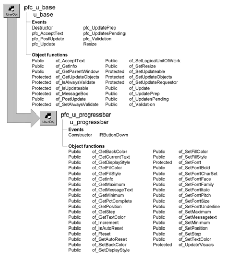

# u_progressbar

**Description**

Progress bar control. Use u_progressbar to provide users with a visual representation of percentage complete for long-running operations. U_progressbar can be vertical or horizontal and can display either percent complete or programmatically specified text.

**Ancestry**



**Library**

- PFCAPSRV.PBL
- PFEAPSRV.PBL

**Usage**

Use this control to display a progress bar for long-running operations.

To use u_progressbar:

1. Place an instance of the u_progressbar object on a window or user object.
2. Size the object to create an appropriately sized vertical or horizontal progress bar.
3. Define defaults for the progress bar instance. This example defines defaults in the Constructor event:

   ```
   of_SetFillStyle(LEFTRIGHT)
   of_SetDisplayStyle(PCTCOMPLETE)
   of_SetFillColor(RGB(128, 128, 128))
   of_SetFontSize(10)
   of_SetAutoReset(FALSE)
   ```

4. In the process to be tracked, set the initial progress bar position, set the maximum, and call the of_Increment function at regular intervals to update the progress bar:

   ```
   Integer li_count

   uo_progress.of_SetMaximum(100)
   uo_progress.of_SetPosition(0)
   FOR li_count = 1 TO &
     uo_progress.of_GetMaximum() STEP 1
       uo_progress.of_Increment(1)
   // Additional code here to perform your process
   NEXT
   ```

**See also**

- [n_cst_winsrv_statusbar](../09-custom-class-user-objects/n_cst_winsrv_statusbar.md)
- [u_hpb](../06-standard-visual-user-objects/u_hpb.md)
- [u_vpb](../06-standard-visual-user-objects/u_vpb.md)

## Instance variables

U_progressbar includes instance variables:

| Instance variable | Description | Data type | Access | Usage |
| --- | --- | --- | --- | --- |
| BAR | Constant set to 0 | Integer | Public | Use with of_SetDisplayStyle |
| BOTTOMTOP | Constant set to 3 | Integer | Public | Use with of_SetFillStyle |
| BOTTOMUP | Constant set to 3 | Integer | Public |  |
| ib_autoreset | Controls autoreset | Boolean | Protected | Set with of_SetAutoReset. Default is TRUE |
| ii_displaystyle | Controls test displayed on progress bar | Integer | Protected | Set with of_DisplayStyle. Default is BAR |
| ii_fillstyle | Controls the direction in which the progress bar fills | Integer | Protected | Set with of_SetFillStyle. Default is LEFTRIGHT |
| ii_maximum | Value at which the incrementation process ends | Integer | Protected | Set with of_SetMaximum. Default is 100 |
| ii_minimum | Value at which the incrementation process starts | Integer | Protected | Set with of_SetMinimum. Default is 0 |
| ii_msgtextcount | Number of items in os_msgtext[] array | Integer | Protected | Internal |
| ii_percentcomplete | Current percent complete | Integer | Protected | Access with of_GetPctComplete |
| ii_position | Current increment position | Integer | Protected | Set with of_SetPosition. Updated internally |
| ii_step | Default increment value | Integer | Protected | Set with of_SetStep. Default is 10 |
| il_backcolor | Background color | Long | Protected | Set with of_SetBackColor. Default is 78682240 |
| il_fillcolor | Fill color | Long | Protected | Set with of_SetFillColor. Default is 16668075 |
| il_textcolor | Text color | Long | Protected | Set with of_SetTextColor. Default is 0 |
| is_msgtext[ ] | Array of text to display on progress bar | String | Protected | Set with of_SetMessageText |
| LEFTRIGHT | Constant set to 0 | Integer | Public | Use with of_SetFillStyle |
| MSGTEXT | Constant set to 3 | Integer | Public | Use with of_SetDisplayStyle |
| PCTCOMPLETE | Constant set to 1 | Integer | Public | Use with of_SetDisplayStyle |
| POSITION | Constant set to 2 | Integer | Public | Use with of_SetDisplayStyle |
| RIGHTLEFT | Constant set to 1 | Integer | Public | Use with of_SetFillStyle |
| TOPDOWN | Constant set to 2 | Integer | Public | Use with of_SetFillStyle |

## Events

U_progressbar includes precoded events:

- Constructor
- RButtonDown

### Constructor

**Description**

Initializes progress bar settings.

**Applies to**

U_progressbar

**Usage**

This event executes when the progress bar object is created.

### RButtonDown

**Description**

Calls the parent’s RButtonDown event.

**Applies to**

Dw_progress

**Usage**

This event executes when the user right-clicks over the progress bar.

## Functions

U_progressbar contains precoded object functions:

- of_GetBackColor
- of_GetCurrentText
- of_GetDisplayStyle
- of_GetFillColor
- of_GetFillStyle
- of_GetInfo
- of_GetMaximum
- of_GetMessageText
- of_GetMinimum
- of_GetPctComplete
- of_GetPosition
- of_GetStep
- of_GetTextColor
- of_Increment
- of_IsAutoReset
- of_Reset
- of_SetAutoReset
- of_SetBackColor
- of_SetDisplayStyle
- of_SetFillColor
- of_SetFillStyle
- of_SetFont
- of_SetFontBold
- of_SetFontCharSet
- of_SetFontFace
- of_SetFontFamily
- of_SetFontItalic
- of_SetFontPitch
- of_SetFontSize
- of_SetFontUnderline
- of_SetMaximum
- of_SetMessageText
- of_SetMinimum
- of_SetPosition
- of_SetStep
- of_SetTextColor
- of_UpdateVisuals

### of_GetBackColor

**Description**

Retrieves the progress bar background color.

**Access**

Public

**Syntax**

```
instancename.of_GetBackColor ( )
```

| Argument | Description |
| --- | --- |
| *instancename* | Instance name of u_progressbar |

**Return value**

Long. Returns the background color.

**Examples**

This example calls the of_GetBackColor function:

```
Long ll_backcolor

ll_backcolor = uo_progress.of_GetBackColor()
MessageBox("Progress Bar", &
  "Background color property is " &
    + String(ll_backcolor))
```

### of_GetCurrentText

**Description**

Retrieves the text currently displayed on the progress bar. This function retrieves any text displayed on the progress bar, not just the display text specified by the of_SetMessageText function.

**Access**

Public

**Syntax**

```
instancename.of_GetCurrentText ( )
```

| Argument | Description |
| --- | --- |
| *instancename* | Instance name of u_progressbar |

**Return value**

String. Returns the current progress bar text.

**Examples**

This example calls the of_GetCurrentText function:

```
String ls_text

ls_text = uo_progress.of_GetCurrentText()
MessageBox("Progress Bar", &
  "Current text is " + ls_text)
```

### of_GetDisplayStyle

**Description**

Retrieves the progress bar display style. The display style controls the information that displays within the bar while tracking progress.

**Access**

Public

**Syntax**

```
instancename.of_GetDisplayStyle ( )
```

| Argument | Description |
| --- | --- |
| *instancename* | Instance name of u_progressbar |

**Return value**

Integer. Returns values as follows:

- **0 (BAR)** Progress bar only
- **1 (PCTCOMPLETE)** Progress bar and percent complete, including the percent sign
- **2 (POSITION)** Current increment value
- **3 (MSGTEXT)** Progress bar and text as specified by the of_SetMessageText function

**Examples**

This example calls the of_GetDisplayStyle function:

```
Integer li_displaystyle

li_displaystyle = uo_progress.of_GetDisplayStyle()
MessageBox("Progress Bar", &
  "DisplayStyle property is " &
    + String(li_displaystyle))
```

### of_GetFillColor

**Description**

Retrieves the progress bar fill color.

**Access**

Public

**Syntax**

```
instancename.of_GetFillColor ( )
```

| Argument | Description |
| --- | --- |
| *instancename* | Instance name of u_progressbar |

**Return value**

Long. Returns the fill color.

**Examples**

This example calls the of_GetFillColor function:

```
Long ll_fillcolor

ll_fillcolor = uo_progress.of_GetFillColor()
MessageBox("Progress Bar", &
  "Fill color property is " &
    + String(ll_fillcolor))
```

### of_GetFillStyle

**Description**

Retrieves the progress bar fill style.

**Access**

Public

**Syntax**

```
instancename.of_GetFillStyle ( )
```

| Argument | Description |
| --- | --- |
| *instancename* | Instance name of u_progressbar |

**Return value**

Integer. Returns values as follows:

- **0 (LEFTRIGHT)** The progress bar fills from left to right
- **1 (RIGHTLEFT)** The progress bar fills from right to left
- **2 (TOPDOWN)** The progress bar fills from top to bottom
- **3 (BOTTOMUP)** The progress bar fills from bottom to top

**Examples**

This example calls the of_GetFillStyle function:

```
Integer li_fillstyle

li_fillstyle = uo_progress.of_GetFillStyle()
MessageBox("Progress Bar", &
  "Fill style is "  + String(li_fillstyle))
```

### of_GetInfo

**Description**

Retrieves object information.

**Access**

Public

**Syntax**

```
dwcontrol.instancename.of_GetInfo ( infoobject )
```

| Argument | Description |
| --- | --- |
| *instancename* | Instance name of u_progressbar |
| *infoobject* | N_cst_infoattrib instance into which the function places information (passed by reference) |

**Return value**

Integer. Returns 1 if the function succeeds and -1 if an error occurs.

**Usage**

The DataWindow Properties window calls this function to access service information:

**Examples**

This example calls the of_GetInfo function:

```
n_cst_infoattrib  lnv_info

uo_progress.of_GetInfo(lnv_info)
MessageBox("Info",  &
  "Description: " + lnv_info.is_description  &
    + ". Name: " + lnv_info.is_name)
```

### of_GetMaximum

**Description**

Retrieves the maximum value used by the progress bar incrementation process.

**Access**

Public

**Syntax**

```
instancename.of_GetMaximum ( )
```

| Argument | Description |
| --- | --- |
| *instancename* | Instance name of u_progressbar |

**Return value**

Integer. Returns the maximum increment value for the progress bar.

**Examples**

This example calls the of_GetMaximum function:

```
uo_progress.of_SetPosition(0)
FOR li_count = 1 TO &
  uo_progress.of_GetMaximum() STEP 1
  uo_progress.of_Increment(1)
  // Additional code here to perform your process
NEXT
```

### of_GetMessageText

**Description**

Retrieves the progress messages specified in the of_SetMessageText function.

**Access**

Public

**Syntax**

```
instancename.of_GetMessageText ( text )
```

| Argument | Description |
| --- | --- |
| *instancename* | Instance name of u_progressbar |
| *text* | String array into which the function places the progress messages (passed by reference) |

**Return value**

Integer. Returns the number of elements in the *text* array.

**Examples**

This example calls the of_GetMessageText function:

```
String ls_text[], ls_all
Integer li_size, li_count

li_size = uo_progress.of_GetMessageText(ls_text)

FOR li_count = 1 to li_size STEP 1
  ls_all += ls_text[li_count] + "~r~n"
NEXT
MessageBox("Progress Bar", &
  "Progress messages are: " + ls_all)
```

### of_GetMinimum

**Description**

Retrieves the minimum value used by the incrementation process. This value is the baseline from which the incrementation process begins.

**Access**

Public

**Syntax**

```
instancename.of_GetMinimum ( )
```

| Argument | Description |
| --- | --- |
| *instancename* | Instance name of u_progressbar |

**Return value**

Integer. Returns the minimum value for the incrementation process.

**Examples**

This example calls the of_GetMinimum function:

```
Integer li_min

li_min = uo_progress.of_GetMinimum )
MessageBox("Progress Bar", &
  "Minimum value is " &
    + String(li_min))
```

### of_GetPctComplete

**Description**

Retrieves the progress bar’s current percent complete.

**Access**

Public

**Syntax**

```
instancename.of_GetPctComplete ( )
```

| Argument | Description |
| --- | --- |
| *instancename* | Instance name of u_progressbar |

**Return value**

Integer. Returns the current percent complete for the progress bar.

**Examples**

This example calls the of_GetPctComplete function:

```
Integer li_count

FOR li_count = 1 TO &
  uo_progress.of_GetMaximum() STEP 1
  uo_progress.of_Increment(1)
  gnv_app.of_GetFrame().SetMicroHelp &
  ("Count is: " + String(li_count) + &
    " Pct Complete is: " + &
      String(uo_progress.of_GetPctComplete()))
  // Additional code here to perform your process
NEXT
```

### of_GetPosition

**Description**

Retrieves the progress bar’s current increment value.

**Access**

Public

**Syntax**

```
instancename.of_GetPosition ( )
```

| Argument | Description |
| --- | --- |
| *instancename* | Instance name of u_progressbar |

**Return value**

Integer. Returns the current increment value for the progress bar.

**Examples**

This example calls the of_GetPosition function:

```
Integer li_count

FOR li_count = 1 TO &
  uo_progress.of_GetMaximum() STEP 1
  uo_progress.of_Increment(1)
  gnv_app.of_GetFrame().SetMicroHelp &
    ("Count is: " + &
      String(uo_progress.of_GetPosition()) + &
        " Pct Complete is: " + &
          String(uo_progress.of_GetPctComplete()))
  // Additional code here to perform your process
NEXT
```

### of_GetStep

**Description**

Retrieves the step value the progress bar uses during a default increment process.

**Access**

Public

**Syntax**

```
instancename.of_GetStep ( )
```

| Argument | Description |
| --- | --- |
| *instancename* | Instance name of u_progressbar |

**Return value**

Integer. Returns the step value.

**Examples**

This example calls the of_GetStep function:

```
Integer li_step

li_step = uo_progress.of_GetStep()
MessageBox("Progress Bar", &
  "Step value is " + String(li_step))
```

### of_GetTextColor

**Description**

Retrieves the text color for the progress bar.

**Access**

Public

**Syntax**

```
instancename.of_GetTextColor ( )
```

| Argument | Description |
| --- | --- |
| *instancename* | Instance name of u_progressbar |

**Return value**

Long. Returns the progress bar text color.

**Examples**

This example calls the of_GetTextColor function:

```
Long ll_color

ll_color = uo_progress.of_GetTextColor()
MessageBox("Progress Bar", &
  "Current text color is " + String(ll_color))
```

### of_Increment

**Description**

Increments progress by either the default increment value or by a specified value.

**Access**

Public

**Syntax**

```
instancename.of_Increment ( { incrementvalue } )
```

| Argument | Description |
| --- | --- |
| *instancename* | Instance name of u_progressbar |
| *incrementvalue* (optional) | Integer specifying the increment value. The default increment value is 10, which you can modify by calling the of_SetStep function |

**Return value**

Integer. Returns the new increment value.

**Examples**

This example calls the of_Increment function:

```
Integer li_count

uo_progress.of_SetPosition(0)
FOR li_count = 1 TO &
uo_progress.of_GetMaximum() STEP 1
uo_progress.of_Increment(1)
// Additional code here to perform your process
NEXT
```

### of_IsAutoReset

**Description**

Reports whether the progress bar returns to zero after it reaches 100%.

**Access**

Public

**Syntax**

```
instancename.of_IsAutoReset ( )
```

| Argument | Description |
| --- | --- |
| *instancename* | Instance name of u_progressbar |

**Return value**

Boolean. Returns TRUE if u_progressbar clears the progress bar when it reaches 100% and FALSE if it does not.

**Examples**

This example calls the of_IsAutoReset function:

```
n_cst_conversion lnv_conversion
Boolean lb_autoreset

lb_autoreset = uo_progress.of_IsAutoReset()
MessageBox("Progress Bar", &
  "Autoreset property is " &
    + lnv_conversion.of_String(lb_autoreset))
```

### of_Reset

**Description**

Clears the progress bar, setting the position to the minimum and percent complete to zero.

**Access**

Public

**Syntax**

```
instancename.of_Reset ( )
```

| Argument | Description |
| --- | --- |
| *instancename* | Instance name of u_progressbar |

**Return value**

Integer. Returns 1 if the function succeeds and -1 if an error occurs.

**Examples**

This example is from the of_SetPosition function:

```
...
IF ldc_completion >= 1 and ib_autoreset THEN
   this.Post Function of_Reset()
END IF
...
```

### of_SetAutoReset

**Description**

Specifies whether to clear the progress bar when it reaches 100%. The progress bar reaches 100% when the incrementation process reaches the maximum value.

**Access**

Public

**Syntax**

```
instancename.of_SetAutoReset ( boolean )
```

| Argument | Description |
| --- | --- |
| *instancename* | Instance name of u_progressbar |
| *boolean* | Boolean indicating whether to clear the status bar when it reaches 100% (TRUE) or leave it visible (FALSE) |

**Return value**

Integer. Returns 1 if the function succeeds and -1 if an error occurs.

**Examples**

This example calls the of_SetAutoReset function:

```
of_SetFillStyle(BOTTOMUP)
of_SetDisplayStyle(PCTCOMPLETE)
of_SetAutoReset(FALSE)
```

### of_SetBackColor

**Description**

Sets the background color of the progress bar.

**Access**

Public

**Syntax**

```
instancename.of_SetBackColor ( color )
```

| Argument | Description |
| --- | --- |
| *instancename* | Instance name of u_progressbar |
| *color* | Long specifying the progress bar fill color. The default is 78682240 (light gray) |

**Return value**

Integer. Returns 1 if the function succeeds and -1 if an error occurs.

**Examples**

This example from the Constructor event of a u_progressbar instance calls the of_SetBackColor function:

```
of_SetFillStyle(BOTTOMUP)
of_SetDisplayStyle(PCTCOMPLETE)
of_SetBackColor (RGB(255, 0, 0)) // Red
of_SetAutoReset(FALSE)
```

### of_SetDisplayStyle

**Description**

Sets a display style for the progress bar. The display style controls the information that displays within the bar while tracking progress.

**Access**

Public

**Syntax**

```
instancename.of_SetDisplayStyle ( displaystyle )
```

| Argument | Description |
| --- | --- |
| *instancename* | Instance name of u_progressbar |
| *displaystyle* | Integer or u_progressbar constant specifying the progress bar display style: |
|  | **• 0 or BAR (default)** Bar only, no text |
|  | **• 1 or PCTCOMPLETE** Bar displays percent complete, including the percent sign |
|  | **• 2 or POSITION** Bar displays the current increment value |
|  | **• 3 or MSGTEXT** Bar displays text, as specified by the of_SetMessageText function |

**Return value**

Integer. Returns 1 if the function succeeds and -1 if an error occurs.

**Usage**

If you use MSGTEXT, you must also call the of_SetMessageText function to specify the text displayed in the status bar.

**Examples**

This example from the Constructor event of a u_progressbar instance calls the of_SetDisplayStyle function:

```
of_SetFillStyle(BOTTOMUP)
of_SetDisplayStyle(PCTCOMPLETE)
```

### of_SetFillColor

**Description**

Sets the fill color of the progress bar.

**Access**

Public

**Syntax**

```
instancename.of_SetFillColor ( color )
```

| Argument | Description |
| --- | --- |
| *instancename* | Instance name of u_progressbar |
| *color* | Long specifying the progress bar fill color. The default is 16668075 (blue) |

**Return value**

Integer. Returns 1 if the function succeeds and -1 if an error occurs.

**Examples**

This example from the Constructor event of a u_progressbar instance calls the of_SetFillColor function:

```
of_SetFillStyle(BOTTOMUP)
of_SetDisplayStyle(PCTCOMPLETE)
of_SetFillColor (RGB(128, 128, 128))
```

### of_SetFillStyle

**Description**

Sets a fill style for the progress bar.

**Access**

Public

**Syntax**

```
instancename.of_SetFillStyle ( style )
```

| Argument | Description |
| --- | --- |
| *instancename* | Instance name of u_progressbar |
| *style* | Integer or u_progressbar constant specifying the fill style: |
|  | **• 0 or TOPDOWN** The bar fills from top to bottom |
|  | **• 1 or BOTTOMUP** The bar fills from bottom to top |
|  | **• 2 or LEFTRIGHT (default)** The bar fills from left to right |
|  | **• 3 or RIGHTLEFT** The bar fills from right to left |

**Return value**

Integer. Returns 1 if the function succeeds and -1 if an error occurs.

**Examples**

This example calls the of_SetFillStyle function:

```
of_SetFillStyle (BOTTOMUP)
of_SetDisplayStyle(PCTCOMPLETE)
of_SetFillColor(RGB(128, 128, 128))
```

### of_SetFont

**Description**

Changes the font displayed in the progress bar.

**Access**

Protected

**Syntax**

```
instancename.of_SetFont ( fontface, fontsize, fontcharset, fontfamily,
fontpitch, bold, italic, underline )
```

| Argument | Description |
| --- | --- |
| *instancename* | Instance name of u_progressbar |
| *fontface* | String specifying the new font. If you pass a NULL, the function does not change the font |
| *fontsize* | Integer specifying the point size of the new font. If you pass a NULL, the function does not change the font size |
| *fontcharset* | Integer specifying the character set: |
|  | • 0–ANSI |
|  | • 1–The default character set for the specified font |
|  | • 2–Symbol |
|  | • 3–Shift JIS |
|  | • 4–OEM |
|  | If you pass a NULL, the function does not change the font character set |
| *fontfamily* | FontFamily enumerated data type specifying the font family: |
|  | • AnyFont! |
|  | • Roman! |
|  | • Swiss! |
|  | • Modern! |
|  | • Script! |
|  | • Decorative! |
|  | If you pass a NULL, the function does not change the font family |
| *fontpitch* | FontPitch enumerated data type specifying the pitch of the new font: |
|  | • Default! |
|  | • Fixed! |
|  | • Variable! |
|  | If you pass a NULL, the function does not change the pitch |
| *bold* | Boolean specifying whether text is bold: |
|  | • TRUE—Bold |
|  | • FALSE—Not bold (default) |
|  | If you pass a NULL, the function does not change the Bold property |
| *italic* | Boolean specifying whether text is italic: |
|  | • TRUE—Italic |
|  | • FALSE—Not italic (default) |
|  | If you pass a NULL, the function does not change the italic property |
| *underline* | Boolean specifying whether text is underlined: |
|  | • TRUE—Underlined |
|  | • FALSE—Not underlined (default) |
|  | If you pass a NULL, the function does not change the underline property |

**Return value**

String. Returns the result of the Modify PowerScript function that changes the font; an empty string indicates success.

**Usage**

Internal.

**Examples**

This example is from the of_SetFontBold function:

```
String ls_fontface
Long ll_fontsize
FontFamilylff_fontfamily
FontPitchlfp_fontpitch
Boolean lb_bold, lb_italic, lb_underline

SetNull(ls_fontface)
SetNull(ll_fontsize)
SetNull(lff_fontfamily)
SetNull(lfp_fontpitch)
SetNull(lb_bold)
SetNull(lb_italic)
SetNull(lb_underline)

// ab_bold is the argument to of_SetBold
Return of_SetFont(ls_fontface, ll_fontsize, &
  lff_fontfamily, lfp_fontpitch, ab_bold, &
    lb_italic, lb_underline)
```

### of_SetFontBold

**Description**

Sets the Bold property for progress bar text.

**Access**

Public

**Syntax**

```
instancename.of_SetFontBold ( boolean )
```

| Argument | Description |
| --- | --- |
| *instancename* | Instance name of u_progressbar |
| *boolean* | Boolean specifying whether progress bar text is bold (TRUE) or not (FALSE) |

**Return value**

String. Returns the result of the Modify PowerScript function that changes the Bold property; an empty string indicates success.

**Examples**

This example calls the of_SetFontBold function:

```
of_SetFillStyle(BOTTOMUP)
of_SetDisplayStyle(PCTCOMPLETE)
of_SetFillColor(RGB(128, 128, 128))
of_SetFontBold(TRUE)
```

### of_SetFontCharSet

**Description**

Sets the CharSet property for progress bar text.

**Access**

Public

**Syntax**

```
instancename.of_SetFontCharSet ( fontcharset )
```

| Argument | Description |
| --- | --- |
| *instancename* | Instance name of u_progressbar |
| *fontcharset* | Integer specifying the character set: |
|  | • 0–ANSI |
|  | • 1–The default character set for the specified font |
|  | • 2–Symbol |
|  | • 3–Shift JIS |
|  | • 4–OEM |

**Return value**

String. Returns the result of the Modify PowerScript function that changes the font face; an empty string indicates success.

**Examples**

This example calls the of_SetFontCharSet function:

```
of_SetFillStyle(BOTTOMUP)
of_SetDisplayStyle(PCTCOMPLETE)
of_SetFillColor(RGB(128, 128, 128))
of_SetFontCharSet(1)
of_SetFontFamily(Script!)
of_SetFontSize(12)
```

### of_SetFontFace

**Description**

Sets the Face (typeface) property for progress bar text.

**Access**

Public

**Syntax**

```
instancename.of_SetFontFace ( fontface )
```

| Argument | Description |
| --- | --- |
| *instancename* | Instance name of u_progressbar |
| *fontface* | String specifying the font face (such as Arial) |

**Return value**

String. Returns the result of the Modify PowerScript function that changes the font face; an empty string indicates success.

**Examples**

This example from the Constructor event of a u_progressbar instance calls the of_SetFontFace function:

```
of_SetFillStyle(BOTTOMUP)
of_SetDisplayStyle(PCTCOMPLETE)
of_SetFillColor(RGB(128, 128, 128))
of_SetFontFace("Monotype Corsiva")
of_SetFontFamily(Script!)
```

### of_SetFontFamily

**Description**

Sets the font Family property (such as Roman) for progress bar text.

**Access**

Public

**Syntax**

```
instancename.of_SetFontFamily ( fontfamily )
```

| Argument | Description |
| --- | --- |
| *instancename* | Instance name of u_progressbar |
| *fontfamily* | FontFamily enumerated data type specifying the font family: |
|  | • AnyFont! |
|  | • Roman! |
|  | • Swiss! |
|  | • Modern! |
|  | • Script! |
|  | • Decorative! |

**Return value**

String. Returns the result of the Modify PowerScript function that changes the font family; an empty string indicates success.

**Examples**

This example calls the of_SetFontFamily function:

```
of_SetFillStyle(BOTTOMUP)
of_SetDisplayStyle(PCTCOMPLETE)
of_SetFillColor(RGB(128, 128, 128))
of_SetFontFace("Monotype Corsiva")
of_SetFontFamily(Script!)
```

### of_SetFontItalic

**Description**

Sets the Italic property for progress bar text.

**Access**

Public

**Syntax**

```
instancename.of_SetFontItalic ( boolean )
```

| Argument | Description |
| --- | --- |
| *instancename* | Instance name of u_progressbar |
| *boolean* | Boolean specifying whether progress bar text is italic (TRUE) or not (FALSE) |

**Return value**

String. Returns the result of the Modify PowerScript function that changes the Italic property; an empty string indicates success.

**Examples**

This example calls the of_SetFontItalic function:

```
of_SetFillStyle(BOTTOMUP)
of_SetDisplayStyle(PCTCOMPLETE)
of_SetFillColor(RGB(128, 128, 128))
of_SetFontItalic (TRUE)
```

### of_SetFontPitch

**Description**

Sets the Pitch property for progress bar text.

**Access**

Public

**Syntax**

```
instancename.of_SetFontPitch ( fontpitch )
```

| Argument | Description |
| --- | --- |
| *instancename* | Instance name of u_progressbar |
| *fontpitch* | FontPitch enumerated data type specifying the font pitch: |
|  | • Default! |
|  | • Fixed! |
|  | • Variable! |

**Return value**

String. Returns the result of the Modify PowerScript function that changes the font pitch; an empty string indicates success.

**Examples**

This example calls the of_SetFontPitch function:

```
of_SetFillStyle(BOTTOMUP)
of_SetDisplayStyle(PCTCOMPLETE)
of_SetFillColor(RGB(128, 128, 128))
of_SetFontPitch(Variable!)
```

### of_SetFontSize

**Description**

Sets the Size property for progress bar text.

**Access**

Public

**Syntax**

```
instancename.of_SetFontSize ( fontsize )
```

| Argument | Description |
| --- | --- |
| *instancename* | Instance name of u_progressbar |
| *fontsize* | Long specifying the font size, in points, for the progress bar text. Do not specify a negative number for this value |

**Return value**

String. Returns the result of the Modify PowerScript function that changes the font size; an empty string indicates success.

**Examples**

This example calls the of_SetFontSize function:

```
of_SetFillStyle(BOTTOMUP)
of_SetDisplayStyle(PCTCOMPLETE)
of_SetFontSize(10)
```

### of_SetFontUnderline

**Description**

Sets the Underline property for progress bar text.

**Access**

Public

**Syntax**

```
instancename.of_SetFontUnderline ( boolean )
```

| Argument | Description |
| --- | --- |
| *instancename* | Instance name of u_progressbar |
| *boolean* | Boolean specifying whether progress bar text is underlined (TRUE) or not (FALSE) |

**Return value**

String. Returns the result of the Modify PowerScript function that changes the underline property; an empty string indicates success.

**Examples**

This example calls the of_SetFontUnderline function:

```
of_SetFillStyle(BOTTOMUP)
of_SetDisplayStyle(PCTCOMPLETE)
of_SetFontUnderline (TRUE)
```

### of_SetMaximum

**Description**

Sets the maximum increment value for the progress bar (also used as the basis for the progress bar’s percent complete calculation).

**Access**

Public

**Syntax**

```
instancename.of_SetMaximum ( maximum )
```

| Argument | Description |
| --- | --- |
| *instancename* | Instance name of u_progressbar |
| *maximum* | Integer specifying the maximum increment value. |

**Return value**

Integer. Returns 1 if the function succeeds and -1 if an error occurs.

**Usage**

The default for this value is 100. The of_SetPosition function uses this value as the dividend in its percent complete calculation (percent complete = current position/maximum \* 100).

**Examples**

This example calls the of_SetMaximum function:

```
SELECT COUNT(emp_id)
  INTO :il_max
  FROM Employee
  USING SQLCA ;
IF il_max > 0 THEN
  uo_progress.of_SetMaximum(il_max)
ELSE
  MessageBox("SQL error", &
    "SELECT COUNT failed~r~n" + SQLCA.SQLERRTEXT)
END IF
```

### of_SetMessageText

**Description**

Sets the text strings that display at regular intervals when the progress bar uses the message text display style.

**Access**

Public

**Syntax**

```
instancename.of_SetMessageText ( text )
```

| Argument | Description |
| --- | --- |
| *instancename* | Instance name of u_progressbar |
| *text* | String array whose elements contain the values to display on the progress bar |

**Return value**

Integer. Returns the number of elements in *text* if the function succeeds and -1 if an error occurs.

**Usage**

You typically call this function after calling of_SetDisplayStyle(MSGTEXT).

**Examples**

This example calls the of_SetMessageText function:

```
String ls_msgtext[ ] = {"Ten", "Twenty", &
  "Thirty", "Forty", "Fifty", "Sixty", &
    "Seventy", "Eighty", "Ninety", "One Hundred"}

of_SetDisplayStyle(MSGTEXT)
of_SetMessageText(ls_msgtext)
```

### of_SetMinimum

**Description**

Sets the initial increment value for the progress bar.

**Access**

Public

**Syntax**

```
instancename.of_SetMinimum ( minimum )
```

| Argument | Description |
| --- | --- |
| *instancename* | Instance name of u_progressbar |
| *minimum* | Integer specifying the initial increment value for the progress bar |

**Return value**

Integer. Returns 1 if the function succeeds and -1 if an error occurs.

**Usage**

The of_SetPosition and of_Reset functions use the minimum to determine the initial position value.

**Examples**

This example calls the of_SetMinimum function:

```
of_SetFillStyle(BOTTOMUP)
of_SetDisplayStyle(PCTCOMPLETE)
of_SetMinimum(0)
```

### of_SetPosition

**Description**

Sets the progress bar’s current position and updates percent complete.

**Access**

Public

**Syntax**

```
instancename.of_SetPosition ( position )
```

| Argument | Description |
| --- | --- |
| *instancename* | Instance name of u_progressbar |
| *position* | Integer specifying the progress bar’s position |

**Return value**

Integer. Returns the current increment value if the function succeeds and -1 if an error occurs.

**Usage**

Call this function to establish an initial position for the progress bar before beginning an incrementation process.

If *position* is less than the minimum (the default minimum is 0), this function sets the position to the minimum. If *position* is greater than the maximum (the default maximum is 100), this function sets the position to the maximum. You modify the default minimum and maximum by calling the of_SetMinimum and of_SetMaximum functions.

The of_Increment function calls this function to update the current position and percent complete.

**Examples**

This example calls the of_SetPosition function:

```
Integer li_count

uo_progress.of_SetPosition(0)
For li_count = 1 to 100 STEP 1
  uo_progress.of_Increment(1)
NEXT
```

### of_SetStep

**Description**

Sets the step value the progress bar uses during a default increment process.

**Access**

Public

**Syntax**

```
instancename.of_SetStep ( stepvalue )
```

| Argument | Description |
| --- | --- |
| *instancename* | Instance name of u_progressbar |
| *stepvalue* | Integer specifying the default increment value |

**Return value**

Integer. Returns 1 if the function succeeds and -1 if an error occurs.

**Usage**

The progress bar uses this value as the default when you call of_Increment with no arguments.

**Examples**

This example calls the of_SetStep function:

```
of_SetFillStyle(BOTTOMUP)
of_SetDisplayStyle(PCTCOMPLETE)
of_SetStep(5)
```

### of_SetTextColor

**Description**

Sets the color of text in the progress bar.

**Access**

Public

**Syntax**

```
instancename.of_SetTextColor ( color )
```

| Argument | Description |
| --- | --- |
| *instancename* | Instance name of u_progressbar |
| *color* | Long specifying the progress bar text color. The default is 0 (black) |

**Return value**

Integer. Returns 1 if the function succeeds and -1 if an error occurs.

**Examples**

This example from the Constructor event of a u_progressbar instance calls the of_SetTextColor function:

```
of_SetFillStyle(BOTTOMUP)
of_SetDisplayStyle(PCTCOMPLETE)
of_SetTextColor(RGB(255, 255, 255))
```

### of_UpdateVisuals

**Description**

Resizes the progress bar and updates the display text.

**Access**

Protected

**Syntax**

```
instancename.of_UpdateVisuals ( completionvalue )
```

| Argument | Description |
| --- | --- |
| *instancename* | Instance name of u_progressbar |
| *completionvalue* | Decimal specifying the completion value of the progress bar |

**Return value**

Integer. Returns 1 if the function succeeds and -1 if an error occurs.

**Usage**

Internal.

**Examples**

This example is from the of_SetPosition function:

```
...
li_rc = of_UpdateVisuals (ldc_completion)
dw_progress.SetRedraw(true)
...
```
