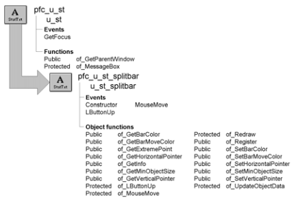

# u_st_splitbar

**Description**

Splitbar service. Use this control to add splitbar functionality to two or more controls in a window.

**Ancestry**



**Library**

- PFCMAIN.PBL
- PFEMAIN.PBL

**Usage**

Use this object to add a splitbar to a window. To use this object:

1. Place the object on a window between two or more controls.
2. (Optional) If you are using the window resize service, register the splitbar:

   ```
   this.of_SetResize(TRUE)
   this.inv_resize.of_Register &
     (tv_deptemp, 0, 0, 0, 100)
   this.inv_resize.of_Register &
     (st_splitbar, 0, 0, 0, 100)
   this.inv_resize.of_Register &
     (lv_empdetail, 0, 0, 0, 100)
   ```

3. Move and resize the splitbar object and the surrounding objects until they relate appropriately. For example, a vertical splitbar between two objects should have the same height as the surrounding objects.
4. Add code to the splitbar control’s Constructor event to register the controls that resize when the user moves the splitbar:

   ```
   this.of_Register(tv_1, LEFT
   this.of_Register(lv_1, RIGHT)
   this.of_SetBarColor(RGB(192, 192, 192))
   ```

**See also**

n_cst_resize

## Instance variables

U_st_splitbar has instance variables:

| Name | Description | Data type | Access | Usage |
| --- | --- | --- | --- | --- |
| ABOVE | Constant set to 3 | Integer | Public | Use with of_Register |
| BELOW | Constant set to 4 | Integer | Public | Use with of_Register |
| BOTTOMMOST | Constant set to 4 | Integer | Protected | Internal |
| HORIZONTAL | Constant set to 2 | Integer | Public | Internal |
| ib_liveresize | TRUE if the registered objects resize while the bar moves (PFC 2025 and later) | Boolean | Protected | Set with of_SetLiveResize |
| ib_performredraw | TRUE (the default): while the bar moves, the registered objects it passes over are redrawn, so the bar leaves no trace on them (of_Redraw) | Boolean | Protected | Internal |
| idrg_lefttop[ ] | Upper-left coordinate for all registered controls | DragObject | Protected | Internal |
| idwg_rightbottom[ ] | Lower-right coordinate for all registered controls | DragObject | Protected | Internal |
| ii_barwidth | Thickness of splitbar | Integer | Protected | Internal |
| ii_lefttopbound | Upper-left coordinate | Integer | Protected | Internal |
| ii_minobjectsize | Minimum object size | Integer | Protected | Set with of_SetMinObject Size |
| ii_prevpositionx | Previous x coordinate | Integer | Protected | Internal |
| ii_prevpositiony | Previous y coordinate | Integer | Protected | Internal |
| ii_bottomrightbound | Bottom right coordinate | Integer | Protected | Internal |
| ii_rounding | Rounding factor | Integer | Protected | Internal |
| ii_style | Splitbar style (horizontal or vertical) | Integer | Protected | Set with of_SetStyle |
| il_barcolor | Splitbar color | Long | Protected | Set with of_SetBarColor |
| il_barmovecolor | Splitbar color when it is being moved | Long | Protected | Set with of_SetBarMove Color |
| ir_lefttopheight[ ] | Left top height for all registered controls | Real | Protected | Internal |
| ir_lefttopwidth[ ] | Left top width for all registered controls | Real | Protected | Internal |
| ir_lefttopx[ ] | Top left x coordinate for all registered controls | Real | Protected | Internal |
| ir_lefttopy[ ] | Top left y coordinate for all registered controls | Real | Protected | Internal |
| ir_rightbottomheight[ ] | Bottom right height for all registered controls | Real | Protected | Internal |
| ir_rightbottomwidth[ ] | Bottom right width for all registered controls | Real | Protected | Internal |
| ir_rightbottomx[ ] | Bottom right x coordinate for all registered controls | Real | Protected | Internal |
| ir_rightbottomy[ ] | Bottom right y coordinate for all registered controls | Real | Protected | Internal |
| is_horizontalpointer | Icon name for the pointer that displays when over a horizontal splitbar | String | Protected | Set with of_SetHorizontal Pointer (default is SizeNS!) |
| is_verticalpointer | Icon name for the pointer that displays when over a vertical splitbar | String | Protected | Set with of_SetHorizontal Pointer (default is SizeWE!) |
| itab_parent | References the Tab control that contains the splitbar | Tab | Protected | Internal |
| iuo_parent | References the custom standard user object that contains the splitbar | UserObject | Protected | Internal |
| iw_parent | References the window that contains the splitbar | Window | Protected | Internal |
| LEFT | Constant set to 1 | Integer | Public | Use with of_Register |
| LEFTMOST | Constant set to 1 | Integer | Protected | Internal |
| RIGHT | Constant set to 2 | Integer | Public | Use with of_Register |
| RIGHTMOST | Constant set to 2 | Integer | Protected | Internal |
| TOPMOST | Constant set to 3 | Integer | Protected | Internal |
| VERTICAL | Constant set to 1 | Integer | Public | Vertical |

| Instance variable | Description | Data type | Access |
| --- | --- | --- | --- |
| ABOVE_ANCHORED | Constant set to 7 | Integer | Public |
| BELOW_ANCHORED | Constant set to 8 | Integer | Public |
| ib_lbuttondown | TRUE while the user drags the splitbar: the left mouse button was pressed on it (PFC 2025 and later) | Boolean | Protected |
| ib_supported |  | Boolean | Protected |
| ii_LeftTopPosition[ ] |  | Integer | Protected |
| ii_rightbottombound |  | Integer | Protected |
| ii_RightBottomPosition[ ] |  | Integer | Protected |
| ii_XRounding |  | Integer | Protected |
| ii_YRounding |  | Integer | Protected |
| iwo_lefttop[ ] |  | WindowObject | Protected |
| iwo_rightbottom[ ] |  | WindowObject | Protected |
| LEFT_ANCHORED | Constant set to 5 | Integer | Public |
| RIGHT_ANCHORED | Constant set to 6 | Integer | Public |
| UNITIALIZED | Constant set to -32000 | Integer | Protected |

## Events

U_st_splitbar includes precoded events:

|   |
| --- |
| Constructor MouseMove |
| LButtonDown LButtonUp |

### Constructor

**Description**

Automatically calculates the bar orientation (vertical or horizontal) and initializes other status-bar settings.

**Usage**

Add code to this event to register the controls that resize when the user moves the splitbar.

**Examples**

This example shows code you might add to the Constructor event:

```
this.of_Register(tv_1, LEFT)
this.of_Register(lv_1, RIGHT)
this.of_SetBarColor(RGB(192, 192, 192))
```

### LButtonDown

> Available in PFC 2025 and later. Not available in the 2019 and 2022 versions of PFC.

**Description**

Starts a drag of the splitbar: the user pressed the left mouse button on it.

**Usage**

Only a drag that starts on the splitbar moves it. In earlier versions, pressing the button next to the splitbar and dragging across it moved the bar without resizing the registered objects.

### LButtonUp

**Description**

Ends the drag and calls the of_LButtonUp function.

**Usage**

PFC uses this event to resize objects when the user moves the splitbar.

### MouseMove

**Description**

Calls the of_MouseMove function.

**Usage**

While the user drags the splitbar (the left mouse button was pressed on it and is still down), PFC uses this event to move the splitbar, refresh the location, and redraw if necessary.

## Functions

U_st_splitbar contains precoded object functions:

- of_GetBarColor
- of_GetBarMoveColor
- of_GetExtremePoint
- of_GetHorizontalPointer
- of_GetInfo
- of_GetMinObjectSize
- of_GetVerticalPointer
- of_IsLiveResize (PFC 2025 and later)
- of_IsSupported
- of_LButtonUp
- of_MouseMove
- of_Move
- of_Redraw
- of_Register
- of_SetBarColor
- of_SetBarMoveColor
- of_SetHorizontalPointer
- of_SetLiveResize (PFC 2025 and later)
- of_SetMinObjectSize
- of_SetVerticalPointer
- of_unRegister
- of_unRegister_all
- of_UpdateObjectData

### of_GetBarColor

**Description**

Retrieves the splitbar color.

**Access**

Public

**Syntax**

```
instancename.of_GetBarColor ( )
```

| Argument | Description |
| --- | --- |
| *instancename* | Instance name of u_st_splitbar |

**Return value**

Long. Returns the splitbar color.

**Examples**

This example calls the of_GetBarColor function:

```
Long ll_colorll_color = st_splitbar.of_GetBarColor()
```

### of_GetBarMoveColor

**Description**

Retrieves the color that displays when the splitbar is being moved.

**Access**

Public

**Syntax**

```
instancename.of_GetBarMoveColor ( )
```

| Argument | Description |
| --- | --- |
| *instancename* | Instance name of u_st_splitbar |

**Return value**

Long. Returns the splitbar move color.

**Examples**

This example calls the of_GetBarMoveColor function:

```
Long ll_colorll_color =
st_splitbar.of_GetBarMoveColor()
```

### of_GetExtremePoint

**Description**

Retrieves the specified extreme point coordinate.

**Access**

Public

**Syntax**

```
instancename.of_GetExtremePoint ( extremetype )
```

| Argument | Description |
| --- | --- |
| *instancename* | Instance name of u_st_splitbar |
| *extremetype* | Integer or u_st_splitbar constant that specifies the extreme point to be returned: |
|  | **• 1 or LEFTMOST** The extreme point to the left |
|  | **• 2 or RIGHTMOST** The extreme point to the right |
|  | **• 3 or TOPMOST** The extreme point at the top |
|  | **• 4 or BOTTOMMOST** The extreme point at the bottom |

**Return value**

Integer. Returns the coordinate of the specified extreme point.

**Usage**

Internal.

**Examples**

This example is from the of_LButtonUp function:

```
...
IF ii_style = HORIZONTAL THEN
li_miny = of_GetExtremePoint(TOPMOST)
li_maxy = of_GetExtremePoint(BOTTOMMOST)
...
```

### of_GetHorizontalPointer

**Description**

Retrieves the name of the pointer that displays when the cursor is over a horizontal splitbar.

**Access**

Public

**Syntax**

```
instancename.of_GetHorizontalPointer ( )
```

| Argument | Description |
| --- | --- |
| *instancename* | Instance name of u_st_splitbar |

**Return value**

String. Returns the name of the pointer that displays when the cursor is over a horizontal splitbar.

**Examples**

This example calls the of_GetHorizontalPointer function:

```
String ls_pointer

ls_pointer = st_1.of_GetHorizontalPointer()
MessageBox("Splitbar", &
  "Horizontal pointer is " + ls_pointer)
```

### of_GetInfo

**Description**

Retrieves object information.

**Access**

Public

**Syntax**

```
dwcontrol.instancename.of_GetInfo ( infoobject )
```

| Argument | Description |
| --- | --- |
| *instancename* | Instance name of u_st_splitbar |
| *infoobject* | N_cst_infoattrib instance into which the function places information (passed by reference) |

**Return value**

Integer. Returns 1 if the function succeeds and -1 if an error occurs.

**Usage**

The DataWindow Properties window calls this function to access service information:

**Examples**

This example calls the of_GetInfo function:

```
n_cst_infoattrib  lnv_info

uo_splitbar.of_GetInfo(lnv_info)
MessageBox("Info",  &
  "Description: " + lnv_info.is_description  &
    + ". Name: " + lnv_info.is_name)
```

### of_GetMinObjectSize

**Description**

Retrieves the minimum size (in PBUs) for registered objects.

**Access**

Public

**Syntax**

```
instancename.of_GetMinObjectSize ( )
```

| Argument | Description |
| --- | --- |
| *instancename* | Instance name of u_st_splitbar |

**Return value**

Integer. Returns the minimum size for registered objects.

**Examples**

This example calls the of_GetMinObjectSize function:

```
Integer li_minsize

li_minsize = st_1.of_GetMinObjectSize()
MessageBox("Splitbar", &
  "Minimum size is " + String(li_minsize))
```

### of_GetVerticalPointer

**Description**

Retrieves the name of the pointer that displays when the cursor is over a vertical splitbar.

**Access**

Public

**Syntax**

```
instancename.of_GetVerticalPointer ( )
```

| Argument | Description |
| --- | --- |
| *instancename* | Instance name of u_st_splitbar |

**Return value**

String. Returns the name of the pointer that displays when the cursor is over a vertical splitbar.

**Examples**

This example calls the of_GetVerticalPointer function:

```
String ls_pointer

ls_pointer = st_1.of_GetVerticalPointer()
MessageBox("Splitbar", &
  "Vertical pointer is " + ls_pointer)
```

### of_IsLiveResize

> Available in PFC 2025 and later. Not available in the 2019 and 2022 versions of PFC.

**Description**

Reports whether the registered objects resize while the user drags the splitbar (see of_SetLiveResize).

**Access**

Public

**Syntax**

```
instancename.of_IsLiveResize ( )
```

| Argument | Description |
| --- | --- |
| *instancename* | Instance name of u_st_splitbar |

**Return value**

Boolean. Returns TRUE if they resize while the bar moves, and FALSE (the default) if they resize when the bar is dropped.

### of_IsSupported

**Description**

Dtermines if object is running in a supported environment.

**Access**

Protected

**Syntax**

```
instancename.of_IsSupported ( )
```

| Argument | Description |
| --- | --- |
| *instancename* | Instance name of u_st_splitbar |

**Return value**

Boolean. True if running in a supported environment.

### of_LButtonUp

**Description**

Resizes registered objects when the user releases the left mouse button.

**Access**

Protected

**Syntax**

```
instancename.of_LButtonUp ( flags, x, y )
```

| Argument | Description |
| --- | --- |
| *instancename* | Instance name of u_st_splitbar |
| *flags* | UnsignedLong indicating the modifier keys and mouse buttons that were pressed |
| *x* | Integer indicating the x position of the mouse click |
| *y* | Integer indicating the y position of the mouse click |

**Return value**

Integer. Returns 1 if the function succeeds and -1 if an error occurs.

**Usage**

Internal.

**Examples**

This example is from the LButtonUp event:

```
of_LButtonUp(flags, xpos, ypos)
```

### of_MouseMove

**Description**

Refreshes the screen as the user moves the splitbar.

**Access**

Protected

**Syntax**

```
instancename.of_MouseMove ( flags, x, y )
```

| Argument | Description |
| --- | --- |
| *instancename* | Instance name of u_st_splitbar |
| *flags* | UnsignedLong indicating the modifier keys and mouse buttons that are currently pressed |
| *x* | Integer indicating the x position of the mouse |
| *y* | Integer indicating the y position of the mouse |

**Return value**

Integer. Returns 1 if the function succeeds and -1 if an error occurs.

**Usage**

Internal.

**Examples**

This example is from the MouseMove event:

```
IF NOT KeyDown(keyLeftButton!) THEN
  Return
END IF
of_MouseMove(flags, xpos, ypos)
```

### of_Move

**Description**

Provides the ability to programmatically move a splitBar.

**Access**

Public

**Syntax**

```
instancename.of_Move ( al_newx, al_newy )
```

| Argument | Description |
| --- | --- |
| *instancename* | Instance name of u_st_splitbar |
| *al_newx* | Long. New X postion. |
| *al_newy* | Long. New Y postion. |

**Return value**

None.

### of_Redraw

**Description**

Redraws objects adjacent to the splitbar.

**Access**

Protected

**Syntax**

```
instancename.of_Redraw ( x, width, y, height )
```

| Argument | Description |
| --- | --- |
| *instancename* | Instance name of u_st_splitbar |
| *x* | Integer specifying the splitbar’s previous x coordinate |
| *width* | Integer specifying the splitbar’s previous width |
| *y* | Integer specifying the splitbar’s previous y coordinate |
| *height* | Integer specifying the splitbar’s previous height |

**Return value**

Integer. Returns 1 if the function succeeds and -1 if an error occurs.

**Usage**

Internal.

**Examples**

This example is from the of_MouseMove function:

```
...
IF ii_style = HORIZONTAL THEN
  this.Y = li_pointery
  this.Height = ii_barwidth
  IF ib_performredraw THEN
    IF (li_prevy <> this.Y) THEN
      of_Redraw(li_prevx, li_prevwidth, &
        li_prevy, li_prevheight)
    END IF
  END IF
...
```

### of_Register

**Description**

Registers the controls to be moved and resized when the user moves the splitbar.

**Access**

Public

**Syntax**

```
instancename.of_Register ( control, relativeposition )
```

| Argument | Description |
| --- | --- |
| *instancename* | Instance name of u_st_splitbar |
| *control* | DragObject containing the control to be registered |
| *relativeposition* | Integer or u_st_splitbar constant specified how the service positions *control* relative to the splitbar: |
|  | **• 1 or LEFT** Position *control* to the left of the splitbar |
|  | **• 2 or RIGHT** Position *control* to the right of the splitbar |
|  | **• 3 or ABOVE** Position *control* above the splitbar |
|  | **• 4 or BELOW** Position *control* below the splitbar |

**Return value**

Integer. Returns 1 if the function succeeds and -1 if an error occurs.

**Usage**

Call this function in the splitbar’s Constructor event to specify the controls affected by the splitbar.

**Examples**

This example calls the of_Register function:

```
this.of_Register (tv_1, LEFT)
this.of_Register (lv_1, RIGHT)
this.of_SetBarColor(RGB(192, 192, 192))
```

### of_SetBarColor

**Description**

Specifies the splitbar color.

**Access**

Public

**Syntax**

```
instancename.of_SetBarColor ( color )
```

| Argument | Description |
| --- | --- |
| *instancename* | Instance name of u_st_splitbar |
| *color* | Long specifying the splitbar color. The default bar color is maintained in the il_barcolor instance variable |

**Return value**

Integer. Returns 1 if the function succeeds and -1 if an error occurs.

**Usage**

Call this function in the splitbar’s Constructor event.

**Examples**

This example calls the of_SetBarColor function:

```
this.of_SetBarColor(RGB(192, 192, 192))
```

### of_SetBarMoveColor

**Description**

Specifies the color that displays when the splitbar is being moved.

**Access**

Public

**Syntax**

```
instancename.of_SetBarMoveColor ( color )
```

| Argument | Description |
| --- | --- |
| *instancename* | Instance name of u_st_splitbar |
| *color* | Long specifying the splitbar color when the user moves it. The default bar move color is maintained in the il_barmovecolor instance variable |

**Return value**

Integer. Returns 1 if the function succeeds and -1 if an error occurs.

**Usage**

Call this function in the splitbar’s Constructor event.

**Examples**

This example calls the of_SetBarMoveColor function:

```
this.of_Register(tv_1, LEFT)
this.of_Register(lv_1, RIGHT)
this.of_SetBarColor(RGB(192, 192, 192))
this.of_SetBarMoveColor(RGB(0, 0, 0))
```

### of_SetHorizontalPointer

**Description**

Specifies the name of the pointer that displays when the cursor is over a horizontal splitbar.

**Access**

Public

**Syntax**

```
instancename.of_SetHorizontalPointer ( pointername )
```

| Argument | Description |
| --- | --- |
| *instancename* | Instance name of u_st_splitbar |
| *pointername* | String specifying the pointer that displays when the cursor is over a horizontal splitbar. This can be one of the following: |
|  | • Arrow! |
|  | • Beam! |
|  | • Cross! |
|  | • Hourglass! |
|  | • SizeNESW! |
|  | • SizeNS! (default) |
|  | • SizeNWSE! |
|  | • SizeWE! |
|  | • Uparrow! |
|  | • Name of a customized cursor file (CUR extension). This file must be accessible at execution time |

**Return value**

Integer. Returns 1 if the function succeeds and -1 if an error occurs.

**Usage**

Call this function in the splitbar’s Constructor event.

**Examples**

This example calls the of_SetHorizontalPointer function:

```
this.of_Register(tv_1, LEFT)
this.of_Register(lv_1, RIGHT)
this.of_SetHorizontalPointer ("SizeNS!")
```

### of_SetLiveResize

> Available in PFC 2025 and later. Not available in the 2019 and 2022 versions of PFC.

**Description**

Specifies whether the registered objects resize while the user drags the splitbar, or only when the bar is dropped.

**Access**

Public

**Syntax**

```
instancename.of_SetLiveResize ( switch )
```

| Argument | Description |
| --- | --- |
| *instancename* | Instance name of u_st_splitbar |
| *switch* | Boolean. TRUE: the registered objects resize as the bar moves. FALSE (the default): they resize when the user releases the mouse button |

**Return value**

Integer. Returns 1 if the function succeeds and -1 if an error occurs.

**Usage**

Live resizing redraws the registered objects at every mouse move, which can be slow for objects that take long to redraw, such as DataWindows with many rows.

**Examples**

This example, in the splitbar's Constructor event, resizes the two DataWindows while the user drags the bar:

```
this.of_Register(dw_list, LEFT)
this.of_Register(dw_detail, RIGHT)
this.of_SetLiveResize(TRUE)
```

### of_SetMinObjectSize

**Description**

Specifies the minimum size (in PBUs) for registered objects.

**Access**

Public

**Syntax**

```
instancename.of_SetMinObjectSize ( minimumsize )
```

| Argument | Description |
| --- | --- |
| *instancename* | Instance name of u_st_splitbar |
| *minimumsize* | Integer specifying the minimum size (in PBUs) for registered objects |

**Return value**

Integer. Returns 1 if the function succeeds and -1 if an error occurs.

**Usage**

Call this function in the splitbar’s Constructor event.

**Examples**

This example calls the of_SetMinObjectSize function:

```
this.of_Register(tv_1, LEFT)
this.of_Register(lv_1, RIGHT)
this.of_SetBarColor(RGB(192,192,192))
this.of_SetBarMoveColor(RGB(128, 128, 128))
this.of_SetMinObjectSize(100)
```

### of_SetVerticalPointer

**Description**

Specifies the name of the pointer that displays when the cursor is over a vertical splitbar.

**Access**

Public

**Syntax**

```
instancename.of_SetVerticalPointer ( pointername )
```

| Argument | Description |
| --- | --- |
| *instancename* | Instance name of u_st_splitbar |
| *pointername* | String specifying the pointer that displays when the cursor is over a vertical splitbar. This can be one of the following: |
|  | • Arrow! |
|  | • Beam! |
|  | • Cross! |
|  | • Hourglass! |
|  | • SizeNESW! |
|  | • SizeNS! (default) |
|  | • SizeNWSE! |
|  | • SizeWE! |
|  | • Uparrow! |
|  | • Filename of a customized cursor file (CUR extension). This file must be accessible at execution time |

**Return value**

Integer. Returns 1 if the function succeeds and -1 if an error occurs.

**Usage**

Call this function in the splitbar’s Constructor event.

**Examples**

This example calls the of_SetVerticalPointer function:

```
this.of_Register(tv_1, LEFT)
this.of_Register(lv_1, RIGHT)
this.of_SetBarColor(RGB(192,192,192))
this.of_SetVerticalPointer("SizeWE!")
```

### of_unRegister

**Description**

UnRegister an object currently registered.

**Access**

Public

**Syntax**

```
instancename.of_unRegister ( awo_object )
```

| Argument | Description |
| --- | --- |
| *instancename* | Instance name of u_st_splitbar |
| *awo_object* | WindowObject. |

**Return value**

Integer. Returns 1 if it succeeds and -1 if an error occurs.

### of_unRegister_all

**Description**

UnRegister all objects currently registered.

**Access**

Public

**Syntax**

```
instancename.of_unRegister_all ( )
```

| Argument | Description |
| --- | --- |
| *instancename* | Instance name of u_st_splitbar |

**Return value**

Integer. Returns 1 if it succeeds and -1 if an error occurs.

### of_UpdateObjectData

**Description**

Updates the instance variables that maintain object coordinates.

**Access**

Protected

**Syntax**

```
instancename.of_UpdateObjectData ( )
```

| Argument | Description |
| --- | --- |
| *instancename* | Instance name of u_st_splitbar |

**Return value**

Integer. Returns 1 if the function succeeds and -1 if an error occurs.

**Usage**

Internal.

**Examples**

This example is from the of_LButtonUp function:

```
...
li_deltax = li_pointerx - ii_prevpositionx
li_deltay = li_pointery - ii_prevpositiony
of_UpdateObjectData()
...
```
