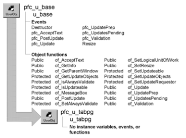

# u_tabpg

**Description**

Tab page visual user object ancestor.

**Ancestry**

**Library**

- PFCMAIN.PBL
- PFEMAIN.PBL

**Usage**

Use this visual object in the User Object painter as the ancestor for all tab pages. After defining the tab page’s appearance and functionality, you then place these tab pages on tab user objects in the User Object painter. To insert a tab page object, click the right mouse button on a tab control, select Insert UserObject, and double-click on a u_tabpg descendant.

**See also**

u_tab
