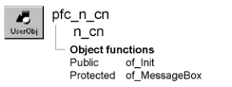

# n_cn

**Description**

Connection object for use with all distributed PFC applications. You can either use this object as is or create descendants that include customized or extended functionality.

**Ancestry**



**Library**

- PFCMAIN.PBL
- PFEMAIN.PBL

**Usage**

Use n_cn whenever you would normally create a Connection object. By calling the of_Init function, you can easily initialize the Connection object.

To use n_cn:

1. Declare a variable of type n_cn (this example declares an instance variable):

   ```
   n_cn   icn_connection
   ```

2. Create the Connection object:

   ```
   icn_connection = CREATE n_cn
   ```

3. Call the of_Init function to initialize Connection object fields:

   ```
   icn_connection.of_Init &
   (gnv_app.of_GetAppINIFile(),"Connect")
   ```

4. Continue the distributed application as appropriate.

**See also**

n_trp

## Instance variables

N_cn includes instance variables:

| Instance variable | Description | Data type | Access |
| --- | --- | --- | --- |
| ib_IsObsolete |  | Boolean | Protected |

## Functions

N_cn includes precoded object functions:

- of_Init
- of_MessageBox

### of_Init

**Description**

Initializes a Connection object’s properties using values from an INI file section or registry key.

**Access**

Public

**Syntax**

```
instancename.of_Init ( fileorkey, section )
```

| Argument | Description |
| --- | --- |
| *instancename* | Instance name of n_cn |
| *fileorkey* | String specifying either the INI file or the registry key containing connection information. If you specify the INI file, you must also specify *section* |
| *section* | String specifying the INI file section containing connection information. If *fileorkey* specifies an INI file, you must specify this value; if *fileorkey* specifies a registry key, you cannot specify this value |

**Return value**

Integer. Returns 1 if the function succeeds and -1 if an error occurs.

**Usage**

The INI file section or registry key must contain the following keywords:

- Application
- ConnectString
- Driver
- Location
- Options
- Password
- Trace
- UserID

If the INI file section or registry key doesn’t have a value, the function defaults the value to an empty string.

For complete information on distributed computing, see *Application Techniques*.

**Examples**

This example calls the of_Init function (assuming an icn_connection instance variable):

```
Integer   li_return

icn_connection = CREATE n_cn
li_return = icn_connection.of_Init &
       ("c:\HKEY_CURRENT_USER\Software\" &
       + "Powersoft\EISUSER\Connect")
IF li_return = -1 THEN
       MessageBox("Connect", &
      "Remote connection error")
ELSE
       gnv_app.of_GetFrame().SetMicroHelp &
      ("Connection succeeded")
END IF
```

### of_MessageBox

**Description**

Displays a MessageBox.

**Access**

Protected

**Syntax 1**

```
instancename.of_MessageBox ( id, title, message, icon, button, default )
```

| Argument | Description |
| --- | --- |
| *instancename* | Instance name of n_cn |
| *id* | String specifying an ID for the message |
| *title* | String specifying the title of the MessageBox |
| *message* | String specifying the message text |
| *icon* | Icon enumerated data type indicating the icon you want to display on the left side of the message box. Values are: |
|  | • Information! |
|  | • StopSign! |
|  | • Exclamation! |
|  | • Question! |
|  | • None! |
| *button* | Button enumerated data type indicating the set of CommandButtons you want to display at the bottom of the message box. The buttons are numbered in the order listed in the enumerated data type. Values are: |
|  | • OK! |
|  | • OKCancel! |
|  | • YesNo! |
|  | • YesNoCancel! |
|  | • RetryCancel! |
|  | • AbortRetryIgnore! |
| *default* | Integer specifying the number of the button you want to be the default button |

**Syntax 2** For a message that contains values (PFC 2025 and later)

```
instancename.of_MessageBox ( id, title, message, values, icon, button, default )
```

| Argument | Description |
| --- | --- |
| *instancename* | Instance name of n_cn |
| *values* | String array. The values for the placeholders in *message* |

The other arguments are the same as in Syntax 1.

**Return value**

Integer. Returns 1 if the function succeeds and -1 if an error occurs.

**Usage**

Override this function to control MessageBox behavior in Connection objects.

**PFC 2025 and later** When the language service is enabled (see the n_cst_appmanager of_SetLanguage function), the message comes from the language file if it has an entry for *id*: the entry *id* replaces *message*, and the entry *id*.title replaces *title*. Without the service, or without an entry, *message* and *title* are used as they are.

Use Syntax 2 for a message that contains values: *message* is the English text with placeholders (%s, or %1 - %9 by position) and *values* holds the values. Syntax 2 calls Syntax 1 to display the message, so an override of Syntax 1 still sees every message.

**Examples**

This example calls the of_MessageBox function:

```
of_Messagebox(’pfc_cn_dberror’,’Save’, &
   as_error, StopSign!, Ok!, 1)
...
```
