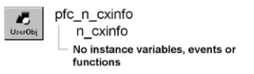

# n_cxinfo

**Description**

ContextInformation nonvisual user object ancestor.

**Ancestry**

**Library**

- PFCMAIN.PBL
- PFEMAIN.PBL

**Usage**

Use this nonvisual object instead of the standard PowerBuilder ContextInformation object.

**See also**

- [n_cxk](n_cxk.md)
- [n_inet](n_inet.md)
- [n_ir](n_ir.md)
- [n_srv](n_srv.md)
