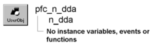

# n_dda

**Description**

DynamicDescriptionArea nonvisual user object ancestor.

**Ancestry**

**Library**

- PFCMAIN.PBL
- PFEMAIN.PBL

**Usage**

Use this nonvisual object instead of the standard PowerBuilder DynamicDescriptionArea object.

**See also**

- [n_dsa](n_dsa.md)
- [n_err](n_err.md)
- [n_msg](n_msg.md)
- [n_tr](n_tr.md)
