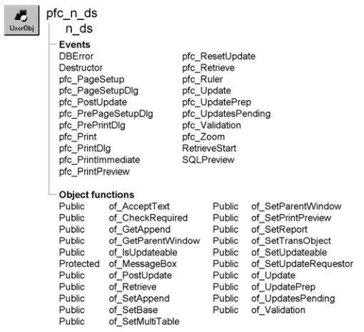

# n_ds

**Description**

DataStore object for use with all PFC applications. This user object includes:

- Functions to enable and disable DataStore services
- Events and functions that call DataStore services
- Events and functions that are called by the logical unit of work service

You can either use this object asis or create descendants that include customized or extended functionality.

N_ds is a self-updating object.

**Ancestry**



**Library**

- PFCMAIN.PBL
- PFEAPSRV.PBL

**Object relationships**

- [n_cst_conversion](../09-custom-class-user-objects/n_cst_conversion.md)
- [n_cst_dssrv](../09-custom-class-user-objects/n_cst_dssrv.md)
- [n_cst_dssrv_multitable](../09-custom-class-user-objects/n_cst_dssrv_multitable.md)
- [n_cst_dssrv_printpreview](../09-custom-class-user-objects/n_cst_dssrv_printpreview.md)
- [n_cst_dssrv_report](../09-custom-class-user-objects/n_cst_dssrv_report.md)
- [n_cst_platform](../09-custom-class-user-objects/n_cst_platform.md)
- [n_tr](n_tr.md)
- [s_pagesetupattrib](../05-global-structures-and-structure-objects/s_pagesetupattrib.md)
- [s_printdlgattrib](../05-global-structures-and-structure-objects/s_printdlgattrib.md)
- [w_master](../02-window-objects/w_master.md)

**Usage**

Use n_ds whenever you would normally create a DataStore. N_ds has the same relationship to n_cst_dssrv as u_dw has to n_cst_dwsrv.

To use n_ds:

1. Declare a variable of type n_ds (this example declares an instance variable):

   ```
   n_ds  ids_datastore
   ```

2. Create the DataStore:

   ```
   ids_datastore = CREATE n_ds
   ```

3. Associate a DataWindow object with the DataStore:

   ```
   ids_datastore.DataObject = "d_emplist"
   ```

4. Set the Transaction object by calling the of_SetTransObject function:

   ```
   ids_datastore.of_SetTransObject(SQLCA)
   ```

5. (Optional) Enable DataStore services:

   ```
   inv_datastore.of_SetPrintPreview(TRUE)
   inv_datastore.of_SetReport(TRUE)
   ```

6. Add code to the pfc_Retrieve event to retrieve rows:

   ```
   Return this.Retrieve()
   ```

7. Access data and perform other DataStore functions as needed. This example retrieves data:

   ```
   inv_datastore.of_Retrieve()
   ```

**See also**

- [n_cst_dwsrv](../09-custom-class-user-objects/n_cst_dwsrv.md)
- [u_dw](../06-standard-visual-user-objects/u_dw.md)

## Instance variables

N_ds contains instance variables.

| Instance variable | Description | Data type | Access | Usage |
| --- | --- | --- | --- | --- |
| ib_append | Indicates whether the Retrieve function appends | Boolean | Protected | Set with of_SetAppend |
| ib_isupdateable | Indicates whether the DataStore is updatable | Boolean | Protected | Set with of_SetUpdateable |
| inv_base | Reference variable for basic DataStore service | n_cst_dssrv | Public | Use in dot notation to access n_cst_dssrv functions and events |
| inv_multitable | Reference variable for multitable update service | n_cst_dssrv_multitable | Public | Use in dot notation to access n_cst_dssrv_multitable functions and events |
| inv_printpreview | Reference variable for print preview service | n_cst_dssrv_printpreview | Public | Use in dot notation to access n_cst_dssrv_printpreview functions and events |
| inv_report | Reference variable for report service | n_cst_dssrv_report | Public | Use in dot notation to access n_cst_dssrv_report functions and events |
| ipo_updaterequestor | Update requestor | PowerObject | Protected | Set with of_SetUpdateRequestor |
| is_updatesallowed | Specifies allowable updates | String | Protected | Internal |
| itr_object | Transaction object used by the DataStore | n_tr | Public | Set with of_SetTransObject |

## Events

N_ds includes precoded event scripts:

- DBError
- Destructor
- pfc_PageSetup
- pfc_PageSetupDlg
- pfc_PostUpdate
- pfc_PrePageSetupDlg
- pfc_PrePrintDlg
- pfc_Print
- pfc_PrintDlg
- pfc_PrintImmediate
- pfc_PrintPreview
- pfc_ResetUpdate
- pfc_Retrieve
- pfc_Ruler
- pfc_Update
- pfc_UpdatePrep
- pfc_UpdatesPending
- pfc_Validation
- pfc_Zoom
- RetrieveStart
- SQLPreview

### DBError

**Description**

Displays a message box informing the user that a database error occurred.

**Usage**

This event is called when there is a database error.

Because DBError calls the of_GetParentWindow function, a parent window is required. To let the DataStore know its parent window, you can call the of_SetParentWindow function after the DataStore creation.

### Destructor

**Description**

Destroys all existing DataStore service objects.

**Usage**

This event executes when the DataStore is destroyed.

### pfc_PageSetup

**Description**

Calls the pfc_PageSetupDlg event to display the Page Setup dialog box.

**Return value**

Integer. Returns 1 if the event succeeds, 0 if the user cancels out of the dialog box, and -1 if an error occurs.

### pfc_PageSetupDlg

**Description**

Displays the Page Setup dialog box by calling the n_cst_platform of_PageSetupDlg function, passing the DataWindow’s page display properties.

**Syntax**

```
instancename.Event pfc_PageSetupDlg ( attributes )
```

| Argument | Description |
| --- | --- |
| *instancename* | Instance name of n_ds |
| *attributes* | S_pagesetupattrib variable into which the event places page setup information. This argument is accessed through the *astr_pagesetup* argument (passed by reference) |

**Return value**

Integer. Returns 1 if the event succeeds, 0 if the user cancels out of the dialog box, and -1 if an error occurs.

**Usage**

This event is called by the pfc_PageSetup event.

### pfc_PostUpdate

**Description**

Clears the DataStore update flags.

**Return value**

Integer. Returns 1 if the event succeeds and -1 if an error occurs.

**Usage**

You can extend this event to code additional post update processing.

**Examples**

This example is from the of_PostUpdate function:

```
Return this.Event pfc_PostUpdate()
```

### pfc_PrePageSetupDlg

**Description**

Empty user event allowing you to modify the properties passed to the n_cst_platform of_PageSetupDlg function.

**Syntax**

```
instancename.Event pfc_PrePageSetupDlg ( attributes )
```

| Argument | Description |
| --- | --- |
| *instancename* | Instance name of n_ds |
| *attributes* | S_pagesetupattrib variable into which the event places additional page setup information. This argument is accessed through the *astr_pagesetup* argument (passed by reference) |

**Usage**

This event is called by the pfc_PageSetupDlg event before calling the n_cst_platform of_PageSetupDlg function.

You can use this event to modify or extend the information passed in the s_pagesettupattrib structure.

**Examples**

This example contains code you might add to the pfc_PrePageSetupDlg event:

```
// Sets page setup to portrait
astr_pagesetup.b_portraitorientation = TRUE
```

### pfc_PrePrintDlg

**Description**

Empty user event allowing you to modify the properties passed to the n_cst_platform of_PrintDlg function.

**Syntax**

```
instancename.Event pfc_PrePrintDlg ( attributes )
```

| Argument | Description |
| --- | --- |
| *instancename* | Instance name of n_ds |
| *attributes* | S_printdlgattrib variable into which the event places additional printing information. This argument is accessed through the *astr_printdlg* argument (passed by reference) |

**Return value**

None

**Usage**

Use this event to modify or extend the information passed in the s_printdlgattrib structure.

**Examples**

This example contains code you might add to the pfc_PrePrintDlg event:

```
// Default copies to 1
astr_printdlg.l_copies = 1
```

### pfc_Print

**Description**

Calls the pfc_PrintDlg function and prints the DataStore, as specified in the Print dialog box.

**Return value**

Integer. Returns 1 if the event succeeds and -1 if an error occurs.

### pfc_PrintDlg

**Description**

Initializes the s_printdlgattrib structure with the DataStore’s current settings, displays the Print dialog box by calling the n_cst_platform of_PrintDlg function, and resets the DataWindow’s settings as specified by the user.

**Syntax**

```
instancename.Event pfc_PrintDlg ( attributes )
```

| Argument | Description |
| --- | --- |
| *instancename* | Instance name of n_ds |
| *attributes* | S_printdlgattrib variable into which the event places printing information. This argument is accessed through the *astr_printdlg* argument (passed by reference) |

**Return value**

Integer. Returns 1 if the event succeeds and -1 if an error occurs.

**Usage**

This event is called by the pfc_Print event.

### pfc_PrintImmediate

**Description**

Prints the current DataStore without displaying the Print dialog box.

**Return value**

Integer. Returns 1 if the event succeeds and -1 if an error occurs.

### pfc_PrintPreview

**Description**

Toggles the DataStore between preview and edit modes.

**Return value**

Boolean. Returns TRUE if the DataStore is placed in preview mode and FALSE if it is placed in edit mode.

**Usage**

To use this event, you must enable the print preview service by calling the of_SetPrintPreview function.

### pfc_ResetUpdate

**Description**

Clears the DataStore’s update flags.

**Return value**

Integer. Returns 1 if the event succeeds and -1 if an error occurs.

**Usage**

The pfc_PostUpdate event calls this event.

### pfc_Retrieve

**Description**

Empty user event to contain all database retrieval logic.

**Return value**

Long. Returns the result of the Retrieve function.

**Usage**

You typically call the of_Retrieve function, which calls this event.

**Examples**

This example calls the pfc_Retrieve event:

```
ids_data = CREATE n_ds
ids_data.DataObject = "d_empall"
ids_data.of_SetTransObject(SQLCA)
IF ids_data.Event pfc_Retrieve() = -1 THEN
       SQLCA.of_Rollback()
ELSE
       SQLCA.of_Commit( )
END IF
```

This example shows the code you add to the pfc_Retrieve event to retrieve rows:

```
Return this.Retrieve( )
```

### pfc_Ruler

**Description**

Toggles the DataStore between displaying and hiding rulers in print preview mode.

**Return value**

Boolean. Returns TRUE if print preview rulers are displayed and FALSE if they are hidden.

**Usage**

To use this event, you must enable the print preview service by calling the of_SetPrintPreview function.

### pfc_Update

**Description**

Updates the DataStore. If the multitable update service is enabled, this event updates all specified tables.

**Syntax**

```
instancename.Event pfc_Update ( accepttext, resetflags )
```

| Argument | Description |
| --- | --- |
| *instancename* | Instance name of n_ds |
| *accepttext* | Boolean specifying whether the DataStore control should automatically perform an AcceptText before performing the Update (TRUE) or not (FALSE) |
| *resetflags* | Boolean specifying whether the DataStore control should automatically reset the update flags (TRUE) or not (FALSE) |

**Return value**

Integer. Returns 1 if the function succeeds and -1 if an error occurs.

**Usage**

Call this event to update a DataStore.

### pfc_UpdatePrep

**Description**

Empty user event to which you can add code that prepares for update.

**Return value**

Long. Return 1 if the update preparation succeeds and -1 to halt the update process.

**Usage**

The of_UpdatePrep function calls this function.

### pfc_UpdatesPending

**Description**

Determines if there are pending updates for the DataStore.

**Return value**

Integer. Returns 1 if there are pending updates for the DataStore and 0 if there are no pending updates.

**Usage**

This event is called by the of_UpdatesPending function.

### pfc_Validation

**Description**

Validates the DataStore, including checks for required fields.

**Return value**

Integer. Returns 1 if the event succeeds and -1 if an error occurs.

**Usage**

Extend this event to perform DataStore-specific validation.

### pfc_Zoom

**Description**

Displays the w_zoom dialog box, allowing the user to control DataStore display while in print preview mode.

**Return value**

Integer. Returns the zoom level chosen by the user if the event succeeds, 0 if the user cancels out of the w_zoom dialog box, and -1 if an error occurs.

**Usage**

To use this event, you must enable the print preview service by calling the of_SetPrintPreview function.

### RetrieveStart

**Description**

Determines whether PowerBuilder should append data to the end of the DataStore when retrieving.

**Usage**

This event executes just before the actual database retrieval. You can control whether PowerBuilder appends to the end of the DataStore when retrieving using the of_SetAppend function.

### SQLPreview

**Description**

Invokes the SQL Spy service, if enabled and controls which SQL statements are sent to the database.

**Usage**

This event executes just before any database access.

## Functions

N_ds includes precoded object functions:

- of_AcceptText
- of_CheckRequired
- of_GetAppend
- of_GetParentWindow
- of_IsUpdateable
- of_MessageBox
- of_PostUpdate
- of_Retrieve
- of_SetAppend
- of_SetBase
- of_SetMultiTable
- of_SetParentWindow
- of_SetPrintPreview
- of_SetReport
- of_SetTransObject
- of_SetUpdateable
- of_SetUpdateRequestor
- of_Update
- of_UpdatePrep
- of_UpdatesPending
- of_Validation

### of_AcceptText

**Description**

Performs an AcceptText function for the DataStore.

**Access**

Public

**Syntax**

```
instancename.of_AcceptText ( focusonerror )
```

| Argument | Description |
| --- | --- |
| *instancename* | Instance name of n_ds |
| *focusonerror* | Boolean indicating whether PFC sets focus to the DataStore when an error occurs |

**Return value**

Integer. Returns 1 if the function succeeds and -1 if an error occurs.

**Usage**

N_cst_luw calls this function as part of the default save process. This function is part of the self-updating object API. To customize accept text processing, extend the pfc_AcceptText event.

**Examples**

This example is from the n_cst_luw of_AcceptText function:

```
...
If lb_defined Then
       li_rc =  &
      lpo_tocheck.Function Dynamic of_AcceptText &
         (ab_focusonerror)
       If li_rc < 0 Then Return -1

...
```

### of_CheckRequired

**Description**

Determines if any of required columns contain NULL values.

**Access**

Public

**Syntax**

```
instancename.of_CheckRequired ( buffer, row, column, colname,
updateonly )
```

| Argument | Description |
| --- | --- |
| *instancename* | Instance name of n_ds |
| *buffer* | DWBuffer enumerated data type specifying the DataStore buffer to check |
| *row* | Long specifying the first row to check and into which the function places the number of the row in error (passed by reference) |
| *column* | Integer specifying the first column to check and into which the function places the number of the column in error (passed by reference) |
| *colname* | String specifying the first column to check and into which the function places the name of the column in error (passed by reference) |
| *updateonly* | Boolean indicating whether to validate only those rows and columns that have changed (TRUE) or validate all rows and columns |

**Return value**

Integer. Returns values as follows:

- **1** The required fields check was successful but errors were found; check the arguments for missing required fields
- **0** The required fields check was successful and no errors were found
- **-1** An error occurred

**Usage**

The pfc_Validation event calls this function.

**Examples**

This example is from the n_ds pfc_Validation event:

```
...
li_rc = of_CheckRequired (primary!, ll_checkrow, &
   li_checkcolumn, ls_checkcolname, ib_updateonly)
if (li_rc < 0) or (ll_checkrow > 0) then return -1
...
```

### of_GetAppend

**Description**

Reports whether DataStore retrieves append to the end of the DataStore.

**Access**

Public

**Syntax**

```
instancename.of_GetAppend ( )
```

| Argument | Description |
| --- | --- |
| *instancename* | Instance name of n_ds |

**Return value**

Boolean. Returns TRUE if retrieves append to the end of the DataStore and FALSE if retrieves reset the DataStore before the retrieve.

**Examples**

This example calls the of_GetAppend function:

```
Boolean  lb_append

lb_append = ids_datasource.of_GetAppend()
...
```

### of_GetParentWindow

**Description**

Retrieves a reference to the window containing this instance of n_ds.

**Access**

Public

**Syntax**

```
instancename.of_GetParentWindow ( window )
```

| Argument | Description |
| --- | --- |
| *instancename* | Instance name of n_ds |
| *window* | Window variable into which the function places a reference to the parent window (passed by reference) |

**Return value**

Integer. Returns 1 if the function succeeds and -1 if there is no parent window.

**Usage**

Internal.

**Examples**

This example is from the pfc_PrintDlg event:

```
...
f_setplatform (lnv_platform, true)
this.of_GetParentWindow(lw_parent)
ll_rc = lnv_platform.of_PrintDlg(astr_printdlg,  &
   lw_parent)
...
```

### of_IsUpdateable

**Description**

Reports whether the DataStore is updatable.

**Access**

Public

**Syntax**

```
instancename.of_IsUpdateable ( )
```

| Argument | Description |
| --- | --- |
| *instancename* | Instance name of n_ds |

**Return value**

Boolean. Returns TRUE if the DataStore is updatable and FALSE if it is not.

**Examples**

This example is from the pfc_UpdatesPending event:

```
...
if not of_IsUpdateable() then
       return 0
end if
...
```

### of_MessageBox

**Description**

Displays a MessageBox.

**Access**

Protected

**Syntax**

```
instancename.of_MessageBox ( id, title, message, icon, button, default )
```

| Argument | Description |
| --- | --- |
| *instancename* | Instance name of n_ds |
| *id* | String specifying an ID for the message |
| *title* | String specifying the title of the MessageBox |
| *message* | String specifying the message text |
| *icon* | Icon enumerated data type indicating the icon you want to display on the left side of the message box. Values are: |
|  | • Information! |
|  | • StopSign! |
|  | • Exclamation! |
|  | • Question! |
|  | • None! |
| *button* | Button enumerated data type indicating the set of CommandButtons you want to display at the bottom of the message box. The buttons are numbered in the order listed in the enumerated data type. Values are: |
|  | • OK! |
|  | • OKCancel! |
|  | • YesNo! |
|  | • YesNoCancel! |
|  | • RetryCancel! |
|  | • AbortRetryIgnore! |
| *default* | Integer specifying the number of the button you want to be the default button |

**Return value**

Integer. Returns 1 if the function succeeds and -1 if an error occurs.

**Usage**

Override this function to control MessageBox behavior in DataStore objects.

The *id* argument is not used in the default implementation.

**Examples**

This example calls the of_MessageBox function:

```
of_Messagebox(’ds_dberror’,’Save’, &
   as_error, StopSign!, Ok!, 1)
...
```

### of_PostUpdate

**Description**

Calls the pfc_PostUpdate event, which clears update flags and allows you to code additional post-update processing.

**Access**

Public

**Syntax**

```
instancename.of_PostUpdate ( )
```

| Argument | Description |
| --- | --- |
| *instancename* | Instance name of n_ds |

**Return value**

Integer. Returns 1 if the function succeeds and -1 if an error occurs.

**Usage**

N_cst_luw calls this function as part of the default save process. This function is part of the self-updating object API. To customize post-update processing, extend the pfc_PostUpdate event.

**Examples**

This example is from the n_cst_luw of_PostUpdate function:

```
...
If lb_defined Then
  li_rc =  &
    lpo_tocheck.Function Dynamic of_PostUpdate()
...
```

### of_Retrieve

**Description**

Calls the pfc_Retrieve event.

**Access**

Public

**Syntax**

```
instancename.of_Retrieve ( )
```

| Argument | Description |
| --- | --- |
| *instancename* | Instance name of n_ds |

**Return value**

Integer. Returns the number of rows retrieved if the function succeeds and -1 if an error occurs.

**Usage**

Call this function to perform DataStore retrieves. You must also code retrieve logic in the pfc_Retrieve event.

**Examples**

This example calls the of_Retrieve function:

```
ids_data.of_Retrieve()
```

### of_SetAppend

**Description**

Specifies whether DataStore retrieves append to the end of the DataStore.

**Access**

Public

**Syntax**

```
instancename.of_SetAppend ( boolean )
```

| Argument | Description |
| --- | --- |
| *instancename* | Instance name of n_ds |
| *boolean* | Boolean specifying whether DataStore retrieves append to the end of existing rows (TRUE) or reset the DataStore before the retrieve (FALSE) |

**Return value**

Integer. Returns 1 if the function succeeds and -1 if an error occurs.

**Examples**

This example calls the of_SetAppend function:

```
Integer  li_return

li_return = ids_datasource.of_SetAppend(FALSE)
```

### of_SetBase

**Description**

Enables or disables n_cst_dssrv, which provides basic DataStore services.

**Access**

Public

**Syntax**

```
instancename.of_SetBase ( boolean )
```

| Argument | Description |
| --- | --- |
| *instancename* | Instance name of n_ds |
| *boolean* | Boolean specifying whether to enable (TRUE) or disable (FALSE) an instance of the n_cst_dssrv object |

**Return value**

Integer. Returns 1 if the function succeeds and -1 if an error occurs.

**Usage**

Call this function to create or destroy an instance of n_cst_dssrv.

**Examples**

This example calls the of_SetBase function:

```
Integer  li_return

li_return = ids_datastore.of_SetBase(TRUE)
IF li_return = -1 THEN
       MessageBox("DataStore", "Error with of_SetBase")
END IF
```

### of_SetMultiTable

**Description**

Enables or disables n_cst_dssrv_multitable, which provides multitable update services.

**Access**

Public

**Syntax**

```
instancename.of_SetMultiTable ( boolean )
```

| Argument | Description |
| --- | --- |
| *instancename* | Instance name of n_ds |
| *boolean* | Boolean specifying whether to enable (TRUE) or disable (FALSE) the multitable update service |

**Return value**

Integer. Returns 1 if the function succeeds and -1 if an error occurs.

**Usage**

Use this function to create or destroy an instance of n_cst_dssrv_multitable.

**Examples**

This example calls the of_SetMultiTable function:

```
ids_data.of_SetMultiTable(TRUE)
```

### of_SetParentWindow

**Description**

Sets a reference to the parent window.

**Access**

Public

**Syntax**

```
instancename.of_SetParentWindow ( window )
```

| Argument | Description |
| --- | --- |
| *instancename* | Instance name of n_ds |
| *window* | Window variable containing the parent window |

**Return value**

Integer. Returns 1 if the function succeeds and -1 if an error occurs.

**Usage**

Some n_ds print functionality requires a reference to a parent window.

**Examples**

This example calls the of_SetParentWindow function in a window Open event:

```
ids_data = CREATE n_ds
ids_data.DataObject = "d_empall"
ids_data.of_SetTransObject(SQLCA)
ids_data.of_SetParentWindow(this)
...
```

### of_SetPrintPreview

**Description**

Enables or disables n_cst_dwsrv_printpreview, which provides the print preview service.

**Access**

Public

**Syntax**

```
instancename.of_SetPrintPreview ( boolean )
```

| Argument | Description |
| --- | --- |
| *instancename* | Instance name of n_ds |
| *boolean* | Boolean specifying whether to enable (TRUE) or disable (FALSE) the print preview service |

**Return value**

Integer. Returns 1 if the function succeeds and -1 if an error occurs.

**Usage**

Use this function to create or destroy an instance of n_cst_dwsrv_printpreview.

**Examples**

This example calls the of_SetPrintPreview function:

```
ids_data.of_SetPrintPreview(TRUE)
```

### of_SetReport

**Description**

Enables or disables n_cst_dwsrv_report, which provides the reporting service.

**Access**

Public

**Syntax**

```
instancename.of_SetReport ( boolean )
```

| Argument | Description |
| --- | --- |
| *instancename* | Instance name of n_ds |
| *boolean* | Boolean specifying whether to enable (TRUE) or disable (FALSE) the reporting service |

**Return value**

Integer. Returns 1 if the function succeeds and -1 if an error occurs.

**Usage**

Use this function to create or destroy an instance of n_cst_dwsrv_report.

**Examples**

This example calls the of_SetReport function:

```
ids_data.of_SetReport(TRUE)
```

### of_SetTransObject

**Description**

Sets the Transaction object for the DataStore.

**Access**

Public

**Syntax**

```
instancename.of_SetTransObject ( transaction )
```

| Argument | Description |
| --- | --- |
| *instancename* | Instance name of n_ds |
| *transaction* | N_tr variable specifying the Transaction object to use for the DataStore |

**Return value**

Integer. Returns 1 if the function succeeds and -1 if an error occurs.

**Examples**

This example calls the of_SetTransObject function (it assumes you have associated n_tr with SQLCA in the Application painter):

```
Integer   li_return

li_return = ids_datastore.of_SetTransObject(SQLCA)
IF li_return = -1 THEN
       MessageBox("DataStore", &
       "Error with of_SetTransObject")
END IF
```

### of_SetUpdateable

**Description**

Specifies whether the DataStore is updatable.

**Access**

Public

**Syntax**

```
instancename.of_SetUpdateable ( boolean )
```

| Argument | Description |
| --- | --- |
| *instancename* | Instance name of n_ds |
| *boolean* | Boolean indicating whether the DataStore is updatable (TRUE) or not (FALSE) |

**Return value**

Integer. Returns 1 if the function succeeds and -1 if an error occurs.

**Usage**

Call this function to disable default save processing for DataStores that are not updatable.

**Examples**

This example calls the of_SetUpdateable function:

```
ids_data.of_SetUpdateable(FALSE)
```

### of_SetUpdateRequestor

**Description**

Creates a reference to the object requesting an update within a logical unit of work.

**Access**

Public

**Syntax**

```
instancename.of_SetUpdateRequestor ( requestor )
```

| Argument | Description |
| --- | --- |
| *instancename* | Instance name of n_ds |
| *requestor* | PowerObject containing the object requesting the update |

**Return value**

Integer. Returns 1 if the function succeeds and -1 if an error occurs.

**Usage**

Internal.

**Examples**

This example is from the of_Update function:

```
...
If this.of_SetUpdateRequestor(apo_requestor) <0 Then
   Return -1
END IF
li_rc = this.of_Update(ab_accepttext, ab_resetflag)
this.of_SetUpdateRequestor(lpo_notvalid)
...
```

### of_Update

Updates the DataStore. There are two syntaxes:

| To | Use |
| --- | --- |
| Update data, optionally controlling update type | Syntax 1 |
| Update data passing the requestor object | Syntax 2 |

| Syntax 1 | Update data, optionally controlling update type |
| --- | --- |

**Description**

Updates rows in the DataStore. With this syntax, you can optionally control the update types:

- Insert
- Update
- Delete

**Access**

Public

**Syntax**

```
instancename.of_Update ( accepttext, resetflags {, insert, update, delete } )
```

| Argument | Description |
| --- | --- |
| *instancename* | Instance name of n_ds |
| *accepttext* | Boolean indicating whether the DataStore should automatically perform an AcceptText before performing the update: |
|  | TRUE—Perform AcceptText (default) FALSE—Do not perform AcceptText |
| *resetflags* | Boolean indicating whether *instancename* should automatically reset the update flags: |
|  | TRUE—Reset the flags (default) FALSE—Do not reset the flags |
| *insert* (optional) | Boolean indicating whether to insert rows: TRUE—Insert rows (default) FALSE—Do not insert rows |
| *update* (optional) | Boolean indicating whether to modify changed rows: TRUE—Modify rows (default) FALSE—Do not modify rows |
| *delete* (optional) | Boolean indicating whether to delete rows: TRUE—Delete rows (default) FALSE—Do not delete rows |

**Return value**

Integer. Returns 1 if the function succeeds and -1 if an error occurs.

**Usage**

N_cst_luw calls this function as part of the default save process. This function is part of the self-updating object API. To customize update processing, extend the pfc_Update event.

For more information on update flags, see the Update function in the *PowerScript Reference*.

**Examples**

This example calls the of_Update function:

```
Integer  li_return

li_return = ids_data.of_Update(TRUE, TRUE)
```

| Syntax 2 | Update data passing the requestor object |
| --- | --- |

**Description**

Updates rows in the DataStore, passing a reference to the requestor object.

**Access**

Public

**Syntax**

```
instancename.of_Update ( accepttext, resetflags, requestor )
```

| Argument | Description |
| --- | --- |
| *instancename* | Instance name of n_ds |
| *accepttext* | Boolean indicating whether the DataStore should automatically perform an AcceptText before performing the update: |
|  | TRUE—Perform AcceptText (default) FALSE—Do not perform AcceptText |
| *resetflags* | Boolean indicating whether *instancename* should automatically reset the update flags: |
|  | TRUE—Reset the flags (default) FALSE—Do not reset the flags |
| *requestor* | PowerObject containing the requestor object |

**Return value**

Integer. Returns 1 if the function succeeds and -1 if an error occurs.

**Usage**

Internal.

**Examples**

This example is from the n_cst_luw of_Update function:

```
...
If lb_defined Then
  li_rc = lpo_tocheck.Function Dynamic of_Update &
    (ab_accepttext,  ab_resetflag, &
      lpo_updaterequestor)
  If li_rc < 0 Then Return -1
  Continue
End If
...
```

### of_UpdatePrep

**Description**

Calls the pfc_UpdatePrep event, which allows you to code additional update preparation logic.

**Access**

Public

**Syntax**

```
instancename.of_UpdatePrep ( )
```

| Argument | Description |
| --- | --- |
| *instancename* | Instance name of n_ds |

**Return value**

Integer. Returns 1 if the function succeeds and -1 if an error occurs.

**Usage**

N_cst_luw calls this function as part of the default save process. This function is part of the self-updating object API. To customize update preparation processing, extend the pfc_UpdatePrep event.

**Examples**

This example is from the n_cst_luw of_UpdatePrep function:

```
...
If lb_defined Then
  li_rc =  &
    lpo_tocheck.Function Dynamic of_UpdatePrep ()
  If li_rc < 0 Then Return -1
  Continue
End If
...
```

### of_UpdatesPending

**Description**

Determines if there are updates pending in the DataStore.

**Access**

Public

**Syntax**

```
instancename.of_UpdatesPending ( )
```

| Argument | Description |
| --- | --- |
| *instancename* | Instance name of n_ds |

**Return value**

Integer. Returns values as follows:

- **1** Updates are pending
- **0** No updates pending
- **-1** An error occurred

**Usage**

N_cst_luw calls this function as part of the default save process. This function is part of the self-updating object API. To customize pending updates processing, extend the pfc_UpdatesPending event.

**Examples**

This example calls the of_UpdatesPending function:

```
...
If lb_defined Then
       la_rc = lpo_tocheck.Dynamic of_UpdatesPending ()
...
```

### of_Validation

**Description**

Performs validation on the DataStore.

**Access**

Public

**Syntax**

```
instancename.of_Validation ( )
```

| Argument | Description |
| --- | --- |
| *instancename* | Instance name of n_ds |

**Return value**

Integer. Returns 1 if the function succeeds and -1 if a validation error occurs.

**Usage**

N_cst_luw calls this function as part of the default save process. This function is part of the self-updating object API. To customize validation processing, extend the pfc_Validation event.

**Examples**

This example calls the of_Validation function:

```
...
If lb_defined Then
  li_rc =  &
    lpo_tocheck.Function Dynamic of_Validation()
...
```
