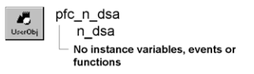

# n_dsa

**Description**

DynamicStagingArea nonvisual user object ancestor.

**Ancestry**

**Library**

- PFCMAIN.PBL
- PFEMAIN.PBL

**Usage**

Use this nonvisual object instead of the standard PowerBuilder DynamicStagingArea object.

**See also**

- [n_dda](n_dda.md)
- [n_err](n_err.md)
- [n_msg](n_msg.md)
- [n_tr](n_tr.md)
