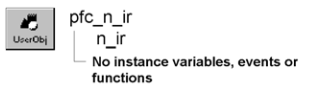

# n_ir

**Description**

InternetResult nonvisual user object ancestor.

**Ancestry**

**Library**

- PFCMAIN.PBL
- PFEMAIN.PBL

**Usage**

Use this nonvisual object instead of the standard PowerBuilder InternetResult object.

**See also**

- [n_cxinfo](n_cxinfo.md)
- [n_cxk](n_cxk.md)
- [n_inet](n_inet.md)
- [n_srv](n_srv.md)

## Instance variables

N_ir includes instance variables:

| Instance variable | Description | Data type | Access |
| --- | --- | --- | --- |
| ib_IsObsolete |  | Boolean | Protected |

