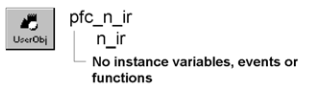

# n_ir

> Removed in PFC 2025. Available in the 2019 and 2022 versions of PFC. PowerBuilder's InternetResult object only receives the data that the Inet object's GetURL and PostURL functions return, so it was removed with [n_inet](n_inet.md). Use the HTTPClient object ([n_httpclient](n_httpclient.md)) instead.

**Description**

InternetResult nonvisual user object ancestor.

**Ancestry**

**Library**

- PFCMAIN.PBL
- PFEMAIN.PBL

**Usage**

Use this nonvisual object instead of the standard PowerBuilder InternetResult object.

**See also**

- [n_cxinfo](n_cxinfo.md)
- [n_cxk](n_cxk.md)
- [n_inet](n_inet.md)
- [n_srv](n_srv.md)

## Instance variables

N_ir includes instance variables:

| Instance variable | Description | Data type | Access |
| --- | --- | --- | --- |
| ib_IsObsolete |  | Boolean | Protected |

