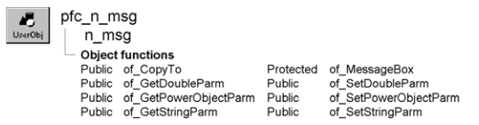

# n_msg

**Description**

Message nonvisual user object ancestor.

**Ancestry**



**Library**

- PFCMAIN.PBL
- PFEMAIN.PBL

**Usage**

Use this nonvisual object instead of the standard PowerBuilder Message object.

N_msg includes functions that provide enhanced behavior when passing numeric, string, or PowerObject values through the Message object. Call these functions to set and get values instead of accessing DoubleParm, StringParm, and PowerObjectParm directly.

**See also**

- [n_ds](n_ds.md)
- [n_err](n_err.md)
- [n_ms](n_ms.md)
- [n_pl](n_pl.md)
- [n_tr](n_tr.md)

## Instance variables

N_msg includes instance variables:

| Instance variable | Description | Data type | Access | Usage |
| --- | --- | --- | --- | --- |
| ib_IsObsolete |  | Boolean | Protected |  |
| idbl_parm | Contains passed numeric values | Double | Protected | Access with of_GetDoubleParm and of_SetDoubleParm |
| ipo_parm | Contains passed objects | PowerObject | Protected | Access with of_GetPowerObjectParm and of_SetPowerObjectParm |
| is_parm | Contains passed string values | String | Protected | Access with of_GetStringParm and of_SetStringParm |

## Functions

N_msg includes precoded functions:

- of_CopyTo
- of_GetDoubleParm
- of_GetPowerObjectParm
- of_GetStringParm
- of_MessageBox
- of_SetDoubleParm
- of_SetPowerObjectParm
- of_SetStringParm

### of_CopyTo

**Description**

Copies the contents of the Message object to the specified Message object.

**Access**

Public

**Syntax**

```
instancename.of_CopyTo ( targetmsg )
```

| Argument | Description |
| --- | --- |
| *instancename* | Instance name of n_msg |
| *targetmsg* | N_msg-based Message object to which the function copies values |

**Return value**

Integer. Returns 1 if the function succeeds and -1 if an error occurs.

**Usage**

Call this function to copy contents from one Message object to another. Call this function instead of simply assigning one object to another (which copies a reference, not the values).

**Examples**

This example calls the of_CopyTo function (it assumes an imsg_back instance variable):

```
Integer  li_return

li_return = Message.of_CopyTo(imsg_back)
...
```

### of_GetDoubleParm

**Description**

Retrieves the numeric value stored in the idbl_parm instance variable.

**Access**

Public

**Syntax**

```
instancename.of_GetDoubleParm ( )
```

| Argument | Description |
| --- | --- |
| *instancename* | Instance name of n_msg |

**Return value**

Double. Returns the idbl_parm instance variable.

**Usage**

Use this function in combination with of_SetDoubleParm instead of accessing Message.DoubleParm directly.

**Examples**

This example calls the of_GetDoubleParm function:

```
Double ldbl_emp_id

ldbl_emp_id = Message.of_GetDoubleParm()
...
```

### of_GetPowerObjectParm

**Description**

Retrieves the PowerObject value stored in the ipo_parm instance variable.

**Access**

Public

**Syntax**

```
instancename.of_GetPowerObjectParm ( )
```

| Argument | Description |
| --- | --- |
| *instancename* | Instance name of n_msg |

**Return value**

PowerObject. Returns the ipo_parm instance variable.

**Usage**

Use this function in combination with of_SetPowerObjectParm instead of accessing Message.PowerObjectParm directly.

You can use this function to access any object that descends from PowerObject.

**Examples**

This example calls the of_GetPowerObjectParm function:

```
PowerObject lpo_obj
n_tr  ltr_trans

lpo_obj = Message.of_GetPowerObjectParm()
IF TypeOf.lpo_obj = n_tr THEN
   ltr_trans = lpo_obj
   dw_1.of_SetTransObject(ltr_trans)
...
```

### of_GetStringParm

**Description**

Retrieves the string value stored in the is_parm instance variable.

**Access**

Public

**Syntax**

```
instancename.of_GetStringParm ( )
```

| Argument | Description |
| --- | --- |
| *instancename* | Instance name of n_msg |

**Return value**

String. Returns the is_parm instance variable.

**Usage**

Use this function in combination with of_SetStringParm instead of accessing Message.StringParm directly.

**Examples**

This example calls the of_GetStringParm function:

```
String ls_empname

ls_empname = Message.of_GetStringParm()
...
```

### of_MessageBox

**Description**

Displays a MessageBox.

**Access**

Protected

**Syntax**

```
instancename.of_MessageBox ( id, title, message, icon, button, default )
```

| Argument | Description |
| --- | --- |
| *instancename* | Instance name of n_msg |
| *id* | String specifying an ID for the message |
| *title* | String specifying the title of the MessageBox |
| *message* | String specifying the message text |
| *icon* | Icon enumerated data type indicating the icon you want to display on the left side of the message box. Values are: |
|  | • Information! |
|  | • StopSign! |
|  | • Exclamation! |
|  | • Question! |
|  | • None! |
| *button* | Button enumerated data type indicating the set of CommandButtons you want to display at the bottom of the message box. The buttons are numbered in the order listed in the enumerated data type. Values are: |
|  | • OK! |
|  | • OKCancel! |
|  | • YesNo! |
|  | • YesNoCancel! |
|  | • RetryCancel! |
|  | • AbortRetryIgnore! |
| *default* | Integer specifying the number of the button you want to be the default button |

**Return value**

Integer. Returns 1 if the function succeeds and -1 if an error occurs.

**Usage**

Override this function to control MessageBox behavior in Message objects.

The *id* argument is not used in the default implementation.

**Examples**

This example calls the of_MessageBox function:

```
of_Messagebox(’msg_dberror’,’Save’, &
   as_error, StopSign!, Ok!, 1)
...
```

### of_SetDoubleParm

**Description**

Sets the numeric value stored in the idbl_parm instance variable.

**Access**

Public

**Syntax**

```
instancename.of_SetDoubleParm ( parm )
```

| Argument | Description |
| --- | --- |
| *instancename* | Instance name of n_msg |
| *parm* | Double specifying the value to be saved |

**Return value**

Integer. Returns 1 if the function succeeds and -1 if an error occurs.

**Usage**

Use this function in combination with of_GetDoubleParm instead of accessing Message.DoubleParm directly.

**Examples**

This example calls the of_SetDoubleParm function:

```
Double ldbl_emp_id

ldbl_emp_id = 599
Message.of_SetDoubleParm(ldbl_emp_id)
...
```

### of_SetPowerObjectParm

**Description**

Sets the PowerObject value stored in the ipo_parm instance variable.

**Access**

Public

**Syntax**

```
instancename.of_SetPowerObjectParm ( parm )
```

| Argument | Description |
| --- | --- |
| *instancename* | Instance name of n_msg |
| *parm* | PowerObject containing the instance to be saved |

**Return value**

Integer. Returns 1 if the function succeeds and -1 if an error occurs.

**Usage**

Use this function in combination with of_GetPowerObjectParm instead of accessing Message.PowerObjectParm directly.

You can use this function for any object that descends from PowerObject.

**Examples**

This example calls the of_SetPowerObjectParm function:

```
PowerObject lpo_obj
n_tr  ltr_trans

lpo_obj = n_tr
Message.of_SetPowerObjectParm(lpo_obj)
Open(w_deptinfo)
...
```

### of_SetStringParm

**Description**

Sets the string value stored in the is_parm instance variable.

**Access**

Public

**Syntax**

```
instancename.of_SetStringParm ( parm )
```

| Argument | Description |
| --- | --- |
| *instancename* | Instance name of n_msg |
| *parm* | String specifying the value to be saved |

**Return value**

Integer. Returns 1 if the function succeeds and -1 if an error occurs.

**Usage**

Use this function in combination with of_GetStringParm instead of accessing Message.StringParm directly.

**Examples**

This example calls the of_SetStringParm function:

```
Message.of_SetStringParm("w_products")
of_SendMessage("pfc_Open")
```
