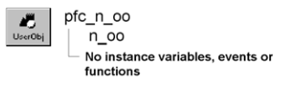

# n_oo

**Description**

OLEObject nonvisual user object ancestor.

**Ancestry**

**Library**

- PFCMAIN.PBL
- PFEMAIN.PBL

**Usage**

Use this nonvisual object instead of the standard PowerBuilder OLEObject object.

**See also**

- [n_ostg](n_ostg.md)
- [n_ostm](n_ostm.md)
