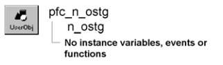

# n_ostg

**Description**

OLEStorage nonvisual user object ancestor.

**Ancestry**

**Library**

- PFCMAIN.PBL
- PFEMAIN.PBL

**Usage**

Use this nonvisual object instead of the standard PowerBuilder OLEStorage object.

**See also**

- [n_oo](n_oo.md)
- [n_ostm](n_ostm.md)
