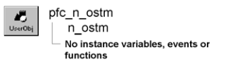

# n_ostm

**Description**

OLEStream nonvisual user object ancestor.

**Ancestry**

**Library**

- PFCMAIN.PBL
- PFEMAIN.PBL

**Usage**

Use this nonvisual object instead of the standard PowerBuilder OLEStream object.

**See also**

- [n_oo](n_oo.md)
- [n_ostg](n_ostg.md)

## Instance variables

N_ostm includes instance variables:

| Instance variable | Description | Data type | Access |
| --- | --- | --- | --- |
| ib_IsObsolete |  | Boolean | Protected |

