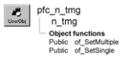

# n_tmg

**Description**

Timing nonvisual user object ancestor.

**Ancestry**



**Library**

- PFCMAIN.PBL
- PFEMAIN.PBL

**Object relationships**

- [n_cst_tmgmultiple](../09-custom-class-user-objects/n_cst_tmgmultiple.md)
- [n_cst_tmgsingle](../09-custom-class-user-objects/n_cst_tmgsingle.md)

**Usage**

Use this nonvisual object instead of the standard PowerBuilder Timing object.

**See also**

n_tr

## Instance variables

N_tmg includes instance variables:

| Instance variable | Description | Data type | Access | Usage |
| --- | --- | --- | --- | --- |
| ib_IsObsolete |  | Boolean | Protected |  |
| inv_multiple | Reference variable for multiple notify service | N_cst_tmgmultiple | Public | Call of_SetMultiple to enable |
| inv_single | Reference variable for single notify service | N_cst_tmgsingle | Public | Call of_SetSingle to enable |

## Events

N_tmg includes these events:

### Destructor

**Description**

Clean anything that has been created or opened by the service.

**Syntax**

```
instancename.EVENT Destructor ( )
```

| Argument | Description |
| --- | --- |
| *instancename* | Instance name of n_tmg |

**Return value**

None.

### Timer

**Description**

Processes timer.

**Syntax**

```
instancename.EVENT Timer ( )
```

| Argument | Description |
| --- | --- |
| *instancename* | Instance name of n_tmg |

**Return value**

None.

## Functions

N_tmg includes precoded object functions:

- of_SetMultiple
- of_SetSingle

### of_SetMultiple

**Description**

Enables or disables n_cst_tmgmultiple, which provides the multiple notify service.

**Access**

Public

**Syntax**

```
instancename.of_SetMultiple ( boolean )
```

| Argument | Description |
| --- | --- |
| *instancename* | Instance name of n_tmg |
| *boolean* | Boolean specifying whether to enable (TRUE) or disable (FALSE) an instance of the n_cst_tmgmultiple object |

**Return value**

Integer. Returns 1 if the function succeeds and -1 if an error occurs.

**Usage**

You cannot use both n_cst_tmgsingle and n_cst_tmgmultiple at the same time.

**Examples**

This example calls the of_SetMultiple function:

```
Integer  li_return

li_return = itmg_timer.of_SetMultiple(TRUE)
IF li_return = -1 THEN
       MessageBox("Timer", "Error with of_SetMultiple")
END IF
```

### of_SetSingle

**Description**

Enables or disables n_cst_tmgsingle, which provides the single notify service.

**Access**

Public

**Syntax**

```
instancename.of_SetSingle ( boolean )
```

| Argument | Description |
| --- | --- |
| *instancename* | Instance name of n_tmg |
| *boolean* | Boolean specifying whether to enable (TRUE) or disable (FALSE) an instance of the n_cst_tmgsingle object |

**Return value**

Integer. Returns 1 if the function succeeds and -1 if an error occurs.

**Usage**

You cannot use both n_cst_tmgsingle and n_cst_tmgmultiple at the same time.

**Examples**

This example calls the of_SetSingle function:

```
Integer  li_return

li_return = itmg_timer.of_SetSingle(TRUE)
IF li_return = -1 THEN
       MessageBox("Timer", "Error with of_SetSingle")
END IF
```
