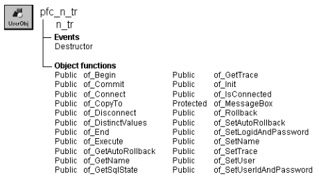

# n_tr

**Description**

Transaction object for use with all PFC applications. You can use this object as is, or create DBMS- or application-specific descendants that include customized or extended functionality.

N_tr includes integration with the SQL Spy debugging service.

For more information on using SQL Spy, see the *PFC User’s Guide*.

**Ancestry**



**Library**

- PFCMAIN.PBL
- PFEMAIN.PBL

**Object relationships**

n_cst_trregistration

**Usage**

Use n_tr functions instead of native SQL transaction management statements. For example, to connect to the database, use of_Connect instead of the CONNECT statement.

To register an n_tr-based Transaction object with the transaction registration service, call the n_cst_trregistration of_Register function.

To use n_tr:

1. If the Transaction object is not SQLCA, create it:

   ```
   // Assumes an itr_security instance variable
   itr_security = CREATE n_tr
   ```

2. (Optional) If you are using the transaction registration service:
   - Register all Transaction objects:

     ```
     gnv_app.inv_trregistration.of_Register(SQLCA)
     // Assumes an itr_security instance variable
     gnv_app.inv_trregistration.of_Register &
            (itr_security)
     ```

   - Establish a transaction name for use with the transaction registration service:

     ```
     // Assumes an itr_security instance variable
     SQLCA.of_SetName("SQLCA")
     itr_security.of_SetName("Security")
     ```

3. Initialize the ib_autorollback instance variable, which specifies what to do if the application closes (or the object is otherwise destroyed) while the transaction is still connected:

   ```
   SQLCA.of_SetAutoRollback(TRUE)
   itr_security.of_SetAutoRollback(FALSE)
   ```

4. Call n_tr functions as needed.

**See also**

n_cst_trregistration

## Instance variables

N_tr includes instance variables:

| Instance variable | Description | Data type | Access | Usage |
| --- | --- | --- | --- | --- |
| CST_FILETYPE_INI | Constant set to 1 | Integer | Public |  |
| CST_FILETYPE_XML | Constant set to 2 | Integer | Public |  |
| ib_autorollback | Specifies whether the Destructor event issues a COMMIT or a ROLLBACK if the transaction is still connected | Boolean | Protected | The Destructor event uses this event to determine whether to call of_Commit or of_Rollback: • TRUE — Call of_Rollback • FALSE (default) — Call of_Commit |
|  |  |  |  | Set with of_SetAutoRollback. This controls how n_tr handles transactions if the application closes (or the object is otherwise destroyed) while the transaction is still connected |
| ib_IsObsolete |  | Boolean | Protected |  |
| ib_trace | Specifies whether trace is enabled | Boolean | Protected | Call of_GetTrace to access this value (default is FALSE) |
| is_name | A name used to identify the transaction | String | Protected | You can reuse transactions between windows by passing this value (using OpenWithParm) when opening a new window. The new window can use the passed value with the n_cst_trregistration of_GetByName function to access the Transaction object |
|  |  |  |  | Call of_GetName and of_SetName to access this value |

## Events

N_tr includes a precoded event:

Destructor

### Destructor

**Description**

If the instance is still connected to a database, this event commits or rolls back the transaction, depending on the ib_autorollback instance variable. It then disconnects the transaction.

**Usage**

This event’s functionality is meant to ensure efficient use of system resources. However, it’s best to commit, rollback, and disconnect explicitly using this object’s of_Commit, of_Rollback, and of_Disconnect functions.

## Functions

N_tr includes precoded object functions:

- of_Begin
- of_Commit
- of_Connect
- of_CopyTo
- of_Disconnect
- of_DistinctValues
- of_End
- of_Execute
- of_GetAutoRollback
- of_GetName
- of_GetSqlState
- of_GetTrace
- of_Init
- of_init_xml
- of_IsConnected
- of_MessageBox
- of_Restore
- of_Rollback
- of_SetAutoRollback
- of_SetLogidAndPassword
- of_SetName
- of_SetTrace
- of_SetUser
- of_SetUserIdAndPassword

### of_Begin

**Description**

Empty function into which you can code DBMS-specific BEGIN TRANSACTION statements in n_tr descendants.

**Access**

Public

**Syntax**

```
instancename.of_Begin ( )
```

| Argument | Description |
| --- | --- |
| *instancename* | Instance name of n_tr |

**Return value**

Long. Always returns -1. Add DBMS-specific returns values in your n_tr descendant.

**Usage**

Call this function to begin a database transaction.

You should connect to the database before issuing this function. Use of_Connect to connect to the database.

### of_Commit

**Description**

Issues a COMMIT statement.

**Access**

Public

**Syntax**

```
instancename.of_Commit ( )
```

| Argument | Description |
| --- | --- |
| *instancename* | Instance name of n_tr |

**Return value**

Long. Returns the SQLCODE value from the COMMIT statement.

**Usage**

Call this function instead of the COMMIT statement to make any changes to the database permanent and end a logical unit of work.

**Examples**

This example calls the of_Commit function:

```
IF dw_sheet.Update( ) = -1 THEN
       itr_trans.of_Rollback( )
       MessageBox("Update", "Update failed")
ELSE
       itr_trans.of_Commit( )
       gnv_app.of_GetFrame( ).SetMicroHelp &
      ("Update succeeded")
END IF
```

### of_Connect

**Description**

Connects to the database.

**Access**

Public

**Syntax**

```
instancename.of_Connect ( )
```

| Argument | Description |
| --- | --- |
| *instancename* | Instance name of n_tr |

**Return value**

Long. Returns the SQLCODE value from the CONNECT statement.

**Usage**

Call this function instead of the CONNECT statement to connect the transaction to the database.

You must initialize the Transaction object before calling this function. The fields initialized vary, depending on your DBMS. You can call the of_Init function to initialize the Transaction object.

**Examples**

This example initializes itr_security fields and connects to the database:

```
String  ls_dbms, ls_database, ls_logid, ls_logpass
String  ls_servername
Long    ll_return

itr_security.DBMS = "Syb"
itr_security.Database = "agora"
itr_security.LogID = "williamk"
itr_security.LogPass = "billpass"
itr_security.ServerName = "MUSTANG"

ll_return = itr_security.of_Connect()
IF ll_return <> 0 THEN
       MessageBox("Connect", "Connect error")
END IF
```

### of_CopyTo

**Description**

Copies the contents of the Transaction object to the specified Transaction object.

**Access**

Public

**Syntax**

```
instancename.of_CopyTo ( targettrans )
```

| Argument | Description |
| --- | --- |
| *instancename* | Instance name of n_tr |
| *targettrans* | N_tr-based Transaction object to which the function copies values |

**Return value**

Integer. Returns 1 if the function succeeds and -1 if an error occurs.

**Usage**

Call this function to copy contents from one Transaction object to another. Call this function instead of simply assigning one object to another (which copies a reference, not the values).

**Examples**

This example calls the of_CopyTo function (it assumes an itr_back instance variable):

```
Integer  li_return

li_return = SQLCA.of_CopyTo(itr_back)
...
```

### of_Disconnect

**Description**

Disconnects from the database.

**Access**

Public

**Syntax**

```
instancename.of_Disconnect ( )
```

| Argument | Description |
| --- | --- |
| *instancename* | Instance name of n_tr |

**Return value**

Long. Returns the SQLCODE value from the DISCONNECT statement.

**Usage**

Call this function instead of the DISCONNECT statement to disconnect the transaction from the database.

Be sure to check the return value to ensure that the function succeeded.

**Examples**

This example disconnects from the database:

```
Long  ll_return

ll_return = itr_security.of_Disconnect()
IF ll_return <> 0 THEN
       MessageBox("Disconnect", "Disconnect error")
END IF
```

### of_DistinctValues

**Description**

Retrieves distinct values for the specified database column.

**Access**

Public

**Syntax**

```
instancename.of_DistinctValues ( table, column, values )
```

| Argument | Description |
| --- | --- |
| *instancename* | Instance name of n_tr |
| *table* | String specifying the database table |
| *column* | String specifying the column for which the function returns distinct values |
| *values* | Unbounded string array into which the function places distinct values for *column* |

**Return value**

Long. Returns the number of elements in the *values* array.

**Examples**

This calls the of_DistinctValues function:

```
Long  ll_return
String  ls_values[ ]
ll_return = SQLCA.of_DistinctValues &
       ("employee", "dept_id", ls_values)
...
```

### of_End

**Description**

Empty function into which you can code DBMS-specific END TRANSACTION statements in n_tr descendants.

**Access**

Public

**Syntax**

```
instancename.of_End ( )
```

| Argument | Description |
| --- | --- |
| *instancename* | Instance name of n_tr |

**Return value**

Long. Always returns -1. Add DBMS-specific returns values in your n_tr descendant.

**Usage**

Call this function to end a database transaction.

### of_Execute

**Description**

Executes a specified SQL statement.

**Access**

Public

**Syntax**

```
instancename.of_Execute ( sqlstatement )
```

| Argument | Description |
| --- | --- |
| *instancename* | Instance name of n_tr |
| *sqlstatement* | String containing the SQL statement to execute |

**Return value**

Long. Returns the SQLCODE returned by the EXECUTE IMMEDIATE statement. A value of -10 indicates that there is no database connection.

**Examples**

This example calls the of_Execute function:

```
Long  ll_return
String  ls_sql

ls_sql = "DELETE from employee WHERE dept_id = 100"
ll_return = SQLCA.of_Execute(ls_sql)
...
```

### of_GetAutoRollback

**Description**

Reports whether autorollback is enabled.

**Access**

Public

**Syntax**

```
instancename.of_GetAutoRollback ( )
```

| Argument | Description |
| --- | --- |
| *instancename* | Instance name of n_tr |

**Return value**

Boolean. Returns TRUE if autorollback is enabled and FALSE if it is not.

**Examples**

This example calls the of_GetAutoRollback function:

```
IF SQLCA.of_GetAutoRollback() THEN
       MessageBox("Transaction", &
      "Autorollback is enabled")
ELSE
       MessageBox("Transaction", &
      "Autorollback is disabled")
END IF
```

### of_GetName

**Description**

Retrieves the transaction name, as specified by the of_SetName function.

**Access**

Public

**Syntax**

```
instancename.of_GetName ( )
```

| Argument | Description |
| --- | --- |
| *instancename* | Instance name of n_tr |

**Return value**

String. Returns the transaction name.

**Usage**

N_cst_trregistration functions call this function to access the Transaction object name.

**Examples**

This example is from the n_cst_trregistration of_GetByName function:

```
...
FOR li_cnt = 1 to li_upperbound
  IF istr_trans[li_cnt].b_used AND &
    IsValid (istr_trans[li_cnt].tr_object) THEN
      ls_name = &
        istr_trans[li_cnt].tr_object.of_GetName()
        IF ls_name = as_name THEN
          atr_obj = istr_trans[li_cnt].tr_object
          lb_found = TRUE
          EXIT
        END IF
  END IF
NEXT
...
```

### of_GetSqlState

**Description**

Retrieves the SQL state string returned by the DBMS.

**Access**

Public

**Syntax**

```
instancename.of_GetSqlState ( )
```

| Argument | Description |
| --- | --- |
| *instancename* | Instance name of n_tr |

**Return value**

String. Returns the SQL state string returned by the DBMS.

**Examples**

This example calls the of_GetSqlState function:

```
String  ls_sqlstate

ls_sqlstate = SQLCA.of_GetSqlState()
MessageBox("SQL State", &
       "SQL state is: " + ls_sqlstate)
```

### of_GetTrace

**Description**

Reports whether the PowerBuilder DBMS trace is enabled.

**Access**

Public

**Syntax**

```
instancename.of_GetTrace ( )
```

| Argument | Description |
| --- | --- |
| *instancename* | Instance name of n_tr |

**Return value**

Boolean. Returns TRUE if trace is enabled and FALSE if it is not.

**Examples**

This example calls the of_GetTrace function:

```
IF SQLCA.of_GetTrace() THEN
       MessageBox("Transaction", "Trace is enabled")
ELSE
       MessageBox("Transaction", "Trace is disabled")
END IF
```

### of_Init

**Description**

Initializes the n_tr-based Transaction object with the passed values.

**Access**

Public

**Syntax**

```
instancename.of_Init ( fileorkey, section )
```

| Argument | Description |
| --- | --- |
| *instancename* | Instance name of n_tr |
| *fileorkey* | String specifying the name of the ini file or registry key containing connection information. If you specify an INI file, you must also specify *section* |
| *section* | String specifying the INI file section containing connection information. If *fileorkey* specifies a registry key, you cannot specify this value |

**Return value**

Integer. Returns 1 if the function succeeds and -1 if an error occurs.

**Usage**

Call this function to initialize n_tr before connecting to the database. The INI-file section or registry key must include the following keywords (with DBMS-specific values as appropriate):

- DBMS
- Database
- LogID
- LogPass
- ServerName
- UserID
- DatabasePassword
- Lock
- DbParm

**Examples**

This example calls the of_Init function:

```
String  ls_file, ls_section
Long    ll_return

ls_file = "c:\pbapp\pbapp.ini"
ls_section = "securityDB"

itr_security.of_Init &
       (ls_file, ls_section)
ll_return = itr_security.of_Connect()
IF ll_return <> 0 THEN
       MessageBox("Connect", "Connect error")
END IF
```

### of_init_xml

**Description**

No description is available.

**Access**

Public

**Syntax**

```
instancename.of_init_xml ( as_xmlfile, as_inisectionxmlroot )
```

| Argument | Description |
| --- | --- |
| *instancename* | Instance name of n_tr |
| *as_xmlfile* | String. |
| *as_inisectionxmlroot* | String. |

**Return value**

Integer.

### of_IsConnected

**Description**

Determines whether the n_tr instance is connected to a database.

**Access**

Public

**Syntax**

```
instancename.of_IsConnected ( )
```

| Argument | Description |
| --- | --- |
| *instancename* | Instance name of n_tr |

**Return value**

Boolean. Returns TRUE if the n_tr instance is connected to a database and FALSE if it is not.

**Examples**

This example calls the of_IsConnected function:

```
Long  ll_return

IF NOT itr_security.of_IsConnected() THEN
       ll_return = itr_security.of_Connect( )
       IF ll_return <> 0 THEN
       MessageBox("Connect", "Connect error")
       END IF
END IF
```

### of_MessageBox

**Description**

Displays a MessageBox.

**Access**

Protected

**Syntax**

```
instancename.of_MessageBox ( id, title, message, icon, button, default )
```

| Argument | Description |
| --- | --- |
| *instancename* | Instance name of n_tr |
| *id* | String specifying an ID for the message |
| *title* | String specifying the title of the MessageBox |
| *message* | String specifying the message text |
| *icon* | Icon enumerated data type indicating the icon you want to display on the left side of the message box. Values are: |
|  | • Information! |
|  | • StopSign! |
|  | • Exclamation! |
|  | • Question! |
|  | • None! |
| *button* | Button enumerated data type indicating the set of CommandButtons you want to display at the bottom of the message box. The buttons are numbered in the order listed in the enumerated data type. Values are: |
|  | • OK! |
|  | • OKCancel! |
|  | • YesNo! |
|  | • YesNoCancel! |
|  | • RetryCancel! |
|  | • AbortRetryIgnore! |
| *default* | Integer specifying the number of the button you want to be the default button |

**Return value**

Integer. Returns 1 if the function succeeds and -1 if an error occurs.

**Usage**

Override this function to control MessageBox behavior in Transaction objects.

The *id* argument is not used in the default implementation.

**Examples**

This example calls the of_MessageBox function:

```
of_Messagebox(’tr_dberror’,’Save’, &
   as_error, StopSign!, Ok!, 1)
...
```

### of_Restore

**Description**

Perform the actual Get from the .Ini or .Xml File.

**Access**

Protected

**Syntax**

```
instancename.of_Restore ( ai_filetype, as_keyoriniorxml, as_inisectionxmlroot, as_subkeyelement, as_value, as_default )
```

| Argument | Description |
| --- | --- |
| *instancename* | Instance name of n_tr |
| *ai_filetype* | Integer. Function behavior. - use the registry, an .ini or .xml file. |
| *as_keyoriniorxml* | String. The KeyName for use with the Registry , the Ini or XML file name for use with an .Ini or .Xml File. |
| *as_inisectionxmlroot* | String. The name of the .Ini section. or Xml Root. |
| *as_subkeyelement* | String. The key/element value to be used on either the Registry , .Ini or .Xml file. |
| *as_value* | String, passed by reference. The value to be restored from either the Registry, .Ini or .Xml file Passed by reference. |
| *as_default* | String. Used also as a default value, if the desired value is not found. |

**Return value**

Integer. 1 if it succeeds. 0 if the default value was used. -1 if an error occurs.

### of_Rollback

**Description**

Rolls back the database transaction.

**Access**

Public

**Syntax**

```
instancename.of_Rollback ( )
```

| Argument | Description |
| --- | --- |
| *instancename* | Instance name of n_tr |

**Return value**

Long. Returns 0 if the function succeeds, -10 if the transaction is not connected and any other nonzero value if an error occurs.

**Usage**

Call this function instead of the ROLLBACK statement to reverse all uncommitted changes.

**Examples**

This example calls the of_Rollback function:

```
IF dw_sheet.Update() = -1 THEN
       itr_trans.of_Rollback()
       MessageBox("Update", "Update failed")
ELSE
       itr_trans.of_Commit()
       gnv_app.of_GetFrame().SetMicroHelp &
       ("Update succeeded")
END IF
```

### of_SetAutoRollback

**Description**

Controls whether autorollback is enabled.

If autorollback is enabled, the n_tr Destructor event issues a ROLLBACK for a connected transaction. If autorollback is disabled, the n_tr Destructor event issues a COMMIT.

**Access**

Public

**Syntax**

```
instancename.of_SetAutoRollback ( boolean )
```

| Argument | Description |
| --- | --- |
| *instancename* | Instance name of n_tr |
| *boolean* | Boolean indicating whether autorollback is enabled (TRUE) or not (FALSE) |

**Return value**

Integer. Returns 1 if the function succeeds and -1 if an error occurs.

**Examples**

This example calls the of_SetAutoRollback function:

```
SQLCA.of_SetAutoRollback(TRUE)
```

### of_SetLogidAndPassword

**Description**

Sets the property values of the Transaction object for LogID and LogPass.

**Access**

Public

**Syntax**

```
instancename.of_SetLogidAndPassword ( loginid , logpassword )
```

| Argument | Description |
| --- | --- |
| *instancename* | Instance name of n_tr |
| *loginid* | String specifying the name of the login ID |
| *logpassword* | String specifying the name of the login password |

**Return value**

None

**See also**

- of_Init
- of_SetUser
- of_SetUserIdAndPassword

### of_SetName

**Description**

Specifies the transaction name, which is used by the transaction registration service.

**Access**

Public

**Syntax**

```
instancename.of_SetName ( name )
```

| Argument | Description |
| --- | --- |
| *instancename* | Instance name of n_tr |
| *name* | String specifying a name for the transaction |

**Return value**

Integer. Returns 1 if the function succeeds and -1 if an error occurs.

**Usage**

Call this function to specify a transaction name when you are using the transaction registration service.

**Examples**

This example calls the of_SetName function:

```
SQLCA.of_SetName("SQLCA")
itr_security.of_SetName("Security")
```

### of_SetTrace

**Description**

Specifies whether the PowerBuilder DBMS trace is enabled.

**Access**

Public

**Syntax**

```
instancename.of_SetTrace ( boolean )
```

| Argument | Description |
| --- | --- |
| *instancename* | Instance name of n_tr |
| *boolean* | Boolean specifying whether trace is enabled (TRUE) or not (FALSE) |

**Return value**

Integer. Returns 1 if the function succeeds, 0 if trace is already in the specified state, and -1 if an error occurs.

**Examples**

This example calls the of_SetTrace function to enable trace:

```
SQLCA.of_SetTrace(TRUE)
```

### of_SetUser

**Description**

Specifies the DBMS user ID and password (DBPass).

**Access**

Public

**Syntax**

```
instancename.of_SetUser ( userid, password )
```

| Argument | Description |
| --- | --- |
| *instancename* | Instance name of n_tr |
| *userid* | String specifying the user ID (Transaction object UserID property) |
| *password* | String specifying the password (Transaction object DBPass property) |

**Return value**

None

**Usage**

Use this function for ODBC database connections. For native connections, use of_SetLogidAndPassword or of_SetUserIdAndPassword, depending on the DBMS.

**Examples**

This example, which is from an n_cst_appmanager pfc_Logon event, calls the of_SetUser function:

```
SQLCA.of_SetUser(as_userid, as_password)
IF SQLCA.of_Connect() >= 0 THEN
       Return 1
ELSE
       MessageBox (iapp_object.DisplayName, &
       "Connect failed")
       Return -1
END IF
```

**See also**

- of_SetLogidAndPassword
- of_SetUserIdAndPassword

### of_SetUserIdAndPassword

**Description**

Sets the property values of the Transaction object for UserID and DBPass.

**Access**

Public

**Syntax**

```
instancename.of_SetUserIDAndPassword ( userid , password )
```

| Argument | Description |
| --- | --- |
| *instancename* | Instance name of n_tr |
| *userid* | String specifying the name of the user’s login ID |
| *password* | String specifying the name of the user’s login password |

**Return value**

None

**See also**

- of_Init
- of_SetLogidAndPassword
- of_SetUser
