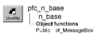

# n_base

**Description**

Ancestor object for all PFC custom class user objects.

**Ancestry**



**Library**

- PFCMAIN.PBL
- PFEMAIN.PBL

**Usage**

PFC uses this object as the ancestor for all custom class user objects.

**Descendants**

All PFC custom class user objects descend from n_base.

**See also**

u_base

## Instance variables

N_base includes instance variables:

| Instance variable | Description | Data type | Access | Usage |
| --- | --- | --- | --- | --- |
| CONTINUE_ACTION | Constant set to 1 | Integer | Public | Internal |
| FAILURE | Constant set to -1 | Integer | Public | Internal |
| NO_ACTION | Constant set to 0 | Integer | Public | Internal |
| PREVENT_ACTION | Constant set to 0 | Integer | Public | Internal |
| SUCCESS | Constant set to 1 | Integer | Public | Internal |

## Functions

N_base includes a precoded function:

of_MessageBox

### of_MessageBox

**Description**

Displays a MessageBox.

**Access**

Protected

**Syntax**

```
instancename.of_MessageBox ( id, title, message, icon, button, default )
```

| Argument | Description |
| --- | --- |
| *instancename* | Instance name of n_base |
| *id* | String specifying an ID for the message |
| *title* | String specifying the title of the MessageBox |
| *message* | String specifying the message text |
| *icon* | Icon enumerated data type indicating the icon you want to display on the left side of the message box. Values are: |
|  | • Information! |
|  | • StopSign! |
|  | • Exclamation! |
|  | • Question! |
|  | • None! |
| *button* | Button enumerated data type indicating the set of CommandButtons you want to display at the bottom of the message box. The buttons are numbered in the order listed in the enumerated data type. Values are: |
|  | • OK! |
|  | • OKCancel! |
|  | • YesNo! |
|  | • YesNoCancel! |
|  | • RetryCancel! |
|  | • AbortRetryIgnore! |
| *default* | Integer specifying the number of the button you want to be the default button |

**Return value**

Integer. Returns 1 if the function succeeds -1 if an error occurs.

**Usage**

Override this function to control MessageBox behavior in PFC custom class user objects. You can either override this function in n_base (which affects all PFC custom class user objects) or override it in the extension level of an individual custom class user object.

The *id* argument is not used in the default implementation.

**Examples**

This example is from the n_cst_luw of_DBError function:

```
of_Messagebox(’pfc_luw_dberror’,’Save’, &
   as_error, StopSign!, Ok!, 1)
...
```
