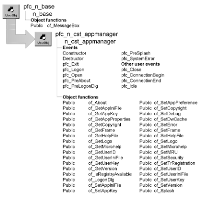

# n_cst_appmanager

**Description**

N_cst_appmanager is the application manager and functions as a substitute for the Application object. It contains many useful functions as well as reference variables for application services.

**Ancestry**



**Library**

- PFCAPSRV.PBL
- PFEAPSRV.PBL

**Object relationships**

- [n_cst_apppreference](n_cst_apppreference.md)
- [n_cst_debug](n_cst_debug.md)
- [n_cst_dwcache](n_cst_dwcache.md)
- [n_cst_error](n_cst_error.md)
- [n_cst_mru](n_cst_mru.md)
- [n_cst_security](n_cst_security.md)
- [n_cst_trregistration](n_cst_trregistration.md)
- w_about
- [w_frame](../02-window-objects/w_frame.md)
- w_logon
- w_splash

**Usage**

To use n_cst_appmanager:

1. (Optional) Access the extension-level n_cst_appmanager user object and create a descendant application manager.
2. Define a global variable, gnv_app, of type n_cst_appmanager (or your customized descendant).

   ```
   n_cst_appmanager   gnv_app
   ```

3. Add PowerScript code to your application’s Open event to create an instance of n_cst_appmanager and call the pfc_Open event, passing the commandline argument:

   ```
   gnv_app = CREATE n_cst_appmanager
   gnv_app.Event pfc_Open(commandline)
   ```

4. Add PowerScript code to the Constructor event to selectively enable application services:

Preference service—of_SetAppPreference Debug service—of_SetDebug DataWindow caching service—of_SetDwCache Most recently used object service—of_SetMRU Error handling service—of_SetError Transaction registration service—of_SetTrRegistration Security service—of_SetSecurity

5. Add PowerScript code to the pfc_Open event to open the initial window.
6. Add code to the Constructor event in n_cst_appmanager (or your customized descendant) to initialize instance variables for version, company, and INI file.

**See also**

- [n_cst_apppreference](n_cst_apppreference.md)
- [n_cst_debug](n_cst_debug.md)
- [n_cst_dwcache](n_cst_dwcache.md)
- [n_cst_error](n_cst_error.md)
- [n_cst_mru](n_cst_mru.md)
- [n_cst_security](n_cst_security.md)
- [n_cst_trregistration](n_cst_trregistration.md)

## Instance variables

N_cst_appmanager includes instance variables:

| Instance variable | Description | Data type | Access | Usage |
| --- | --- | --- | --- | --- |
| iapp_object | Application object associated with n_cst_appmanager | Application | Public | Use to access application attributes |
| ib_microhelp | Reports whether the application supports MicroHelp | Boolean | Protected | Call of_GetMicrohelp and of_SetMicrohelp to access |
| ienv_object | The Environment object, which contains information such as screen height, screen width, and operating system | Environment | Public | Use instead of repeated calls to the GetEnvironment function |
| inv_apppref | Reference variable for the preference service | n_cst_apppreference | Public | Use in dot notation to access n_cst_apppreference functions |
| inv_debug | Reference variable for the debug service | n_cst_debug | Public | Use in dot notation to access n_cst_debug functions |
| inv_dwcache | Reference variable for data caching services | n_cst_dwcache | Public | Use in dot notation to access n_cst_dwcache functions |
| inv_error | Reference variable for the error service | n_cst_error | Public | Use in dot notation to access n_cst_error functions |
| inv_help | Reference variable for the help service (PFC 2025 and later) | n_cst_help | Public | Use in dot notation to access n_cst_help functions |
| inv_language | Reference variable for the language service (PFC 2025 and later) | n_cst_language | Public | Use in dot notation to access n_cst_language functions |
| inv_mru | Reference variable for the most recently used object service | n_cst_mru | Public | Use in dot notation to access n_cst_mru functions |
| inv_security | Reference variable for the security service | n_cst_security | Public | Use in dot notation to access n_cst_security functions |
| inv_trregistration | Reference variable for the transaction registration service | n_cst_trregistration | Public | Use in dot notation to access n_cst_trregistration functions |
| is_appinifile | The name of the application INI file | String | Protected | Use in profile functions (such as ProfileString) to specify the name of the application INI file (typically includes database connection profile) |
|  |  |  |  | Call of_GetAppIniFile and of_SetAppIniFile to access |
| is_appkey | The name of the registry key for application information | String | Protected | Use in PowerScript functions (such as RegistryGet) to specify the name of the application’s registry key (typically includes database connection profile) |
|  |  |  |  | Call of_GetAppKey and of_SetAppKey to access |
| is_copyright | Application-specific copyright information | String | Protected | Call of_GetCopyright and of_SetCopyright to access |
|  |  |  |  | The w_about window displays this variable automatically |
| is_helpfile | The name of the application’s Help file | String | Protected | Use in the ShowHelp function |
|  |  |  |  | Call of_GetHelpFile and of_SetHelpFile access |
| is_logo | The name of the image displayed in the application’s About box | String | Protected | Call of_GetLogo and of_SetLogo to access |
| is_userid | User information | String | Protected | Call of_GetUserID and of_SetUserID to access |
| is_userinifile | The name of the user INI file | String | Protected | Use in profile functions (such as ProfileString) to access information in the user INI file (typically contains user-specific information, such as toolbar settings and window position) |
|  |  |  |  | Call of_GetUserIniFile and of_SetUserIniFile to access |
| is_userkey | The name of the registry key for user information | String | Protected | User information (typically includes toolbar settings and window position) |
|  |  |  |  | Call of_GetUserKey and of_SetUserKey to access |
| is_version | Application-specific version information | String | Protected | Call of_GetVersion and of_SetVersion to access |
|  |  |  |  | The w_about window displays this variable automatically |
| iw_frame | Frame window | w_frame | Protected | Use to get the active frame window |
|  |  |  |  | This is set automatically in the w_frame Activate event |
|  |  |  |  | Call of_GetFrame to access |

## Events

N_cst_appmanager includes precoded events:

- Constructor
- Destructor
- pfc_Close
- pfc_ConnectionBegin
- pfc_ConnectionEnd
- pfc_Exit
- pfc_Idle
- pfc_Logon
- pfc_Open
- pfc_PreAbout
- pfc_PreLogonDlg
- pfc_PreSplash
- pfc_SystemError

### Constructor

**Description**

Initializes the iapp_object and ienv_object instance variables.

**Usage**

Initialize application-wide instance variables in this event. Depending on your application’s needs, you initialize the following:

| Instance variable | Initialization function |
| --- | --- |
| is_appinifile | of_SetAppIniFile |
| is_appkey | of_SetAppKey |
| is_appinifile | of_SetAppIniFile |
| is_helpfile | of_SetHelpFile |
| is_userinifile | of_SetUserIniFile |
| is_userkey | of_SetUserKey |
| is_version | of_SetVersion |

**Examples**

This example initializes selected instance variables:

```
of_SetAppIniFile("c:\eis\eisapp.ini")
of_SetUserIniFile("c:\eis\eisuser.ini")
of_SetHelpFile("c:\eis\eis.hlp")
of_SetVersion("1.1")
```

### Destructor

**Description**

Destroys the service objects associated with an instance of n_cst_appmanager.

**Usage**

Use this event to destroy any other user objects associated with n_cst_appmanager.

**Examples**

This example checks for the existence of the inv_app_logic custom class user object and destroys it if an instance exists:

```
IF IsValid(gnv_app.inv_app_logic) THEN
   DESTROY gnv_app.inv_app_logic
END IF
```

### pfc_Close

**Description**

Application manager Close event.

**Usage**

To use this event:

1. Call pfc_Close from the application object’s Close event.
2. Add application close logic to pfc_Close.

**Examples**

This example disconnects from the database:

```
Integer   li_return

IF IsValid itr_app_trans THEN
   li_return = itr_app_trans.of_Disconnect()
   IF li_return <> 0 THEN
   MessageBox("Disconnect Error", &
      itr_app_trans.SqlErrText)
   END IF
END IF
```

### pfc_ConnectionBegin

**Description**

Application manager ConnectionBegin event. The ConnectionBegin event is triggered by a distributed application when a client application attempts to establish a connection to a server application. This event is triggered only in a server application running in a distributed computing environment.

**Syntax**

```
instancename.EVENT pfc_ConnectionBegin ( userid, password,
connectstring )
```

| Argument | Description |
| --- | --- |
| *instancename* | Global variable of type n_cst_appmanager (must be gnv_app) |
| *userid* | String specifying the user ID. From within the pfc_ConnectionBegin event, access this value through the *as_userid* argument |
| *password* | String specifying the password. From within the pfc_ConnectionBegin event, access this value through the *as_password* argument |
| *connectstring* | String containing the connectstring. From within the pfc_ConnectionBegin event, access this value through the *as_connectstring* argument |

**Return value**

ConnectPrivilege. Returns one of the following:

- ConnectPrivilege!
- ConnectWithAdminPrivilege!
- NoConnectPrivilege!

**Usage**

To use this event:

1. Call pfc_ConnectionBegin from the application object’s ConnectionBegin event, passing the *userid*, *password*, and *connectstring* arguments.
2. Add connection logic to pfc_ConnectionBegin, returning the appropriate connect privilege.
3. In the application object’s ConnectionBegin event, return the connect privilege.

For more information on distributed computing, see *Application Techniques*.

**Examples**

This example returns the client’s connection privilege:

```
CHOOSE CASE as_userid
   CASE "adm"
   Return ConnectWithAdminPrivilege!
   CASE "ctl","mmw","jdb"
   Return ConnectPrivilege!
   CASE ELSE
   Return NoConnectPrivilege!
END CHOOSE
```

### pfc_ConnectionEnd

**Description**

Application manager ConnectionEnd event. The ConnectionEnd event is triggered by a distributed application when a client application’s connection is terminated. This event is triggered only in a server application running in a distributed computing environment.

**Usage**

To use this event:

1. Call pfc_ConnectionEnd from the application object's ConnectionEnd event.
2. Add logic to pfc_ConnectionEnd.

For more information on distributed PowerBuilder, see *Application Techniques*.

**Examples**

This example disconnects from the database:

```
Integer   li_return

IF IsValid itr_app_trans THEN
   li_return = itr_app_trans.of_Disconnect()
END IF
```

### pfc_Exit

**Description**

Event to close the frame window, shutting down the application.

**Usage**

Add code to this event to perform the appropriate end-of-application processing (for example, closing the frame window.)

**Examples**

This example closes the frame window:

```
w_frame   lw_frame

lw_frame = of_GetFrame()
Close(lw_frame)
```

### pfc_Idle

**Description**

Application manager Idle event.

**Usage**

To use this event:

1. Call pfc_Idle from the application object's Idle event.
2. Add application idle logic to pfc_Idle.

**Examples**

This example triggers the pfc_Exit event to shut down the application when the pfc_Idle event is triggered:

```
this.Event pfc_Exit()
```

### pfc_Logon

**Description**

Application manager logon event. This event is called by the w_logon dialog box when the user clicks OK.

**Syntax**

```
instancename.EVENT pfc_Logon ( userid, password )
```

| Argument | Description |
| --- | --- |
| *instancename* | Global variable of type n_cst_appmanager (must be gnv_app) |
| *userid* | String specifying the user ID. From within the pfc_Logon event, access this value through the *as_userid* argument |
| *password* | String specifying the password. From within the pfc_Logon event, access this value through *as_password* argument |

**Return value**

Integer. Returns 1 if the logon succeeds and -1 if the logon fails.

**Usage**

Add code to use this event to log on to the database using the passed user ID and password.

**Examples**

This example takes the passed user ID and password and uses them to log on to the database (assuming an itr_default transaction object):

```
itr_default.of_SetUser(as_userid, as_password)
IF itr_default.of_Connect() >= 0 THEN
   Return 1
ELSE
   Return -1
END IF
```

### pfc_Open

**Description**

Application manager Open event.

**Syntax**

```
instancename.EVENT pfc_Open ( commandline )
```

| Argument | Description |
| --- | --- |
| *instancename* | Global variable of type n_cst_appmanager (must be gnv_app) |
| *commandline* | String containing the command-line options specified when the program was invoked |

**Usage**

To use this event:

1. Call pfc_Open from the Application object’s Open event (after creating gnv_app).
2. Add application open logic to pfc_Open.

**Examples**

This example enables transaction registration and opens the w_test_frame window:

```
// Enable transaction registration services
this.of_SetTrRegistration(TRUE)

// Register SQLCA
inv_trregistration.of_Register(SQLCA)

// Now open the frame
Open(w_test_frame)
```

### pfc_PreAbout

**Description**

Event to control display of the application’s About dialog box. This event copies application, logo, version, and copyright information to the n_cst_aboutattrib object, which is used in the About dialog box.

**Syntax**

```
instancename.EVENT pfc_PreAbout ( attributes )
```

| Argument | Description |
| --- | --- |
| *instancename* | Global variable of type n_cst_appmanager (must be gnv_app) |
| *attributes* | N_cst_aboutattrib variable into which the event places application, logo, version, and copyright information. This argument is accessed through the *anv_aboutattrib* argument (passed by reference) |

**Usage**

This event is triggered when the user selects Help>About in a menu that descends from the PFC m_master menu.

**Examples**

This example is from the of_About function:

```
n_cst_aboutattrib   lnv_aboutattrib

this.Event pfc_PreAbout(lnv_aboutattrib)
Return OpenWithParm (w_about, lnv_aboutattrib)
```

### pfc_PreLogonDlg

**Description**

Event to control display of the w_logon dialog box. This event copies information to the n_cst_logonattrib structure object.

**Syntax**

```
instancename.EVENT pfc_PreLogonDlg ( attributes )
```

| Argument | Description |
| --- | --- |
| *instancename* | Global variable of type n_cst_appmanager (must be gnv_app) |
| *attributes* | N_cst_logonattrib variable into which the event places user ID, application, and logo information. This argument is accessed through the *anv_logonattrib* argument (passed by reference) |

**Usage**

This event is called by the of_LogonDlg function. Extend or update *attributes* to control display of the w_logon dialog box.

**Examples**

This example is from the of_LogonDlg function:

```
Integer   li_rc
String    ls_userid
n_cst_logonattrib   lnv_logonattrib

this.Event pfc_PreLogonDlg(lnv_logonattrib)
...
```

### pfc_PreSplash

**Description**

Event to control display of the application’s splash screen.

**Syntax**

```
instancename.Event pfc_PreSplash ( attributes )
```

| Argument | Description |
| --- | --- |
| *instancename* | Global variable of type n_cst_appmanager (must be gnv_app) |
| *attributes* | N_cst_splashattrib variable into which the event places application, logo, version, and copyright information. This argument is accessed through the *anv_splashattrib* argument (passed by reference) |

**Usage**

This event is called by the of_Splash function.

This event copies application, logo, version, and copyright information to the n_cst_splashattrib object, which is used in the splash window.

**Examples**

This example is from the of_Splash function:

```
n_cst_splashattrib   lnv_splashattrib

lnv_splashattrib.ii_secondsvisible = &
   ai_secondsvisible
this.Event pfc_PreSplash(lnv_splashattrib)

OpenWithParm (w_splash, lnv_splashattrib)
```

### pfc_SystemError

**Description**

Application manager SystemError event.

**Usage**

To use this event:

1. Call pfc_SystemError from the application object’s SystemError event.
2. (Optional) Add system error logic to pfc_SystemError.

**Examples**

This example displays information from the Error object:

```
MessageBox("System Error", &
   "Error Number: " + String(Error.Number) &
   + "~r~n" &
   + "Message: " + Error.Text + "~r~n" &
   + "Where: " + Error.WindowMenu + "~r~n" &
   + "Object: " + Error.Object + "~r~n" &
   + "Event: " + Error.ObjectEvent + "~r~n" &
   + "Line: " + String(Error.Line) )
```

## Functions

N_cst_appmanager includes precoded object functions:

- of_About
- of_ApplyTheme
- of_GetAppIniFile
- of_GetAppKey
- of_GetCopyright
- of_GetFrame
- of_GetHelpFile
- of_GetLogo
- of_GetMicrohelp
- of_GetThemePath
- of_GetUserID
- of_GetUserIniFile
- of_GetUserKey
- of_GetVersion
- of_IsRegistryAvailable
- of_LogonDlg
- of_OpenIDLogonDlg (PFC 2025 and later)
- of_SetAppIniFile
- of_SetAppKey
- of_SetAppPreference
- of_SetCopyright
- of_SetDebug
- of_SetDwCache
- of_SetError
- of_SetFrame
- of_SetHelp (PFC 2025 and later)
- of_SetHelpFile
- of_SetLanguage (PFC 2025 and later)
- of_SetLogo
- of_SetMicrohelp
- of_SetMRU
- of_SetSecurity
- of_SetTrRegistration
- of_SetUserID
- of_SetUserIniFile
- of_SetUserKey
- of_SetVersion
- of_Splash

### of_About

**Description**

Displays the w_about dialog box.

**Access**

Public

**Syntax**

```
instancename.of_About ( )
```

| Argument | Description |
| --- | --- |
| *instancename* | Global variable of type n_cst_appmanager (must be gnv_app) |

**Return value**

Integer. Returns 1 if the function succeeds and -1 if an error occurs.

**Usage**

PFC calls this function when the user selects Help>About from the menu bar of a menu descended from the PFC m_master menu.

**Examples**

This example is from the m_master Help>About Clicked event:

```
IF IsValid (gnv_app) THEN
   gnv_app.of_About()
END IF
```

### of_ApplyTheme

**Description**

Applies a UI theme, remembers its folder, and refreshes the colors of the frame's status bar.

**Access**

Public

**Syntax**

```
instancename.of_ApplyTheme ( themepath )
```

| Argument | Description |
| --- | --- |
| *instancename* | Global variable of type n_cst_appmanager (must be gnv_app) |
| *themepath* | String specifying the full path of the theme's folder, or an empty string to remove the theme |

**Return value**

Integer. Returns 1 if it succeeds and -1 if ApplyTheme fails.

**Usage**

Use it instead of ApplyTheme: the PFC status bar, which UI themes don't style, takes its colors from the theme at once (n_cst_winsrv_statusbar of_RefreshThemeColors). A theme applied with ApplyTheme reaches the status bar at its next refresh.

### of_GetAppIniFile

**Description**

Retrieves the name of the application INI file as established by the of_SetAppIniFile function.

**Access**

Public

**Syntax**

```
instancename.of_GetAppIniFile ( )
```

| Argument | Description |
| --- | --- |
| *instancename* | Global variable of type n_cst_appmanager (must be gnv_app) |

**Return value**

String. Returns the is_appinifile instance variable, which contains the name of the application-level INI file (specified using the of_SetAppIniFile function).

**Usage**

Call this function in profile functions (such as ProfileString) to access information in the application INI file. The application INI file typically contains application wide information, such as the database connection profile.

**Examples**

This example uses the of_GetAppIniFile function to retrieve database connection information:

```
SQLCA.dbms=ProfileString &
   (gnv_app.of_GetAppIniFile(), &
   "Database","DBMS"," ")
SQLCA.database=ProfileString &
   (gnv_app.of_GetAppIniFile(), &
   "Database","Database"," ")
SQLCA.servername=ProfileString &
   (gnv_app.of_GetAppIniFile(), &
   "Database","ServerName"," ")
SQLCA.logid=ProfileString &
   (gnv_app.of_GetAppIniFile(), &
   "Database","LogID"," ")
SQLCA.logpass=ProfileString &
   (gnv_app.of_GetAppIniFile(), &
   "Database","LogPassword"," ")
```

### of_GetAppKey

**Description**

Retrieves the registry key for application information as established by the of_SetAppKey function.

**Access**

Public

**Syntax**

```
instancename.of_GetAppKey ( )
```

| Argument | Description |
| --- | --- |
| *instancename* | Global variable of type n_cst_appmanager (must be gnv_app) |

**Return value**

String. Returns the is_appkey instance variable.

**Examples**

This example calls the of_GetAppKey function:

```
String    ls_appkey

ls_appkey = gnv_app.of_GetAppKey()
MessageBox("Application", &
   "Application key is:~r~n" + ls_appkey)
```

### of_GetCopyright

**Description**

Retrieves the copyright statement as established by the of_SetCopyright function.

**Access**

Public

**Syntax**

```
instancename.of_GetCopyright ( )
```

| Argument | Description |
| --- | --- |
| *instancename* | Global variable of type n_cst_appmanager (must be gnv_app) |

**Return value**

String. Returns the is_copyright instance variable.

**Usage**

Call this function to access the application’s copyright statement, which is contained in the is_copyright instance variable.

**Examples**

This example calls the of_GetCopyright function:

```
String    ls_copyright

ls_copyright = gnv_app.of_GetCopyright()
MessageBox("Application", &
   "Copyright is:~r~n" + ls_copyright)
```

### of_GetFrame

**Description**

Retrieves the active frame window as established by the of_SetFrame function.

**Access**

Public

**Syntax**

```
instancename.of_GetFrame ( )
```

| Argument | Description |
| --- | --- |
| *instancename* | Global variable of type n_cst_appmanager (must be gnv_app) |

**Return value**

W_frame. Returns the application’s active frame window.

**Usage**

Call this function in PowerScript functions that require the frame window.

**Examples**

This example uses the of_GetFrame function in a SetMicroHelp function:

```
gnv_app.of_GetFrame().SetMicroHelp("Connecting...")
```

### of_GetHelpFile

**Description**

Retrieves the name of the application’s online Help file as established by the of_SetHelpFile function.

**Access**

Public

**Syntax**

```
instancename.of_GetHelpFile ( )
```

| Argument | Description |
| --- | --- |
| *instancename* | Global variable of type n_cst_appmanager (must be gnv_app) |

**Return value**

String. Returns the name of the application’s online Help file.

**Usage**

Call this function instead of hard coding the online Help filename in the PowerScript ShowHelp function.

**Examples**

This example uses the of_GetHelpFile function as part of a PowerScript ShowHelp function that displays the main Help topic:

```
ShowHelp(gnv_app.of_GetHelpFile(), Index!)
```

In PFC 2025 and later, where the Help file can be a PDF file, this example shows it with the help service ([n_cst_help](n_cst_help.md)):

```
gnv_app.inv_help.of_ShowHelp(gnv_app.of_GetHelpFile())
```

### of_GetLogo

**Description**

Retrieves the name of the logo as established by the of_SetLogo function.

**Access**

Public

**Syntax**

```
instancename.of_GetLogo ( )
```

| Argument | Description |
| --- | --- |
| *instancename* | Global variable of type n_cst_appmanager (must be gnv_app) |

**Return value**

String. Returns the is_logo instance variable.

**Examples**

This example calls the of_GetLogo function:

```
String    ls_logo

ls_logo = gnv_app.of_GetLogo()
MessageBox("Application", &
   "Logo is:~r~n" + ls_logo)
```

### of_GetMicrohelp

**Description**

Retrieves the application’s current MicroHelp behavior as established by the of_SetMicrohelp function.

**Access**

Public

**Syntax**

```
instancename.of_GetMicrohelp ( )
```

| Argument | Description |
| --- | --- |
| *instancename* | Global variable of type n_cst_appmanager (must be gnv_app) |

**Return value**

Boolean. Returns TRUE if MicroHelp is enabled and FALSE if it is not.

**Examples**

This example calls the of_GetMicrohelp function:

```
IF gnv_app.of_GetMicrohelp() THEN
   MessageBox("Application", &
   "Microhelp is enabled")
ELSE
   MessageBox("Application", &
   "Microhelp is disabled")
END IF
```

### of_GetThemePath

**Description**

Gets the folder of the UI theme applied with of_ApplyTheme.

**Access**

Public

**Syntax**

```
instancename.of_GetThemePath ( )
```

| Argument | Description |
| --- | --- |
| *instancename* | Global variable of type n_cst_appmanager (must be gnv_app) |

**Return value**

String. The folder, or an empty string if no theme was applied with of_ApplyTheme.

**Usage**

GetTheme gives only the theme's name; services that read the theme's files, such as the status bar service, use this function to find them.

### of_GetUserID

**Description**

Retrieves the current user’s ID as established by the of_SetUserID function.

**Access**

Public

**Syntax**

```
instancename.of_GetUserID ( )
```

| Argument | Description |
| --- | --- |
| *instancename* | Global variable of type n_cst_appmanager (must be gnv_app) |

**Return value**

String. Returns the ID of the current user, which is contained in the is_userid instance variable.

**Examples**

This example uses the of_GetUserID function to populate the st_user static text field:

```
st_version.text = gnv_app.of_GetVersion()
st_user.text = gnv_app.of_GetUserID()
```

### of_GetUserIniFile

**Description**

Retrieves the name of the user INI file as established by the of_SetUserIniFile function.

**Access**

Public

**Syntax**

```
instancename.of_GetUserIniFile ( )
```

| Argument | Description |
| --- | --- |
| *instancename* | Global variable of type n_cst_appmanager (must be gnv_app) |

**Return value**

String. Returns the is_userinifile instance variable, which contains the name of the user-specific INI file.

**Usage**

Call this function in profile functions (such as ProfileString) to access information in the user INI file.

The user INI file typically contains user-specific information, such as toolbar settings and window position.

**Examples**

This example calls the of_GetUserIniFile function to name the user INI file in the n_cst_winsrv_preference of_Save function:

```
this.inv_preference.of_Save &
   (gnv_app.of_GetUserIniFile(), "Position")
```

### of_GetUserKey

**Description**

Retrieves the registry key for user information as established by the of_SetUserKey function.

**Access**

Public

**Syntax**

```
instancename.of_GetUserKey ( )
```

| Argument | Description |
| --- | --- |
| *instancename* | Global variable of type n_cst_appmanager (must be gnv_app) |

**Return value**

String. Returns the is_userkey instance variable.

**Examples**

This example calls the of_GetUserKey function:

```
String    ls_userkey

ls_userkey = gnv_app.of_GetUserKey()
MessageBox("Application", &
   "User key is:~r~n" + ls_userkey)
```

### of_GetVersion

**Description**

Retrieves the current version as established by the of_SetVersion function.

**Access**

Public

**Syntax**

```
instancename.of_GetVersion ( )
```

| Argument | Description |
| --- | --- |
| *instancename* | Global variable of type n_cst_appmanager (must be gnv_app) |

**Return value**

String. Returns the application version, which is contained in the is_version instance variable.

**Examples**

This example uses the of_GetVersion function to populate the st_version static text field:

```
st_version.text = gnv_app.of_GetVersion()
st_user.text = gnv_app.of_GetUserID()
```

### of_IsRegistryAvailable

**Description**

Reports whether the workstation supports the registry.

**Access**

Public

**Syntax**

```
instancename.of_IsRegistryAvailable ( )
```

| Argument | Description |
| --- | --- |
| *instancename* | Global variable of type n_cst_appmanager (must be gnv_app) |

**Return value**

Boolean. Returns TRUE if the workstation is running Windows and FALSE if it is not.

**Usage**

You can use this function to add cross-platform support to an application, writing information to either the registry or an INI file, depending on the platform.

**If you never want to use the registry** PFC uses this function internally to determine whether to access the registry or an INI file. If your application never uses the registry, override this function’s extension-level descendant to always return FALSE.

**Examples**

This example calls the of_IsRegistryAvailable function:

```
String    ls_setting
Integer   li_return

IF gnv_app.of_IsRegistryAvailable() THEN
   registryGet(gnv_app.of_GetUserKey(), &
   "ToolbarSettings", ls_setting)
   IF ls_setting = "" THEN ls_setting = "TRUE"
ELSE
   ls_setting = &
   ProfileString(gnv_app.of_GetUserIniFile(), &
   "ToolbarSettings", "Visible", "TRUE")
END IF
MessageBox("Application", "Visible setting is " &
   + ls_setting)
```

### of_LogonDlg

**Description**

Displays the w_logon dialog box and then calls the pfc_Logon event, allowing you to log the user on to the database.

**Access**

Public

**Syntax**

```
instancename.of_LogonDlg ( )
```

| Argument | Description |
| --- | --- |
| *instancename* | Global variable of type n_cst_appmanager (must be gnv_app) |

**Return value**

Integer. Returns 1 if the function succeeds, 0 if the user cancels out of the dialog box, and -1 if an error occurs.

**Usage**

If you call this function, you must also add code to pfc_Logon to perform the actual database logon.

**Examples**

This example is from a frame window’s pfc_Open event:

```
of_Splash (1)
Open(w_frame)
IF of_LogonDlg() = 0 THEN
   this.Event pfc_Exit()
END IF
```

### of_OpenIDLogonDlg

> Available in PFC 2025 and later. Not available in the 2019 and 2022 versions of PFC.

**Description**

Displays the w_openid_logon dialog box, which signs the user in with an OpenID Connect identity provider and gets the groups the user belongs to.

**Access**

Public

**Syntax 1** Settings from the application INI file

```
instancename.of_OpenIDLogonDlg ( openidattrib )
```

| Argument | Description |
| --- | --- |
| *instancename* | Global variable of type n_cst_appmanager (must be gnv_app) |
| *openidattrib* | n_cst_openidattrib, passed by reference. Settings for the logon on input; the results on return |

**Syntax 2** Settings from another INI file or section

```
instancename.of_OpenIDLogonDlg ( openidattrib, inifile, inisection )
```

| Argument | Description |
| --- | --- |
| *instancename* | Global variable of type n_cst_appmanager (must be gnv_app) |
| *openidattrib* | n_cst_openidattrib, passed by reference. Settings for the logon on input; the results on return |
| *inifile* | String. INI file with the identity provider settings |
| *inisection* | String. Section of *inifile* with the settings |

**Return value**

Integer. Returns 1 if the user signs in, 0 if the user cancels out of the dialog box, and -1 if an error occurs.

**Usage**

Settings left empty in *openidattrib* are read from the `[OpenID]` section of the application INI file (Syntax 1) or from the section you specify (Syntax 2):

| Key | Description |
| --- | --- |
| TokenEndpoint | URL of the identity provider's token endpoint |
| UserInfoEndpoint | URL of the identity provider's userinfo endpoint |
| ClientID | Client ID of the application, as registered with the identity provider |
| Scope | Scopes to request (the default is `openid profile`) |
| Flow | `password` (the default) or `code`: see below |
| AuthorizationEndpoint | URL of the identity provider's authorization endpoint (for `Flow=code`) |
| RedirectPath | Path of the redirect URI for `Flow=code` (the default is `/callback`) |
| Timeout | How long to wait for the user to sign in in the browser with `Flow=code`, in seconds (the default is 300) |
| Client | `OAuthClient` (the default) or `HTTPClient`, the PowerBuilder object used for the token request |
| GroupsClaim | Name of the claim with the user's groups (the default is `groups`; for Microsoft Entra ID app roles, `roles`) |
| ShowResponses | 1 to show the identity provider's responses and the choice of client, for demonstrations |

The Flow, RedirectPath, and Timeout keys, when present, replace the values in *openidattrib*.

The dialog box signs the user in with one of two flows:

- **`Flow=code`** (recommended): the user signs in in the web browser, with the OAuth 2.0 authorization code flow and PKCE, so multi-factor authentication and single sign-on work. The identity provider must allow the redirect URI `http://127.0.0.1:port/callback` for any port, and the application must be registered as a public client. See w_openid_logon.
- **`Flow=password`** (the default): the user types a user ID and password in the dialog box, which requests a token with the OAuth 2.0 password grant. The password grant has been deprecated in OAuth 2.1 and doesn't support multi-factor authentication. Use it only with identity providers and applications where that is acceptable.

The dialog box then reads the user's claims from the userinfo endpoint. If the userinfo response has no groups, as with Microsoft Entra ID, the groups are read from the ID token instead (see w_openid_logon). If the user signs in, this function sets the user ID with of_SetUserID, and *openidattrib*.is_groups holds the groups from the provider's groups claim, which you can pass to the n_cst_security of_InitSecurity function.

**Examples**

This example from an n_cst_appmanager pfc_Open event signs the user in and initializes security with the user's groups:

```
n_cst_openidattrib lnv_openid

this.of_SetSecurity(TRUE)
IF this.of_OpenIDLogonDlg(lnv_openid) <> 1 THEN
   this.Event pfc_Exit()
   RETURN
END IF
this.inv_security.of_InitSecurity &
   (itr_sec, "EISAPP", this.of_GetUserID(), &
    lnv_openid.is_groups, "")
```

The application INI file contains:

```
[OpenID]
Flow=code
AuthorizationEndpoint=https://idp.example.com/application/o/authorize/
TokenEndpoint=https://idp.example.com/application/o/token/
UserInfoEndpoint=https://idp.example.com/application/o/userinfo/
ClientID=my-client-id
```

**See also**

of_LogonDlg, [n_cst_openidattrib](../05-global-structures-and-structure-objects/n_cst_openidattrib.md), [w_openid_logon](../02-window-objects/w_openid_logon.md)

### of_SetAppIniFile

**Description**

Specifies the application INI file. The application INI file contains application-wide settings, such as database connection information. N_cst_appmanager maintains this setting in the is_appinifile instance variable.

**Access**

Public

**Syntax**

```
instancename.of_SetAppIniFile ( inifilename )
```

| Argument | Description |
| --- | --- |
| *instancename* | Global variable of type n_cst_appmanager (must be gnv_app) |
| *inifilename* | String specifying the fully qualified name of the application INI file |

**Return value**

Integer. Returns 1 if the function succeeds and -1 if an error occurs.

**Usage**

You should call this function at application startup, typically in the n_cst_appmanager Constructor event.

Your application accesses the application INI filename through the of_GetAppIniFile function.

**Examples**

This example calls the of_SetAppIniFile function in the n_cst_appmanager Constructor event (since it’s called from within the object, it doesn’t require the gnv_app prefix):

```
of_SetAppIniFile("c:\eis\eisapp.ini")
```

### of_SetAppKey

**Description**

Specifies the registry key for application information.

**Access**

Public

**Syntax**

```
instancename.of_SetAppKey ( registrykey )
```

| Argument | Description |
| --- | --- |
| *instancename* | Global variable of type n_cst_appmanager (must be gnv_app) |
| *registrykey* | String containing the registry key |

**Return value**

Integer. Returns 1 if the function succeeds and -1 if an error occurs.

**Usage**

The application registry key is contained in the is_appkey instance variable.

**Examples**

This example calls the of_SetAppKey function:

```
String   ls_appkey

ls_appkey = "HKEY_CURRENT_USER\Software\EISAPP"
gnv_app.of_SetAppKey(ls_appkey)
gnv_app.of_GetFrame().SetMicroHelp &
   ("Application key set successfully")
```

### of_SetAppPreference

**Description**

Enables or disables the application preference service. The application preference service is implemented through the n_cst_apppreference user object. You reference this instance of n_cst_apppreference through the inv_apppref instance variable.

**Access**

Public

**Syntax**

```
instancename.of_SetAppPreference ( boolean )
```

| Argument | Description |
| --- | --- |
| *instancename* | Global variable of type n_cst_appmanager (must be gnv_app) |
| *boolean* | Boolean specifying whether to enable (TRUE) or disable (FALSE) the application preference service |

**Return value**

Integer. Returns 1 if the function succeeds and -1 if an error occurs.

**Examples**

This example enables the security service:

```
gnv_app.of_SetAppPreference(TRUE)
```

### of_SetCopyright

**Description**

Sets the copyright statement that displays in the w_about dialog box.

**Access**

Public

**Syntax**

```
instancename.of_SetCopyright ( copyrighttext )
```

| Argument | Description |
| --- | --- |
| *instancename* | Global variable of type n_cst_appmanager (must be gnv_app) |
| *copyrighttext* | String specifying the copyright text |

**Return value**

Integer. Returns 1 if the function succeeds and -1 if an error occurs.

**Examples**

This example calls the of_SetCopyright function:

```
String    ls_copyright

ls_copyright = &
   "Acme Software, Inc. All rights reserved"
gnv_app.of_SetCopyright(ls_copyright)
```

### of_SetDebug

**Description**

Enables or disables the debugging service. The debugging service is implemented through the n_cst_debug user object. You reference this instance of n_cst_debug through the inv_debug instance variable.

**Access**

Public

**Syntax**

```
instancename.of_SetDebug ( boolean )
```

| Argument | Description |
| --- | --- |
| *instancename* | Global variable of type n_cst_appmanager (must be gnv_app) |
| *boolean* | Boolean specifying whether to enable (TRUE) or disable (FALSE) the PFC debugging service |

**Return value**

Integer. Returns 1 if the function succeeds and -1 if an error occurs.

**Examples**

This example calls the of_SetDebug function:

```
gnv_app.of_SetDebug(TRUE)
```

### of_SetDwCache

**Description**

Enables or disables the data caching service. The data caching service is implemented through the n_cst_dwcache user object. You reference this instance of n_cst_dwcache through the inv_dwcache instance variable.

**Access**

Public

**Syntax**

```
instancename.of_SetDwCache ( boolean )
```

| Argument | Description |
| --- | --- |
| *instancename* | Global variable of type n_cst_appmanager (must be gnv_app) |
| *boolean* | Boolean specifying whether to enable (TRUE) or disable (FALSE) the data caching service |

**Return value**

Integer. Returns 1 if the function succeeds and -1 if an error occurs.

**Examples**

This example enables the data caching service:

```
gnv_app.of_SetDwCache(TRUE)
```

### of_SetError

**Description**

Enables or disables the error service. The error service is implemented through the n_cst_error user object. You reference this instance of n_cst_error through the inv_error instance variable.

**Access**

Public

**Syntax**

```
instancename.of_SetError ( boolean )
```

| Argument | Description |
| --- | --- |
| *instancename* | Global variable of type n_cst_appmanager (must be gnv_app). |
| *boolean* | Boolean specifying whether to enable (TRUE) or disable (FALSE) the error service |

**Return value**

Integer. Returns 1 if the function succeeds and -1 if an error occurs.

**Examples**

This example enables the error service:

```
gnv_app.of_SetError(TRUE)
```

### of_SetFrame

**Description**

Assigns the active frame window to the iw_frame instance variable.

**Access**

Public

**Syntax**

```
instancename.of_SetFrame ( framewindow )
```

| Argument | Description |
| --- | --- |
| *instancename* | Global variable of type n_cst_appmanager (must be gnv_app) |
| *framewindow* | W_frame variable specifying the frame window |

**Return value**

Integer. Returns 1 if the function succeeds and -1 if an error occurs.

**Usage**

The w_frame Activate event calls this function to establish the iw_frame instance variable.

**Examples**

This example is from the w_frame Activate event and establishes the active frame window:

```
IF IsValid (gnv_app) THEN
   gnv_app.of_SetFrame(this)
END IF
```

### of_SetHelp

> Available in PFC 2025 and later. Not available in the 2019 and 2022 versions of PFC.

**Description**

Enables or disables the help service, which shows the application's help file (of_SetHelpFile) and the help of the PFC dialog boxes: a PDF help file in the application or in the user's PDF viewer. The help service is implemented through the n_cst_help user object. You reference this instance of n_cst_help through the inv_help instance variable.

**Access**

Public

**Syntax**

```
instancename.of_SetHelp ( boolean )
```

| Argument | Description |
| --- | --- |
| *instancename* | Global variable of type n_cst_appmanager (must be gnv_app) |
| *boolean* | Boolean specifying whether to enable (TRUE) or disable (FALSE) the help service |

**Return value**

Integer. Returns 1 if the function succeeds, 0 if no action was necessary, and -1 if an error occurs.

**Usage**

Enable the service to choose how help is shown, with its of_SetViewer and of_SetDialogHelpFile functions. Without it, w_master creates one when help is requested, which shows help in the application. See [n_cst_help](n_cst_help.md).

**Examples**

This example from an application manager pfc_Open event enables the help service and shows help in the user's PDF viewer:

```
this.of_SetHelp(TRUE)
inv_help.of_SetViewer(inv_help.PDFVIEWER)
```

### of_SetHelpFile

**Description**

Specifies the application’s Help file. N_cst_appmanager maintains this setting in the is_helpfile instance variable.

**Access**

Public

**Syntax**

```
instancename.of_SetHelpFile ( filename )
```

| Argument | Description |
| --- | --- |
| *instancename* | Global variable of type n_cst_appmanager (must be gnv_app) |
| *filename* | String specifying the online Help file: a PDF file, or a compiled HTML Help (.chm) or WinHelp (.hlp) file. In PFC 2025 and later, a file without a path is looked for in the current folder and then in the folder of the application |

**Return value**

Integer. Returns 1 if the function succeeds and -1 if an error occurs.

**Usage**

You should call this function at application startup, typically in the n_cst_appmanager Constructor event. Your application accesses the Help filename through the of_GetHelpFile function.

In PFC 2025 and later, w_master pfc_Help shows the file with the help service ([n_cst_help](n_cst_help.md)): a PDF file in the application or in the user's PDF viewer, and a compiled help file with ShowHelp.

**Examples**

This example calls the of_SetHelpFile function in the n_cst_appmanager Constructor event (since it’s called from within the object, it doesn’t require the gnv_app prefix):

```
of_SetHelpFile("c:\eis\eisapp.hlp")
```

In PFC 2025 and later, this example sets a PDF help file beside the application:

```
of_SetHelpFile("eisapp.pdf")
```

### of_SetLanguage

> Available in PFC 2025 and later. Not available in the 2019 and 2022 versions of PFC.

**Description**

Enables or disables the language service, which shows PFC messages and the captions of windows, menus and DataWindow objects in another language, from a language file. The language service is implemented through the n_cst_language user object. You reference this instance of n_cst_language through the inv_language instance variable.

**Access**

Public

**Syntax**

```
instancename.of_SetLanguage ( boolean )
```

| Argument | Description |
| --- | --- |
| *instancename* | Global variable of type n_cst_appmanager (must be gnv_app) |
| *boolean* | Boolean specifying whether to enable (TRUE) or disable (FALSE) the language service |

**Return value**

Integer. Returns 1 if the function succeeds, 0 if no action was necessary, and -1 if an error occurs.

**Usage**

Enable the service before you open any windows, so that they are translated when they open. The service reads `lang\pfc.lng` in the application folder; see [n_cst_language](n_cst_language.md).

**Examples**

This example from an application manager pfc_Open event enables the language service:

```
this.of_SetLanguage(TRUE)
```

### of_SetLogo

**Description**

Specifies the name of the logo that displays in the w_about dialog box.

**Access**

Public

**Syntax**

```
instancename.of_SetLogo ( logoname )
```

| Argument | Description |
| --- | --- |
| *instancename* | Global variable of type n_cst_appmanager (must be gnv_app) |
| *logoname* | String specifying the name of the image file containing the logo. This must either be a fully qualified filename or reside in a directory on the system path |

**Return value**

Integer. Returns 1 if the function succeeds and -1 if an error occurs.

**Examples**

This example calls the of_SetLogo function.

```
String    ls_logo

ls_logo = "bubbles.bmp"
gnv_app.of_SetLogo(ls_logo)
```

### of_SetMicrohelp

**Description**

Enables or disables automatic MicroHelp display.

**Access**

Public

**Syntax**

```
instancename.of_SetMicrohelp ( boolean )
```

| Argument | Description |
| --- | --- |
| *instancename* | Global variable of type n_cst_appmanager (must be gnv_app) |
| *boolean* | Boolean specifying whether to enable (TRUE) or disable (FALSE) default MicroHelp display |

**Return value**

Integer. Returns 1 if the function succeeds and -1 if an error occurs.

**Examples**

This example calls the of_SetMicrohelp function:

```
gnv_app.of_SetMicrohelp(TRUE)
```

### of_SetMRU

**Description**

Enables or disables the most recently used object service. The most recently used object service is implemented through the n_cst_mru user object. You reference this instance of n_cst_mru through the inv_mru instance variable.

**Access**

Public

**Syntax**

```
instancename.of_SetMRU ( boolean )
```

| Argument | Description |
| --- | --- |
| *instancename* | Global variable of type n_cst_appmanager (must be gnv_app) |
| *boolean* | Boolean specifying whether to enable (TRUE) or disable (FALSE) the most recently used object service |

**Return value**

Integer. Returns 1 if the function succeeds and -1 if an error occurs.

**Examples**

This example enables the most recently used object service:

```
gnv_app.of_SetMRU(TRUE)
```

### of_SetSecurity

**Description**

Enables or disables the security service. The security service is implemented through the n_cst_security user object. You reference this instance of n_cst_security through the inv_security instance variable.

**Access**

Public

**Syntax**

```
instancename.of_SetSecurity ( boolean )
```

| Argument | Description |
| --- | --- |
| *instancename* | Global variable of type n_cst_appmanager (must be gnv_app) |
| *boolean* | Boolean specifying whether to enable (TRUE) or disable (FALSE) the security service |

**Return value**

Integer. Returns 1 if the function succeeds and -1 if an error occurs.

**Examples**

This example enables the security service:

```
gnv_app.of_SetSecurity(TRUE)
```

### of_SetTrRegistration

**Description**

Enables or disables the transaction registration service. The transaction registration service is implemented through the n_cst_trregistration user object. You reference this instance of through the inv_trregistration instance variable.

**Access**

Public

**Syntax**

```
instancename.of_SetTrRegistration ( boolean )
```

| Argument | Description |
| --- | --- |
| *instancename* | Global variable of type n_cst_appmanager (must be gnv_app) |
| *boolean* | Boolean specifying whether to enable (TRUE) or disable (FALSE) the transaction registration service |

**Return value**

Integer. Returns 1 if the function succeeds and -1 if an error occurs.

**Examples**

This example enables the transaction registration service:

```
gnv_app.of_SetTrRegistration(TRUE)
```

### of_SetUserID

**Description**

Saves the passed user name in the is_userid instance variable.

**Access**

Public

**Syntax**

```
instancename.of_SetUserID ( userid )
```

| Argument | Description |
| --- | --- |
| *instancename* | Global variable of type n_cst_appmanager (must be gnv_app) |
| *userid* | String specifying the user id |

**Return value**

Integer. Returns 1 if the function succeeds and -1 if an error occurs.

**Usage**

Call this function to establish the user ID of the current user.

**Examples**

This example sets the current user equal to the user ID entered in the sle_user SingleLineEdit:

```
IF sle_user.text <> "" THEN
   gnv_app.of_SetUserID(sle_user.text)
END IF
```

### of_SetUserIniFile

**Description**

Specifies the user INI file. The user INI file contains user-specific settings, such as window position information. N_cst_appmanager maintains this setting in the is_userinifile instance variable.

**Access**

Public

**Syntax**

```
instancename.of_SetUserIniFile ( inifilename )
```

| Argument | Description |
| --- | --- |
| *instancename* | Global variable of type n_cst_appmanager (must be gnv_app) |
| *inifilename* | String specifying the fully qualified name of the user INI file |

**Return value**

Integer. Returns 1 if the function succeeds and -1 if an error occurs.

**Usage**

You should call this function at application startup, typically in the n_cst_appmanager Constructor event.

Your application accesses the application INI filename through the of_GetUserIniFile function.

**Examples**

This example calls the of_SetUserIniFile function in the n_cst_appmanager Constructor event (since it’s called from within the object, it doesn’t require the gnv_app prefix):

```
of_SetUserIniFile("c:\eis\eisuser.ini")
```

### of_SetUserKey

**Description**

Specifies the registry key for user information.

**Access**

Public

**Syntax**

```
instancename.of_SetUserKey ( registrykey )
```

| Argument | Description |
| --- | --- |
| *instancename* | Global variable of type n_cst_appmanager (must be gnv_app) |
| *registrykey* | String containing the registry key |

**Return value**

Integer. Returns 1 if the function succeeds and -1 if an error occurs.

**Usage**

Call this function to set the user’s registry key, which is contained in the is_userkey instance variable.

**Examples**

This example calls the of_SetUserKey function:

```
String   ls_userkey

ls_userkey = "HKEY_CURRENT_USER\Software\EISUSER"
gnv_app.of_SetUserKey(ls_userkey)
gnv_app.of_GetFrame().SetMicroHelp &
   ("User key set successfully")
```

### of_SetVersion

**Description**

Specifies the application version. N_cst_appmanager maintains this setting in the is_version instance variable.

**Access**

Public

**Syntax**

```
instancename.of_SetVersion ( version )
```

| Argument | Description |
| --- | --- |
| *instancename* | Global variable of type n_cst_appmanager (must be gnv_app) |
| *version* | String specifying the version |

**Return value**

Integer. Returns 1 if the function succeeds and -1 if an error occurs.

**Usage**

You should call this function at application startup, typically in the n_cst_appmanager Constructor event.

Your application accesses the application version through the of_GetVersion function.

**Examples**

This example calls the of_SetVersion function in the n_cst_appmanager Constructor event (since it’s called from within the object, it doesn’t require the gnv_app prefix):

```
of_SetVersion("Version 2.1B")
```

### of_Splash

**Description**

Displays the w_splash window for the specified number of seconds.

**Access**

Public

**Syntax**

```
instancename.of_Splash ( secondsvisible )
```

| Argument | Description |
| --- | --- |
| *instancename* | Global variable of type n_cst_appmanager (must be gnv_app) |
| *secondsvisible* | Integer specifying the number of seconds to display the w_splash window |

**Return value**

Integer. Returns 1 if the function succeeds and -1 if an error occurs.

**Usage**

To use this function:

1. (Optional) Modify the w_splash extension-level window to display site-specific information.
2. (Optional) Extend the pfc_PreSplash event to dynamically modify w_splash.
3. In the n_cst_appmanager Constructor event, call functions to specify application, copyright, logo, and version information.
4. In the pfc_Open event, call this function just before opening the main window.

**Examples**

This example calls the of_Splash function:

```
of_Splash(1)
Open(w_tut_frame)
IF of_LogonDlg() = 0 THEN
   this.Event pfc_Exit()
END IF
```
