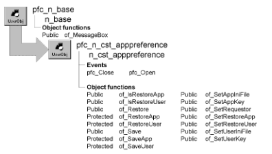

# n_cst_apppreference

**Description**

Application preference service. When enabled, you can use n_cst_apppreference to save and restore application and user information using either an INI file or the Windows registry. N_cst_apppreference saves the following *application* information:

User key MicroHelp Help file Version Logo bitmap Copyright notice DDETimeOut property DisplayName property DWMessageTitle property MicrohelpDefault property RightToLeft property ToolbarFrameTitle property ToolbarPopMenuText property ToolbarSheetTitle property ToolbarUserControl property

N_cst_apppreference can also save the following *user* information:

ToolbarText property ToolbarTips property User ID

N_cst_apppreference automatically loads settings when the application opens and stores them when the application closes. This information is stored in either the registry (available on Windows platforms only) or an INI file (available on all platforms).

**Ancestry**



**Library**

- PFCAPSRV.PBL
- PFEAPSRV.PBL

**Object relationships**

- n_cst_appatrib
- [n_cst_conversion](n_cst_conversion.md)
- [n_cst_inifile](n_cst_inifile.md)
- [n_cst_string](n_cst_string.md)

**Usage**

Use this object to save and restore application information.

To use n_cst_apppreference:

1. Enabled n_cst_apppreference by calling the n_cst_appmanager of_SetAppPreference function (this example is from an n_cst_appmanager Constructor event):

   ```
   this.of_SetAppPreference(TRUE)
   ```

2. Specify the platform-specific repository for application preferences. This example from an application manager Constructor event saves application preferences in the registry or INI file, depending on the execution platform. It assumes you’ve already established n_cst_appmanager specifications for application key, user key, application INI file, and user INI file:

   ```
   IF this.of_IsRegistryAvailable() THEN
      this.inv_apppref.of_SetAppKey &
        (this.of_GetAppKey())
      this.inv_apppref.of_SetUserKey &
        (this.of_GetUserKey())
   ELSE
      this.inv_apppref.of_SetAppINIFile &
        (this.of_GetAppINIFile())
      this.inv_apppref.of_SetUserINIFile &
        (this.of_GetUserINIFile())
   END IF
   ```

3. Specify the types of information to save by calling the of_SetRestoreApp and of_SetRestoreUser functions:

   ```
   this.inv_apppref.of_SetRestoreApp(TRUE)
   this.inv_apppref.of_SetRestoreUser(TRUE)
   ```

**See also**

- [n_cst_appmanager](n_cst_appmanager.md)
- [n_cst_winsrv_preference](n_cst_winsrv_preference.md)

## Instance variables

N_cst_apppreference includes instance variables:

| Instance variable | Description | Data type | Access | Usage |
| --- | --- | --- | --- | --- |
| CST_FILETYPE_INI | Constant set to 2 | Integer | Public |  |
| CST_FILETYPE_REG | Constant set to 1 | Integer | Public |  |
| CST_FILETYPE_XML | Constant set to 3 | Integer | Public |  |
| ib_restoreapp | Controls whether the service saves and restores application-wide settings | Boolean | Protected | Set with of_SetRestoreApp |
| ib_restoreuser | Controls whether the service saves and restores user-specific settings | Boolean | Protected | Set with of_SetRestoreUser |
| ii_filetype |  | Integer | Protected |  |
| inv_appmanager | Reference to application manager | n_cst_appmanager | Protected | Used to access application information |
| inv_context |  | n_cst_list | Protected |  |
| is_appinifile | INI file that contains application information | String | Protected | Set with of_SetAppINIFile |
| is_appkey | Registry key that contains application information | String | Protected | Set with of_SetAppKey |
| is_appprefsection | INI file section or registry key for application information | String | Protected | Internal. Default is AppPref |
| is_appxmlfile |  | String | Protected |  |
| is_userinifile | INI file that contains user information | String | Protected | Set with of_SetUserINIFile |
| is_userkey | Registry key that contains application information | String | Protected | Set with of_SetUserKey |
| is_userpref | INI file or registry key for user information | String | Protected | Internal. Default is AppUserPref |
| is_userprefsection |  | String | Protected |  |
| is_userxmlfile |  | String | Protected |  |

## Events

N_cst_apppreference includes precoded events:

- Constructor
- pfc_Close
- pfc_Open

### Constructor

**Description**

Application Manager preference service.

**Syntax**

```
instancename.EVENT Constructor ( )
```

| Argument | Description |
| --- | --- |
| *instancename* | Instance name of n_cst_apppreference |

**Return value**

None.

### pfc_Close

**Description**

Saves application and user properties when the application closes.

**Syntax**

```
application.instancename.EVENTpfc_Close ( )
```

| Argument | Description |
| --- | --- |
| *application* | Global variable of type n_cst_appmanager (must be gnv_app) |
| *instancename* | Instance name of n_cst_apppreference (the n_cst_appmanager default for this is inv_apppref) |

**Return value**

Integer. Returns 1 if the event succeeds and -1 if an error occurs.

**Usage**

This event executes when the application closes; it is called by the n_cst_appmanager pfc_Close event if n_cst_apppreference is enabled. It saves application and user properties as specified by the of_SetRestoreApp and of_SetRestoreUser functions.

### pfc_Open

**Description**

Restores application and user properties when the application opens.

**Syntax**

```
application.instancename.EVENTpfc_Open ( commandline )
```

| Argument | Description |
| --- | --- |
| *application* | Global variable of type n_cst_appmanager (must be gnv_app) |
| *instancename* | Instance name of n_cst_apppreference (the n_cst_appmanager default for this is inv_apppref) |
| *commandline* | String containing the command-line options specified when the program was invoked |

**Return value**

Integer. Returns 1 if the event succeeds and -1 if an error occurs.

**Usage**

This event executes when the application opens; it is called by the n_cst_appmanager pfc_Open event if n_cst_apppreference is enabled. It restores application and user properties as specified by the of_SetRestoreApp and of_SetRestoreUser functions, which you typically call in the n_cst_appmanager Constructor event.

## Functions

N_cst_apppreference contains precoded object functions:

- of_getcontext
- of_getfiletype
- of_IsRestoreApp
- of_RestoreUser
- of_Restore
- of_RestoreApp
- of_RestoreUser
- of_Save
- of_SaveApp
- of_SaveUser
- of_SetAppIniFile
- of_SetAppKey
- of_SetAppXmlFile
- of_setcontext
- of_SetRequestor
- of_SetRestoreApp
- of_SetRestoreUser
- of_SetUserIniFile
- of_SetUserKey
- of_SetuserXmlFile

### of_getcontext

**Description**

Perform the actual Get from the Registry, .Ini or .Xml File.

**Access**

Public

**Syntax**

```
instancename.of_getcontext ( as_key, aa_value )
```

| Argument | Description |
| --- | --- |
| *instancename* | Instance name of n_cst_apppreference |
| *as_key* | String. |
| *aa_value* | Any, passed by reference. |

**Return value**

Integer. 1 if it succeeds. 0 if the default value was used. -1 if an error occurs.

### of_getfiletype

**Description**

Return the actual file type used to store Preferences Informations.

**Access**

Public

**Syntax**

```
instancename.of_getfiletype ( )
```

| Argument | Description |
| --- | --- |
| *instancename* | Instance name of n_cst_apppreference |

**Return value**

Integer. CST_FILETYPE_REG (1) - Regsitry Used CST_FILETYPE_INI (2) - INI file used CST_FILETYPE_XML (3) - XML file used.

**Usage**

Call this method to know the file type used to store prefrences.

### of_IsRestoreApp

**Description**

Reports whether n_cst_apppreference saves and restores application settings.

**Access**

Public

**Syntax**

```
application.instancename.of_IsRestoreApp ( )
```

| Argument | Description |
| --- | --- |
| *application* | Global variable of type n_cst_appmanager (must be gnv_app) |
| *instancename* | Instance name of n_cst_apppreference (the n_cst_appmanager default for this is inv_apppref) |

**Return value**

Boolean. Returns TRUE if the service saves and restores application settings and FALSE if it does not.

**Examples**

This example calls the of_IsRestoreApp function:

```
n_cst_conversion lnv_conversion
Boolean lb_appinfo

lb_appinfo = &
gnv_app.inv_apppref.of_IsRestoreApp()
MessageBox("App Preferences", &
  "Save app info is " &
    + lnv_conversion.of_String(lb_appinfo))
```

### of_IsRestoreUser

**Description**

Reports whether n_cst_apppreference saves and restores user settings.

**Access**

Public

**Syntax**

```
application.instancename.of_IsRestoreUser ( )
```

| Argument | Description |
| --- | --- |
| *application* | Global variable of type n_cst_appmanager (must be gnv_app) |
| *instancename* | Instance name of n_cst_apppreference (the n_cst_appmanager default for this is inv_apppref) |

**Return value**

Boolean. Returns TRUE if the service saves and restores user settings and FALSE if it does not.

**Examples**

This example calls the of_IsRestoreUser function:

```
n_cst_conversion lnv_conversion
Boolean lb_userinfo

lb_userinfo = &
gnv_app.inv_apppref.of_IsRestoreUser()
MessageBox("App Preferences", &
  "Save user info is " &
    + lnv_conversion.of_String(lb_userinfo))
```

### of_Restore

Restores application and user settings from the registry or an INI file:

| To | Use |
| --- | --- |
| Restore settings from the registry | Syntax 1 |
| Restore settings from an INI file | Syntax 2 |

**Other syntaxes** There are two additional protected versions of the of_Restore function. These are for internal use.

| Syntax 1 | Restore settings from the registry |
| --- | --- |

**Description**

Restores application and user settings from the registry.

**Access**

Public

**Syntax**

```
application.instancename.of_Restore ( processapp, registrykey )
```

| Argument | Description |
| --- | --- |
| *application* | Global variable of type n_cst_appmanager (must be gnv_app) |
| *instancename* | Instance name of n_cst_apppreference (the n_cst_appmanager default for this is inv_apppref) |
| *processapp* | Boolean indicating whether to restore application settings (TRUE) or user settings (FALSE) |
| *registrykey* | String specifying the registry key in which to restore settings |

**Return value**

Integer. Returns 1 if the function succeeds and -1 if an error occurs.

**Usage**

If n_cst_apppreference is enabled, the n_cst_apppreference pfc_Open event calls this function automatically.

This syntax is for Windows platforms only. Use Syntax 2 to restore settings from an INI file.

**Examples**

This example is from the pfc_Open event:

```
...
IF ib_restoreapp THEN
  IF (is_appkey <> "") THEN
    li_rc = of_Restore (TRUE, is_appkey)
  ELSEIF (is_appinifile <> "") THEN
    li_rc = of_Restore(TRUE, &
    is_appinifile, is_apppref)
  ELSE
    Return 0
  END IF
END IF
...
```

| Syntax 2 | Restore settings from an INI file |
| --- | --- |

**Description**

Restores application and user settings from an INI file.

**Access**

Public

**Syntax**

```
application.instancename.of_Restore ( processapp, inifile, inisection )
```

| Argument | Description |
| --- | --- |
| *application* | Global variable of type n_cst_appmanager (must be gnv_app) |
| *instancename* | Instance name of n_cst_apppreference (the n_cst_appmanager default for this is inv_apppref) |
| *processapp* | Boolean indicating whether to restore application settings (TRUE) or user settings (FALSE) |
| *inifile* | String specifying the INI file from which to restore settings |
| *inisection* | String specifying the INI file section containing the settings |

**Return value**

Integer. Returns 1 if the function succeeds and -1 if an error occurs.

**Usage**

If n_cst_apppreference is enabled, the n_cst_apppreference pfc_Open event calls this function automatically.

This syntax is for all platforms. Use Syntax 1 to restore settings from the registry.

**Examples**

This example is from the pfc_Open event:

```
...
IF ib_restoreapp THEN
  IF (is_appkey <> "") THEN
    li_rc = of_Restore(TRUE, is_appkey)
  ELSEIF (is_appinifile <> "") THEN
    li_rc = of_Restore (TRUE, &
      is_appinifile, is_apppref )
  ELSE
    Return 0
  END IF
END IF
...
```

### of_RestoreApp

**Description**

Restores application information from either the registry or an INI file.

**Access**

Protected

**Syntax**

```
application.instancename.of_RestoreApp ( useregistry, keyorinifile, section )
```

| Argument | Description |
| --- | --- |
| *application* | Global variable of type n_cst_appmanager (must be gnv_app) |
| *instancename* | Instance name of n_cst_apppreference (the n_cst_appmanager default for this is inv_apppref) |
| *useregistry* | Boolean specifying whether to use the registry (TRUE) or an INI file (FALSE) |
| *keyorinifile* | String specifying either the registry key or the INI file from which to restore settings |
| *section* | String specifying the section containing the settings |

**Return value**

Integer. Returns 1 if the function succeeds and -1 if an error occurs.

**Usage**

Internal.

**Examples**

This example is from the of_Restore function:

```
...
IF ab_processapp THEN
  li_rc =  of_RestoreApp (ab_useregistry, &
    as_keyorini, as_inisection)
ELSE
  li_rc = of_RestoreUser(ab_useregistry, &
    as_keyorini, as_inisection
END IF
...
```

### of_RestoreUser

**Description**

Restores user information from either the registry or an INI file.

**Access**

Protected

**Syntax**

```
application.instancename.of_RestoreUser ( useregistry, keyorinifile, )
```

| Argument | Description |
| --- | --- |
| *application* | Global variable of type n_cst_appmanager (must be gnv_app) |
| *instancename* | Instance name of n_cst_apppreference (the n_cst_appmanager default for this is inv_apppref) |
| *useregistry* | Boolean specifying whether to use the registry (TRUE) or an INI file (FALSE) |
| *keyorinifile* | String specifying either the registry key or the INI file from which to restore settings |
| *section* | String specifying the section containing the settings |

**Return value**

Integer. Returns 1 if the function succeeds and -1 if an error occurs.

**Usage**

Internal.

**Examples**

This example is from the of_Restore function:

```
...
IF ab_processapp THEN
  li_rc = of_RestoreApp(ab_useregistry, &
  as_keyorini, as_inisection)
ELSE
  li_rc = of_RestoreUser (ab_useregistry, &
  as_keyorini, as_inisection)
END IF
...
```

### of_Save

Saves window, toolbar, and menu settings in the registry or an INI file. There are two syntaxes:

| To | Use |
| --- | --- |
| Save settings in the registry | Syntax 1 |
| Save settings in an INI file | Syntax 2 |

**Other syntaxes** There are two additional protected versions of the of_Save function. These are for internal use.

| Syntax 1 | Save settings in the registry |
| --- | --- |

**Description**

Saves application and user settings in the registry.

**Access**

Public

**Syntax**

```
application.instancename.of_Save ( processapp, registrykey )
```

| Argument | Description |
| --- | --- |
| *application* | Global variable of type n_cst_appmanager (must be gnv_app) |
| *instancename* | Instance name of n_cst_apppreference (the n_cst_appmanager default for this is inv_apppref) |
| *processapp* | Boolean indicating whether to save application settings (TRUE) or user settings (FALSE) |
| *registrykey* | String specifying the registry key in which to save settings |

**Return value**

Integer. Returns 1 if the function succeeds and -1 if an error occurs.

**Usage**

If n_cst_apppreference is enabled, the n_cst_apppreference pfc_Close event calls this function automatically.

This syntax is for the Windows platforms only. Use Syntax 2 to save settings in an INI file.

**Examples**

This example is from the pfc_Close event:

```
...
IF ib_restoreapp THEN
  IF (is_appkey <> "") THEN
    li_rc = of_Save(TRUE, is_appkey)
  ELSEIF (is_appinifile <> "") THEN
    li_rc = of_Save(TRUE, is_appinifile, &
      is_appprefsection)
  ELSE
    Return 0
  END IF
END IF
...
```

| Syntax 2 | Save settings in an INI file |
| --- | --- |

**Description**

Saves application and user settings in an INI file.

**Access**

Public

**Syntax**

```
application.instancename.of_Save ( processapp, inifile, section )
```

| Argument | Description |
| --- | --- |
| *application* | Global variable of type n_cst_appmanager (must be gnv_app) |
| *instancename* | Instance name of n_cst_apppreference (the n_cst_appmanager default for this is inv_apppref) |
| *processapp* | Boolean indicating whether to save application settings (TRUE) or user settings (FALSE) |
| *inifile* | String specifying the INI file in which to save settings |
| *section* | String specifying the INI file section containing the settings |

**Return value**

Integer. Returns 1 if the function succeeds and -1 if an error occurs.

**Usage**

If n_cst_apppreference is enabled, the n_cst_apppreference pfc_Close event calls this function automatically.

This syntax is for all platforms. Use Syntax 1 to save settings in the registry.

**Examples**

This example is from the pfc_Close event:

```
...
IF ib_restoreapp THEN
  IF (is_appkey <> "") THEN
    li_rc = of_Save(TRUE, is_appkey)
  ELSEIF (is_appinifile <> "") THEN
    li_rc = of_Save(TRUE, is_appinifile, &
      is_appprefsection)
  ELSE
    Return 0
  END IF
END IF
...
```

### of_SaveApp

**Description**

Saves application information in either the registry or an INI file.

**Access**

Protected

**Syntax**

```
application.instancename.of_SaveApp ( useregistry, keyorinifile, section )
```

| Argument | Description |
| --- | --- |
| *application* | Global variable of type n_cst_appmanager (must be gnv_app) |
| *instancename* | Instance name of n_cst_apppreference (the n_cst_appmanager default for this is apppref) |
| *useregistry* | Boolean specifying whether to use the registry (TRUE) or an INI file (FALSE) |
| *keyorinifile* | String specifying the registry key or INI file in which to save settings |
| *section* | String specifying the INI file section containing the settings |

**Return value**

Integer. Returns 1 if the function succeeds and -1 if an error occurs.

**Usage**

Internal.

**Examples**

This example calls the of_Save function:

```
...
IF ab_ProcessApp THEN
  li_rc = of_SaveApp (ab_useregistry, &
    as_keyorini, as_inisection)
ELSE
  li_rc = of_SaveUser(ab_useregistry, &
    as_keyorini, as_inisection)
END IF
...
```

### of_SaveUser

**Description**

Saves user information in either the registry or an INI file.

**Access**

Protected

**Syntax**

```
application.instancename.of_SaveUser ( useregistry, keyorinifile, section )
```

| Argument | Description |
| --- | --- |
| *application* | Global variable of type n_cst_appmanager (must be gnv_app) |
| *instancename* | Instance name of n_cst_apppreference (the n_cst_appmanager default for this is inv_apppref) |
| *useregistry* | Boolean specifying whether to use the registry (TRUE) or an INI file (FALSE) |
| *keyorinifile* | String specifying the registry key or INI file in which to save settings |
| *section* | String specifying the registry key or INI file section containing the settings |

**Return value**

Integer. Returns 1 if the function succeeds and -1 if an error occurs.

**Usage**

Internal.

**Examples**

This example calls the of_SaveUser function:

```
...
IF ab_ProcessApp THEN
   li_rc = of_SaveApp(ab_useregistry, &
      as_keyorini, as_inisection)
ELSE
   li_rc = of_SaveUser(ab_useregistry, &
      as_keyorini, as_inisection)
END IF
...
```

### of_SetAppIniFile

**Description**

Specifies the name of the application INI file, which contains application preferences.

**Access**

Public

**Syntax**

```
application.instancename.of_SetAppIniFile ( inifilename )
```

| Argument | Description |
| --- | --- |
| *application* | Global variable of type n_cst_appmanager (must be gnv_app) |
| *instancename* | Instance name of n_cst_apppreference (the n_cst_appmanager default for this is inv_apppref) |
| *inifilename* | String specifying the fully qualified name of the application INI file |

**Return value**

Integer. Returns 1 if the function succeeds and -1 if an error occurs.

**Usage**

The INI file you set for application preferences is typically the same as the n_cst_appmanager application INI file.

**Examples**

This example from an n_cst_appmanager Constructor event calls the of_SetAppINIFile function:

```
...
IF this.of_IsRegistryAvailable() THEN
  this.inv_apppref.of_SetAppKey &
    (this.of_GetAppKey())
  this.inv_apppref.of_SetUserKey &
    (this.of_GetUserKey())
ELSE
  this.inv_apppref.of_SetAppINIFile &
    (this.of_GetAppINIFile())
  this.inv_apppref.of_SetUserINIFile &
    (this.of_GetUserINIFile())
END IF
...
```

### of_SetAppKey

**Description**

Specifies the name of the registry key for application information. N_cst_apppreference uses this key by default on Windows platforms.

**Access**

Public

**Syntax**

```
application.instancename.of_SetAppKey ( registrykey )
```

| Argument | Description |
| --- | --- |
| *application* | Global variable of type n_cst_appmanager (must be gnv_app) |
| *instancename* | Instance name of n_cst_apppreference (the n_cst_appmanager default for this is inv_apppref) |
| *registrykey* | String containing the registry key |

**Return value**

Integer. Returns 1 if the function succeeds and -1 if an error occurs.

**Usage**

The registry key you set for application information is typically the same as the n_cst_appmanager application key.

**Examples**

This example calls the of_SetAppKey function:

```
...
IF this.of_IsRegistryAvailable() THEN
  this.inv_apppref.of_SetAppKey &
    (this.of_GetAppKey())
  this.inv_apppref.of_SetUserKey &
    (this.of_GetUserKey())
ELSE
  this.inv_apppref.of_SetAppINIFile &
    (this.of_GetAppINIFile())
  this.inv_apppref.of_SetUserINIFile &
    (this.of_GetUserINIFile())
END IF
...
```

### of_SetAppXmlFile

**Description**

Sets the filename of the application's XML file.

**Access**

Public

**Syntax**

```
instancename.of_SetAppXmlFile ( as_appxmlfile )
```

| Argument | Description |
| --- | --- |
| *instancename* | Instance name of n_cst_apppreference |
| *as_appxmlfile* | String. the full pathname of the application XML file. |

**Return value**

Integer. Returns 1 = success, -1 = error.

### of_setcontext

**Description**

Perform the actual Get from the Registry, .Ini or .Xml File.

**Access**

Public

**Syntax**

```
instancename.of_setcontext ( as_key, aa_value )
```

| Argument | Description |
| --- | --- |
| *instancename* | Instance name of n_cst_apppreference |
| *as_key* | String. |
| *aa_value* | Any. |

**Return value**

Integer. 1 if it succeeds. 0 if the default value was used. -1 if an error occurs.

### of_SetRequestor

**Description**

Associates n_cst_appmanager with n_cst_apppreference.

**Access**

Public

**Syntax**

```
application.instancename.of_SetRequestor ( requestor )
```

| Argument | Description |
| --- | --- |
| *application* | Global variable of type n_cst_appmanager (must be gnv_app) |
| *instancename* | Instance name of n_cst_apppreference (the n_cst_appmanager default for this is inv_apppref) |
| *requestor* | N_cst_appmanager instance to associate with this instance of n_cst_apppreference |

**Return value**

Integer. Returns 1 if the function succeeds and -1 if an error occurs.

**Usage**

The n_cst_appmanager of_SetAppPreference function calls this function.

**Examples**

This example is from the n_cst_appmanager of_SetAppPreference function:

```
...
IF ab_Switch THEN
  IF IsNull(inv_apppref) &
    OR NOT IsValid (inv_apppref) THEN
      inv_apppref = CREATE n_cst_apppreference
      inv_apppref. of_SetRequestor (this)
  Return 1
END IF
...
```

### of_SetRestoreApp

**Description**

Specifies whether n_cst_apppreference restores application settings.

**Access**

Public

**Syntax**

```
application.instancename.of_SetRestoreApp ( boolean )
```

| Argument | Description |
| --- | --- |
| *application* | Global variable of type n_cst_appmanager (must be gnv_app) |
| *instancename* | Instance name of n_cst_apppreference (the n_cst_appmanager default for this is inv_apppref) |
| *boolean* | Boolean specifying whether to save application preferences (TRUE) or not (FALSE) |

**Return value**

Integer. Returns 1 if the function succeeds and -1 if an error occurs.

**Usage**

You typically call this function in the n_cst_appmanager Constructor event, just after enabling n_cst_apppreference.

**Examples**

This example calls the of_SetRestoreApp function:

```
...
IF this.of_IsRegistryAvailable() THEN
  this.inv_apppref.of_SetAppKey &
    (this.of_GetAppKey())
  this.inv_apppref.of_SetUserKey &
    (this.of_GetUserKey())
ELSE
  this.inv_apppref.of_SetAppINIFile &
    (this.of_GetAppINIFile())
  this.inv_apppref.of_SetUserINIFile &
    (this.of_GetUserINIFile())
END IF
this.inv_apppref.of_SetRestoreApp (TRUE)
this.inv_apppref.of_SetRestoreUser(TRUE)
```

### of_SetRestoreUser

**Description**

Specifies whether n_cst_apppreference restores user settings.

**Access**

Public

**Syntax**

```
application.instancename.of_SetRestoreUser ( boolean )
```

| Argument | Description |
| --- | --- |
| *application* | Global variable of type n_cst_appmanager (must be gnv_app) |
| *instancename* | Instance name of n_cst_apppreference (the n_cst_appmanager default for this is inv_apppref) |
| *boolean* | Boolean specifying whether to save user preferences (TRUE) or not (FALSE) |

**Return value**

Integer. Returns 1 if the function succeeds and -1 if an error occurs.

**Usage**

You typically call this function in the n_cst_appmanager Constructor event, just after enabling n_cst_apppreference.

**Examples**

This example calls the of_SetRestoreUser function:

```
...
this.of_SetAppPreference(TRUE)
IF this.of_IsRegistryAvailable() THEN
  this.inv_apppref.of_SetAppKey &
    (this.of_GetAppKey())
  this.inv_apppref.of_SetUserKey &
    (this.of_GetUserKey())
ELSE
  this.inv_apppref.of_SetAppINIFile &
    (this.of_GetAppINIFile())
  this.inv_apppref.of_SetUserINIFile &
    (this.of_GetUserINIFile())
END IF
this.inv_apppref.of_SetRestoreApp(TRUE)
this.inv_apppref.of_SetRestoreUser( TRUE)
```

### of_SetUserIniFile

**Description**

Specifies the name of the INI file for user information.

**Access**

Public

**Syntax**

```
application.instancename.of_SetUserIniFile ( inifilename )
```

| Argument | Description |
| --- | --- |
| *application* | Global variable of type n_cst_appmanager (must be gnv_app) |
| *instancename* | Instance name of n_cst_apppreference (the n_cst_appmanager default for this is inv_apppref) |
| *inifilename* | String specifying the fully qualified name of the user INI file |

**Return value**

Integer. Returns 1 if the function succeeds and -1 if an error occurs.

**Usage**

The INI file for user information is typically the same as the n_cst_appmanager user INI file.

**Examples**

This example calls the of_SetUserIniFile function:

```
...
this.of_SetAppPreference(TRUE)
IF this.of_IsRegistryAvailable() THEN
  this.inv_apppref.of_SetAppKey &
    (this.of_GetAppKey())
  this.inv_apppref.of_SetUserKey &
    (this.of_GetUserKey())
ELSE
  this.inv_apppref.of_SetAppINIFile &
    (this.of_GetAppINIFile())
  this.inv_apppref.of_SetUserINIFile &
    (this.of_GetUserINIFile())
END IF
...
```

### of_SetUserKey

**Description**

Specifies the name of the registry key for user information. N_cst_apppreference uses this key by default on Windows platforms.

**Access**

Public

**Syntax**

```
application.instancename.of_SetUserKey ( registrykey )
```

| Argument | Description |
| --- | --- |
| *application* | Global variable of type n_cst_appmanager (must be gnv_app) |
| *instancename* | Instance name of n_cst_apppreference (the n_cst_appmanager default for this is inv_apppref) |
| *registrykey* | String containing the registry key |

**Return value**

Integer. Returns 1 if the function succeeds and -1 if an error occurs.

**Usage**

The registry key for user information is typically the same as the n_cst_appmanager user key.

**Examples**

This example calls the of_SetUserKey function:

```
...
this.of_SetAppPreference(TRUE)
IF this.of_IsRegistryAvailable() THEN
  this.inv_apppref.of_SetAppKey &
    (this.of_GetAppKey())
  this.inv_apppref.of_SetUserKey &
    (this.of_GetUserKey())
ELSE
  this.inv_apppref.of_SetAppINIFile &
    (this.of_GetAppINIFile())
  this.inv_apppref.of_SetUserINIFile &
    (this.of_GetUserINIFile())
END IF
...
```

### of_SetuserXmlFile

**Description**

Sets the filename of the use's XML file.

**Access**

Public

**Syntax**

```
instancename.of_SetuserXmlFile ( as_userxmlfile )
```

| Argument | Description |
| --- | --- |
| *instancename* | Instance name of n_cst_apppreference |
| *as_userxmlfile* | String. the full pathname of the use XML file. |

**Return value**

Integer. Returns 1 = success, -1 = error.
