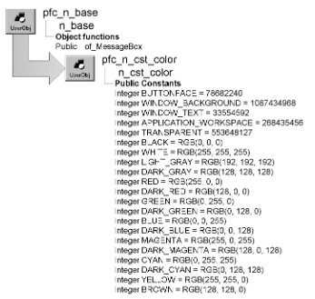

# n_cst_color

**Description**

Color object. This object contains a set of constants you can reference to specify color values.

**Ancestry**



**Library**

- PFCAPSRV.PBL
- PFEAPSRV.PBL

**Usage**

To use this object:

1. Declare a variable of type n_cst_color.

   Because PFC defines this object with the autoinstantiate option, you don’t need to code CREATE or DESTROY statements:

   ```
   n_cst_color lnv_color
   ```

2. Use n_cst_color constants as needed:

   ```
   rte_1.SetTextColor  &
      (lnv_color.CYAN)
   ```

## Instance variables

N_cst_color includes instance variables:

| Instance variable | Description | Data type | Access | Usage |
| --- | --- | --- | --- | --- |
| APPLICATION_WORKSPACE | Constant set to 268435456 | Integer | Public | Specify colors |
| BLACK | Constant set to RGB(0, 0, 0) | Integer | Public | Specify colors |
| BLUE | Constant set to RGB(0, 0, 255) | Integer | Public | Specify colors |
| BROWN | Constant set to RGB(128, 128, 0) | Integer | Public | Specify colors |
| BUTTONFACE | Constant set to 78682240 | Integer | Public | Specify colors |
| CYAN | Constant set to RGB(0, 255, 255) | Integer | Public | Specify colors |
| DARK_BLUE | Constant set to RGB(0, 0, 128) | Integer | Public | Specify colors |
| DARK_CYAN | Constant set to RGB(0, 128, 128) | Integer | Public | Specify colors |
| DARK_GRAY | Constant set to RGB(128, 128, 128) | Integer | Public | Specify colors |
| DARK_GREEN | Constant set to RGB(0, 128, 0) | Integer | Public | Specify colors |
| DARK_MAGENTA | Constant set to RGB(128, 0, 128) | Integer | Public | Specify colors |
| DARK_RED | Constant set to RGB(128, 0, 0) | Integer | Public | Specify colors |
| GREEN | Constant set to RGB(0, 255, 0) | Integer | Public | Specify colors |
| LIGHT_GRAY | Constant set to RGB(192, 192, 192) | Integer | Public | Specify colors |
| MAGENTA | Constant set to RGB(255, 0, 255) | Integer | Public | Specify colors |
| RED | Constant set to RGB(255, 0, 0) | Integer | Public | Specify colors |
| TRANSPARENT | Constant set to 553648127 | Integer | Public | Specify colors |
| WHITE | Constant set to RGB(255, 255, 255) | Integer | Public | Specify colors |
| WINDOW_BACKGROUND | Constant set to 1087434968 | Integer | Public | Specify colors |
| WINDOW_TEXT | Constant set to 33554592 | Integer | Public | Specify colors |
| YELLOW | Constant set to RGB(255, 255, 0) | Integer | Public | Specify colors |
